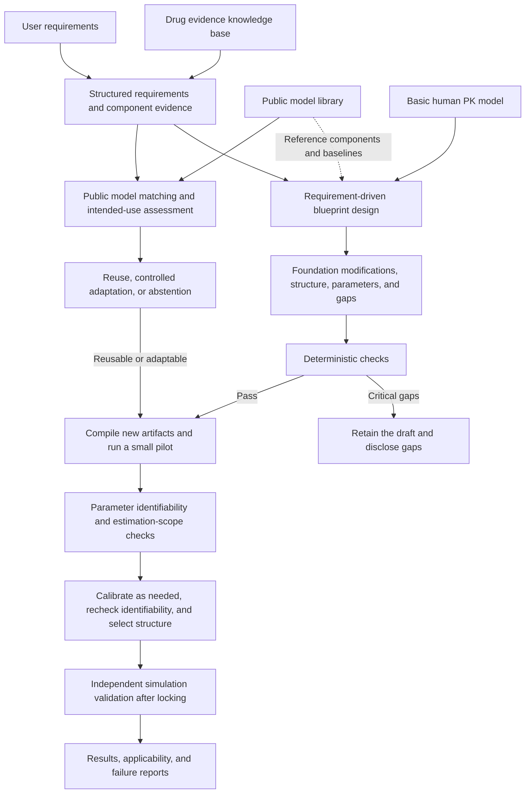

# Component Recommendation, Model Ranking, Blueprint Design, and Experimental Evaluation

Component recommendation uses an evidence graph, retrieval, HGT, and local Qwen. The model service retains deterministic intended-use gates; the research model has not been promoted to production. Current metrics are in the [experiment summary](../experiments/README.md), and next steps are in the [research plan](research_plan.md).

Component recommendation, public-model recommendation, and blueprint design share an evidence foundation but have separate task definitions and acceptance criteria. Blueprints follow the [intended-use-driven PBPK module adaptation strategy](#blueprint-design); historical frozen experiments must not serve as unseen tests in the next round.

**Current blueprint focus: provenance, intended-use-driven automatic construction, updates from additional evidence, and explicit applicability limits.** [Section 8](#blueprint-design) is the sole authoritative strategy. Additional sampling defaults to simple temporal coverage. A learned selector that outperforms time-based rules is no longer a development objective or a prerequisite for the paper. Existing papers and frozen branches are retained; each claim must be supported by experiments for its corresponding version.

## PBPK KG Recommendation Agent Strategy

### 0. Scope of This Document

This strategy defines the complete target architecture from automatically validated evidence to PBPK modeling requirements, mechanisms, and component recommendations. Its output is a `RequirementProfile` for subsequent public-model ranking and executable blueprint generation; it does not mean that an executable PBPK model has already been recommended or generated. Public-model ranking and abstention follow the [current public-model recommendation strategy](#current-public-model-recommendation-strategy), and blueprint design follows the [intended-use-driven PBPK module adaptation strategy](#blueprint-design).

Recommendations are source-supported model design suggestions. They do not establish that a PBPK model has completed parameter calibration, validation, applicability assessment, or regulatory qualification.

### 1. Current Gaps and Final Implementation Requirements

Currently reusable inputs:

```text
07_llm_quality_validation/final_auto_validated_evidence.jsonl
07_llm_quality_validation/final_quarantined_evidence.jsonl
```

Hard constraints:

```text
Only final_auto_validated_evidence may generate scientific facts and recommendations
Quarantined evidence is for audit only; it must not enter retrieval, positive training examples, or recommendations
```

The following gaps separate the current code from the final target:

1. `build_kg_ready()` mainly performs fixed mappings from structured fields to nodes/edges; it is not a complete KG construction pipeline.
2. General biomedical NER is absent. Compound attribution is inherited from upstream processing; enzymes/transporters use only dictionaries and regular expressions.
3. Relation extraction covers only a small set of `substrate_of`, `inhibits`, `induces`, and `transported_by` patterns.
4. DDI is mainly represented by undirected `HAS_DDI_WITH` edges, without fully expressing victim, perpetrator, mechanism, effect size, and experimental conditions.
5. Population, dose, route, condition, and related fields still contain free text and lack standard ontology mappings.
6. Current 1-hop/2-hop labels primarily describe policy labels and evidence parameter groups, rather than actual adjacency-based traversal and retrieval.
7. Current subgraph reranking uses rule weights rather than actual biomedical embedding retrieval.
8. There is no trained GNN, Graph Transformer, GNN subgraph embedding, or query-conditioned graph encoder.
9. There is no actual LLM soft graph prompt.
10. There is no recommendation training, retrieval evaluation, recommendation evaluation, or ablation study based on reference answers.
11. Current recommendation requests have too few fields to fully express PBPK modeling scenarios.
12. Current component recommendation relies only on evidence and source counts; it does not verify whether the parameters support a specific model structure.

The final implementation must close every gap and provide separate tests and acceptance reports. No intermediate result may be considered complete if any required capability, test, or acceptance report is missing.

### 2. Fixed Execution Order

```text
1. Define the PBPK ontology and identifier system
2. Construct a complete ModelingRequest
3. Perform biomedical NER and entity normalization
4. Resolve coreference and extract events and relations
5. Validate KG consistency, provenance, and quality
6. Generate formal KG nodes, edges, and events
7. Generate 0-hop, 1-hop, and 2-hop subgraphs
8. Build a biomedical embedding subgraph index
9. Perform actual multihop graph traversal and retrieval
10. Train a GNN/Graph Transformer subgraph encoder
11. Retrieve subgraph embeddings and apply query-conditioned reranking
12. Build an LLM graph prompt or an actual soft graph prompt
13. Generate model design recommendations with citations
14. Validate with an independent Recommendation Validator
15. Train, evaluate, and ablate using reference answers
16. Integrate API, UI, database, and execution audit
```

Do not train a GNN before completing the ontology, entity normalization, and relation extraction. Do not compute subgraph embeddings before compound, population, dose, route, parameter, and source attribution is established.

### 3. PBPK Ontology

#### 3.1 Node Selection Principles

Create an independent node when any of the following applies:

```text
It has a stable identifier
Multiple evidence records reference it
It participates in multiple relations
It requires independent retrieval, aggregation, or constraints
It represents a measurement, interaction, metabolism, or simulation event
```

Values meaningful only within local context remain event attributes. Do not unconditionally convert every string into a node.

For example, `5 mg oral fasted` must belong to the same DoseRegimen/StudyArm; it must not be split into three isolated nodes without context.

#### 3.2 Core Entities

```text
Compound
ActiveMoiety
SaltForm
Metabolite
Formulation
DosageForm
AdministrationRoute
DoseRegimen
Enzyme
Transporter
Protein
Gene
GeneticVariant
Organ
Tissue
CellType
Species
Population
Disease
Study
StudyArm
ClinicalTrial
Publication
SourceDocument
Assay
Observation
PKParameter
ParameterValue
Unit
PBPKModel
ModelVersion
ModelStructure
Compartment
ModelParameter
Software
SimulationScenario
QualificationDataset
ValidationMetric
Evidence
```

#### 3.3 Event Nodes

Prefer event representations, rather than simple binary edges, for the following relations:

```text
PKMeasurement
DDIEvent
MetabolismEvent
TransportEvent
AbsorptionEvent
ExcretionEvent
ModelCalibrationEvent
ModelValidationEvent
```

DDI example:

```text
Ketoconazole --PERPETRATOR_IN--> DDIEvent
Midazolam --VICTIM_IN--> DDIEvent
DDIEvent --MEDIATED_BY--> CYP3A4
DDIEvent --AFFECTS_PARAMETER--> AUC
DDIEvent --HAS_EFFECT_VALUE--> 5.2
DDIEvent --HAS_EFFECT_UNIT--> fold
DDIEvent --UNDER_REGIMEN--> DoseRegimen
DDIEvent --STUDIED_IN--> Population
DDIEvent --SUPPORTED_BY--> Evidence
```

PK measurement example:

```text
Evidence --REPORTS--> PKMeasurement
PKMeasurement --OF_COMPOUND--> Midazolam
PKMeasurement --MEASURES--> AUC
PKMeasurement --HAS_VALUE--> ParameterValue
ParameterValue --HAS_UNIT--> ng*h/mL
PKMeasurement --UNDER_REGIMEN--> DoseRegimen
PKMeasurement --IN_STUDY_ARM--> StudyArm
```

#### 3.4 Identifiers and Standardization

```text
Compound:PubChem CID,InChIKey,ChEMBL ID,DrugCentral ID,RxCUI,UNII
Protein/Gene:UniProt,HGNC,NCBI Gene
Disease:MONDO,MeSH
Tissue/Organ:UBERON
Cell type:Cell Ontology
Route:EDQM/FHIR route code
Unit:UCUM
Clinical trial:NCT ID
Publication:PMID,PMCID,DOI
Model:repository path,version,commit checksum
```

Represent salts, parent compounds, prodrugs, metabolites, and stereoisomers through explicit relations; do not merge them automatically.

### 4. Biomedical NER and Entity Linking

#### 4.1 Inputs

```text
source_text
Adjacent sentences and section headings
Table headers, rows, columns, and footnotes
Structured JSON/XML fields
The document's active ingredient
Existing compound identity
```

#### 4.2 Hybrid Recognition Methods

```text
Structured fields: deterministic mapping
Stable IDs: exact linking
Drug, enzyme, and transporter aliases: controlled dictionaries
Natural-language entities: biomedical NER models
Complex paragraphs with multiple entities: LLM-assisted recognition
```

Select the NER model only after evaluation on this project's annotated set. Candidates include biomedical transformer NER, SciSpacy/knowledge-base linkers, or equivalent models. A model name alone does not justify deployment.

Formal Gate 1 uses a locked silver set derived from structured fields and fixes the following model recall thresholds:

```text
silver expected mentions >= 100
overall exact recall >= 0.80
overall overlap/type recall >= 0.85
Compound exact recall >= 0.90
PKParameter exact recall >= 0.65
```

This silver set does not exhaustively annotate every entity in the text. Additional predictions are therefore not automatically counted as false positives, and no gold
precision/F1 is claimed. `Unit` and `AdministrationRoute` are ensured by structured fields, controlled dictionaries, and deterministic parsing; NER
model scores must not override deterministic linking results.

#### 4.3 Entity Types

Recognize at least:

```text
compound
metabolite
enzyme
transporter
gene
protein
organ
tissue
population
disease
genotype
route
formulation
dose
frequency
time point
PK parameter
unit
software
PBPK model
study
publication
```

#### 4.4 Entity Linking and Rejection Rules

1. Store the original mention, character span, standard ID, linking method, and confidence for every entity.
2. Exact IDs and unique aliases may be linked automatically.
3. Use contextual reranking when multiple entity candidates exist.
4. Retain `unresolved_entity` when a unique link cannot be established; do not guess an ID.
5. Distinguish comparator, excipient, co-medication, victim, perpetrator, and target-compound roles.
6. NER outputs must not overwrite original evidence; they only create derived entity records.

#### 4.5 Public-Identifier Resolution and Contextual Reranking

Execute in this order:

```text
Mention and evidence context
→ PubChem exact-synonym candidates
→ RxNorm exact-concept candidates
→ Agreement check across the two sources
→ Contextual reranking for single-source matches, abbreviations, class terms, and multiple candidates
→ Deterministic validation
→ accepted / ambiguous / unresolved
```

Execution rules:

1. A unique match for the same mention in both PubChem and RxNorm may be treated as a high-confidence candidate.
2. Single-source matches, multiple candidates, short uppercase abbreviations, drug-class terms, combination-product names, and food/herbal names must not be automatically linked on string matching alone.
3. Contextual reranking uses local `Qwen/Qwen3-14B-AWQ`. Inputs contain only the original mention, complete evidence sentence, candidate names, candidate standard IDs, and resolution sources.
4. The model may choose one input `candidate_id` or return `ambiguous` or `unresolved`; it must not generate a new name or ID.
5. Outputs must include a verbatim input quote, role assignment, and selection rationale. A deterministic validator checks that the candidate_id belongs to the candidate set, the quote occurs in the original text, the mention occurs in the quote, and the role does not conflict with evidence fields.
6. Any failed validation prevents entry into the external entity catalog.
7. Select the model using a locked silver evaluation set. Positive silver examples are candidates supported by both PubChem and RxNorm; rejection examples include class terms, combination products, foods, unresolvable names, and conflicting candidates. Report accuracy, coverage, error types, and model version without claiming gold accuracy.
8. The external entity catalog stores the resolution request, raw response, checksum, model version, prompt version, decision, and rejection reason.
9. Drug classes, unexpanded short abbreviations, botanical extracts, and foods must not be written as `Compound`. Retain unresolved records for a `DrugClass`, `BotanicalProduct`, `Food`, or other ontology-compatible resolver.

`Qwen3-14B-AWQ` runs in an isolated environment with dependencies locked in
`pbpk_kb/config/recommendation_awq_requirements.txt`. This environment is separate from the GLiNER, embedding, and GNN
environments so the Transformers version pinned by the AWQ runtime cannot override other model dependencies.

The contextual reranking model locks the following silver acceptance thresholds before execution:

```text
decision accuracy >= 0.90
false-accept rate <= 0.05
valid JSON rate >= 0.99
accepted decision verbatim-quote validity = 1.00
```

If any threshold is missed, all single-source and ambiguous candidates remain unresolved and must not enter the formal external entity catalog.

### 5. Coreference, Event, and Relation Extraction

#### 5.1 Fixed Processing Order

```text
Identify sentence and table boundaries
→ Recognize entities
→ Normalize entities
→ Resolve within-document coreference
→ Identify event triggers
→ Assign argument roles
→ Determine relation direction
→ Identify negation, speculation, and conditions
→ Bind relation confidence and provenance
```

#### 5.2 Extraction Methods

```text
High-precision relations: rules and dependency parsing
Common relations: supervised biomedical relation extraction
Complex cases with multiple drugs, parameters, or time points: LLM structured extraction
Final relations: independent rule and model validation
```

First evaluate the supervised relation model using official NCBI BioREx code and the BioLinkBERT checkpoint. Its runtime is
independently locked in `pbpk_kb/config/biorex_requirements.txt`. Convert inputs to PubTator and map output logits
back to original evidence by document/pair. Record the model repository commit, checkpoint checksum, converted-input checksum,
logits checksum, and threshold report in the run manifest. The locked silver set must meet all of the following:

```text
positive recall >= 0.75
hard-negative specificity >= 0.80
balanced accuracy >= 0.80
```

If any threshold fails, retain the model output only as a failed-comparator report; it must not enter LLM inputs, event candidates, or the formal KG.

The LLM may output only entity mentions, relation types, roles, verbatim quotes, and confidence. Every quote must occur in the input context.

DDI roles follow these constraints:

```text
The target-compound role is known, and the text contains exactly one normalized non-target drug
→ Deterministically assign the non-target drug the opposite role

The text contains multiple normalized drugs
→ Supervised biomedical RE generates relation candidates
→ The LLM returns victim, perpetrator, trigger, and verbatim quote separately for each candidate
→ An independent validator checks entity IDs, role direction, negation, conditions, and citations

No co-administered drug is recognized, or role direction is not unique
→ Retain rejected/unresolved status; do not create a DDIEvent
```

When a sentence contains multiple actual interactions, create separate `DDIEvent` records. Do not arbitrarily select the first drug or combine multiple perpetrators into one string node.

#### 5.3 Relation Coverage

Cover at least:

```text
HAS_ACTIVE_MOIETY
HAS_SALT_FORM
HAS_METABOLITE
SUBSTRATE_OF
INHIBITS
INDUCES
TRANSPORTED_BY
METABOLIZED_TO
EXPRESSED_IN
ABSORBED_VIA
EXCRETED_VIA
PERPETRATOR_IN
VICTIM_IN
MEDIATED_BY
AFFECTS_PARAMETER
HAS_MEASUREMENT
HAS_VALUE
HAS_UNIT
UNDER_REGIMEN
STUDIED_IN
HAS_FORMULATION
DESCRIBED_BY_MODEL
USES_PARAMETER
CALIBRATED_WITH
VALIDATED_WITH
SUPPORTED_BY
CONTRADICTS
```

#### 5.4 Relation Validation

Every relation must include:

```text
subject_id
predicate
object_id
evidence_id
source_id
source_location
supporting_text
source_text_hash
extraction_method
relation_confidence
negation_status
speculation_status
context_id
quality_status=auto_validated
```

Relations lacking evidence, a verbatim quote, linked entities, or an unambiguous direction must not enter the formal fact graph.

### 6. Complete ModelingRequest

The recommendation agent supports both structured forms and natural-language requests. Natural language is first parsed into a ModelingRequest; the parsed result is then shown to the user.

#### 6.1 Compound

```text
compound
active_moiety
salt_form
metabolites_to_model
candidate_public_model
```

#### 6.2 Modeling Objective

```text
base_pk
first_in_human
dose_selection
formulation_comparison
food_effect
bioequivalence
ddi_victim
ddi_perpetrator
renal_impairment
hepatic_impairment
pediatric
geriatric
pregnancy
pharmacogenomics
tissue_exposure
public_model_reuse
```

#### 6.3 Biological System

```text
species
population
age_range
sex
body_weight
ethnicity
renal_function
hepatic_function
disease_state
genotype
pregnancy_status
```

#### 6.4 Administration and Formulation

```text
route
dose
dose_unit
single_or_multiple
frequency
infusion_duration
fed_or_fasted
formulation
dosage_form
release_type
```

#### 6.5 DDI

```text
victim_drug
perpetrator_drug
enzyme
transporter
interaction_mechanism
interaction_duration
victim_regimen
perpetrator_regimen
```

#### 6.6 Prediction Endpoints

```text
AUC
Cmax
Tmax
half_life
clearance
volume_of_distribution
concentration_time_profile
tissue_concentration
fraction_absorbed
bioavailability
renal_excretion
DDI_AUC_ratio
DDI_Cmax_ratio
```

#### 6.7 Model Constraints

```text
whole_body_or_reduced_pbpk
parent_or_parent_metabolite
required_organs
required_enzymes
required_transporters
software_preference
parameter_uncertainty
calibration_datasets
validation_datasets
acceptance_criteria
sensitivity_analysis
uncertainty_analysis
```

#### 6.8 Request Validation

1. The compound must resolve to a stable identity.
2. DDI requests must specify victim/perpetrator roles; missing roles trigger a clarification requirement.
3. Special-population requests must define the population or allow the agent to use an explicitly stated default scope.
4. Dose, route, formulation, and frequency must form a single DoseRegimen.
5. Incomplete requests may be used for retrieval, but missing information must appear as request gaps in the output.

### 7. Formal KG Generation

#### 7.1 Inputs

```text
final_auto_validated_evidence
normalized entities
validated relation events
compound identity
public model metadata
source registry
```

#### 7.2 Outputs

```text
kg_nodes.jsonl
kg_edges.jsonl
kg_events.jsonl
kg_entity_mentions.jsonl
kg_unresolved_entities.jsonl
kg_rejected_relations.jsonl
kg_build_summary.json
```

#### 7.3 Graph Consistency

1. Node IDs are globally unique.
2. Both endpoints of every edge must exist.
3. Relations must satisfy the ontology's domain/range constraints.
4. Every scientific fact edge must point to Evidence.
5. Retain separate evidence records from multiple sources supporting the same fact; do not overwrite them.
6. Connect conflicting facts through Conflict/Event nodes; do not delete or average them.
7. Temporary name-only nodes must not participate in final recommendations until entity linking is complete.

### 8. Biomedical Embedding Subgraph Index

#### 8.1 Prohibited Approaches

```text
No hash embeddings
No embeddings of node names alone
No indexing of quarantined evidence
No indexing of unresolved name-only scientific entities
```

#### 8.2 Embedding Model Selection

Use actual biomedical sentence embeddings. Select the model through an in-project retrieval benchmark rather than permanently fixing a single model in the strategy.

Candidate models for evaluation:

```text
NCBI MedCPT Query Encoder + Article Encoder dual encoder
NeuML/pubmedbert-base-embeddings
PubMedBERT variants trained for sentence-level biomedical retrieval
Instruction-aware Qwen3-Embedding models and their Matryoshka dimensions
Strong general retrieval models, such as GTE ModernBERT/BGE, as comparators
```

Selection metrics:

```text
entity query Recall@K
parameter query Recall@K
scenario query Recall@K
multi-hop path Recall@K
DDI role retrieval accuracy
special population retrieval accuracy
```

#### 8.3 Subgraph Text Representation

Generate for every center node:

```text
0-hop: the node itself, its standard name, type, and key attributes
1-hop: the center node and its direct events/relations/evidence
2-hop: a controlled neighborhood expanded through events, parameters, enzymes, transporters, populations, and models
```

Subgraph serialization must include:

```text
center entity
Center preferred name, controlled aliases, and ontology definition
typed nodes
typed directed edges
Relation code and versioned ontology gloss
event roles
normalized values and units
study context
evidence citations
quality/conflict status
```

Standard nodes expressed as abbreviations must not store only the abbreviation. For example, `TPSA`, `XLogP`, and `AUC` must also serialize their full standard names, controlled synonyms, and definitions. Relations must not serialize only codes such as `STUDIED_IN` or `INHIBITS`; stable natural-language definitions must accompany them. Ontology gloss/alias tables must be independently versioned and locked before evaluation. Do not generate definitions ad hoc from a benchmark example's positive IDs or `label_basis`.

#### 8.3.1 Token Budget and Information Priority

Control subgraph embedding inputs using actual token counts from the selected model's tokenizer, rather than character-count truncation. The serialization order is fixed:

```text
Center entity and standard identifiers
Center ontology definition and controlled aliases
Relation/event type counts
Ontology glosses for relations actually present in the subgraph
Key directed edges and event roles connected to the center
parameter/value/unit
route/dose/formulation/population/study context
High-quality evidence citations from diverse sources
Remaining nodes and lower-priority edges
```

Gate 2 must first store canonical subgraph text without character-based truncation. Fixed-character slicing is prohibited because it can
cut an edge, event, or citation halfway through a line. Gate 3 then generates model-specific inputs using each embedding model's actual
tokenizer: first compress verbose names and quoted text, then select complete lines in the priority order above.
Each model input must retain at least the center, standard identifiers, relation types, ontology
glosses for relations actually present, key directed edges, event roles where available, a source summary, and at least one citation. Only
complete lower-priority lines may be removed; structured lines must not be cut midway.

Within the model's maximum length, 0-hop, 1-hop, and 2-hop inputs must contain at least the center, key relations, event roles, and evidence sources. Lists of highly connected nodes must not exhaust the token budget before relations, events, and citations appear.

Store for each embedding record:

```text
Token count of the original serialization
Token count actually supplied to the model
Whether truncation occurred
Retained counts for each information section
Tokenizer name and revision
```

If truncation removes key relations, event roles, or provenance, the vector must not enter the formal index.

#### 8.4 Embeddings

Store separately:

```text
node_text_embedding
edge_text_embedding
evidence_embedding
subgraph_0hop_embedding
subgraph_1hop_embedding
subgraph_2hop_embedding
```

Persist the model name, model version, dimension, input hash, and generation time. Use PostgreSQL/pgvector to build HNSW or an equivalent index.

The formal index must match the multichannel candidate generator locked in Section 12.1:

1. `node`,`edge`,`evidence`,`subgraph_0hop`,`subgraph_1hop`,`subgraph_2hop`
   canonical text and provenance metadata are stored only once.
2. NCBI MedCPT, PubMedBERT, BGE base, GTE ModernBERT, and Qwen3 Embedding
   each generate independent vector files. Do not reduce the accepted five-channel retrieval system to one `selected_model`.
3. For each model, store the exact revision, dimension, L2-normalization status, per-record token audit,
   vector checksum, and query probes. When dimensions differ, only publicly supported
   Matryoshka truncation may map them to the locked dimension; random projection is prohibited.
4. Build the lexical index from the same canonical text using PostgreSQL `tsvector`/GIN or equivalent
   word-bigram retrieval. A dense model's text copy must not be treated as an independent lexical corpus.
5. The formal index manifest must bind the SHA-256 hashes of the Gate 1 graph, Gate 2 subgraphs, locked queries,
   acceptance configuration, Gate 3 comparison report, and all model revisions.
6. After pgvector import, reproduce exact top-K results for the locked queries separately for every model. HNSW
   acceptance stores both the default and verification query plans: on a small dataset, PostgreSQL may omit HNSW
   from the default plan because exact sorting is cheaper. The verification session must disable sequential scans, bitmap scans, and explicit
   sorting to demonstrate that the corresponding partial HNSW index can actually execute. Check HNSW
   top-10 recall against exact results and positive hits using every locked probe. A successful `CREATE INDEX` alone does not establish
   acceptance. The Qwen3 reranker is not written to the embedding table; its model revision and scoring configuration are recorded
   separately as fine-retrieval runtime dependencies.
7. Embeddings from different models must not be compared across vector spaces. PostgreSQL must create an isolated
   partial HNSW index for every `embedding_model + revision`, and queries must filter on both
   model and revision. Combining all five models in one global HNSW space is prohibited.

### 9. Actual 1-Hop/2-Hop Graph Traversal and Retrieval

#### 9.1 Seed Entities

Parse from ModelingRequest:

```text
compound
metabolite
population
route
formulation
enzyme/transporter
DDI drugs
endpoint
public model
```

#### 9.2 Traversal

```text
0-hop: seed nodes
1-hop: direct measurements, events, parameters, sources, and models
2-hop: related entities reached through events/parameters/targets/populations/models
```

Use actual adjacency traversal. Do not merely group evidence by parameter and label the groups 1-hop/2-hop.

#### 9.3 Relation Allowlist

Restrict traversable relations by objective. For example, a DDI-victim request prioritizes:

```text
VICTIM_IN
PERPETRATOR_IN
MEDIATED_BY
AFFECTS_PARAMETER
SUBSTRATE_OF
INHIBITS
INDUCES
UNDER_REGIMEN
STUDIED_IN
SUPPORTED_BY
```

#### 9.4 Graph Expansion Controls

```text
Maximum hop count
Maximum neighbors per relation type
Maximum evidence records per source
Merged display of duplicate facts
Separate retention of conflicting facts
Time and version filters
Minimum quality threshold
Maximum token/node budget
```

### 10. Selective Retrieval Strategy

K-RagRec's original popularity policy is unsuitable for PBPK. Replace it with an evidence-sufficiency and uncertainty policy.

Retrieval triggers:

```text
Insufficient coverage of task-required components
Missing key parameters
Only one source
Unresolved conflicts
Target-population/route/dose mismatch
Mismatch between a public model and the requested scenario
High model-prediction uncertainty
```

Policy:

```text
High coverage and low uncertainty: 0-hop/1-hop
Moderate coverage: 1-hop + embedding top-K
Low coverage or complex DDI/population tasks: 2-hop + event-path retrieval
Still no evidence: stop expansion and report an evidence gap
```

### 11. GNN/Graph Transformer

#### 11.1 Graph Type

This project uses a heterogeneous directed multirelational graph. Compare at least:

```text
R-GCN
Heterogeneous Graph Transformer/HGT
Graph Transformer
An embedding comparator without a GNN
```

#### 11.2 Node Features

```text
biomedical text embedding
node type embedding
normalized numeric feature
unit/dimension embedding
quality confidence
source family
study context
missingness mask
```

#### 11.3 Edge Features

```text
relation type
direction
event role
evidence confidence
negation/speculation
source type
time/version
context compatibility
```

#### 11.4 Two Encoders

```text
GNNIndexing:
Generate 0-hop, 1-hop, and 2-hop subgraph embeddings offline and write them to pgvector

GNNEncoding:
Apply query-conditioned encoding and reranking to retrieved subgraphs online
```

A mean of node embeddings must not be presented as a GNN subgraph representation.

#### 11.5 Training Objectives

```text
Contrastive learning for query–positive-subgraph pairs
Contrastive learning with hard-negative subgraphs
relation/path prediction
component relevance classification
parameter evidence ranking
citation selection
```

#### 11.6 Fixed Gate 4 Implementation

Gate 4 uses the 768-dimensional Qwen3 Embedding query/node vectors locked in Gate 3 as frozen text
features. Compare four encoders with identical query-conditioned pooling, scoring heads, training examples,
and optimization configurations:

```text
NoGNN: node-feature projection without message passing
RGCN: two-layer basis-decomposed R-GCN, encoding forward and reverse relations separately
HGT: two-layer Heterogeneous Graph Transformer with message passing by node/relation type
GraphTransformer: two-layer edge-aware TransformerConv
```

Do not replace these models with mean node pooling. All four models use query-conditioned attention pooling over subgraph nodes.
The GraphTransformer edge embedding must include relation, direction, event role, confidence,
negation/speculation, source type, version, and context-missingness indicators. RGCN/HGT must at least incorporate relation/direction
types in message passing; remaining edge features enter shared auxiliary tasks and the reranking head.

Node inputs must include:

```text
Qwen3 biomedical text embedding
node type embedding
Bounded numerical transforms of value/value_low/value_high
unit/dimension embedding
quality/extraction confidence
source family embedding
route/population/condition study-context embedding
A missingness mask for every field
```

The training loss is fixed as:

```text
1.00 * query-subgraph relevance BCE
0.20 * multi-positive contrastive loss
0.15 * relation/path prediction
0.10 * component/category relevance classification
0.10 * parameter evidence ranking
0.05 * citation selection
```

The optimization configuration is fixed at `hidden_dim=256`, `layers=2`, `heads=4`, `dropout=0.15`,
`AdamW(lr=2e-4, weight_decay=1e-4)`, gradient clipping at `1.0`, at most 200 epochs,
and patience 25, using random seeds `17/29/43`. For each model and seed, save the checkpoint,
training curves, input checksum, and software/GPU versions separately.

#### 11.7 Preregistered Gate 4 Splits and Acceptance

Gate 4 training labels come from the locked silver benchmark. The primary split uses
`category + canonical(label_basis)` as an indivisible semantic group; paraphrases of the same target must not cross
train/validation/test boundaries. Perform deterministic group splitting by category, and audit query IDs, canonical query
text, label basis, positive subgraphs, and hard-negative references. Test labels and
`label_basis` must not enter model inputs.

Compute Hit@10, MRR, nDCG@10, and Recall@10 within the candidate pool, and report every query category,
all three seeds, and means/standard deviations. Formal acceptance criteria are locked before training:

```text
Every checkpoint can be reloaded with identical input hashes and reproduce test scores
No model may read test labels for early stopping during training
Selected model's three-seed mean composite >= NoGNN three-seed mean composite + 0.01
Selected model's three-seed mean nDCG@10 >= NoGNN + 0.01
No query category may lose more than 0.10 Hit@10 relative to NoGNN
Selected model's three-seed composite standard deviation <= 0.05
Relation/path auxiliary-task macro-F1 >= NoGNN
Number of quarantined evidence records entering training = 0
```

`composite = (Hit@10 + MRR + nDCG@10) / 3`. If no model meets the thresholds, Gate 4
must fail and retain its comparison report. The best single seed on the test set must not be selected and presented as a pass.

#### 11.8 Gate 4 Failure Iteration and Retraining Constraints

The first Gate 4 comparison must be permanently retained as a failure audit; it must not be overwritten, deleted, or rewritten. Retraining uses a new
benchmark/training version and output directory, and a new
`preregistered_acceptance.json` must be written before training starts. Original acceptance thresholds must not be lowered.

Retraining must correct the following training semantics:

```text
Training ranking set = all candidates in the train split, not only positives and hard negatives
Query–subgraph relevance = query-equally-weighted BCE + multi-positive listwise ranking
Hard negatives = increased within-query weight, not a replacement for ordinary negatives
Category relevance = whether this candidate is relevant to the current category, not merely restating the query category
Relation/path prediction = target relation/path loss computed only on positive subgraphs
Parameter ranking = positive/negative comparisons only within parameter queries
Citation selection = distinguish cited positives, uncited positives, and negatives
```

Retrieval and reranking signals validated in Gate 3 must enter all four models as shared candidate priors:

```text
RRF score
Each retriever's reciprocal rank and coverage count
Qwen3 reranker score
graph constraint pass
A bounded transform of candidate rank
```

The GNN must not overwrite validated text-ranking signals. RGCN, HGT, and GraphTransformer use
semantic-preserving residual graph fusion:

```text
Frozen text-node representations
→ Graph message passing to generate a graph delta
→ Learnable residual gating
→ query-conditioned pooling
→ Fusion with the shared NoGNN ranking representation
```

Each GNN seed loads shared parameters from the NoGNN checkpoint with the same seed. The shared ranking branch serves as a
teacher anchor, while the graph branch learns a residual score. Training uses a teacher-score consistency
constraint to prevent graph propagation from systematically suppressing strong text matches. In addition to the six fixed losses in Section 11.6, v2 adds
`0.10 * SmoothL1(GNN score, NoGNN teacher score)`; this term is zero for NoGNN.

Final model scores may be calibrated only on the validation split:

```text
final_score = NoGNN score + alpha(category) * graph residual
```

Determine `alpha(category)` by a grid search over validation queries while constraining validation
composite, nDCG@10, and Hit@10 to be no lower than NoGNN. If a category has no semantically isolated validation
query, set `alpha=0` and fall back to NoGNN. Test labels must not influence alpha selection. Evaluate the test set only once,
after locking the checkpoint and alpha.

The test split inspected after the first failure is now a regression audit, not an unseen test set. Final generalization claims
must rely on the independent compound/source/model/time splits in Section 16 and Gate 6. Gate 4 v2
still evaluates the graph encoder's controlled improvement with the same data, candidates, and priors.

#### 11.9 Gate 4 v3 Ranking Objective

Retain the Gate 4 v2 failure report. Because v2 missed only the nDCG@10 improvement threshold, v3
changes only training and validation calibration directly related to candidate ordering; it changes neither the graph, labels, splits, nor acceptance thresholds.

Split the original `0.20 * multi-positive contrastive loss` into:

```text
0.10 * multi-positive listwise softmax loss
0.10 * LambdaRank loss weighted by absolute delta nDCG@10
```

LambdaRank constructs positive–negative pairs within each query and uses current predicted ranks to compute the effect of swapping two items
on nDCG@10. Swaps beyond rank 10 receive weight only if they can change the top 10. Normalize each query
independently before averaging so queries with more candidates or positives do not dominate training.

The validation residual coefficient uses this fixed search:

```text
alpha in [0, 0.25, 0.50, 0.75, 1.00, 1.25, 1.50, 2.00]
```

Each category must first satisfy Hit@10 and nDCG@10 no lower than NoGNN, then maximize
`0.5 * composite + 0.5 * nDCG@10`. Ties are broken by higher composite, then smaller
alpha. Test labels must not affect LambdaRank weights, alpha selection, early stopping, or
architecture selection.

#### 11.10 GNNIndexing and Explanation Artifacts

After Gate 4 passes, select the production checkpoint from the chosen architecture's three seeds using the highest validation composite,
never the test score.

Generate offline subgraph embeddings as follows:

```text
Load the frozen checkpoint and input checksum
→ Encode the complete heterogeneous graph with the selected GNN
→ Use the subgraph center node as the anchor
→ Apply anchor attention pooling over subgraph member nodes
→ Fuse the anchor and pooled representations
→ L2 normalize
→ Write to a separate 256-dimensional GNN pgvector index
```

Do not use mean node pooling. GNN vectors must not enter the 768-dimensional text embedding table; they require a separate table, separate
model revision, and separate HNSW index. Online queries use the same checkpoint's
`query_projection(768 -> 256)` to generate retrieval vectors.

For every subgraph, save:

```text
subgraph_id, center_id, hop, and node/edge/path counts
vector row,vector checksum,checkpoint checksum,input checksum
top node attention
Source/version/quality summaries
```

For every benchmark query, save the following top-10 explanations:

```text
NoGNN teacher score
raw GNN score
validation-locked residual alpha
final score
top node attention
top edge contribution
top path contribution
Citations and source locations
```

Database-import acceptance must verify exact cosine top-10 results, forced HNSW execution plans, HNSW recall against exact
top-10 results, and positive hits. Successful index creation alone does not establish completion.

### 12. Subgraph Retrieval and Reranking

#### 12.1 Coarse retrieval

First constrain the searchable set by standard IDs, entity types, objective, and hop; then run in parallel:

```text
Biomedical dense-embedding retrieval
PostgreSQL FTS/BM25 or equivalent lexical retrieval
```

Candidate generation uses the following fixed retrieval channels; do not add or remove channels ad hoc based on the test set:

```text
NCBI MedCPT
PubMedBERT biomedical sentence embedding
BGE base
GTE ModernBERT
Qwen3 Embedding instruction-aware
word/bigram lexical retrieval
```

Each channel retrieves the top 50 from the same hop-constrained search set. Deduplicate, apply fixed `RRF(k=60)`, and retain the top 100 as the sole fine-retrieval candidate pool. RRF is only for candidate generation, not the final relevance score. Hash embeddings must not participate in formal fusion.

Also evaluate:

```text
dense only
lexical only
dense + lexical RRF
multi-dense + lexical candidate generation
```

Report `candidate Hit@50/100`, `candidate Recall@50/100`, and coverage by query category separately for the candidate pool. Formal thresholds are overall candidate Hit@100 ≥ 0.95 and candidate Hit@100 ≥ 0.90 in every query category. Do not proceed to reranking or formal indexing if these thresholds are missed.

Query hop, standard entity IDs, entity types, and explicit scenario constraints may be parsed only from the actual `ModelingRequest`. Evaluation `positive_subgraph_ids`, `label_basis`, and hard-negative flags must not enter candidate generation or reranking inputs.

Every locked retrieval evaluation must save SHA-256 hashes for the queries, acceptance configuration, and 0/1/2-hop subgraph corpora. Verify each hash at runtime and stop immediately on any mismatch. Positive and hard-negative subgraph IDs for every query must also pass reference-integrity checks against the locked corpus for the specified hop. Regenerate query labels after a subgraph-version change; mapping old subgraph IDs to a new corpus is prohibited.

#### 12.2 Fine retrieval

First rerank the top-100 candidates with a dedicated cross-encoder, then apply graph constraints and quality checks.

The cross-encoder uses the official yes/no relevance scoring method of `Qwen/Qwen3-Reranker-0.6B`, with this English task instruction:

```text
Given a PBPK modeling or pharmacokinetics query, judge whether the provenance-backed
knowledge-graph subgraph is directly relevant and contains the entities, relations,
study context, and evidence needed to answer the query.
```

Inputs consist of the query and the complete token-aware subgraph serialization. The locked evaluation uses `max_length=2048`;
when this length covers the current corpus, the number of truncated pairs in formal evaluation must be 0. If future corpora exceed this budget,
first preregister a new length or perform semantic-preserving compression consistent with Section 8.3.1; do not change the value during an evaluation run.
Use the model tokenizer with `longest_first` truncation, and record the model revision, tokenizer
revision, original token count, actual token count, truncation flag, candidate-generator version, and reranking score.
Silver/gold labels, positive IDs, label_basis, and evaluation answers must not appear in the prompt.

After reranking, apply:

```text
Entity constraints
Relation-path constraints
Route/dose/population/formulation compatibility
Numerical and unit-dimensional compatibility
Source independence
Conflict status
Task-component coverage
GNN query-subgraph score
```

For DDI victim/perpetrator roles, target relations, and two-hop paths explicitly stated in `ModelingRequest`, graph compatibility is a hard constraint, not a soft feature that semantic scores can offset. First parse required predicates/paths from request fields and controlled ontology aliases, then validate candidates against actual directed edges. All compatible candidates rank ahead of incompatible ones; cross-encoder scores order candidates only within the same compatibility tier. Do not guess hard constraints from ambiguous natural language. Retain alternative candidate constraints and report parsing uncertainty. The evaluation implementation must not read `label_basis` to obtain relations or paths.

#### 12.3 Final Reranking Score

Determine weights from training and validation data rather than permanently retaining current rule weights. Keep at least these interpretable components:

```text
semantic similarity
graph relevance
scenario compatibility
evidence quality
source diversity
component coverage
conflict penalty
missing-context penalty
```

Save all component scores and model versions for every recommendation.

### 13. LLM Graph Prompt

#### 13.1 Textual Graph Prompt

Applicable to DeepSeek/OpenAI-compatible APIs:

```text
typed subgraph serialization
Key paths
Model-component coverage matrix
parameter/value/unit/context
Individual citations
Conflicts and gaps
```

API chat models accept only text or their publicly supported input formats. A textual graph prompt must not be described as a soft graph prompt.

#### 13.2 Actual Soft Graph Prompt

An actual soft prompt requires a local or open-source LLM whose internal embeddings can be controlled:

```text
retrieved subgraph
→ GNNEncoding
→ projector/MLP
→ Align to the LLM hidden size
→ Inject as soft graph tokens through input_embeds
→ Generate jointly with the textual ModelingRequest
```

During training:

```text
The LLM may be frozen
Train the GNN encoder + projector
Or use joint training with LoRA
```

Evaluate separately:

```text
text graph prompt
soft graph prompt
text + soft hybrid
A no-KG control
```

#### 13.3 Locked Gate 5 Implementation

`Qwen/Qwen3-14B-AWQ` revision
`31c69efc29464b6bb0aee1398b5a7b50a99340c3` has completed compatibility experiments, but the frozen quantized
model's autoregressive target loss does not produce nonzero gradients for preceding soft tokens/the projector. Therefore,
retain this model only as a failure audit; it must not be used for Gate 5 training.

The formal Gate 5 model is locked to `Qwen/Qwen3-8B` BF16, with official Hugging Face revision
`b968826d9c46dd6066d109eabc6255188de91218` and `hidden_size=16384`. The server may download it from
the official ModelScope mirror `Qwen/Qwen3-8B@master`, but must record the model source, official
revision, download directory, and SHA256 for every weight/configuration file. The runtime environment may be created only on the server under
`/root/autodl-tmp`; do not create a model environment or download weights on the local machine.

Before formal training, use the actual training example with the largest token count to execute one complete
`forward + target loss + backward + generate` probe, and record:

```text
Qwen3ForCausalLM accepts inputs_embeds
Every valid soft token has a finite, nonzero gradient
The projector's total gradient is finite and nonzero
Peak allocated/reserved GPU memory
The model reloads offline with unchanged weight checksums
```

Training and probes retain the full causal Transformer forward pass, but compute the LM head and cross-entropy only at supervised
`target JSON + EOS` prediction positions. Specifically, `logits_to_keep` selects positions from the final prompt
token through the penultimate target input token, and computes cross-entropy item by item against the complete target token
sequence. Do not discard prompt hidden states, alter labels, or describe this memory optimization as an approximate loss.

Fallback to `Qwen/Qwen3-4B` BF16 is allowed only if the 8B BF16 probe produces CUDA OOM, nonfinite loss, or zero
soft-token/projector gradients. Retain the 8B failure audit before falling back, and repeat
the same probe on 4B. Training time or convenience alone does not justify fallback.

Textual graph prompt inputs are fixed as:

```text
The complete ModelingRequest
Typed nodes, typed directed edges, and event roles obtained by actual traversal
Gate 3 multichannel retrieval and Gate 4 HGT reranking scores
Key 1-hop/2-hop paths
Component-coverage matrix
parameter/value/unit/compound/form/population/route/dose/study context
Individual evidence_id/source_id/source_location/supporting_text records
Conflicts, missing context, and evidence gaps
```

Gate 5 must not construct candidates from the target or `positive_subgraph_ids`. Each
`ModelingRequest` must actually execute Gate 3's five dense retrieval channels, word/bigram lexical
retrieval, `RRF(k=60)` top-100 candidate generation, and Qwen3 cross-encoder reranking. Then apply
hard graph constraints to actual directed edges using the request's compound, DDI role/counterpart, population, route,
and objective. Finally, score query–subgraph pairs online with Gate 4's selected NoGNN teacher and HGT,
and fuse scores with the category-specific residual alpha locked on the validation split. Every result must
store each retriever's rank, RRF score, cross-encoder score, graph constraints, teacher score, HGT
score, and final score.

The final top 8 use ranking tiers based on hard constraints. First retain the target compound's 2-hop and 1-hop subgraphs, identified by
the standard ID in `ModelingRequest.compound`, as structural anchors. Then rank other candidates by the fused HGT
score within the same compatibility tier. This anchoring reads only the requested standard ID and hop, not target evidence,
positive subgraphs, or evaluation labels. It prevents parameter-centered subgraphs from displacing the central
subgraphs that contain the compound's complete evidence.

The soft graph prompt uses the HGT checkpoint selected in Gate 4
`cbcc82b669db61c9966eb1f59fd31dd534ac5379cc8a902c36985511d8692b53`
to compute a 256-dimensional `pair_representation` for the online query and candidate subgraph. Static subgraph
embeddings must not replace this query-conditioned representation. Select at most 8 subgraphs by final HGT ranking,
and pass each subgraph vector through a shared two-layer projector:

```text
LayerNorm(256)
Linear(256, 2048)
GELU
Dropout(0.10)
Linear(2048, 16384)
LayerNorm(16384)
```

Each subgraph produces one soft token; an additional global soft token is produced by
score-aware attention pooling. Insert soft tokens between the system instruction and ModelingRequest text.
Printing a 256-dimensional vector as numerical text and calling it a soft prompt is prohibited.

The hybrid textual graph serializes only scenario-compatible auto-validated evidence from the online top 8,
with corresponding typed edges/nodes, paths, public models, and sources. Unrelated citations in the same subgraph
must not enter the LLM input. The textual graph also stores:

```text
REQUIRED_COMPONENTS: determined only by locked rules for ModelingRequest.objective
SUPPORTED_COMPONENTS: determined only by online-retrieved allowed evidence and public models
GAP_SELECTION_RULE: required - supported; public-model reuse requests additionally check for a reusable model
```

Compute all three from the request and online retrieval results before reading silver targets, and verify this in the leakage audit.
Do not read `target`, `target_ids`, or `positive_subgraph_ids` to generate these fields.
The LLM prompt retains at most 8 scenario-compatible evidence records and uses `E01/M01/S01` handles for
evidence, public models, and subgraphs. Actual UUIDs, the complete typed graph, paths, source locations, and handle mappings
remain in the retrieval trace and run manifest for assembler backfilling; they are not repeatedly expanded in the prompt.

Freeze Qwen3 and HGT during training and train only the projector. The training objective is constrained JSON generated from independently constructed
silver recommendation targets with item-level provenance. Do not derive targets by reverse-engineering outputs
under evaluation. Both `soft_graph` and `hybrid` enter training; validation loss is fixed as their
mean, and checkpoint selection reads only the validation split. The hybrid prompt length is capped at
1408 tokens, using the compact scenario-compatible textual graph above. Training and testing use the same token budget.
Use `AdamW(lr=1e-4, weight_decay=1e-4)`, gradient clipping at `1.0`, at most 40
epochs, patience 6, and fixed seeds `17/29/43`, without reading test labels.

Target JSON uses target-only causal cross-entropy. Tokens covering the `gap_codes` key and values
have fixed weight `4.0`; remaining target tokens and EOS have weight `1.0`. Training and validation use
the same weights, and checkpoint selection still depends only on validation loss. Lock these weights after regenerating
`preregistered_acceptance.json` and before training; do not adjust them using test metrics.

Apply one constrained handle-normalization step to LLM outputs before schema validation. If an output item is not a short handle but uniquely
matches the canonical value of an allowed handle in the current example's `output_handle_map`, deterministically convert it to that short handle
and record the field, original value, and target handle in the raw-output audit. Unknown values, ambiguous mappings, and values outside the currently allowed
set must not be repaired; they remain subject to schema/validator quarantine. This step repairs only reversible serialization formats.
It must not add, delete, or infer evidence, components, public models, or gaps.

The four control inputs share the same ModelingRequest, Qwen3-8B BF16 revision, decoding parameters, and
output schema:

```text
no_kg: ModelingRequest only
text_graph: ModelingRequest + textual graph prompt
soft_graph:ModelingRequest + soft graph tokens
hybrid: ModelingRequest + textual graph prompt + soft graph tokens
```

The LLM may select only IDs and controlled enumerations supplied in the prompt. An independent assembler produces the final recommendation
by backfilling original facts, numerical values, units, and citations from the selected IDs. LLM output cannot directly overwrite source fields.

Before reading silver targets, generate the controlled gap enumeration from `ModelingRequest.objective` and locked
`REQUIRED_COMPONENTS`. Allow only:

```text
missing_component:<component required by the objective>
For public_model_reuse, additionally allow no_reusable_public_model
```

Gaps unrelated to the current objective must not enter `ALLOWED_OUTPUT_IDS`. This constraint only narrows the output space to ontologically
possible outputs; it reads neither targets, positive subgraphs, nor LLM outputs. Record the allowed set and its generation
basis in the prompt dataset's leakage audit. The LLM must still use the online-retrieved
`SUPPORTED_COMPONENTS` to determine whether an allowed gap actually exists.

#### 13.4 Preregistered Gate 5 Acceptance

Save `preregistered_acceptance.json` before Gate 5 training begins; thresholds must not be lowered in response to test results:

```text
inputs_embeds forward passes, generation, and projector gradient backpropagation all pass
All four prompt variants use exactly the same test requests
JSON schema valid rate >= 0.95
hybrid component F1 >= no_kg component F1 + 0.05
hybrid citation recall >= 0.90
hybrid evidence-gap F1 >= 0.80
citation provenance completeness = 1.00 for every official recommendation
unsupported numeric parameter rate = 0
quarantined evidence leakage = 0
ontology-invalid recommendation = 0
Outputs that fail the validator must not be written to recommendation_final.json
```

If soft-prompt quality thresholds are not met, Gate 5 must retain the failure report and retrain or correct the method; text-graph results
must not be presented as a passed soft graph prompt. Raw model outputs from text-graph, soft graph, and hybrid variants must
all be retained to distinguish LLM generation quality from the safety guarantees of the final deterministic assembler.

### 14. Recommendation generation

This section generates recommendations for model requirements, mechanisms, components, and evidence. `selected public model/template`
denotes only a public model candidate discovered by upstream retrieval; it does not mean the model has passed asset-integrity, applicability,
executability, validation-transferability, and ranking assessments. The final public-model `reuse / adapt / abstain`
decision is produced by the public model recommendation service; component requirements can also enter the independent blueprint-design workflow directly.

The output must include at least:

```text
resolved ModelingRequest
selected public model/template
recommended model structure
required compartments
parent/metabolite scope
absorption strategy
distribution strategy
metabolism pathways
transport pathways
excretion pathways
DDI mechanisms
special population adjustments
parameter candidates
calibration datasets
validation datasets
sensitivity targets
uncertainty parameters
evidence gaps
conflicts
citations
overall confidence
```

Each parameter candidate must be linked to:

```text
parameter
value/range
canonical unit
compound/form
population/species
route/dose/formulation
study context
evidence_id
source_id
source_location
supporting_text
selection reason
```

A numeric parameter candidate may be output only when `value/value_low/value_high` can all be verified verbatim in the linked
`supporting_text`, or when explicit normalization provenance records the original value, conversion formula, and unit dimension.
An event with only a canonical value, with neither the original value in the current source excerpt
nor a conversion trail, may still serve as qualitative evidence but must not become a numeric parameter
candidate.

Prohibited:

```text
Filling missing values from internal LLM knowledge
Averaging conflicting values
Mixing values from different doses, populations, or routes
Presenting qualitative evidence as quantitative parameters
Treating the existence of a public model as proof of model validation
```

### 15. Recommendation Validator

After recommendation generation, an independent validator performs:

```text
Request-field coverage checks
Citation checks for every recommended fact
Verbatim source checks for parameter values
Unit and dimension checks
compound/form/population/route/dose context checks
KG path existence checks
Conflict and gap disclosure checks
Consistency checks between model components and the objective
Unsupported-statement checks
```

Statuses:

```text
recommendation_validated
recommendation_repairable
recommendation_quarantined
```

Only `recommendation_validated` may appear as an official recommendation in the default UI.

### 16. Reference answers, training data, and data splits

#### 16.1 Reference-answer levels

```text
Silver:
Traceable weakly supervised answers generated from public PBPK models, parameter files, evaluation reports, and labels

Gold:
Locked reference ModelingRequests, correct subgraphs, model components, parameter sources, and expected gaps
```

Gold answers must not be derived retrospectively from the same recommendation output being evaluated. Without any expert review, the benchmark must explicitly be called silver and must not be claimed as a scientific gold standard.

#### 16.2 Training examples

Each example includes:

```text
ModelingRequest
seed entities
positive subgraphs
hard-negative subgraphs
required components
accepted parameter candidates
rejected parameter candidates and reasons
expected evidence gaps
expected citations
```

#### 16.3 Preventing data leakage

Run each of the following:

```text
compound-disjoint split
source-document-disjoint split
public-model-disjoint split
time-based split
```

The same model version, paper, label, or duplicate paragraph must not appear in both training and test sets.

The primary Gate 4 split trains the encoder and cannot replace the final generalization evaluation in this section. Gate 6 must additionally generate
four disjoint evaluation manifests for compound, source-document, public-model, and time. If a source
lacks a verifiable publication date, it must be listed as `time_split_ineligible` and excluded from the time-split denominator;
a retrieval date must not be presented as a publication date.

#### 16.4 Gate 5 silver recommendation data

Gate 5 silver targets are generated deterministically from `final_auto_validated_evidence`, the official KG, public-model nodes, and
actual 0/1/2-hop paths. Each target stores only:

```text
Components required by the request objective
Context-compatible parameter evidence IDs present in the KG
IDs of public models that can actually be reused
Actual conflicts and gaps
Citation IDs verifiable through graph paths
```

The same evidence, source document, public model version, and their near-duplicates must not cross
train/validation/test. Gate 5 uses a compound-disjoint primary split; official recommendation metrics may be calculated only for splits containing at least two independent
compounds. When data are insufficient, report `insufficient_silver`
rather than copying training examples into the test set.

Before recommendation retrieval runs, silver targets must be generated independently and directly from the official KG using the target compound, event roles,
counterpart, population, and directed relations such as `DESCRIBED_BY_MODEL`. Targets must not be inferred from
subgraphs returned by the current retrieval, candidate rankings, or LLM outputs. Each example also stores independent
`positive_subgraph_ids`; online retrieval may read only `ModelingRequest`, and Hit/Recall is computed against the positive
set only afterward. If target evidence or the target public model is not covered by the subgraphs included in the final prompt,
record the example as a retrieval failure; do not silently shrink its target.

Each silver target selects at most 8 representative evidence records. Selection occurs before retrieval, using a fixed
greedy order: cover PBPK components required by the objective that remain uncovered; then prefer evidence with complete numeric/unit
context; then add independent source documents; finally apply a stable sort by `auto_validated`
confidence and evidence ID. Online retrieval rank, LLM output, or test metrics must not determine
target selection; all remaining objective-compatible evidence stays in the KG and the
`positive_subgraph_ids` coverage audit.

After hard anchors, online top-8 selection performs greedy set cover based on the incremental coverage of objective-compatible
evidence verifiable from `ModelingRequest`; HGT scores rank candidates with equal coverage gains.
This process must not read the silver-target list. Full coverage is calculated against the independent targets only afterward;
full coverage must be >= 0.95. Incompletely covered examples remain in retrieval evaluation and the failure list, but
must not enter LLM-projector training; their targets must not be reduced or replaced.

Gate 5 data construction must produce and pass the following leakage and attribution audits:

```text
train/validation/test compound overlap = 0
DDI target-compound role matches ModelingRequest
DDI counterpart role matches ModelingRequest
The public model is linked by a direct DESCRIBED_BY_MODEL edge from the target compound
All target evidence is auto_validated and traceable to source_id/source_location
Retriever/LLM inputs contain no positive_subgraph_ids, label_basis, or target JSON
```

#### 16.5 Independent Gate 6 evaluation

Gate 6 reads only the locked Gate 5 dataset, raw outputs from the four prompt variants, validator results, the official KG,
and upstream Gate manifests; it performs no further training, tuning, or threshold changes. Verify every input SHA-256 before running,
and produce these four independent manifests:

```text
compound_split_manifest.json
source_document_split_manifest.json
public_model_split_manifest.json
time_split_manifest.json
```

Split rules:

```text
compound: each canonical compound may belong to only one split
source-document: each source document and its near-duplicates may belong to only one split
public-model: each public model checksum/version may belong to only one split
time: use only verifiable publication/release/model-version dates; download dates are prohibited
```

Each manifest must retain train/validation/test example IDs, resource owners, overlap audits,
eligible-example counts, and reasons for exclusion. An axis may report official recommendation metrics only when its test set has at least 2 independent compounds and nonempty target fields;
otherwise its status is `insufficient_silver`. Examples without a verifiable publication date
are written to `time_split_ineligible.jsonl` and excluded from the time-split denominator. These
`insufficient_silver` and `time_split_ineligible` states are data limitations and must not be relabeled as passed;
training examples must not be copied to fill the test set.

Gate 6 produces:

```text
retrieval_evaluation.json
recommendation_evaluation.json
safety_evaluation.json
ablation_evaluation.json
generalization_evaluation.json
gate6_manifest.json
```

Recommendation metrics use only schema-valid original selections from Gate 5 `test`; official product-output counts include only
assembler results marked `recommendation_validated`. Hard safety metrics must trace every citation,
evidence-quality status, ontology domain/range, and original numeric passage; reusing only the Gate 5
aggregate counts is insufficient. Gate 6 may set
`engineering_acceptance=true` after safety and reproducibility acceptance; only when all four compound/source/model/time axes have sufficient
independent silver test data and meet the preregistered thresholds may it set
`generalization_claim_eligible=true`. Without expert review, no report may describe the evaluation as gold
or as validation of clinical effectiveness.

### 17. Evaluation metrics

#### 17.1 KG construction

```text
NER precision/recall/F1
entity linking accuracy
relation extraction precision/recall/F1
event argument F1
relation direction accuracy
negation/speculation accuracy
provenance completeness
ontology violation count
```

#### 17.2 Retrieval

```text
node Recall@K
subgraph Recall@K
path Recall@K
MRR
nDCG@K
DDI role retrieval accuracy
scenario-compatible evidence precision
latency
retrieved token/node budget
```

#### 17.3 Recommendation

```text
component precision/recall/F1
parameter selection precision/recall/F1
normalized value/unit exact match
public model selection accuracy
evidence gap accuracy
citation precision/recall
unsupported statement rate
conflict disclosure rate
confidence calibration/ECE
```

Official precision/recall/F1 for components, citations, public models, and evidence gaps
uses micro metrics after accumulating TP/FP/FN across all test examples. Examples with both empty targets and empty predictions contribute no
TP/FP/FN; report exact-set accuracy and empty-target specificity separately. Do not assign
F1=0 to empty/empty cases and then macro-average. Macro metrics over nonempty targets are diagnostic only
and do not replace preregistered micro-F1.

Mandatory targets:

```text
citation provenance completeness = 100%
quarantined evidence leakage = 0
unsupported numeric parameter rate = 0
ontology-invalid recommendation = 0
```

#### 17.4 Ablations

```text
no KG
text RAG only
0-hop only
1-hop only
1+2-hop
embedding without GNN
R-GCN
HGT/Graph Transformer
text graph prompt
soft graph prompt
without selective retrieval
without conflict penalty
without source diversity
```

### 18. Recommendation output files

```text
recommendation_request.json
resolved_modeling_request.json
seed_entities.jsonl
traversed_paths.jsonl
coarse_retrieved_subgraphs.jsonl
reranked_subgraphs.jsonl
component_coverage.json
parameter_candidates.jsonl
recommendation_draft.json
recommendation_validation.json
recommendation_final.json
recommendation_run_manifest.json
```

The manifest stores:

```text
KG version
evidence run ID
ontology version
NER/RE model versions
embedding model/version
GNN checkpoint
LLM/projector version
retrieval parameters
prompt version
input/output checksums
Run duration
```

#### 18.1 Database, API, and UI execution boundaries

After both Gate 5 and Gate 6 pass, create a non-overwritable
`recommendation_model_run` identified by the manifest SHA-256; import only `recommendation_validated` results into
`recommendation_result`. The database also retains the complete request, recommendation,
validation, LLM revision, projector checksum, KG/evidence run, and Gate manifest.

API processing order:

```text
ModelingRequest exactly matches a validated result
→ Return recommendation_validated directly from the database

No exact match
→ Run multi-channel biomedical retrieval on the server only
→ Qwen3 cross-encoder
→ HGT query-conditioned reranking
→ Qwen3-8B BF16 hybrid graph prompt
→ deterministic assembler
→ Recommendation Validator
→ On success, write to the database and return
→ On failure, quarantine and return a blocked status
```

The API/UI must not fall back to the old rule-based Agent or a model that has not passed Gate 6. Online execution must recheck the model,
embedding, reranker, HGT, projector, and KG manifest checksums. Streamlit reads validated results and submits ModelingRequests only through
FastAPI; models, GPU environments, and intermediate files exist only on the
server. Local synchronization includes only code, manifests, final reports, and validated results permitted for display, excluding model
weights, virtual environments, and model caches.

The API queries the deduplicated objective list of
`recommendation_validated` results from the latest `recommendation_model_run` that passed engineering acceptance; Streamlit permits only objectives in that
list. Pydantic may retain fields for objectives not yet evaluated, but these objectives must not appear in the executable interface until the corresponding benchmark,
training, Gate 5, and Gate 6 are complete.

### 19. Mandatory acceptance gates for the final system

The following gates constrain engineering order and prevent incorrect results from entering downstream stages; they are not separate product versions. All six gates and end-to-end acceptance must pass before the recommendation Agent can be considered implemented according to this strategy.

#### Gate 1: Ontology, NER, and relation extraction

Acceptance:

```text
Ontology domain/range validation passes
NER/RE meets the preset thresholds on the locked test set
DDI, PKMeasurement, and DoseRegimen events can be represented completely
Every factual relation has provenance
```

#### Gate 2: Official KG and multihop traversal

Acceptance:

```text
Graph nodes, edges, and events are complete
Actual 1-hop/2-hop adjacency traversal
Name-only nodes do not enter official recommendations
Paths are traceable to evidence
```

#### Gate 3: Biomedical embedding

Acceptance:

```text
Actual model embeddings
0/1/2-hop subgraph vectors are complete
The pgvector index is queryable
Multi-channel retrieval candidate Hit@100 >= 0.95
Candidate Hit@100 >= 0.90 for every query category
After Qwen3 cross-encoder reranking, Hit@10 >= 0.80, MRR >= 0.45, and nDCG@10 >= 0.50
The combined reranking score exceeds the best lexical/hash baseline by at least 0.005
For every query category, Hit@10 declines by no more than 0.10 relative to the best baseline
All results record model revision, token truncation, and candidate-generation parameters
```

#### Gate 4: GNN/Graph Transformer

Acceptance:

```text
Training and validation checkpoints are reproducible
NoGNN, R-GCN, HGT, and GraphTransformer complete comparisons with three random seeds using identical splits and training objectives
The selected model meets the improvement, stability, per-category, and auxiliary-task thresholds preregistered in Section 11.7
Offline GNN subgraph vectors are written to a pgvector index for a separate model version
Query-conditioned reranking returns node attention, key edges, key paths, and itemized scores
```

#### Gate 5: LLM Graph Prompt and recommendation

Acceptance:

```text
The text-graph prompt runs successfully
Actual soft graph prompts are implemented only on models that support input_embeds
Every recommendation item has a citation
All Recommendation Validator checks pass
```

#### Gate 6: Reference-answer evaluation

Acceptance:

```text
The silver/gold distinction is explicit
Compound/source/model/time splits are leakage-free
Retrieval, recommendation, safety, and ablation reports are complete
Preregistered acceptance thresholds are met
```


## PBPK public model recommendation and blueprint design

### 1. Objectives and system boundaries

Building on the existing PBPK evidence knowledge base, component recommendation, and KG, this strategy supports two independently initiated tasks:

```text
Public model recommendation: rank existing models and decide reuse, adapt, or abstain
Blueprint design: start from a basic human PK model and use drug evidence and user requirements to design, compile, and validate a model
```

Public model candidates can provide references and baselines for blueprints. Use model recommendation when a model fully supports the request and can be reused; enter blueprint design when no suitable model exists or an existing model does not support the intended use. Blueprint design does not require a complete same-drug template in advance.

The final system must answer:

1. Whether a public PBPK model is applicable to the current modeling request.
2. Which specific model version is recommended, and which conditions it satisfies or fails to satisfy.
3. Whether the model can be reused directly, requires adaptation, or should not be recommended.
4. How to modify the basic human model using user requirements and drug evidence, producing a traceable, executable, and verifiable blueprint.
5. Whether the recommended or generated model actually runs and passes validation against independent data.

In this strategy, a model must correspond to locatable, version-verifiable, parseable, and executable model assets. Records containing only a model name, a paper mention, or a component list must not be treated as reusable models.

### 2. Current system role

The existing recommendation Agent outputs:

```text
Required absorption, distribution, metabolism, and excretion mechanisms
Required enzymes, transporters, organs, and compartments
DDI victim/perpetrator mechanisms
Special-population requirements
Parameter candidates, evidence gaps, and conflicts
Suggested whole-body or reduced PBPK structure
```

This capability is formally named:

```text
PBPK Model Requirement and Mechanism Inference
PBPK Model Requirement and Mechanism Inference
```

It does not itself constitute a model ranking. Its output must be converted into a structured `RequirementProfile` for use as:

```text
Matching criteria for public model recommendation
Structural and parameter requirements for blueprint design on the human physiological foundation
```

#### 2.1 Scope of subsequent deliverables

Public model recommendation continues asset, license, applicability, execution, and scientific-validation checks, with evaluation following the [research plan](research_plan.md). Blueprint design proceeds independently under [Section 8](#blueprint-design), using the human foundation, drug evidence, and requirement-driven modifications.

The two paths share requirement parsing, evidence provenance, parameter checks, execution, and scientific evaluation. Model-recommendation experiments already running retain priority; this strategy revision does not change their tasks or results.

#### 2.2 Gap between current implementation and the target

The existing `blueprints/` package already supports strongly typed blueprints, parameter resolution, structural checks, and offline OSP compilation and execution. An evidence-driven entry point for constructing new drug models was added on 2026-09-22; see 8.4 for scope and implementation. Native runs and scoring for two historical caffeine studies are complete, but do not constitute independent validation. Online `POST /blueprints` still uses the old public-model-first and registered-template lookup; `compile/run` primarily returns historical successful records, and the new construction workflow is not yet connected to the webpage.

The historical Caffeine blueprint is executable, but absorption-structure identification failed, so its scientific status must not be upgraded. Existing source code, validators, executors, and failed experiments remain available for reuse and regression testing; historical cases no longer determine future design entry points or general parameters. [Actual simulation results](../experiments/README.md)

#### 2.3 Candidate retrieval and tiered recommendations

The public-model service follows a fixed sequence: full-catalog scan -> relevance gate -> hard-constraint matrix for relevant candidates -> tiered presentation
-> strict reuse decision. Tiers explain how relevant candidates may be used next; they do not change the
scientific `reuse/abstain` decision in Section 2.1.

Every registered `ModelVersion` must be scanned, without automatically becoming a candidate for the target compound. Each request
must produce three mutually exclusive sets:

| Set | Meaning | Participates in ranking? |
|---|---|---|
| `catalog_scanned` | The complete model-version catalog checked in this request | No |
| `relevant_candidates` | Versions passing the same-compound or strict mechanistic-relevance gate | Yes |
| `excluded_unrelated` | Versions without traceable evidence of relevance | No; retained only in the exclusion audit |

A different-compound model may enter `mechanistic_reference` only if all of the following hold:

1. The target compound has a mechanism explicitly specified by the user, or a positive enzyme/transporter relation whose evidence, compound-protein relation, and protein identity are all
   `auto_validated`, with relation and protein-identity confidence each at least 0.90, and relation type `substrate_of`,
   `transported_by`, or `metabolized_by`;
2. The Model KG audit is `accepted=true`, checksums for `summary.json` and `model_kg.sqlite`
   match, and the number of model versions in the KG matches the current database catalog;
3. The Model KG contains a reconstructible path
   `ModelVersion -HAS_COMPONENT-> Process -MODIFIED_BY-> Enzyme/Transporter`;
4. The educt of that Process must include a compound or metabolite actually registered for the model, excluding background
   enzymes, transporters, expression components, and turnover components from software templates;
5. After normalization by standard names or synonyms, the target relation matches the model process exactly, and the result returns the target evidence ID,
   relationship ID, Model KG edge ID, model-asset checksum, and source location.

Same-compound identity requires an exact match between the primary active moiety of the model family and the standardized identity of the target compound.
DDI co-medications, probe drugs, control drugs, metabolites, or validation analytes appearing in project assets must not establish
same-compound identity. For example, an Erythromycin model containing Midazolam in its assets remains a different-compound model
and may enter `mechanistic_reference` only through the bilateral mechanistic-evidence gate above.

Sharing only species, route, formulation, population, AUC/Cmax, generic ADME processes, or the same
software does not establish model relevance. If the Model KG is missing, checksums/audits fail, or version counts disagree, the system must
fail closed: retain same-compound candidates and exclude all different-compound candidates.

Versions passing the relevance gate are then assigned to these mutually exclusive tiers:

| Tier code | Display name | Entry conditions | Permitted use |
|---|---|---|---|
| `validated_reuse` | Validated for reuse | Same active moiety, exact model family, all hard constraints passed, Grade 3, `reuse_positive` | Direct reuse within the registered applicability scope |
| `controlled_adaptation_candidate` | Controlled adaptation candidate | Same compound, permitted license, complete assets/parsing/execution, but route, formulation, population, mechanism, or endpoint requires explicit adaptation | Create a versioned `AdaptationPlan`, rerun, and validate independently; direct reuse is prohibited |
| `same_compound_qualification_candidate` | Same-compound qualification candidate | Exact match between the model family's primary active moiety and the target compound, with auditable technical assets, but license, validation transferability, or Grade qualification remains incomplete | Qualification work on licensing, evaluation reports, and independent validation only; no direct prediction |
| `mechanistic_reference` | Mechanistic reference | Different compound, passed the bilateral-evidence and Model KG process-path gates above, with intact core assets | Reference only for the specifically matched process and mechanism; transferring compound-specific parameters is prohibited |
| `blocked` | Blocked | Missing assets, failed checksum, parsing failure, execution failure, unavailable software, or explicit license prohibition | Metadata and failure audit only; excluded from adaptation and reuse |

Fixed decision order:

```text
Exact match between the model family's primary active moiety and the target compound -> same-compound relevant candidate set
Different compound with matching target-mechanism evidence + Model KG process path -> relevant candidate set
Other different-compound models -> excluded_unrelated
Relevant candidate fails assets/checksum/parsing/execution/explicitly restrictive license -> blocked
Relevant different-compound model -> mechanistic_reference
Same compound and all Grade 3 reuse conditions pass -> validated_reuse
Same compound, permitted license, technically complete, but context requires adaptation -> controlled_adaptation_candidate
Other same-compound technical assets -> same_compound_qualification_candidate
```

Each candidate must return:

```text
candidate_layer
candidate_layer_label
relevance_class
relevance_reason_codes
relevance_basis
permitted_use
direct_reuse_allowed
deterministic_compatibility
hard_blockers
qualification_actions
asset locations, source, version, checksum, license, parse, execution, and validation status
```

Within each tier, ranking uses interpretable `deterministic_compatibility`, with the stable model ID as the final
tie-breaker. Scores determine display order within a tier only; they must not promote a candidate across tiers or override any hard constraint.
LLMs, embeddings, and HGT may discover requirements and relevant subgraphs, but do not determine the final tier of current public-model candidates.

The API/UI must separately display counts for `catalog_scanned`, `relevant_candidates`, `excluded_unrelated`, and
the five relevant-candidate tiers. The candidate table displays only `relevant_candidates`; unrelated versions must not appear in candidate tiers
or rankings. The excluded set returns only stable IDs and exclusion reasons in audit information. Tiers other than `validated_reuse`
must not use labels such as "ready for direct use," "validated," or synonyms. The existing `decision=reuse/abstain` field remains the
final scientific decision, preventing retrieved candidates from being mistaken for permission to reuse.

### 3. End-to-end architecture



The diagram describes the intended future workflow. Requirements and evidence can enter blueprint design directly; model recommendation provides optional references. Every scientific-use claim requires actual execution and independent support. Missing evidence and incomplete validation must remain explicit.

### 4. Unified inputs

#### 4.0 Integration with existing code

Retain and extend the existing implementation according to these responsibilities:

| Existing location | Current responsibility | Subsequent integration |
|---|---|---|
| `pbpk_kb/recommendation/schemas.py` | `ModelingRequest` and component-recommendation responses | Add `RequirementProfile`, model-ranking decisions, and blueprint schemas |
| `pbpk_kb/recommendation/agent.py` | Component and mechanism requirement generation | Serve as the upstream generator of `RequirementProfile` |
| `pbpk_kb/recommendation/formal_graph.py` | Evidence KG and subgraph construction | Add Model KG nodes, events, and model-asset relations |
| `pbpk_kb/recommendation/online_agent.py` | Online retrieval, reranking, generation, and validation | Split into three independently audited service steps: requirement inference, model ranking, and blueprint generation |
| `pbpk_kb/storage/schema.sql` | Evidence, model registry, and parameter evidence | Retain the model master table; add version, asset, applicability, run, ranking, and blueprint tables |
| `pbpk_kb/graph/graph_queries.py` | Model, source, and evidence graph queries | Add queries for model structure, applicability, validation runs, and requirement matching |
| `pbpk_kb/api/model_routes.py` | Public model listing and details | Add endpoints for versions, assets, applicability, and execution probes |
| `pbpk_kb/ui/pages/14_recommendation_agent.py` | Component recommendation and evidence display | Separate requirement, model-ranking, blueprint, and simulation-validation views |

The existing `RecommendationResponse.public_model_candidates` may remain only as candidate-discovery results.
Official model ranking must use a separate `RankedModelRecommendation`; do not reuse
`ComponentRecommendation` to represent a specific model version.

The Recommendation Agent UI provides three task workspaces; the new blueprint-design entry must be marked as pending implementation until complete:

1. `PBPK component recommendation`: read `recommendation_validated` results from runs accepted by Gate 6, displaying
   absorption, distribution, metabolism, excretion, physicochemical, DDI, and special-population components, together with parameter candidates, mechanistic entities,
   evidence IDs, source locations, KG subgraphs, and validation audits; components must not be presented as executable model versions.
2. `Public model recommendation`: scan downloaded models and apply relevance gates, hard constraints, tiered ranking, and intended-use assessment.
3. `Blueprint design`: show the human foundation, user requirements, drug evidence, structural and parameter modifications, gaps, runs, and validation; users may initiate design directly. Historical registered blueprints are separately labeled as existing cases.

When online LLM/GNN inference is disabled on the server, the component-recommendation workspace may only browse validated results and must explicitly show
`validated_results_only`. New requests must not fall back to unvalidated rule outputs, and the UI must not pretend that generation is available
when the server lacks a GPU. Once online inference is enabled, new results must still pass citation completeness, numeric support,
quarantined-evidence leakage, and schema validation before entering the UI.

The master compound set for the component-recommendation workspace must come from `compound_identity`, rather than directly from the paper benchmark
compound set. `recommendation_result.compound_node_id` counts toward knowledge-base coverage and appears in this workspace only when it
exactly matches `Compound:<compound_identity.compound_id>`.
Drugs used for external benchmark evaluation but absent from the Stage 1 compound table may remain only in evaluation audits;
they must not appear as recommendations for knowledge-base compounds. When a knowledge-base compound has no Gate 6 result, the UI must display
`not_generated_or_validated`; a same-mechanism drug, external benchmark drug, or public-model candidate must not substitute for it.
Coverage statistics must show the knowledge-base total, compounds with results, missing compounds, and validated scenarios together.

#### 4.1 ModelingRequest

Continue using the existing `ModelingRequest`, including at least:

```text
compound, active_moiety, salt_form, metabolites_to_model
objective, species, population, disease_state, genotype
route, dose, dose_unit, frequency, formulation
victim_drug, perpetrator_drug, enzyme, transporter
prediction_endpoints
whole_body_or_reduced_pbpk, parent_or_parent_metabolite
required_organs, required_enzymes, required_transporters
software_preference, acceptance_criteria
calibration_datasets, validation_datasets
```

Identity resolution, unit normalization, and required-condition checks must be complete before a request enters ranking. The LLM must not guess unresolved critical entities.

#### 4.2 RequirementProfile

The existing Agent must produce the following structured result:

```text
request_id
compound_identity
biological_scope
required_model_structure
required_compartments
required_adme_processes
required_enzymes
required_transporters
required_ddi_roles
required_population_features
required_routes_and_formulations
required_prediction_endpoints
required_validation_contexts
parameter_requirements
evidence_ids
critical_gaps
conflicts
profile_version
```

Each requirement must be marked:

```text
hard_required
preferred
optional
unsupported
```

Requirements must originate from the modeling request, automatically validated evidence, controlled PBPK rules, or a versioned ontology. LLM-generated requirements may enter the official profile only after deterministic validation.

#### 4.3 Machine-executable contracts

The following objects must be implemented in `pbpk_kb/recommendation/schemas.py` as
Pydantic v2 models with `extra="forbid"`, with corresponding JSON Schemas exported:

```text
RequirementItem
  requirement_id: UUID
  category: controlled enum
  semantic_id: string
  preferred_name: string
  necessity: hard_required | preferred | optional | unsupported
  expected_value: string | number | range | null
  canonical_unit: UCUM | null
  context: species/population/route/formulation/dose
  evidence_ids: non-empty list[UUID], except items explicitly specified in the request
  origin: user_request | validated_evidence | ontology_rule
  confidence: 0..1

RequirementProfile
  profile_id: UUID
  profile_version: semantic version
  request_id: UUID
  ontology_version: string
  compound_identity: resolved CompoundRef
  requirements: non-empty list[RequirementItem]
  critical_gaps: list[Gap]
  conflicts: list[ConflictRef]
  source_evidence_run_id: UUID
  created_at: timezone-aware datetime
  checksum: SHA-256

ConstraintCheck
  constraint_id: string
  model_version_id: UUID
  requirement_id: UUID
  severity: hard | soft
  result: pass | fail | unknown | not_applicable
  observed_value: typed value | null
  reason_code: controlled enum
  evidence_ids/model_asset_locations: non-empty when result != not_applicable

RankedModelRecommendation
  ranking_run_id: UUID
  profile_id: UUID
  decision: reuse | adapt | abstain
  candidates: list[RankedModelCandidate]
  selected_model_version_id: UUID | null
  adaptation_plan_id: UUID | null
  abstention_reason_codes: list[enum]
  decision_certainty: 0..1
  confidence_semantics: deterministic_gate | probability_calibrated
  model_run_manifest_id: UUID
```

The current public-model service uses `deterministic_gate`. `decision_certainty=1.0` means only that the deterministic rules were executed completely;
it does not indicate a 100% probability of successful model prediction and must not be named or displayed as calibrated confidence. `probability_calibrated` may be used only after
probability calibration on an independent labeled dataset, with the calibration method, version, and error retained.

Cross-validation rules:

1. `reuse` requires `selected_model_version_id`, and every hard constraint for that candidate must be
   `pass`.
2. `adapt` requires both `selected_model_version_id` and a schema-valid
   `adaptation_plan_id`.
3. `abstain` must not include a selected model and must include at least one abstention reason.
4. Treat hard-constraint `unknown` as `fail`.
5. All referenced IDs must exist in the data snapshot identified by the same versioned run manifest.
6. Compute checksums from canonical JSON with sorted fields.

### 5. Public PBPK model asset layer

#### 5.0 Locked initial sources and execution platform

The initial batch claims "rankable and executable" only within this scope:

```text
Model source: Open Systems Pharmacology OSP-PBPK-Model-Library
Model source version: v12.3.1
Model source commit: 07a71b3e025879db5cc46feca1d262cc786ed0f6
Primary execution platform: OSP Suite 12 Update 3 Hotfix 1 (12.3.263)
PK-Sim runtime:12.3.173
Scripting interface: OSPSuite-R 12.4.3 (computational core matched to OSP 12 Update 3)
Original repository input: .pksim5 projects in the OSP model library
Standard execution input: .pkml simulations exported from .pksim5 by a matching PKSim.CLI version
Evaluation materials: evaluation reports, qualification data, and observed data in the model repositories
```

Current official version locks:

```text
OSP Suite installer:
  OSPSuite-Full.12.3.263.exe
  SHA-256 e910a46f76c852f9f5a021257c021a9e5c101934f722ef11cb9ff9eb10a939aa
PK-Sim portable:
  PKSim-Portable.12.3.173.zip
  SHA-256 94a704b67c05042131cd5e51b4237b1633466a08cd6ec77506322b4d009c8567
OSPSuite-R Linux binary:
  ospsuite_12.4.3_R_x86_64-pc-linux-gnu.tar.gz
  SHA-256 9f2ae868ee072b363e824618c63e1a804a9ff04c7c757b8227c14fece86038fb
```

Version numbers are not `latest` aliases. Official run configuration must record SHA-256 values for the Suite installer, PK-Sim
runtime, OSPSuite-R, model-repository tag/commit, and runtime image/VM.
Version upgrades require a new compatibility run and must not overwrite previous results.

Execution deployment:

```text
FastAPI/PostgreSQL/KG services: existing Linux services
OSP execution worker: isolated Windows worker
Job communication: database job/outbox or persistent queue
Model and result exchange: immutable object storage
```

Initial adapters:

```text
osp_repository_adapter: complete repository and commit mirror
osp_asset_inventory_parser: model, data, report, and license inventories
osp_pksim5_parser: read-only parsing of the project database, compressed XML, simulation index, and observed-data index
osp_cli_export_adapter: export .pkml, structural XML, and CSV, and execute simulations on the Windows worker
osp_pkml_parser: read simulations, entities, parameters, containers, and outputs
osp_evaluation_report_parser: parse evaluation scenarios, datasets, and metrics
osp_runtime_adapter: load and run .pkml, retaining simulation results
```

Initial `.pksim5` assets must first pass the static parser, then use official `PKSim.CLI export` for format export and
a minimal execution probe. MoBi projects, snapshots, R workflows, Excel files, and other formats may enter the asset table,
but must be marked
`registered_not_executable` until their parser and runtime adapter pass compatibility tests. If a repository or individual asset license is unresolved, mark it
`license_unresolved` and exclude it from the reuse/adapt candidate pool.

The Windows worker executes the following official CLI functionality for each `.pksim5` project; command help, the CLI
binary checksum, and the Suite installer checksum must be recorded in the run manifest:

```text
PKSim.CLI export
  -p <project.pksim5>
  -o <immutable_output_directory>
  -k
  -x
  -c
  -r
```

Here, `-k` exports PKML, `-x` exports structural XML, `-c` exports CSV, and `-r` runs the simulation.
The Windows worker must invoke `--simulations` separately for each simulation in the locked plan, without relying on
implicit CLI behavior that selects all simulations. Retain each simulation's complete command, exit code,
stdout, stderr, duration, export checksums, and coverage status separately; one simulation failure must not stop
probes of the remaining simulations. A project may qualify only when all planned simulations run successfully and PKML,
XML, and CSV coverage is complete.
The Linux service must not equate successful static parsing with successful execution; `execution_probe_status` may become `success` only after the Windows worker returns
a successful result whose output artifacts have been verified.

A second batch of sources may be registered only after end-to-end acceptance of the first batch. Each new source must provide a source adapter,
format adapter, license policy, execution probe, and regression benchmark; adding only a URL is insufficient.

#### 5.0.1 Strict licensed-model reuse protocol for Rosuvastatin v1.0

The first positive `reuse` candidate is fixed to the official OSP Rosuvastatin model snapshot. This candidate establishes a
reproducible, auditable positive example of model reuse; it does not mean model reproduction is complete for other compounds.

```text
repository: https://github.com/Open-Systems-Pharmacology/Rosuvastatin-Model
release tag: v1.0
commit: ffbacba8ff1978150f5e008fecbd12d8877d1fa1
license: GPL-2.0-only
license SHA-256: b90ed8150a6d371c84b7dbaa680cd0e9893ef7c2558765e1e00930513efcfe3b
snapshot: Rosuvastatin-Model.json
snapshot schema version: 79
snapshot SHA-256: 21361305c75e3144fac0053f1dbc62ec0f496fc6cfc4ad8997cf60b3182592dd
evaluation plan: Evaluation/Input/evaluation_plan.json
evaluation plan SHA-256: bd7c2e743fd5fa748bb5b3550e8c07be10e1d36b46379fb6ce0d9ab826221ed9
immutable source archive SHA-256: 9592d1c5013ad179113eec04f1447749390197eac21be75ad6cc80288903287d
runtime: PKSim.CLI 12.3.173
```

The Rosuvastatin `.pksim5` file from `OSP-PBPK-Model-Library`, which lacks a repository-level license, must not
replace the GPL snapshot above. Before execution, verify the tag, commit, clean working-tree status, license text,
snapshot, evaluation plan, and immutable archive checksums together; any mismatch blocks execution with `source_integrity_failed`
status.

Static snapshot parsing must yield and verify each of the following: 1 compound, 428 expression profiles,
2 formulations, 39 individuals, 14 protocols, 42 simulations, 60
observed-data records, and 3 simulation classifications. In the evaluation plan,
`Plots.AllPlots[].SectionId` is the sole basis for classifying data usage:

```text
SectionId 331: model_building, 10 simulations, used only for development-set diagnostics
SectionId 332: model_verification, 26 simulations, forming the frozen official validation set
Absent from AllPlots: execution_only, 6 simulations, checked for execution coverage only and excluded from scientific metrics
```

These 26 simulations form a repository holdout preregistered in the official model repository evaluation plan. They are disjoint from the
`model_building` set and recomputed by independent code, but are not an external replication dataset created separately by an unrelated laboratory.
The system must record `validation_independence=repository_preregistered_holdout`; the UI must not abbreviate this as
"independent external replication."

The implementation must not infer the validation set as "42 minus the development set." Parse simulation names from the evaluation plan and verify that the three
sets are disjoint, their union equals the 42 simulations in the snapshot, and every simulation referenced by the evaluation plan exists.
A change to the official evaluation plan requires a new protocol version; the old split must not be reused.

The execution sequence is fixed:

1. Use `PKSim.CLI snap -p` to reconstruct one unique `.pksim5` project from the locked snapshot.
2. Use `PKSim.CLI snap -s` to export a round-trip snapshot; compare schema version, compounds,
   simulations, observed data, protocols, output mappings, and development/validation classifications. Byte identity
   must not substitute for semantic consistency.
3. Without modifying model parameters or recalibrating, execute all 42 simulation names in the protocol individually and export
   PKML, structural XML, and result CSV files.
4. Repeat the same protocol in two separate immutable output directories; compare all numeric
   outputs using Gate 5 tolerances, retaining CLI, operating-system, input, and output checksums.
5. An independent Python auditor reads output mappings, original
   observed data, and prediction CSVs for the 26 verification simulations, interpolates at observation times, and recomputes per-dataset and aggregate metrics.

The locked PK-Sim 12.3 runtime migrates schema 79 snapshots to schema 80. The round-trip audit permits only
these verified equivalent migration transformations: `Version 79 -> 80`; the first segment of simulation-override parameter paths
changes from `Applications -> Events`; `Concentration (mass)` changes from `mg/L -> ng/mL` with simultaneous multiplication by 1000;
dimensionless `Fraction -> %` with simultaneous multiplication by 100; omission of empty strings in `ExtendedProperties.Value`.
Converted observed values are equivalent only within `rel_tol=2e-7` and `abs_tol=1e-10`; these tolerances
account for significant-digit loss during serialization and are not model-prediction acceptance criteria. The audit report must retain input/output schemas,
original semantic hashes, migration types, difference counts, and example differences. Any non-whitelisted difference in compound, expression profile,
formulation, individual, protocol, simulation, observed dataset, output mapping, parameter value,
parameter unit, or any other field fails the round-trip gate.

Concentration interpolation and endpoint calculation are fixed: use linear interpolation in log-concentration space when the evaluation plan has `Scaling=Log` and adjacent predictions are both positive;
otherwise interpolate in linear-concentration space. Extrapolation beyond prediction times is prohibited. AUC is fixed to linear trapezoidal `AUC0-last` integration on the shared observation
time grid, and Cmax is the maximum on that same grid. Do not calculate AUC for datasets with fewer than two valid
time points; report them as not evaluable rather than silently removing them from the denominator.

Before the first Windows results are viewed, Rosuvastatin v1.0 acceptance criteria are fixed as:

```text
Engineering integrity: 42/42 simulations succeed in both runs; complete PKML/XML/CSV coverage in each;
             semantic round-trip consistency; both runs satisfy abs_tol=1e-12 and rel_tol=1e-10
Evaluation integrity: all 26/26 verification simulations have unique output/observed-data mappings;
             each available positive observation has a unique interpolation on the prediction timeline; failed datasets must not be selectively deleted
Aggregate concentration points: pooled GMFE <= 2.0; geometric bias within 0.5-2.0;
             at least 80% of positive observations fall within the two-fold interval
Per-dataset protection: report every verification dataset in full; any dataset with GMFE > 3.0 or
               geometric bias outside 1/3-3.0 fails the scientific gate
Endpoint metrics: report fold errors for all datasets with uniquely calculable AUC and Cmax;
          both AUC and Cmax must lie within 0.5-2.0 for at least 80% of evaluable scenarios
```

Only when licensing, source integrity, round-trip verification, both runs of all 42 simulations, output coverage, and all scientific criteria pass together
may the system write `validation_grade=external_study_validated`, `run_label_grade=3`,
`ranking_label=reuse_positive`, and `reusable_candidate=true`. If the engineering gate passes but the scientific gate fails,
write only `execution_verified`, `run_label_grade=1`,
`ranking_label=abstain_validation_failed`, and `reusable_candidate=false`. All negative results must be
retained; after viewing results, do not tune parameters, delete data, relax thresholds, or change set membership.

#### 5.1 Acquisition unit

The smallest model-acquisition unit is an executable version, not a webpage or paper title. Each version stores:

```text
model_id, model_version_id
repository, repository_path, release or commit
model file, parameter file, evaluation report
software, software_version
license
download URL, download time
SHA-256 checksum
source_id, source_location
parser_name, parser_version, parse_status
execution_probe_status
```

Model files, parameter files, evaluation reports, and execution artifacts must not be overwritten; a version change requires a new `ModelVersion`.

#### 5.2 Model parsing

Implement a separate parser adapter for each target platform. Parsed results include at least:

```text
compound and metabolites
species and population
route and formulation
model topology and compartments
organ volumes and blood flows
absorption processes
distribution method
metabolic enzymes and reactions
transporters
renal and biliary excretion
DDI mechanisms
parameter names, values, units and scopes
dosing and simulation scenarios
calibration datasets
validation datasets and metrics
solver and runtime requirements
```

The parser must not infer model structure from the model name. Unparseable fields remain unresolved, with their original file locations recorded.

#### 5.3 Executability probes

Run isolated probes before a model enters the ranking candidate pool:

```text
File-integrity verification
Successful parsing
Dependency and software-version checks
Model loading
Minimal baseline-scenario execution
Output-file generation
Retention of execution logs and errors
```

Models that fail the probe may remain in the model registry but must not be marked `reusable_candidate`.

### 6. PBPK Model KG

#### 6.1 Core nodes

```text
PBPKModel
ModelVersion
ModelAsset
Software
ModelStructure
Compartment
ModelComponent
ModelParameter
Compound
Metabolite
Enzyme
Transporter
Protein
MolecularComplex
MolecularEntity
Species
Population
AdministrationRoute
Formulation
SimulationScenario
CalibrationDataset
QualificationDataset
ValidationRun
ValidationMetric
Evidence
SourceDocument
```

#### 6.2 Core relations

```text
PBPKModel -HAS_VERSION-> ModelVersion
ModelVersion -HAS_ASSET-> ModelAsset
ModelVersion -IMPLEMENTED_IN-> Software
ModelVersion -MODELS_COMPOUND-> Compound
ModelVersion -HAS_STRUCTURE-> ModelStructure
ModelStructure -HAS_COMPARTMENT-> Compartment
ModelVersion -HAS_COMPONENT-> ModelComponent
ModelVersion -USES_PARAMETER-> ModelParameter
ModelComponent -HAS_EDUCT-> Compound | Metabolite | Enzyme | Transporter | Protein | MolecularComplex | MolecularEntity
ModelComponent -HAS_PRODUCT-> Compound | Metabolite | Enzyme | Transporter | Protein | MolecularComplex | MolecularEntity
ModelComponent -MODIFIED_BY-> Compound | Metabolite | Enzyme | Transporter | Protein | MolecularComplex | MolecularEntity
ModelVersion -SUPPORTS_ROUTE-> AdministrationRoute
ModelVersion -SUPPORTS_FORMULATION-> Formulation
ModelVersion -APPLIES_TO-> Population
ModelVersion -CALIBRATED_WITH-> CalibrationDataset
ModelVersion -VALIDATED_WITH-> QualificationDataset
ModelVersion -HAS_VALIDATION_RUN-> ValidationRun
ValidationRun -VALIDATED_WITH-> QualificationDataset
ValidationRun -REPORTS-> ValidationMetric
ValidationMetric -EVALUATES_DATASET-> QualificationDataset
Any fact -SUPPORTED_BY-> Evidence
```

All scientific facts, applicability statements, and validation conclusions in the Model KG must point to evidence or model-asset locations.

#### 6.3 Storage responsibilities

```text
PostgreSQL: primary database for facts, versions, provenance, audits, and transactions
pgvector: vector indexes for requests, evidence, models, and subgraphs
Neo4j or an equivalent graph engine: optional read projection for graph traversal and algorithms
Object storage: immutable model files, parameter files, reports, and simulation results
```

If Neo4j is added, generate it only by synchronization from versioned PostgreSQL snapshots or the outbox; do not manually maintain two sets of scientific facts.

The Gate 2 model graph uses these fixed generation rules:

```text
1. Complete compressed JSONL for Gate 1 parameters/components/processes is the immutable fact layer and must not be deleted or overwritten during graph construction
2. Graph nodes deterministically deduplicate only semantically identical parameter concepts, components, and processes within the same ModelVersion
3. OSP component IDs, process IDs, and parameter IDs may be regenerated per simulation and must not alone serve as graph-node keys across simulations
4. ModelParameter is a parameter-concept node whose stable key consists of ModelVersion, name, normalized scope, element type, dimension, display unit, and quantity type; every variant of values, formulas, is_default, and ValueOrigin remains in the immutable parameter fact layer and is excluded from the concept-node key; no single variant may be presented as a universal value
5. ModelComponent stable keys consist of ModelVersion, component type, name, element type, dimension, and display unit; process-node stable keys consist of ModelVersion, process name, process type, element type, and names and types of resolved participants; original component/process IDs, descriptions, and formulas remain in the fact layer and are excluded from stable keys
6. Deduplicated nodes retain occurrence_count, value_variants_in_fact_layer/process_variants_in_fact_layer flags, and at least one exact PKML element path; complete IDs, values, formulas, descriptions, sources, and variant sets remain available from the immutable fact layer
7. PKML process participants stored as component IDs must be mapped through component_id to entity names and types within the same simulation, retaining both original and unresolved IDs; opaque IDs must not be treated as compound names
8. Process educt/product/modifier nodes use parsed explicit component types to create Compound, Metabolite, Enzyme, Transporter, Protein, MolecularComplex, or neutral MolecularEntity nodes; OSP `quantityType=Undefined` must not be guessed as a drug, protein, or metabolite from its name alone; enzyme synthesis, degradation, and turnover processes must not be forcibly rewritten as drug relations
9. Unresolved process participants remain only in the Gate 1 fact layer and quality report and must not enter molecular or protein entity nodes
10. Model, ModelVersion, assets, software, structures, components, parameters, scenarios, datasets, and validation metrics are modeled separately; retaining only model names is insufficient
11. Calibration, qualification/validation, and unresolved datasets are modeled separately; unresolved datasets must not receive VALIDATED_WITH links
12. Evaluation metrics in reports initially have status reported_not_reproduced and must not be displayed as system-reproduced results
13. Every node and relation uses a stable ID and retains source_id, source_location, asset checksum, and extraction method
14. Generate compressed nodes/edges, a read-only SQLite graph snapshot with bidirectional adjacency indexes, and a schema manifest
15. PostgreSQL imports and Neo4j projections may be generated only from the same versioned snapshot; the SQLite snapshot supports offline audits and traversal rather than a second manually maintained fact source
16. For licensed models strictly reproduced under Section 5.0.1, first lock the registration summary, protocol, Windows manifest, scientific audit, and checksums of all fact files as immutable inputs, then generate the Model KG adaptation package; adaptation must not rewrite parameters, results, or validation metrics
17. A `ValidationRun` from actual system reproduction must retain `validation_run_id`, validation grade, run count, simulation coverage, dataset count, observation count, acceptance thresholds, software versions, and all audit checksums
18. Create a separate `QualificationDataset` for each external validation dataset; create `ValidationMetric` records for aggregate and per-dataset GMFE, geometric bias, two-fold fraction, log RMSE, AUC0-last ratio, and Cmax ratio, retaining original references, source locations, and audit-file checksums
19. `reported_not_reproduced` and `external_study_validated` must be distinct statuses; only a grade 3 run passing both executions, scientific-metric recomputation, and independent audits may project `reusable_candidate` as `true`
20. The detailed Model KG retains internal model structure; the recommendation-facing Evidence KG projects only models, versions, scenarios, datasets, validation events, and metric summaries, without copying nearly one million simulation parameters into online retrieval subgraphs
```

The independent Gate 2 audit must stream the official nodes/edges and verify:

```text
Output checksums match the summary
Node and relation IDs are unique
Relation domain/range violation count = 0
Missing edge endpoints and type-mismatch count = 0
Isolated scientific-fact count = 0
All model facts have complete provenance
Every ModelVersion has software, license, static-parse, PKML-parse, and execution statuses
Opaque component IDs represented as molecular or protein entity nodes count = 0
Unresolved process participants entering molecular or protein entity nodes count = 0
Node, relation, and category counts match exactly between compressed JSONL and the SQLite graph projection
```

### 7. Public model ranking and abstention

#### 7.1 Candidate generation

Classify candidates first, then retrieve them in this order:

```text
exact_compound_model:
  Exact match between the model family's primary active moiety and the standardized target identity, supporting the same salt/formulation or differences that do not affect the core model
  Eligible for reuse or adapt

same_compound_adaptation:
  Exact match between the model family's primary active moiety and the standardized target identity, but a different target population, dosing regimen, scenario, or extensible mechanism
  Eligible for adapt only

mechanistic_template:
  Different active moiety, with target evidence and a Model KG process path jointly establishing relevance of a specific ADME mechanism
  Excluded from public-model reuse ranking; may provide mechanistic references for blueprint design, requiring verification of generic modules and new target-drug parameters
```

The three candidate classes use separate retrieval lists and score spaces. `mechanistic_template` must not appear in
the reusable-model ranking in `ranked_model_versions`.

The `RequirementProfile` for `public_model_reuse` records only explicit user conditions and ontology rules;
it must not prepopulate an "ADME evidence missing" blocker before candidate models reach the filtering stage.
Whether absorption, distribution, metabolism, excretion, and other mechanisms are implemented must be determined after candidate generation from registered
model components, processes, simulations, asset checksums, and validation runs, checking each item. Other modeling objectives that depend on compound-evidence
coverage retain their existing evidence-gap gates.

In a `public_model_reuse` request, specifying only route, formulation, or endpoint supports candidate
retrieval and applicability browsing, but is insufficient to trigger automatic direct reuse.

Direct reuse requires explicit `route`, `dose`, `dose_unit`, `frequency`,
`single_or_multiple`, `formulation`, and at least one `prediction_endpoint`. Missing fields are not
wildcards and must not default to matching every scenario. Whether a model merits recommendation, permits direct reuse, or needs a new
scenario run must be decided separately; numeric changes to simulation inputs must not be treated as model-identity mismatches.

Handle request variables by type:

```text
Model identity, species, required mechanisms, execution capability, and license: strict hard gates
Route, formulation, endpoint, and population category: categorical applicability after ontology normalization
Dose, age, body weight, numeric organ-function measures, and dosing time: unit-aware continuous applicability
```

First convert continuous variables to canonical units, then return `exact`, `numerically_equivalent`,
`interpolation`, `extrapolation`, `scope_missing`, or `unit_mismatch`. Numeric equivalence uses
versioned, variable-specific tolerances for floating-point, display-precision, and nominal-dose differences only; it does not represent biological extrapolation.
For example, `39.9 mg` and `40 mg` differ by 0.25%, within the 0.5% dose-equivalence tolerance, so the model identity
and direct-reuse eligibility are retained; the system still generates a new simulation scenario using `39.9 mg`.

Interpolation or extrapolation must not remove same-compound candidates. They enter `same_compound_adaptation` and remain in model
recommendation, accompanied by the nearest validated value, validated range, relative difference, extrapolation direction, and required resimulation/calibration actions. Only
`exact` or `numerically_equivalent` retains direct-reuse eligibility; interpolation, extrapolation, missing applicability scope, or
nonconvertible units prohibit a validated-use claim, but must not be presented as "no relevant model."

Assess continuous population and physiological variables against registered model-applicability intervals. When age, weight, eGFR,
liver-function, or other numeric ranges are not registered, return `scope_missing` and require controlled adaptation; neither exact string
equality nor LLM guesses may establish applicability. Categorical population labels continue to use standard ontology mappings.
Model-output records substantiate direct endpoints such as concentration-time curves; derived endpoints such as AUC and Cmax are evaluable only when
they have been recomputed from the same datasets and registered as metrics in locked validation runs. Endpoint names,
derived metrics, and specific validation scenarios must all be traceable; the LLM must not fill them in.

#### 7.2 Hard-constraint filtering

Mark a candidate `ineligible` if any of these critical conditions fails:

```text
Model assets are missing, checksums fail, or the license does not permit use
The model cannot be parsed, loaded, or run in a minimal scenario
active moiety mismatch for exact_compound_model/same_compound_adaptation
Species or target model-type mismatch
Required administration route is unsupported
A critical metabolic, transport, or DDI mechanism explicitly required by the request is missing
The model cannot produce a requested prediction endpoint
The software environment is unavailable
Critical applicability or validation status is not traceable
```

`registered_not_executable` from the static `.pksim5` SQLite parser means only that this read-only parser
cannot replace the PK-Sim runtime; it must not alone map to `PARSER_FAILED`. When a project with the same checksum
has been exported and executed successfully by the locked Windows runtime and its exported PKML is fully parsed, treat the model parsing and
execution constraints as passed; any failed PKML parse or actual execution remains a hard failure.

High embedding, GNN, or LLM scores must not override failed hard constraints.

#### 7.3 Soft matching features

For candidates passing hard constraints, compute:

```text
compound_identity_match
mechanism_coverage
route_formulation_match
population_match
structure_match
endpoint_coverage
validation_quality
validation_transferability
source_quality
reproducibility
parameter_completeness
evidence_conflict_penalty
adaptation_cost
uncertainty
```

GNN/HGT encodes compatibility between request and model subgraphs. It may contribute ranking features only; final results must also retain interpretable rule features and itemized constraint outcomes.

#### 7.4 Ranking model

For current public-model recommendation data, algorithms, and evaluation definitions, see "Current public model recommendation strategy" at the end of this document. The component-recommendation Gate 4
HGT benchmark must not replace the public-model ranking benchmark, and its metrics must not be used to substantiate model-reuse,
adaptation, or abstention quality.

The public-model ranking service follows the contract "hard constraints determine the intended-use tier; learned models rank only within tiers." The service must retain licensing, asset, checksum, parsing, execution, identity, required-mechanism, and validation-transferability gates; high graph similarity must not override their failures. If an accepted checkpoint is absent or checksum/feature-store validation fails, the service must return a deterministic fallback with its reason.

The final score combines interpretable features, learned ranking scores, and uncertainty:

```text
final_score =
    deterministic_compatibility
  + learned_graph_compatibility
  + validation_transferability
  + reproducibility
  - adaptation_cost
  - conflict_penalty
  - uncertainty_penalty
```

Weights and thresholds may be determined only from training data and locked on validation sets separated by compound, model family, and time. Test data must not tune weights.

#### 7.4.1 Ranking labels and training examples

Ranking labels must not derive from model-name similarity or a single LLM judgment. Build labels from verifiable execution outcomes:

```text
grade 3 / reuse_positive:
  Same active moiety
  All hard constraints pass
  Model execution is reproducible
  Preregistered acceptance criteria are met on independent data matching the request

grade 2 / adapt_positive:
  Same active moiety
  Core structure and mechanisms are compatible
  An AdaptationPlan exists and is restricted to permitted operations
  The adapted model runs and meets preregistered acceptance criteria

grade 1 / retrieval_only:
  Assets are authentic and executable, but applicability or validation transferability is insufficient
  May serve only as a relevant retrieval result, not a final recommendation

grade 0 / hard_negative:
  A hard constraint on identity, species, a critical mechanism, route, license, or executability fails

abstain_case:
  No grade 2 or grade 3 candidate exists in the current model library
```

Each label retains its generation rule, run ID, validation-data ID, metrics, and code version. Automatic labels may derive only from
deterministic constraints and actual execution outcomes; LLMs may propose candidates for validation but must not assign final grades.

The official benchmark includes at least:

```text
At least 30 ModelingRequests
At least 10 independent compounds
At least three objective categories: base PK, DDI, and special populations
At least one hard negative per request
At least 20% of requests are abstain_case
```

Below this dataset size, report engineering feasibility only; do not train a GNN or draw generalization conclusions.

#### 7.5 Decisions

```text
reuse: the model satisfies hard constraints, has low adaptation cost, and has sufficient validation applicability
adapt: the model satisfies core hard constraints but requires explicit, feasible structural or parameter adaptation
abstain: no qualified model, insufficient critical evidence, unresolved conflicts, or excessive uncertainty
```

Mandatory abstention cases:

```text
No candidate passes the hard constraints
The highest score is below the locked threshold
The top two candidates are insufficiently separated and have conflicting critical applicability
Critical parameters or mechanisms are missing
Validation data are not transferable to the target population, route, or endpoint
Model execution cannot be reproduced reliably
```

Initial controlled reason codes:

```text
ASSET_MISSING
CHECKSUM_FAILED
LICENSE_UNRESOLVED
PARSER_FAILED
EXECUTION_PROBE_FAILED
COMPOUND_MISMATCH
SPECIES_MISMATCH
ROUTE_UNSUPPORTED
FORMULATION_UNSUPPORTED
REQUIRED_MECHANISM_MISSING
ENDPOINT_UNSUPPORTED
VALIDATION_NOT_TRANSFERABLE
CRITICAL_EVIDENCE_GAP
UNRESOLVED_CONFLICT
AMBIGUOUS_TOP_CANDIDATES
SCORE_BELOW_THRESHOLD
NO_EXECUTABLE_TEMPLATE
NO_EXACT_COMPOUND_MODEL
VALIDATION_CRITERIA_MISSING
VALIDATION_FAILED
```

The API, database, and decision packages store only reason codes; user-facing Chinese and English explanations are generated by a versioned message catalog,
and free text must not serve as a programmatic decision condition.

#### 7.5.1 Threshold calibration and safety targets

Do not hard-code unvalidated generic score thresholds; derive thresholds using this reproducible protocol:

1. Apply isotonic regression or
   Platt calibration to `final_score` on the validation split only; select and lock the method using validation Brier score.
2. Choose `reuse_threshold` as the lowest calibrated probability satisfying `false reuse rate <= 0.01`.
3. When validation contains too few error examples, use a 95% Wilson upper confidence bound; if the
   false-reuse upper bound cannot be shown to be <= 0.05, prohibit automatic `reuse` and permit only `adapt` or `abstain`.
4. `adapt_threshold` must require all hard constraints to pass, an executable AdaptationPlan,
   and a 95% lower confidence bound of at least 0.80 on successful validation after adaptation.
5. If the calibrated probability intervals of top-1 and top-2 overlap and the candidates differ in critical applicability, return
   `abstain_ambiguous_top_candidates`.
6. Any critical gap, hard-constraint unknown, unstable execution, or unresolved license
   triggers immediate abstention without probabilistic compensation.
7. Recalibrate and generate a threshold manifest whenever data, models, features, or software versions change.

PBPK scientific-validation metrics do not use a single globally fixed threshold. Each ModelingRequest must obtain
preregistered acceptance criteria in this order:

```text
Explicit acceptance_criteria in the request
→ Preregistered criteria in the corresponding model evaluation report
→ Objective-specific, versioned project criteria
→ If none exists, report metrics only and abstain_validation_criteria_missing
```

#### 7.6 Public model recommendation outputs

```text
decision
ranked_model_versions
hard_constraint_matrix
score_breakdown
uncertainty
matched_requirements
unmet_requirements
adaptation_tasks
validation_evidence
model asset paths and checksums
citations
abstention_reasons
ranking_run_id
```

Public model recommendation must not return only a model name or total score.

#### 7.7 AdaptationPlan

`adapt` is not a natural-language suggestion; it must produce a strongly typed `AdaptationPlan`:

```text
adaptation_plan_id: UUID
source_model_version_id: UUID
target_profile_id: UUID
operations: ordered list[AdaptationOperation]
immutable_components: list[semantic ID]
parameters_to_reestimate: list[ParameterRef]
required_calibration_datasets: list[DatasetRef]
required_validation_datasets: list[DatasetRef]
estimated_cost: normalized 0..1
rollback_asset_checksum: SHA-256
status: proposed | validated | compiled | executed | rejected
```

Initially permitted automatic operations:

```text
SET_DOSING_SCENARIO: modify the dosing regimen and simulation scenario
SELECT_SUPPORTED_FORMULATION: switch formulation within the model's existing supported scope
SELECT_SUPPORTED_ROUTE: switch route within the model's existing supported scope
REPLACE_SOURCED_PARAMETER: replace a sourced compound-specific parameter with compatible units and context
SELECT_OSP_POPULATION_TEMPLATE: adjust population parameters explicitly supported by an OSP population template
REESTIMATE_BOUNDED_PARAMETER: reestimate a bounded parameter explicitly marked estimated
ENABLE_EXISTING_OUTPUT: enable an existing but disabled output or observation mapping
```

Initially prohibited automatic operations:

```text
Adding or deleting organs, compartments, or mass-conservation equations
Adding enzymes, transporters, or DDI mechanisms unsupported by the original model
Changing the parent/metabolite network
Modifying unversioned underlying physiology
Using unsourced numeric values
```

If a prohibited operation is required, the candidate must not return `adapt`; return
`abstain_requires_blueprint` instead. The adaptation workflow is fixed:

```text
Generate AdaptationPlan
→ Validate the schema and operation allowlist
→ Clone the immutable source model into a new ModelVersion
→ Execute operations in order and retain itemized diffs
→ Validate structure, units, and provenance
→ Compile and run a minimal scenario
→ Estimate parameters using calibration data only
→ Validate using a separate validation dataset
→ Return adapt_validated on success or rejected/quarantined on failure
```

Each diff retains before, after, reason, evidence, executor version, and checksum, supporting replay and rollback.

<a id="blueprint-design"></a>

### 8. PBPK Blueprint Recommendation When Models Are Missing or Not Reusable

**Current development direction (2026-10-09): construct PBPK models automatically, add development observations using simple time-based rules, update the model, and evaluate actual gains for the user's requested endpoints.** Sampling uses the existing logarithmic temporal-coverage rule. No new selector is trained, and the sampling module need not itself be novel. When no suitable ready-made model exists, use a basic human PBPK model as the foundation, distinguish retained empirical inputs, predicted gap filling, and parameters estimated from development curves, record provenance, and report missing-input sensitivity and unsupported uses. The latest curve-informed branch calibrates blood-cell partitioning only when it is formula-predicted, retaining direct_relaxed as the three-parameter comparator (Section 8.9). The original branch without same-drug curves remains separate; calibration gains cannot substitute for its validation. Neither enforced equality of sampling-window exposure nor CL-prior selection was adopted. Grouped parameter selection remains an evidence-inspection tool. Frozen historical results are unchanged; paper status is described below.

**Current paper method:** The main method uses simple temporal coverage from Section 8.11.6, corresponding to `time_repaired` in the frozen 30-drug experiments. Human construction, four-parameter calibration, and visible-data capacity diagnosis and repair retain their existing implementations. This version uses a small number of same-drug development observations and must not be described as prediction without same-drug data; having observations does not imply having a suitable PBPK model. Learned selection remains a historical comparator, not a necessary workflow step. Across all 30 drugs, Cmax/curve GMFE is 1.4654/1.5535; mean Cmax error decreases in the additional 20 drugs, but the paired interval includes 1. Figure 1(d), Figure 2, Figures 6–9, clinical endpoint tables, related text, and appendices follow the actual time-based branch. The old ten-drug and other historical results retain their original identities. The [current paper](../results/manuscript/pbpk_paper_zh.pdf) is authoritative.

<a id="blueprint-rf-role"></a>

**Current blueprint method: human template and drug evidence → calibration of unknown parameters → feasibility checks and necessary repair → prediction under target conditions.** With same-drug development observations, estimate unknown CL and other adjustable parameters from the development curve, then lock the model before target-condition prediction. Main text and figures consistently present this method without RF labels or detailed RF instructions; RF provenance, ablations, and comparators are documented near Appendix Table E.6. The gap-filling predictor is not credited as the source of post-calibration accuracy. Boundaries are:

- **Separate CL initialization from the final estimate.** Existing calibration uses identical absolute nonrenal-CL bounds with no penalty forcing final CL toward its initialization, so free calibration can absorb initialization differences. Near-identical calibrated results across gap fillers support removing a separate CL-prediction step from the main workflow; they do not establish that all drug-parameter gap filling is ineffective.
- **Retain drug evidence.** Do not overwrite original parameter values, units, or sources; qualified net renal CL remains fixed. Record the source of total CL separately from calibrated CL, and do not describe preservation of the source value as fixing final total CL. Handling of other missing parameters, such as fu, is not removed because of the CL findings; their contributions need separate validation.
- **Evaluate the branch without same-drug observations separately.** It cannot estimate unknown CL from a same-drug curve and still needs external experimental data, extrapolation, or predictive gap filling. RF is one replaceable candidate implementation. Current direct-prediction results do not support reliable prediction with zero clinical data, and curve-calibration scores cannot substitute for that validation.
- **Reproducibility.** Existing results are unchanged and are not rerun merely to revise presentation. Reproducibility assets retain the actual CL initializations, fu gap filling, and RF sources; paper explanations appear only near Appendix Table E.6 rather than repeatedly in the main text. Presentation changes do not mean the artifacts were regenerated with entirely RF-free code. The appendix and Section 8.13 retain direct-prediction, calibrated, and negative results for RF and other predictors. Evaluate the two information conditions separately without rewriting actual inputs or values.

<a id="blueprint-method"></a>
<a id="blueprint-purpose-construction"></a>

**Core objective and current evidence conclusions.** This project tests whether evidence- and intended-use-driven construction decisions deliver practical gains. Automatic model generation alone is not treated as a prediction innovation, and no evidence-priority rule is assumed to improve accuracy.

| Question | Currently supported conclusion | Claim not yet supported |
|---|---|---|
| Automatic construction and traceability | Capability experiments support protection of qualified inputs, provenance recording, consistent conflict handling, and reproduction of frozen trajectories | Proven biological correctness, saved person-hours, or clinical safety |
| Predictive benefit of evidence decisions | Without same-drug curves, evidence inputs actually changed for 8 drugs: 5 improved and 3 worsened; paired curve-error ratio 0.626, 95% interval [0.324,1.043] | Empirical-evidence priority is universally more accurate, or curve-calibration gains establish this claim |
| Stability under missing inputs | Existing experiments support only limited stability to missing fu; without curves, removing CL shifts predictions 2.608-fold across 6 drugs and raises clinical error 1.884-fold | Stability with missing CL, or equivalence between sparse-sampling stability and missing-parameter stability |
| Accuracy for most drugs | Blood-cell calibration reduces full/five-point GMFE to 1.3773/1.4099; 6/7 drugs improve directionally, but only 3 exceed 1% improvement in either condition; gains are concentrated and intervals cross no difference | Substantial gains for most drugs, better results for every endpoint, or equal accuracy without same-drug data |
| Intended-use and risk decisions | Explicit applicability rules can be enforced; numerical tail warnings assess estimability | Reliable detection of large clinical errors or clinical-risk guarantees |

The supported conclusion is therefore narrower: **Traceable PBPK models can be assembled automatically according to provenance and intended use, exposing the limits of gap filling and calibration. Some drugs show measurable evidence-related gains, but broad accuracy, stability with missing CL, and reliable clinical-risk judgments remain unsupported.** Further missing-input decisions should address the user's requested endpoint, reporting which additional information changes outputs and by how much, rather than presenting uncalibrated gap-filled results as reliable predictions.

#### 8.1 Rationale for the Previous Calibration-Branch Revision

The two-drug grouped-parameter pilot produced predictions identical to the equal-budget search, saving only a few constructions and showing no accuracy benefit. A further audit using only the original ten drugs' development data found clearance multipliers at the 0.25 lower bound for Ertapenem and Ceftriaxone under both full and five-point fitting; the development objective continued improving as CL decreased. The priority was therefore to address inappropriate clearance constraints, rather than add complex drug-specific mechanisms based on target errors. Treprostinil also has shape mismatch; this change does not guarantee a solution for every drug.

The completed exposure-constrained experiment preregistered this hypothesis: **When data permit, can clearance be constrained by exposure consistency over the actual sampling window, concentrating outer optimization on distribution and exchange, improving cross-study prediction, and reducing dependence on a potentially inappropriate RF clearance prior?** This is a comparative hypothesis within the project, not a claim to originate exposure matching or conditional root finding. Its protocol and all results are retained below; the subsequent held-out-point selection experiment is in Section 8.8.

#### 8.2 Retained Model and Boundaries

Retain the 15-organ vascular/tissue two-region structure, reversible exchange, OSP human-physiology export, mass-conserving solver, and endpoint calculations. Current clearance is a systemic sink for intravenous plasma predictions, not identified hepatic intrinsic clearance or a disease mechanism. Construction inputs, provenance, and body weight are unchanged.

The same 11 outputs remain: concentration curve, window AUC, Cmax, Tmax, last concentration, terminal half-life, AUC∞, CL, Vz, MRT, and Vss. All derive from one model trajectory; entries without clinical references or valid terminal-estimation conditions remain blank. Clinical risk, organ exposure, and DDI are not validated in this round.

This optimization requires a same-drug development curve but not an existing same-drug PBPK model. Without such a curve, retain the original evidence/shared-parameter gap-filling path and label it uncalibrated. **These results must not be presented as new-drug prediction with no same-drug data.** The shared-parameter model is not retrained.

<a id="blueprint-exposure-calibration"></a>

#### 8.3 Retained Three-Parameter Baseline with Development Curves

With a same-drug development curve, preserve net renal inputs and calibrate only nonrenal CL, partition multiplier K, and exchange multiplier PS. Remove the old 0.25–4-fold CL bound and CL-prior penalty, using the broad numerical range below. The source CL remains recorded and supplies the first starting point and multiplier reference; original evidence values are unchanged. The objective is mean squared log-concentration error plus the original weak K/PS regularization. Select between the two partition formulas by development objective; the target study receives locked parameters and does not participate in estimation.

The implementation is `relaxed_fit` in `scripts/run_exposure_blueprint.py`; all 20 direct_relaxed units in this batch use it. Calibration is disabled without a same-drug curve, leaving the original curve-free branch unchanged.

#### 8.4 Exposure-Constrained Comparator (Not Adopted as the Main Method)

1. **Freeze visible points.** Build separate training inputs for full curves and fixed five-point subsets. Do not share observation-fitted initializations, estimates, or optimal parameters; observation-independent fixed starting points are identical. Seal all target-study concentrations and endpoints.
2. **Calculate the development sampling-window area.** Apply linear trapezoidal integration to currently visible time/concentration points, from the first actual visible point to the last. Add neither an artificial zero nor terminal extrapolation. This is a sampling-window constraint, not measured AUC∞, and Dose/AUC cannot directly be interpreted as observed systemic CL.
3. **Conditionally solve nonrenal CL.** Given K and PS, simulate on the same sampling grid and use one-dimensional bracketing to match model area to development area. Qualified net renal CL stays fixed; only the nonrenal component is solved. If no root can be bracketed, record infeasibility rather than clipping to a boundary and claiming success.
4. **Fit shape.** The outer optimization minimizes mean squared log-error at development points over K and PS, retaining their original weak regularization without forcing a return to RF clearance priors. CL, K, and PS are still estimated from development data; only the outer optimization coordinates change from three to two. This is not one fewer statistical degree of freedom.
5. **Lock and transfer.** Choose the partition formula only by development objective. Convert fitted nonrenal CL back to a per-kg rate/multiplier consistent with construction inputs, then generate CL for target body weight. Do not repeat root finding or fitting on the target study. Lock all target predictions before reading actual observations for scoring.

The nonrenal CL search spans 1e-4 L/h to 10 times cardiac output, explicitly a numerical bracketing range, **not a validated physiological upper limit**. Record boundaries/infeasibility, original CL, fitted CL, and target CL separately. K spans [0.1,10], and PS spans [0.01,100]. The partition formulas remain PK-Sim Standard and Rodgers–Rowland.

#### 8.5 Fair Ten-Drug Validation

| Method | What it tests |
|---|---|
| fixed_prior | Rerun the three-parameter method with the original clearance-multiplier bounds and regularization |
| direct_relaxed | Directly fit three parameters using the same broad numerical CL range as the new method, without a CL prior, isolating the contribution of relaxing constraints |
| exposure_constrained | Broad CL range + development-window area constraint + outer K/PS optimization |
| Original-paper PBPK and two-compartment model | Frozen accuracy references, explicitly marked as having different original budgets |

The original 10 drugs × full/five-point sampling × 3 newly computed methods give 60 units; reuse another 40 frozen references. Every method/formula uses 16 fixed starting points and at most 16,384 **actual model solves**, including internal Brent calls, finite differences, and failures; at most 32,768 per method/drug/sampling condition. Existing uncalibrated native physiology may be reused, but old fitted parameters must not provide warm starts.

Primary metric: target-curve GMFE with equal drug weights. Also report errors by drug and every referenced endpoint, fractions within twofold, weak tails, failures, exhausted budgets, five-point changes, and 2,000 paired bootstrap replicates clustered by study (Ertapenem/Ceftriaxone share a cluster). Do not report only benefiting drugs or substitute larger search budgets for algorithmic contribution.

Theoretically, direct_relaxed's feasible set contains the area-constrained solutions. The new method must demonstrate value in target prediction and stability, not claim a lower global optimum of the development loss. If it improves only over fixed_prior and not direct_relaxed, attribute gains to removing inappropriate priors rather than to successful area constraints.

#### 8.6 Results, Implementation, and Acceptance

All 60 new units completed, with 40 frozen references reused. Full/five-point curve GMFE: fixed_prior 1.6286/1.6444, direct_relaxed **1.4884/1.5055**, and exposure-constrained 1.5645/1.6119. The frozen two-compartment reference remains lower at 1.3532/1.4239. In both sampling conditions, 7 drugs improve directionally and 3 worsen; drugs within twofold increase from 8/10 to 9/10.

Choosing direct_relaxed as the next development baseline is a development decision made after inspecting these results. Paired error ratios against fixed_prior are 0.9139 [0.8088,1.0128] and 0.9155 [0.8065,1.0190]; both intervals cross 1. About 81% of the net log-GMFE gain comes from Ertapenem. Excluding it is exploratory only: the remaining nine drugs improve by about 1.9% on average, which cannot replace the ten-drug primary result. Cefepime, Midazolam, and Nemonoxacin curves worsen; overall last-concentration performance worsens; Remdesivir half-life errors remain about 6.34/6.42-fold with a weak tail. Do not claim improvement for every endpoint, better missing-input stability, or reliable clinical risk.

The hard exposure constraint provides no additional benefit: Treprostinil error reaches 4.304/4.227, so this approach is excluded from the main method. Existing gains support investigating removal of overly strong CL constraints but do not establish broad innovative effectiveness or prediction without same-drug data.

Code: `scripts/run_exposure_blueprint.py` retains the three frozen computations; `src/pbpk_kb/blueprint_policy/exposure_profile.py` retains the exposure-constrained comparator. The unified prepare/run/status/cleanup entry points are unchanged. Reporting uses `scripts/report_exposure_blueprint.py` to remove duplicate embedded dense curves and avoid exceeding 32 MiB; original curves are referenced by hash. The new format adapter changes neither predictions nor scoring formulas.

This batch: [results and limitations](../experiments/blueprint_design/exposure_profile_20261008/README.md). Thirty-two engineering checks and independent recalculations passed: 831 file hashes, 1,040 curve-point comparisons, and 800 scalar errors, preserving all 1,100 endpoint rows. Formal mathematical solves total 300,161; the 21,999 development prechecks are separate. The sample remains 10 drugs/9 study clusters. Run at most 14 background tasks, 2 threads each, with a 180-second native timeout. Check sources and directory growth every 20 minutes; pause above 10 GiB or upon source changes.

Acceptance covers actual-call hard budgets, consistent same-window integration and root finding, no boundary clipping of infeasible cases, fixed net renal CL, CL units and body-weight transfer, five-point isolation, no old-fit initialization, scoring only after all predictions are locked, and restart input validation. Store one compact fit record per formula rather than optimizer-step outputs. Final deliverables are one CSV, one machine-readable result, one short explanation, and necessary artifacts.

<a id="blueprint-condition-selection"></a>
<a id="blueprint-finite-exchange"></a>
<a id="blueprint-end-to-end-comparison"></a>

#### 8.7 Historical and Literature Boundaries

- Two-drug grouped parameter selection: full/five-point GMFE 1.4864/1.4808, identical to equal-budget search, with 4 fewer native constructions. Retain the [complete record](../experiments/blueprint_design/condition_matched_selection_20261007/README.md); do not describe it as an accuracy innovation.
- The paper's ten-drug calibrated branch `vascular-tissue-ten-drug-1` has full-curve GMFE 1.629. The twenty-drug branch without same-drug curves, `fixed-complementary-clearance-prior-1` + `learned-exchange-design-2`, has GMFE 2.475 across 19 drugs. These information conditions differ and must not be pooled; the new experiment does not overwrite the PDF.
- [Distribution Clearance, Pharmaceutical Research, 2024](https://doi.org/10.1007/s11095-024-03738-7) supports distinguishing elimination and distribution processes, but this implementation is not its direct reproduction.
- [Busulfan model-based versus NCA comparison, JPKPD, 2024](https://doi.org/10.1007/s10928-024-09915-w) highlights the effects of sampling and model assumptions on exposure estimates. This round does not treat sparse trapezoidal area as true infinite-horizon exposure.
- [Separable Nonlinear Least-Squares, 2020](https://pmc.ncbi.nlm.nih.gov/articles/PMC8188859/) provides related ideas for separated parameter estimation. This round matches area in an inner solve; it is not classical linear variable projection or a profile-likelihood confidence interval.

#### 8.8 Last Related Calibration Retest: Development Held-Out-Point Selection

This experiment asks one bounded question: can held-out development-point error choose consistently between fixed_prior and direct_relaxed, avoiding a single mandatory CL constraint for every drug? It adds no mechanism, does not treat the selector as the blueprint's core innovation, and does not extend curve-informed results to curve-free scenarios.

For each original drug, use the full curve and fixed five-point subset, giving 20 units. Build 5 temporal folds only from each unit's visible development points. Fit 2 calibration candidates × 2 partition formulas per fold, totaling 400 fold/formula fits. Each fit uses 16 fixed starting points and at most 4,096 actual model solves, including finite differences and failures. Five-point branches must not read full-curve fitted parameters, held-out estimates, or intermediate results. The final 40 drug × sampling × calibration-candidate combinations reuse the previous batch's locked all-visible-point fits and predictions, with at most 16,384 solves per formula. Reuse does not create new independent experiments.

Candidate selection reads only held-out development results; target scoring is read only after all 20 decisions are locked. Results reside in `experiments/blueprint_design/development_prior_selection_20261008`. Compare against uniform direct_relaxed, retaining every drug, failure, and all 11 endpoint classes. The prespecified rule is: **Unless overall curve GMFE improves under both full and five-point conditions, stop this held-out selection route and related threshold tuning, and continue using the uniform direct_relaxed baseline.** Even improvement in both conditions would establish only selection gains on previously seen development data, not general decision benefits or clinical-risk conclusions.

**Completed results and decision (2026-10-08).** All 20/20 selection tasks and 400 within-fold formula fits completed, requiring an additional 381,947 fitting solves and 200 held-out validation solves, with no solver failures. Final outputs reuse 40 frozen candidates, rather than adding 40 independent clinical predictions. All methods retain the ten drugs' full/five-point records for 11 endpoint classes, totaling 660 rows.

Twenty-two engineering checks passed. Independent audits agreed on 855 unique file hashes, 400 training objectives, 320 held-out errors, 600 scalar endpoints, GMFE, and intervals, and verified that all selections were locked before scoring. Passing the audit verifies implementation/report consistency, not the scientific hypothesis.

| Method | Full-curve GMFE | Five-point GMFE |
|---|---:|---:|
| Uniform relaxed CL constraint (direct_relaxed, retained) | 1.4884 | 1.5055 |
| Automatic development held-out selection (adaptive, not adopted) | 1.4885 | 1.5145 |
| Fixed CL prior (fixed_prior, comparator) | 1.6286 | 1.6444 |

Adaptive/uniform-relaxed error ratios are 1.00007, 95% interval [0.99777,1.00200], for full curves and 1.00601 [0.99946,1.01534] for five points. Full sampling: 1 drug improves, 2 worsen, 7 are unchanged; five-point sampling: 1 improves, 4 worsen, 5 are unchanged. **The stopping rule is triggered. Do not adopt this selector or retune folds, thresholds, or prior grids against the same target results.** Gains over fixed priors mainly inherit the existing relaxed-constraint candidate and must not be credited to selection. [Results and all endpoints](../experiments/blueprint_design/development_prior_selection_20261008/README.md).

This strategy revision withdraws an unsupported predictive-advantage claim; it does not prove all automatic decisions are ineffective. The retained question is: **When no reusable PBPK model exists, can provenance and user intent drive automatic executable construction that distinguishes empirical, gap-filled, and calibrated parameters and honestly reports missing-input effects and unsupported uses?** Construction success, source protection, and repeatability use engineering acceptance; endpoint error, missing-input sensitivity, and intended-use decisions require separate independent-data validation. Existing rule checks do not establish saved labor or clinical reliability, and chaining tools automatically does not itself demonstrate algorithmic novelty. Any new decision-benefit hypothesis requires a separately frozen independent protocol; do not rewrite this batch's negative results as success.

#### 8.9 New Structural Hypothesis: Calibrating Blood-Cell Partitioning Without Measured Support

Optimization continued on 2026-10-08 without restarting the stopped CL-prior selection route. Development diagnostics showed that the original partition multiplier changed only tissue capacity, leaving formula-predicted blood-cell/plasma partition fixed. Treprostinil's native B/P of 13.192 maps an actual blood volume of 5.491 L to 72.439 L of plasma-equivalent vascular capacity. The tissue multiplier was already at its 0.1 lower bound and could not correct this capacity floor. This value cannot simply be declared wrong, but without measured support it is a testable hypothesis rather than fixed truth.

Add an effective blood-cell partition multiplier, `K_RBC'=K_RBC*exp(x4)`, and update blood and organ vascular capacities consistently through `B/P'=1-Hct+Hct*K_RBC'` and `V_vascular'=V_plasma+V_RBC*K_RBC'`. Preserve blood volume, Hct, organ volumes, flows, fu, and net renal inputs. Native artifacts remain unchanged; calibrated values are explicitly derived model parameters, not measured RBC binding. Qualified measured BP/RBC records cannot be modified; unknown or conflicting provenance is rejected. None of the ten drugs has such an explicit measured record.

[Official OSP documentation](https://docs.open-systems-pharmacology.org/working-with-pk-sim/pk-sim-documentation/pk-sim-compounds-definition-and-work-flow) states that blood-cell partitioning is generally calculated from physicochemical properties, while measured B/P provides different information. This justifies testing predicted-partition assumptions, not assuming that this calibration will work.

Compare all ten drugs × full/five-point conditions: blood-cell calibration and a four-parameter exchange-shape comparator produce 40 new units, with 20 direct_relaxed and 20 two-compartment results reused. Each new method/formula has 16 fixed starts and at most 16,384 actual solves. The fourth axes are RBC multiplier 0.05–20 and exchange-shape alpha=-1–1, respectively, each with fixed weak regularization. The four-parameter comparator controls additional flexibility and call budget, not identical physiological priors. Formal fitting does not warm-start from development diagnostics.

Lock all predictions before reading target outcomes; report all 11 endpoint classes, failures, boundary solutions, and local Jacobian diagnostics. Additionally perturb RBC inputs by 0.5/2-fold with fitted parameters fixed, examining prediction changes without refitting. These sensitivity ranges are neither clinical confidence intervals nor evidence of stability with missing CL.

Adoption criteria are frozen before scoring: relative to direct_relaxed, overall GMFE must decrease under both full and five-point conditions, at least 6/10 drugs must improve in each, and failures must not increase. Even if passed, the four-parameter comparator must be examined separately; gains from extra flexibility cannot all be attributed to a blood-cell mechanism. These are previously seen development drugs, and fitting four parameters to five points may overfit. Claims about no-curve drugs, clinical risk, and general predictive superiority do not automatically change. Entry: `scripts/run_blood_partition_blueprint.py`; results: `experiments/blueprint_design/blood_partition_20261008`. The paper is not overwritten.

**This round is complete and met its predefined development-adoption criteria.** All 40 new units and 80 formula fits completed. Retain this version as a development candidate when development curves exist and RBC partitioning lacks measured support; retain both the three-parameter baseline and four-parameter comparator.

| Method | Full-curve GMFE | Five-point GMFE |
|---|---:|---:|
| Blood-cell partition calibration (this version) | **1.3773** | **1.4099** |
| Four-parameter exchange-shape comparator | 1.4813 | 1.5017 |
| Original three-parameter direct_relaxed | 1.4884 | 1.5055 |
| Frozen two-compartment reference (different original budget) | 1.3532 | 1.4239 |

Mean curve error falls 7.47%/6.35% relative to the three-parameter baseline. All ten drugs have curve GMFE below 2, with 6/7 directionally improving under the two conditions. An exploratory threshold of more than 1% change, however, gives only 3 improved, 1 worsened, and 6 nearly unchanged drugs in each condition: Treprostinil, Remdesivir, and Dexmedetomidine improve; Moxifloxacin worsens about 2.5%. Tiny numerical changes must not all be interpreted as practical benefits.

Paired error ratios are 0.9253 [0.7949,1.0016] for full curves and 0.9365 [0.8209,1.0019] for five points; both cross 1, as do intervals against the four-parameter comparator. Treprostinil contributes about 86.8%/88.7% of net log-GMFE gain, falling from 2.3746/2.2644 to 1.2106/1.2649. This supports correcting a development-diagnosed partition limitation, not proven universal superiority or substantial gains for most drugs.

Retain all 11 endpoint classes. Under full sampling, AUC, Cmax, CL, and Vss GMFE are 1.147, 1.318, 1.161, and 1.247, with reference coverage of 6, 10, 10, and 7 drugs. Overall half-life slightly worsens from 1.761 to 1.768; Remdesivir remains about 6.526-fold with a weak tail. Overall last-concentration error is 3.491-fold, but only 2 drugs have references. Better curves therefore do not imply acceptable performance for every endpoint. Five-point curve error increases about 2.37% versus full sampling, compared with about 1.15% for the original baseline, so improved sparse-sampling stability is also unsupported.

The 0.5/2-fold RBC perturbation is only an input-sensitivity check after fixing parameters; it includes long extrapolations and model-specific near-zero concentration masks. Lower mean sensitivity does not prove clinical robustness or stability with missing CL. Target observations did not tune RBC multipliers, but these targets had been inspected historically, so this remains development validation. [All results](../experiments/blueprint_design/blood_partition_20261008/README.md).

Acceptance: 93 engineering checks passed. Independent verification covered 903 source/output hashes, 80 development objectives, 40 target trajectories, 360 RBC vascular-capacity updates, 832 curve-point errors, 640 scalar errors, and 880 CSV rows. Frozen NCA recalculation agreed on 800 scalar outputs. Formal fitting used 135,864 solves; 40 final predictions, 200 Jacobian solves, and 180 sensitivity solves are separate. The 572 precheck and 300 independent-audit solves do not enter the formal budget. Three starts exhausted their allocations; do not report universal optimizer convergence.

#### 8.10 Selective Calibration: First Test Whether RBC Flexibility Should Be Added

Novelty boundaries also require comparison with [automated PopPK research, Communications Medicine 2025](https://doi.org/10.1038/s43856-025-01054-8), which already used a unified search space and complexity/parameter-plausibility penalties, comparing against expert models on synthetic data and four clinical datasets. It is not this project's PBPK solver, but establishes precedent for automatic modeling plus parameter-plausibility filtering. This project must separately demonstrate the additional value of provenance protection and intended-use decisions.

Reassessment on 2026-10-08: the previous gains concentrate in a few drugs, and four-parameter fitting may use flexibility to absorb other errors. This does not establish top-tier-journal novelty. Parameter profiling and automatic parameter selection already exist; classical tools must not be renamed as original algorithms. [PWA, 2023](https://doi.org/10.1371/journal.pcbi.1011515) motivates examining parameter constraints after eliminating other parameters; [PBPK parameter inference, 2025](https://doi.org/10.1098/rsta.2024.0219) emphasizes that local sensitivity cannot replace a complete constraint analysis.

This round implements provenance protection plus selective calibration from visible data: measured BP/RBC remains fixed; only native-predicted parameters are candidates. Fix the partition formula chosen by the three-parameter baseline's development curve, scan RBC multipliers while reoptimizing CL/K/PS, and use unregularized log-concentration MSE. The engineering acceptance band is minimum MSE + `ln(1.1)^2`. Permit a fourth axis only if the original value lies outside the band, the band is connected and avoids numerical boundaries, and every grid solve is valid. The main rule requires at least 8 visible points; five-point cases retain three axes and report exploratory diagnostics. The 10% tolerance and point threshold are predefined engineering rules, not clinical confidence intervals, statistical significance, or proof of mechanism.

The clinical comparison uses the original ten drugs' full/five-point development data: always three axes, always four axes, fit-necessity-only selection, and the complete selection rule. Both candidates are frozen fits under the same formula; gains from formula changes cannot be credited to RBC decisions. Lock all decisions and predictions before scoring; missing references among the original 11 endpoints remain blank. Separately test false modification and attribution using ten native templates × four known mechanism states × two noise levels × two seeds × full/five-point sampling, giving 320 synthetic tasks. Only RBC-error scenarios should trigger detection; clearance/exchange errors and out-of-candidate exchange structures are negative cases. Synthetic tasks do not increase clinical sample size or validate curve-free drugs or clinical risk.

Calibrating fewer parameters is not automatically valuable: report correct-repair ability, target-curve cost, numerical failures, and extra solves together. Do not tune thresholds against previously seen clinical scores or automatically replace the previous predictor/paper. Code: `selective_blood_partition.py`; unified entry: `scripts/run_selective_blood_partition.py`; results: `experiments/blueprint_design/selective_partition_20261008`.

**Completed validation: this selector is not adopted.** All 20 clinical selections and 320 synthetic tasks completed. Full/five-point GMFE is 1.4882/1.5055 versus 1.3773/1.4099 for the previous always-four-axis method, increasing error 8.06%/6.78%. Only Ertapenem selects four axes under full sampling; all five-point cases retain three axes under the preset rule. Treprostinil's profile reaches a boundary, rejecting a correction with known predictive benefit. Removing only the boundedness condition restores full-curve GMFE to 1.3913, still not better than the previous method; this ablation does not replace the main rule.

Among full-curve synthetic tasks, 0/40 true RBC errors are detected, and 0/40 RBC-correct cases activate. Removing boundedness detects only 2/40. No false modifications cannot compensate for zero detection, so decisions cannot be described as more reliable. With RBC errors, full transfer GMFE is 1.3363 for always-four-axis and 2.2319 for strict selection. Complete profile grids succeed in 331/340 cases; 9 retain nonconvergence status and fall back, and must not all be classified as insufficient scientific evidence. [Complete results](../experiments/blueprint_design/selective_partition_20261008/README.md) include the original 11 clinical endpoint classes, noise-stratified results, and failures.

**Retained strategy revision: distinguish parameter truth from predictive utility.** Profiles diagnose estimability of effective parameters; they are not a universal hard veto on validated predictive corrections. Curve-informed branches retain the four-axis candidate from Section 8.9 and protection of qualified measured parameters. RBC multipliers are not proven biological truths. This round supports neither new decision gains nor top-tier algorithmic novelty; classical profiling and automation must not be packaged as original inventions. Stop tuning profile tolerances, point thresholds, or boundaries on these targets to manufacture positive results. Claims about curve-free prediction and clinical risk still lack independent evidence. The paper is not overwritten.

#### 8.11 Current Decision Direction: Identify Useful Additional Sampling Points, Then Update the Blueprint

**Two claims must be tested separately: whether additional observations are valuable, and whether our sampling policy outperforms simple rules at the same observation budget.** Construct the model from a human PBPK template, traceable drug information, and available development observations; select the next observation for the user's requested endpoint, refit after obtaining it, and repeat. Retain the branch without same-drug curves, but do not use this section's curve-informed results to establish zero-data new-drug prediction.

Retain the previous two completed rounds as negative evidence, not pending strategies:

| Completed development experiment | Actual conclusion | Retained record |
|---|---|---|
| Add one point to five | Cmax GMFE 1.3448→1.3256, versus 1.3241 for the time rule; no unique selection benefit established | [Protocol, data, and results](../experiments/blueprint_design/endpoint_evidence_design_20261008/README.md) |
| Add one point to four with missing early/late coverage | Primary Cmax 2.4030→1.3759, versus 1.3712 for the time rule; AUC∞ and half-life improve, but selected points exactly match the time rule | [Protocol, data, and audit](../experiments/blueprint_design/evidence_gap_design_20261008/README.md) |

These rounds support adding evidence when information is missing, not superiority of complex selection over simple rules. The second round still has about 15% post hoc improvement headroom, so lack of headroom is not the explanation. Its utility calculation reweights a finite candidate ensemble, whereas final prediction reoptimizes parameters; these are different updates. This is a limitation to test next, not an established sole cause of failure.

**Methodological sources and exact correspondence.**

- The [official PopED sampling example](https://raw.githubusercontent.com/andrewhooker/PopED/master/tests/testthat/examples_fcn_doc/warfarin_optimize.R) uses proportional plus additive measurement error to prevent unrealistic advantages at extremely low concentrations. This round borrows that noise-handling principle, not its warfarin parameters. Without clinical precision data, noise settings are explicitly engineering assumptions.
- The [official code](https://github.com/sandialabs/pyapprox) for [PyApprox, Environmental Modelling & Software 2023](https://doi.org/10.1016/j.envsoft.2023.105825) provides the classical c-optimal criterion. This round actually calls `COptimalCriterion` from pinned release 2.0.0, rather than labeling a custom formula as author code. It is an existing statistical-design baseline, not a new project algorithm.
- [Prediction-Oriented Bayesian Active Learning, AISTATS 2023](https://arxiv.org/abs/2304.08151) emphasizes data selection for prediction outputs; [Goal-Oriented Bayesian Optimal Experimental Design](https://doi.org/10.1137/24M1649344) studies information gain for target quantities. This round borrows endpoint-directed decisions without claiming to reproduce EPIG or nested MCMC, or to establish new Bayesian theory.

**Implementation: expected refitting benefit under finite scenarios.**

1. Fit both partition formulas with the original four-parameter calibrator using only currently visible same-drug development points. The 15-organ human template, reversible vascular/tissue exchange, measured-input protection, and net renal clearance rules are unchanged.
2. For each formula, retain its best fixed-multistart solution and the solution farthest from it in normalized parameter distance among those within best objective + `ln(1.1)^2`. Do not double-weight near duplicates. These are finite engineering scenarios, not a complete parameter posterior.
3. Predict concentrations at each candidate time. Assume proportional noise 0.1 and an additive floor equal to 1% of the **currently visible** maximum concentration. Derive log-noise scales and use three fixed quadrature nodes to simulate possible observations. Treat predicted concentration as a median; this is not an empirically measured clinical-noise distribution.
4. For each simulated observation, locally refit both formulas using the same PBPK equations and original penalized loss, allowing at most 128 actual calls per formula. Select the formula with the better development objective, calculate the requested endpoint, and select the time with minimum simulated mean squared log-endpoint error.
5. This local computation is a budgeted approximation to actual multistart refitting, not exact utility. After acquiring a real observation, **formal fitting still uses 16 fixed independent starts and a 16,384-call limit per formula**, with no warm starts from full curves or other sampling conditions.
6. Save each choice and verification record before revealing that development concentration, updating sequentially. Retain failures, negative expected benefit, and actual deterioration. Open target clinical values for scoring only after all sequence predictions are locked.

**Small experiment: ten drugs, two mixed layouts, and three sequential additions.**

For each drug, use two fixed random seeds to select 4 points solely from positive sampling times, with at least one point in each temporal half; the second layout must differ from the first. All methods share starting points and add 0, 1, 2, or 3 points sequentially. Cmax is the sole primary request, avoiding post hoc selection of the most improved endpoint. Output and evaluate all original 11 endpoint classes; AUC∞ and half-life are secondary and are not claimed to have received dedicated sampling optimization.

| Comparator | Purpose |
|---|---|
| Expected refitting benefit | Test approximate decisions aligned with the actual model update |
| Expected endpoint variance over the same scenario ensemble | Compare refitting utility with ensemble-weight-only updating; do not claim a complete rerun of the old profile method |
| Official PyApprox classical c-optimal | Strong comparator using local log-concentration sensitivities and the log-Cmax gradient |
| Farthest-point logarithmic temporal coverage | Test whether complexity improves over a simple, interpretable rule |
| Three fixed random permutations | Estimate random-sampling performance, not an exact average over every possible sequence |
| No additional points and full development-curve fitting | Starting and richer-information references; full-data fitting is not guaranteed optimal and must not initialize fitting or guide selection |

c-opt uses the currently better development formula, fixes noise at the local prediction, and omits derivatives of noise variance. Its regularization precision is a prespecified engineering setting matching the original fit loss only under a homoscedastic approximation. The finite-difference step is fixed at `1e-4`; clinical confidence intervals are not claimed. Observation budgets match across methods; computational costs are reported separately, not described as equal.

**Three evaluations and prespecified criteria.**

- Actual value of additional evidence: compare target-study Cmax, curves, AUC∞, half-life, and other endpoints against the initial four points, showing drug-level deterioration, failures, and absent references rather than only mean gains.
- Value of the selection algorithm: compare clinical endpoint errors for the same drug, layout, and added-point budget. For the primary result, first average log-Cmax errors equally across each drug's two layouts and 1/2/3-point budgets, then weight drugs equally. Also report each budget separately; do not pool different metric types.
- Data efficiency: retrospectively count additions needed for `Cmax FE≤2` and `≤1.10×full-development-curve-fit FE`, explicitly retaining unmet, failed, and unevaluable full-data cases. This is a retrospective comparison, not an online stopping rule without clinical truth.

Reuse a fit across methods sharing the same visible-point set. Cache identity includes drug, development request, observation source, visible original indices, and new protocol version. Twenty layouts do not mean twenty drugs, and three additions do not increase independent clinical sample size. Use the original study clusters and 2,000 fixed-seed bootstrap replicates, clustering Ertapenem with Ceftriaxone. All ten drugs have been repeatedly used for development; this is not a new blinded test.

Freeze engineering criteria for expansion before scoring: mean primary Cmax error must beat time, c-opt, and random policies by at least 1% each, with directional gains for at least 6/10 drugs versus time. Curve error must be ≤1.01 times time-rule error; AUC∞ and half-life must be ≤1.05 times no-addition error. Include every policy/drug with no unhandled failure. Do not revise thresholds after failure or retain only favorable budgets. These are not significance, clinical-effectiveness, or paper-acceptance criteria.

**Execution and outputs.** `scripts/run_sequential_sampling_design.py` provides `prepare / run / status / report / cleanup`. All data reside in `experiments/blueprint_design/sequential_sampling_20261008`. Use at most 14 processes, normally 8; check source hashes and the 10 GiB cap every 20 minutes and at stage boundaries. Only small CPU linear solves are used; do not start GPU/LLM/web services. Do not produce per-drug reports or trial-level files. Retain compact fits, choice records, final trajectories, one endpoint CSV, and summary results. Paper figures are not overwritten in this round.

**Completed results (2026-10-08): expansion criteria were not met.** All 10 drugs, 20 layouts, 140 sequences, and 420 selections completed. Reusing identical observation sets leaves 296 distinct fits/predictions and 592 formula fits, taking about 807 seconds. The 146 implementation checks and independent audit passed: 1,058 source checks, 6,270 rows across 11 endpoint classes, all predicted NCA outputs, and clustered statistics agreed on recalculation. The 570 table cells contain shared results; they are not 570 drugs or independent training runs.

| Cmax GMFE | No addition | +1 point | +2 points | +3 points | Prespecified log-mean over 1–3 points |
|---|---:|---:|---:|---:|---:|
| Expected refitting benefit | 1.4107 | 1.3690 | 1.3642 | 1.3539 | 1.3624 |
| Same-scenario expected variance | 1.4107 | 1.3693 | 1.3647 | 1.3521 | 1.3620 |
| Official c-optimal | 1.4107 | 1.3620 | 1.3440 | 1.3321 | 1.3460 |
| Temporal coverage | 1.4107 | 1.3526 | 1.3504 | 1.3198 | 1.3409 |
| Random, three fixed permutations | 1.4107 | 1.3572 | 1.3286 | 1.3222 | 1.3359 |

The new method's primary Cmax error ratio versus no additions is 0.9657, with 95% study-clustered interval [0.9138,1.0116], 6 improved drugs, and 4 worsened. Versus time, the ratio is 1.0160 [0.9968,1.0360], with only 4 improved drugs. Lower mean error does not establish overall or unique superiority. Retain secondary main-budget averages: curve GMFE 1.3850, AUC∞ 1.1545, half-life 1.8756. Better AUC cannot replace the prespecified Cmax conclusion.

Data efficiency also shows no advantage: 14/20 starting layouts already satisfy engineering thresholds before additions. Among the other 6, by the third addition the new method reaches 3, time reaches 6, and c-opt reaches 5. This is retrospective, not a reliable online stopping rule. All scalar predictions are computable, but clinical references remain incomplete: 10 drugs each for Cmax/AUC∞/CL/half-life, 9 for Tmax, 8 for MRT and Vz, 7 for Vss, 6 for window AUC, and 2 for last concentration. Every drug has an observed curve. Leave unreferenced cells blank.

Post hoc diagnostics, without changing frozen criteria: scenario Cmax differences are below 1% in 21/60 decisions; predicted addition benefit is nonpositive in 37. Original noise-mixture intervals contain 57/60 revealed observations, so widespread observation-distribution mismatch or a single failure cause cannot be asserted. This is neither clinical coverage nor 60 independent clinical samples.

Selection alone requires an extra 369,403 development-model calls and 4,419 target-prediction calls for the new method, versus 540/480 for c-opt. The complex approximation yields no primary-endpoint advantage, so it is not the default, does not trigger drug expansion, and does not replace the paper. Retain the original predictor and this negative validation. Next, test whether visible-model scenarios and measurement-noise assumptions explain held-out real observations before revising decisions; do not substitute more computation for evidence. [Results, figures, and audit](../experiments/blueprint_design/sequential_sampling_20261008/README.md).

#### 8.11.1 2026-10-09: Learn Utility from Actual Sampling Outcomes in One Bounded Validation

Keep the human PBPK predictor and four-parameter calibration from Section 8.9 unchanged. The previous missing-segment four-point experiment enumerated 140 actual addition outcomes; the post hoc optimum still offers about 15% primary-Cmax improvement over time-based selection. This is a diagnostic, not achieved benefit. Test only whether selection can learn from other drugs' actual sampling outcomes; do not refit a large new PBPK collection or change the current paper.

Borrow the idea of learning added-data utility from historical tasks from [Learning Active Learning from Data, NeurIPS 2017](https://arxiv.org/abs/1703.03365). Use a fixed regularized linear model without claiming new active-learning theory or reproduction of that algorithm. Train one ridge scorer per requested endpoint, with regularization fixed at 1 and no parameter search. Labels are reductions in clinical-endpoint log-fold error after adding a point, centered within each candidate menu to learn relative choices. Scores are not probabilities of real benefit or clinical stopping rules.

**Frozen inputs and isolation:** The 8 features are log time relative to infusion duration, log-time distance from visible points, model mean log concentration relative to the visible maximum, model log-concentration variance, original linear/nonlinear explained endpoint-variance fractions, local c-opt variance-reduction fraction, and postinfusion status. Exclude candidate-point concentration, its fitted result, target clinical truth, actual baseline error, and drug-ID features. Weight drug, layout, and candidate menu equally in sequence within training; scale only within training folds. Leave out 9 whole target-study groups, keeping Ertapenem/Ceftriaxone together and isolating both layouts/all candidates for each drug. Lock all held-out selections before combined scoring. Because the ten drugs were historically inspected, this is retrospective development validation only.

Reuse the 20 layouts from the missing-segment 4+1 experiment. Missing-early-point Cmax is primary; missing-late-point AUC∞/half-life are secondary. Report all three endpoints in both layout directions. Compare same-layout temporal coverage, concentration variance, both original utilities, exact random expectation, and official PyApprox c-opt. c-opt adds only sensitivity calculations, not fitting: constant log noise 0.1 matches the previous experiment, four-coordinate finite differences use `1e-4`, and engineering regularization precision is `5×PENALTY²/0.1²+1e-8`. Reference data and solver are unchanged; all methods use the same cached actual-addition predictions.

**Freeze criteria and stopping rules first:** Primary Cmax must improve at least 1% over time, variance, exact random, and c-opt, with at least 6/10 drugs improving versus time. Primary-task curve error must be ≤1.01 times both time and no-addition error; both early-four-point secondary endpoints must be ≤1.05 times no-addition error. All drugs/actions must be complete. Report descriptive study-clustered intervals with 2,000 bootstrap replicates and seed 20261009. Preserve all 11 output classes and absent references without a composite score. Test this one feature/regularization specification only. On failure, stop adding complex selection variants to these ten drugs and retain simple rules and negative evidence. Passing permits only frozen expanded validation, not claims of clinical effectiveness.

`scripts/run_learned_sampling_design.py` provides `prepare / run / status / report / cleanup`; outputs reside in `experiments/blueprint_design/learned_sampling_20261009`. Do not generate per-drug reports or new fitting intermediates. Verify sources and the 10 GiB cap every 20 minutes and at stage boundaries. Pause on source-hash changes or computational anomalies; start no background services, LLM, or GPU tasks.

**Completed: mean improvement, but not all criteria passed.** All 20 layouts, 9 held-out study groups, and 27 fixed ridge models completed, without new PBPK fitting. Primary Cmax GMFE: learned 1.3116, time 1.3712, official c-opt 1.4199, exact random 1.5974. Improvement over time is 4.35%, paired ratio 0.9565, 95% interval [0.8696,1.0309]. Treprostinil, Cefepime, and Moxifloxacin improve; Ceftriaxone and Nemonoxacin worsen; the other 5 drugs match time in choice and result. Curve error is 1.4072 versus 1.4161 for time; early-four-point AUC∞/half-life are 1.1536/1.7109, matching time. Every preset engineering criterion passes except improvement for at least 6/10 drugs. Mean improvement does not justify dropping this criterion.

Thirty-eight implementation checks passed. Independent recalculation agrees on 2,220 source hashes, least-squares solutions for all 27 models, 60 c-opt formulas, 5,940 rows across 11 outputs, and 108 clustered statistics. Row counts include cross-policy reuse, not new independent observations. These results support learnable sampling utility for a few drugs in this batch, not general superiority or independent algorithmic novelty. Under the frozen stopping rule, do not search additional features/regularization on these ten drugs or automatically expand the cohort. Retain the PBPK foundation, simple time rule, and this candidate for future independent validation. The paper is not overwritten. [Full results and figures](../experiments/blueprint_design/learned_sampling_20261009/README.md).

#### 8.11.2 2026-10-09: Expand to at Least 30 Drugs at the User's Request

The user's request for larger-sample validation supersedes the earlier operational decision against automatic expansion. The historical ten-drug failure to meet the majority-benefit criterion remains unchanged. Freeze the current method and expand evaluation without tuning sampling features, ridge regularization, or human PBPK equations.

**Enrollment complete: 30 distinct compounds.** The original 10 retain their original 9-study-group held-out choices. Another 20 evaluate the frozen selector: 10 already had paired data, and 10 are newly curated from observation branches in local public repositories. The new 10 are Ethinylestradiol, Finerenone, Levonorgestrel, Mexiletine, Moclobemide, Paclitaxel, Probenecid, Rifampicin, Rosuvastatin, and Montelukast. Each has at least 5 real positive-time development observations and a target curve from another study or a prespecified different-dose arm. Thirty drugs are not thirty independent clinical trials: Finerenone and Montelukast use different arms within the same study and are reported separately; other pairs are categorized by source-study labels. Retain sensitivity notes for serum/plasma, arterial/peripheral plasma, disease, co-medication, and generic human-condition assumptions.

**Algorithm/data isolation:** Train 3 fixed endpoint scorers using only the original ten drugs' 140 historical addition outcomes (8 features, alpha=1), saving training provenance and models before evaluating the new 20. New-drug target concentrations, endpoints, and errors must not train or modify the method. Original-drug results must use their held-out choices, not resubstitution after training on all ten. RF gap filling for the new 20 excludes normalized structures and scaffolds of all 30; RF settings are fixed, and molecules failing complete bounded chemical normalization remain excluded. Original-ten caches retain old priors, so pooled statistics must disclose this difference. This is not a new blinded test.

For every new drug, use time-defined early-four-point and late-four-point gaps and add one point. Retain temporal coverage, concentration variance, linear/nonlinear utilities, official c-opt, exact random, no-addition, and post hoc optimum controls. Compute all eligible additions, making random expectation exact; the post hoc optimum is only an upper bound. Keep 16 starts, 16,384 actual calls per formula, profiles, and the previous budget. Lock every choice and every prediction before reading target values for scoring.

**Unified endpoints and reporting scope:** Primary conclusions concern missing-early-point Cmax and curve GMFE in the new 20 drugs. Report original 10, all 30, cross-/within-study, and existing/newly curated groups separately; pooled results cannot replace the new-20 conclusion. Retain all 11 prediction classes. Shared references use NCA of actual observed curves, explicitly not averages of individual parameters reported in papers. Without real t0 or tail support, leave complete AUC∞, CL, Vz, MRT, and Vss references blank; partial AUC cannot stand in for complete area. Report original-paper scalars separately as sensitivity results. True boluses retain zero infusion; selection features use a one-hour reference time, adding only a menu-shared constant that leaves linear ranking differences unchanged and does not fabricate a short infusion.

Entry: `scripts/run_sampling_expansion.py`; results: `experiments/blueprint_design/sampling_expansion_20261009`. Support prepare/run/status/report/cleanup, at most 14 processes, and native tasks with 2 threads/180 seconds. Pause on source changes or numerical/infrastructure anomalies; inspect the batch's 10 GiB cap at stage boundaries and every 20 minutes. Retain raw sources, models, and failure diagnostics; do not remove drugs for poor results. The paper is not yet overwritten.

**Completed results:** All 80 native constructions, 40 new layouts, and 386 actual-addition fits completed, combining into 586 cached predictions and 17,820 output rows. New-20 primary Cmax GMFE is 2.0155, versus 2.0107 for time and 2.3331 without additions. The ratio against time is 1.0024, 95% study-clustered interval [0.8908,1.1196], with 7 improved, 7 unchanged, and 6 worsened drugs. All-30 curve/Cmax GMFE is 1.7071/1.7619 as a secondary summary. Learned selection has not proven superior to simple time rules; pooled scores do not replace the new-20 conclusion.

Unified 30-drug curve references support curves, window AUC, sampled Cmax/Tmax, last concentration, and half-life. Complete AUC∞, CL, Vz, MRT, and Vss lack start-time support: unified reference coverage is 0/30, while predictions are computable for 27/30. Original-paper scalars for the old ten remain a separate sensitivity analysis, explaining why their Cmax summary differs from the previous report despite unchanged fits and selections.

**Newly exposed foundation failure:** Montelukast has native B/P 6097.21 and RBC/plasma partition coefficient 13360.11. Three partition/exchange calibration multipliers hit lower bounds, development GMFE remains 11.24, target Cmax error is 332.50, and curve GMFE is 52.03. Original curves, pKa, dose/duration readback, and unit conversions were checked without finding pairing or conversion errors. Retain this drug in primary results. Address extreme partition priors and fit applicability first, rather than hiding predictor failure behind a more complex selector. Any revision requires a new protocol and cannot rewrite these frozen results. Sixty-two implementation checks, 3,507 hashes, and 468 independently recalculated statistics passed. This task did not overwrite the paper. [Report and figures](../experiments/blueprint_design/sampling_expansion_20261009/README.md).

#### 8.11.3 2026-10-09: Harmonized Evaluation, Conservative Selection, and Visible-Data Capacity Repair

Continue development after the 30-drug expansion while retaining frozen results. The 30-drug history is already known; this is a development revision, not a new blinded test. Error analysis found a mismatch between original-paper Cmax training labels and sampled curve peaks in the new evaluation: 64/140 original-ten Cmax-utility labels change, including 20 sign reversals. Five drugs have substantive deterioration. The previously counted sixth, Montelukast, differs from time by only about 1e-13, a floating-point tie, although its absolute prediction remains severely wrong.

1. **Harmonize definitions:** Rebuild original-ten Cmax and half-life utility labels using matched-sampling P/O errors, and recompute their model features from frozen visible-parameter ensembles. New-20 labels do not train or tune hyperparameters. Retain 8 features and alpha=1; use the time rule when harmonized AUC∞ labels are unavailable rather than inventing labels.
2. **Conservative selection:** Use outer study-group holdout for the original ten, with another study held out within training. Check the new 20 against the original ten's 9 study-holdout models. After the full-training model proposes a candidate, accept it only if every training submodel favors it over temporal coverage by >1e-12; otherwise use time. This tests sensitivity to training composition, not guaranteed clinical improvement. Classify result wins/losses with relative tolerance 1e-10.
3. **Repair an impossible fitting range:** For the actually visible 4 points or completed 5-point set, use mass conservation to check C(t)≤administered dose×max(concentration observation vector). If the bound is still violated at the old minimum RBC multiplier 0.05 and no qualified measured blood-partition evidence exists, expand the RBC lower bound to include K_RBC=1. Preserve equations, four axes, objective, other bounds, 16 starts, and 16,384 calls per formula. One is only an engineering-neutral reference, not a measured value; one fixed starting point covers the expanded range. Measured partitioning remains protected from free RBC fitting. Reuse original predictions when no conflict is found.

[Official OSP documentation](https://docs.open-systems-pharmacology.org/working-with-pk-sim/pk-sim-documentation/pk-sim-compounds-definition-and-work-flow) states that Standard and Rodgers–Rowland may share the RBC formula without measured B/P; a [2024 study](https://doi.org/10.1007/s11095-024-03703-4) discusses lipophilicity and partition-prediction sensitivity. The capacity check follows nonnegative drug amounts and mass conservation; the literature is not claimed to validate the K_RBC=1 repair rule.

**Isolation and controls:** Freeze all choices before opening the corresponding added-point training files. Evaluate predictor repair after fixed selection separately; do not claim repaired profiles retrospectively guided the earlier choice. Compare the old learned method, harmonization alone, conservative selection, time rules, and equally repaired versions of both policies. Do not credit a single-drug foundation repair to learned selection. Separate original 10 and new 20. The primary endpoint remains missing-early-point Cmax in the new 20; retain curves, all 11 outputs, absent references, and every deterioration. Use 2,000 study-clustered bootstrap replicates, locking all predictions before scoring.

Implementation: stable_sampling_design.py, visible_partition_feasibility.py, and scripts/run_sampling_stability.py; results: experiments/blueprint_design/sampling_stability_20261009. Use at most 14 concurrent tasks with project-isolated execution and 20-minute hash/10 GiB checks. After authorization, this protocol and its results were incorporated into the paper.

**Completed:** All 165 required units were verified (161 reused, 4 refitted); 49 new checks and independent recalculations passed. All-30 Cmax/curve GMFE is 1.4417/1.5472 versus 1.7619/1.7071 previously; new-20 values are 1.4618/1.6137. Equally repaired time rules give all-30 1.4654/1.5535, with all-30 paired Cmax ratio 0.9838, 95% interval [0.9148,1.0265]. Versus time, the new 20 include 1 improved and 19 unchanged drugs, but all 30 include 1 improved, 3 worsened, and 26 unchanged, so neither universal improvement nor absence of deterioration is supported. Versus the old learned method, all 30 include 6 improved, 8 worsened, and 16 unchanged.

Gains concentrate in Montelukast: Cmax FE 332.50→1.34 and curve GMFE 52.03→2.08; the other 29 drugs do not trigger repair. Cmax for the original five worsened drugs returns to time-rule performance, but conservative fallback also sacrifices some earlier gains. Harmonization alone does not improve mean prediction; methodological consistency does not imply clinical correctness. Retain the physically motivated repair and evidence from this round. Conservative selection remains a candidate, not a universally superior default based on a few mean improvements. This remains historical 30-drug development, not blinded testing. The paper update includes positive and negative results without changing frozen experiments. [Results and figures](../experiments/blueprint_design/sampling_stability_20261009/README.md).

#### 8.11.4 2026-10-09: Reviewer Revision—Concurrent Controls, Parameter Uncertainty, and Source Quality

Preserve all frozen Section 8.11.3 results, without relabeling or removing drugs by error. Code, experiments, and publication outputs reside in `experiments/blueprint_design/reviewer_revision_20261009/`. **The core conclusion is limited to mean benefit from adding real development observations and updating the model. Temporal coverage is the baseline; learned selection remains exploratory, neither necessary nor universally superior.** Preserve earlier learned results in figures and identify information conditions in new analyses.

1. **Classical controls with matched information and single-study influence.** Across all 30 drugs, use identical four-point, time-selected five-point, and learned five-point sets to fit one-compartment, two-compartment, and two-compartment plus same-source CL-prior models. Sixty-four distinct observation sets × 3 models give 192 actual fits, with 16 starts and 400 evaluations per start; lock predictions before scoring. Main transfer scales CL/V/Q linearly with weight; sensitivity analysis scales CL/Q by weight^0.75. Time-five-point PBPK/two-compartment Cmax GMFE is 1.4654/1.8088 and curve GMFE 1.5535/1.7035. The curve-ratio interval crosses 1, as do both new-20 intervals, so no universal superiority is claimed. Separate target-study deletion from training jackknife. Excluding Montelukast leaves new-19 Cmax improving 1.7971→1.4686, but excluding Sufentanil removes learned selection's advantage on new drugs.
2. **Parameters are not physiological truth.** Add four-axis profiles for 30 time-five-point and 4 distinct learned-five-point fits, requiring 591,565 calls. Of 2,211 nodes, 2,125 converge; retain nonconverged nodes. Report final four multipliers, total CL, distances to numerical bounds, near-equivalent parameter sets, target-trajectory envelopes, and ranges of all computable endpoints. Data-MSE tolerance remains minimum + `ln(1.1)^2`, not a posterior or confidence interval. At least one axis is near a bound for 5/30 drugs, and 4/30 hit a bound; convergence does not prove identifiability. Montelukast's bounds also change, so profile narrowing cannot all be attributed to sampling.
3. **Tail-quality stratification.** Preserve historical sampled NCA and add a strict sensitivity analysis: at least 3 terminal points on both sides, adjusted R²≥0.98, and span≥1 half-life. Dense model tails require at least 4 points; complete area/moment estimates also check starting support and a 20% extrapolation limit. Only 13/30 drugs pass bilateral strict half-life criteria; improved subset averages are not model improvements. Remdesivir/Sufentanil long-tail regressions actually span about 896–1344 h and must not be called clinical half-lives. Numerical floors are not detection limits. Models already provide 1,344-hour trajectories; 168 h is only the cap for suggested extra extension, so disclose the actual horizon too.
4. **Direct RF ablation.** Recalculate two scaffold-isolated 100-structure parameter tests, then replace RF-derived CL, fu, or both with training medians under the same five points, protecting independent evidence. This involves 80 native readbacks, 64 new fits, 10 identical-input reuses, and 90 logical comparisons. Median-CL substitution gives curve GMFE 1.553477 versus RF 1.553475; median-fu substitution gives 1.553436, slightly lower Cmax error but slightly higher AUC error. There is no clear calibrated predictive benefit from RF; automatic gap filling is not synonymous with better clinical accuracy.
5. **Sources and estimands.** Register original citations, figure/pages, sample sizes, curve types, means, analytes, matrices/sampling sites, administration, populations, LLOQ, and extraction methods for 30 pairs/60 sides, retaining unknowns. Finerenone resolves to Heinig2018/Bayer16535/EudraCT2014-000752-28; OSP F B is an internal series name. Original Bayer A229 Levonorgestrel data are serum; retain values but correct interpretation. Edaravone has early sampling that the current digitized retained points omit; the sampled peak is not the actual peak. Report original individual-peak means separately from curve NCA.

The joint source-risk-restricted subset contains 15 drugs, with added-point Cmax/curve ratios 0.6446/0.8393. Intervals cross 1 for the 9 new drugs in that subset, and learned/time choices are identical. The 15-drug PBPK/two-compartment curve ratio is 1.0007, not general accuracy superiority. All 30 remain primary; exclusion lists follow metadata, not error. LLOQ, sample-size, and other fields still include unverified entries; this subset is neither blinded nor entirely high-quality data.

Entries: `scripts/blueprint_reviewer_comparators.py`, `scripts/blueprint_reviewer_diagnostics.py`, and `scripts/blueprint_reviewer_rf_ablation.py`; source table: `scripts/blueprint_reviewer_sources.py`; publication scripts: `scripts/report_blueprint_reviewer_comparators.py` and `scripts/render_blueprint_reviewer_revision.py`. Added quality rules do not retroactively change frozen training labels. Half-life learning is especially exploratory: 79/160 records qualify, and only 5/20 menus qualify completely. The paper adds concurrent controls, source deletions, RF ablations, parameter tables, actual terminal windows, and trajectory plots without presenting these post hoc analyses as prospective validation.

#### 8.11.5 2026-10-09: Visible-Curve-Informed Sampling Improvement (Preregistered Pilot)

Keep human PBPK, four-parameter calibration, and capacity checks unchanged; modify only the next sampling choice. The candidate uses residuals and slopes from the original four points plus model-ensemble responses at candidate times, adding four time-dependent interaction features. Drug features shared by every candidate vanish under the old ranker's centering and cannot solve generalization. Learn Cmax and whole-curve benefits relative to temporal coverage separately; curve benefit is an independent safeguard, not part of a weighted composite. Change the point only when training-study deletions still support peak improvement and predicted curve deterioration is at most 5%; otherwise use temporal coverage. This is not a clinical-risk probability or safety guarantee.

Rationale: Tang et al.'s [R-IDeA, 2026 version](https://arxiv.org/html/2506.07805v3) notes that information-only sampling can amplify predictive bias under model-structure error. Test visible residuals and a separate curve safeguard rather than equating model disagreement with clinical benefit. Only this principle is borrowed, not the Bayesian algorithm. Its PK demonstration is a synthetic oral model, not clinical PBPK validation for our project.

Apply identical capacity-repair rules to every candidate, completing 15 previously unrepaired Montelukast candidates. Repair occurs after obtaining the fifth point and must not enter selection features early. Lock predictions for all 60 layouts, 526 candidates, and 60 four-point baselines before scoring. Features read only four-point concentrations and models fitted to them, not candidate fifth concentrations or target observations.

Prespecify two analyses: original-10 training → new-20 evaluation as primary, and all-30 drug/shared-development-or-target-study group holdout as development cross-validation. All 30 have already been inspected; neither is a new blinded test. Select regularization only by nested grouped validation within training folds over 0.1, 1, and 10. If inner validation does not support benefit over time, fall back directly. Compare original 8-dimensional features, removal of curve protection, removal of study-deletion protection, and frozen old policies. Retain early/late four-point layouts and all deterioration.

The primary criterion is a 95% study-clustered bootstrap upper bound below 1 for new-20 late-four-point Cmax error ratio, with curve GMFE ratio ≤1.01. These are descriptive sampling intervals after frozen training, not substitutes for independent validation. Retain all 11 endpoints and missing-reference flags; half-lives failing strict tail criteria must not train the new selector. Only passing criteria permits considering promotion to the paper's main method. Otherwise retain current conclusions and document why. Protocol, status, and results: `experiments/blueprint_design/sampling_policy_20261009/`; entry: `scripts/run_contextual_sampling_policy.py prepare/run/status/report`.

**Completed: no promotion to the main method.** All 30 outer folds completed: original-10 → new-20 plus 29 drug/study-group holdouts. Native repair additionally completed 15 candidates, 30 formula fits, and 39,589 solves. New-20 primary Cmax: new method 1.5659 versus time 1.5261, ratio 1.0261 [0.9865,1.0788], with 4 improved, 5 worsened, and 11 unchanged drugs; curve error 1.6298 versus 1.6271. All-30 development cross-validation gives Cmax 1.4979 versus 1.4654 and curve 1.5425 versus 1.5535. An endpoint trade-off is not overall improvement. Removing curve protection in the new-20 early layout improves Cmax but worsens curve error to 2.1592 versus time 1.7744; retain every ablation. Some folds' inner validation selects time directly, leaving protection ablations inactive; this does not prove the safeguards contribute nothing.

New features outperform the original-eight-feature ablation within the same framework but not simple temporal coverage. Do not manufacture novelty by reporting only a weaker comparator. Temporal coverage remains the baseline, and the learner does not replace paper results. Discuss human structure, evidence constraints, feasibility checks, and evidence-update value separately from a claim that complex sampling is necessary; this round does not support the latter. Stop tuning thresholds on these already viewed results to obtain a pass. [Complete results and reproduction](../experiments/blueprint_design/sampling_policy_20261009/README.md).

#### 8.11.6 Current Decision: Use Simple Temporal Coverage Directly

The user explicitly chose the simple approach. The default selects the eligible time maximizing its minimum log-time distance to existing observations; ties within `1e-12` choose the earlier time. It uses only times, not unavailable concentrations, training, or a model ensemble. It is a temporal-coverage heuristic, not an endpoint-optimal key-point discovery algorithm. The existing four-plus-one protocol and handling of missing references are unchanged.

The main blueprint workflow is: human template/drug-evidence construction → calibration using visible development observations → evidence/parameter feasibility checks and necessary updates → locked prediction → scoring against independent target data. Temporal-coverage sampling is an additional investigation, not mandatory for every model. Primary validation concerns correct traceable construction, prediction under matched information, and unsupported endpoints; report evidence-update gains separately. Useful added evidence supports workflow value but is neither a new sampling algorithm nor automatic proof of overall originality. Automation, diagnostic rules, and quality control still require separate controls.

The 30-drug time-five-point and concurrent classical-model results are complete and reusable; changing the default policy does not require repeating identical fits. Retain completed learned-selection experiments without requiring them to beat time before advancing blueprints. Main figures, per-drug tables, and deletion sensitivities in the current paper are recomputed from `time_repaired`. Historical learning equations move to the appendix; original protocols/source hashes are unchanged, and learned-method values have not been relabeled as time-rule results.

#### 8.11.7 Comparable Algorithm Controls (2026-10-11)

The main table compares public parameter-inference algorithms under the same PBPK structure and retains the classical two-compartment PK reference. Historical one-/three-compartment and CL-constrained variants remain, but compartment count no longer substitutes for external-algorithm comparison.

| Method | Formal implementation and source | Comparison boundaries |
|---|---|---|
| Our blueprint | Frozen `time_repaired`, same five-point calibration and capacity checks | Reuses original predictions; existing drugs are not new blinded tests |
| DRAM–PBPK | [DRAM 2006](https://doi.org/10.1007/s11222-006-9438-0), official [pymcmcstat 2019](https://doi.org/10.21105/joss.01417) | Adaptation for Bayesian inference of all four parameters, not a reproduction of the BayesPBPK 2023 NUTS population model |
| PSS-SVD + DRAM | [Dadashova 2025](https://doi.org/10.1098/rsta.2024.0219), SVD subset rule from [author MATLAB code](https://zenodo.org/records/14366956) + official DRAM | Same five-point log sensitivities, subset selection from four parameters, preset threshold; no reproduction of manual posterior revisions or million-step sampling |
| SNPE-C + PBPK | [Greenberg ICML 2019 APT](https://proceedings.mlr.press/v97/greenberg19a.html), [sbi 0.27](https://github.com/sbi-dev/sbi) | Shared PBPK generates simulation training data and five points condition the posterior; not a new molecular-parameter prediction network |
| Two-compartment PK | Original frozen same-five-point implementation | Classical kinetic reference with drug priors not identical to PBPK |

The three external inferencers and our method share physiology, drug evidence, both partition formulas, the same five development concentrations, parameter ranges, and visible-data feasibility preprocessing. Shared repair is a project step, not credited to external methods. External point predictions use componentwise posterior medians in log-parameter space; ours uses the penalized-development-loss optimum, a different statistical estimand. Formula selection uses development loss; target observations influence neither initialization, priors, training, sampling extensions, repair, nor selection.

The shared engineering likelihood has log standard deviation 0.3. Calibratable log-clearance multipliers have bounded uniform priors; the other three axes have zero-centered truncated normal priors. With fixed formula/bounds, the four-axis log-space MAP objective is equivalent to the original regularization; PSS equivalence holds only in its retained subspace, with other axes fixed. DRAM uses 4 chains × 2,000 steps, discarding the first 1,000, with prespecified extensions to 4,000/8,000 based on development convergence diagnostics. PSS uses threshold 1e-6 versus the author's default 1e-12, replacing concentration with log-concentration sensitivity; document these differences. SNPE-C uses three rounds of 4,096 simulations, official multiround proposal correction, and 2,048 posterior samples, trained separately by drug/formula with one frozen seed per task. Do not silently filter invalid simulations. Retain nonconvergence and prediction failures; do not select methods or remove drugs by target scores. Budgets differ, so report actual calls, time, and convergence.

For 30 drugs × 3 inferencers × 2 formulas, all 90 predictions/unavailable records were locked before scoring and all 180 formula states registered. Retain all 11 outputs, but this batch's references support only curves, window AUC, sampled Cmax, Tmax, last concentration, and half-life. Do not fabricate errors for AUC∞, CL, Vz, MRT, or Vss. Protocol, state, predictions, posteriors, and final CSV reside in `experiments/blueprint_design/published_inference_controls_20261011`; entry: `scripts/run_published_blueprint_controls.py prepare/run/status/report`. `scripts/report_published_blueprint_controls.py` generates paper Table 13 after checking 3,877 sources, prediction locks, and CSV records. All 20 GMFE values and 16 paired-interval groups agree under independent recalculation.

Formal 30-drug Cmax/curve GMFE for our method, DRAM, PSS-SVD + DRAM, and two-compartment PK is respectively 1.4654/1.5535, 1.4910/1.6833, 1.6490/1.7742, and 1.8088/1.7035. SNPE is scoreable for 29/30, with conditional GMFE 1.5516/1.6515. On the common 29 drugs, our/SNPE curve ratio is 0.9313 [0.8260,1.0192]; do not rank unequal denominators directly. Our curve ratios are 0.9229 [0.8194,1.0118] versus DRAM and 0.8756 [0.7693,0.9782] versus PSS. Results support competitive error levels, not universal superiority over all inference algorithms. Intervals are retrospective descriptions without multiplicity correction.

Selected formulas pass predefined chain diagnostics for 25/30 DRAM and 27/30 PSS drugs; finite predictions from nonconverged fits remain included. SNPE succeeds only for Ertapenem's first formula; its second hits the original two-hour per-drug budget. Montelukast's first formula times out and the second is not run, leaving no prediction. Timeout adjudication was revised before target scoring while preserving the original 7,200-second budget, sources, and completed formulas; this is not physiological-model invalidity. Median accumulated fitting times across both formulas are 152.7, 118.7, and 727.4 seconds; median calls are 46,192, 36,420.5, and at least 24,704. Historical fits used different environments, so neither equal compute nor speed superiority is claimed.

The [public code](https://github.com/xtalpi-xic/pk-model) for [Li 2024 D-MPNN + PBPK](https://doi.org/10.1007/s11095-024-03725-y) lacks `fullbody_model_sm` and `analyze`, which its prediction entry imports, preventing direct execution of the complete author PBPK. It also does not use same-drug development curves and is not pooled with these five-point controls. Old RF/SVR/XGBoost likewise omit development concentrations and cannot be placed directly in the main table as a fair comparison. Original-paper and official-source audits are in `artifacts/published_blueprint_controls/source_manifest.json` and `source_audit.json`.

#### 8.13 CL Gap-Filler Comparison: Separate Direct Prediction from Clinical Calibration (2026-10-12, Complete)

This section preserves gap-filler controls and methodological boundaries; it does not argue that RF is required by the main method. Current methodology and parameter treatment are at the [start of this section](#blueprint-rf-role). Near paper Appendix Table E.6, document RF input provenance, ablations, and direct/calibrated results for all three predictors.

Compare RF, official TabPFNv2, and a fixed animal-parameter augmentation + Tanimoto KRR ensemble using 1,006 shared human CL training labels and a scaffold-isolated 100-drug parameter test, excluding identities/scaffolds of all 30 clinical drugs. TabPFN adapts to 500 dimensions using training-side variance only. The augmented ensemble uses additional animal CL labels, so this is not a pure algorithm comparison with equal information. Do not tune the frozen specifications on test outcomes.

**Direct prediction first, calibrated results separately.** Feed predicted CL unchanged into PBPK with identical other evidence, setting CL, tissue-partition, exchange, and blood-cell-partition multipliers to 1. Do not read development concentrations, fit, apply observation-driven repair, or select formulas by drug. Fix PK-Sim Standard for the main analysis and Rodgers–Rowland for sensitivity. Two formulas × three gap fillers × 30 drugs give 180 units: 156 independent solves and 24 identical-input reuses, all locked before scoring. Protect independent CL for 6 drugs; separately report the actual CL-changing comparison across 24. All 180 units succeed; 18 checks pass.

Retain the calibrated group's 90 units: 72 new calibrations and 18 unchanged-input reuses, with identical five-point observations, two formulas, and four-variable calibration. Identical absolute CL bounds and no requirement to remain near the gap-filled CL make different initial values almost reparameterizations of the same optimization problem. **Near-equality after calibration is not evidence validating the choice of RF.**

| Gap filler | 100-drug CL GMFE | Direct curve GMFE: 30 drugs | Direct curve GMFE: 24 drugs | Five-point calibrated curve GMFE: 30 drugs |
|---|---:|---:|---:|---:|
| RF, jointly retrained | 2.6931 | 5.4094 | 6.8095 | 1.553477 |
| TabPFNv2 | 2.4459 | 5.8286 | 7.4753 | 1.553475 |
| CL-augmented ensemble | 2.5485 | 5.4232 | 6.8312 | 1.553477 |

Direct results above use fixed PK-Sim Standard. The 24-drug curve ratios are TabPFNv2/RF 1.098 [0.958,1.271] and augmented ensemble/RF 1.003 [0.905,1.104]. Under Rodgers–Rowland, 24-drug curve GMFE is 10.598/11.727/10.685; do not retain only the better-performing formula. Better parameter scores do not directly improve curves; direct prediction under default partition/exchange/CL combinations remains inaccurate. The five-point group also changes other parameters, formula selection, and repair, so between-group differences are not the isolated causal effect of CL calibration.

Retain all 11 outputs and missingness states; common clinical references still cover only six classes. Use equal drug weighting and 2,000 study-clustered paired bootstrap replicates with seed 20261012, without multiplicity correction. Previously inspected data make this retrospective development comparison, not blinded testing. Do not remove drugs based on results or fabricate references.

Artifacts reside in `experiments/blueprint_design/rf_gap_comparison_20261012`; the new direct group is under `direct_prediction`, preserving old results. Entry: `scripts/run_direct_cl_comparison.py prepare/run/status/report`; `scripts/report_direct_cl_comparison.py` merges both conditions and parameter tests into existing Table E.6. Table 13 and other figure values remain unchanged; no new per-drug figures are added.

### 9. Calibration, Independent Validation, and Uncertainty

This section applies to model reuse, controlled adaptation, and new blueprints. Reproducing a source model is an engineering baseline; data already used for its fitting or selection cannot independently validate the adapted model.

#### 9.1 Data Isolation

Partition data by purpose into parameter calibration, development-stage structural selection, and final independent validation. With limited data, use study-grouped cross-validation inside development data while keeping final validation isolated. A study, duplicate publication, or overlapping participant cohort must not cross the final-validation boundary. Data used to revise structure or thresholds are development data.

For each dataset, record study, source checksum, participants/cohort, drug, population, route, formulation, regimen, observed endpoints, units, and role. Freeze candidates, parameter bounds, objective, compute budget, and acceptance criteria before viewing independent-validation results. Resplitting data used to develop the original model does not make them independent validation.

#### 9.2 Calibration and Structural Selection

Fit only parameters marked `estimated` with bounds and justification. Do not arbitrarily alter fixed parameters or observations to improve curves. Necessary revisions require a new version and documented provenance.

Record actual solves, parameters, objective, failure reasons, and best candidates. Prespecify multistart, parameter profiles, or other identifiability analyses according to model and budget. Stop if every run fails; penalty values or optimizer exit codes do not establish scientific convergence.

Assess structural identifiability and initial parameter selection before large-scale estimation. After calibration, reassess practical identifiability, parameter correlations, and predictive uncertainty around final parameters. Repeat checks when structure, observations, or time window change. Record individual variability, parameter uncertainty, and observation error separately. Track shared provenance between literature priors and fitting data; group means alone do not identify individual-level distributions.

Boundary solutions, unidentifiable parameters, and structural fitting failures need diagnosis using development data only. Check data mappings, units, dosing, physiology, and mechanisms. Revise structure or bounds only with new evidence and retain original failures. Report parameter and prediction identifiability separately.

#### 9.3 Validation Metrics and Uncertainty

Report AUC, Cmax, concentration-curve errors, and residuals separately; add Tmax and half-life according to intended use and data support. Specify AUC windows, terminal extrapolation, and sampled versus continuous peaks. Prespecify treatment of zeros, below-quantification values, and missing points.

Use intended-use-specific acceptance criteria for each request. Compute probabilistic prediction intervals only when sources support parameter distributions. With ranges alone, report scenario ranges rather than probability intervals. Sensitivity/uncertainty analyses cover target endpoints and key mechanisms, with sample counts, seeds, and stopping rules fixed in advance.

An independent auditor recalculates metrics from raw results and verifies artifact checksums instead of trusting run-script Boolean flags. Save engineering-audit and scientific-validation outcomes separately. Failed results cannot become successes through post hoc tolerance relaxation.

#### 9.4 Validation Levels

- `execution_verified`: successful execution in a locked environment; engineering executability only.
- `internal_holdout_validated`: passed on held-out data within development sources that were not used for calibration or selection; relabel the role if those data later guide selection.
- `external_study_validated`: passed on different-study, different-participant data not used in development or model selection.
- `prospectively_validated`: model, intended use, predictions, and acceptance criteria were locked and timestamped before a subsequently conducted study supplied evaluation data. Previously conducted studies obtained later qualify only as external or temporal holdout according to their independence.

Report system generalization to unseen drugs separately from individual-model scientific status. `externally_validated` must identify specific studies, scenarios, and criteria; it cannot extend to unevaluated populations or uses.

#### 9.5 Failures and Resource Controls

Record solver nonconvergence, missing/nonfinite outputs, calibration failures, ambiguous mappings, and independent-validation failures separately. Missing data mean unknown, not failure or success.

Retry transient engineering failures with identical inputs at most twice. Scientific-input changes require a new version. Batch jobs need time limits, disk/log quotas, and heartbeats; stop on persistent anomalies rather than accumulating failure files indefinitely. Resume only when input, model, parameter, data, and protocol checksums match.

### 10. Database, API, and UI Integration

#### 10.1 Database

Extend the existing model registry with:

```text
public_pbpk_model_version
model_asset
model_applicability
model_component
model_qualification_dataset
model_validation_run
model_validation_metric
model_ranking_run
model_ranking_candidate
pbpk_blueprint
blueprint_version
blueprint_component
blueprint_parameter
blueprint_artifact
simulation_run
simulation_output
```

All tables retain source, version, checksum, created_at, and execution-audit fields. Keep `public_pbpk_model_registry` as the model-family entry rather than creating a second model master table.

#### 10.2 API

The following are target API contracts. Existing template queries, offline drafts, and native executors do not establish completion of the new adaptation algorithm in Section 8; full provenance-preserving import and request-driven adaptation still require integration. New designs after migration should submit background jobs and return `job_id`; historical results must be labeled explicitly.

```text
POST /recommendation/public-model-ranking
GET  /models/search
GET  /models/{model_id}
GET  /models/{model_version_id}/applicability
POST /models/{model_version_id}/execution-probe
POST /blueprints
GET  /blueprints/{blueprint_id}
POST /blueprints/{blueprint_id}/validate
POST /blueprints/{blueprint_id}/compile
POST /blueprints/{blueprint_id}/run
GET  /simulation-runs/{simulation_run_id}
```

Long parsing, training, and simulation tasks use background-job status rather than blocking HTTP requests.

Unified background-job contract:

```text
job_id: UUID
job_type: asset_parse | execution_probe | rank | adapt | compile | simulate | calibrate | validate
idempotency_key: SHA-256(job_type + canonical input + version manifest)
status: queued | running | succeeded | failed | cancelled | timed_out
attempt: integer, max 2
progress_current/progress_total
worker_id
created_at/started_at/heartbeat_at/finished_at
input_manifest_id/output_manifest_id
error_code/error_log_asset_id
```

Additional endpoints:

```text
GET  /jobs/{job_id}
POST /jobs/{job_id}/cancel
POST /jobs/{job_id}/retry
GET  /jobs/{job_id}/events
```

Only successful jobs with the same idempotency key may be reused directly. A running worker exceeding its locked heartbeat
deadline becomes `timed_out`; retries must reuse the identical input manifest.

Execution-worker restrictions:

```text
No external network, or access only to registered object storage
Read-only input directory
Separate writable output directory for each task
CPU, memory, disk, and maximum-runtime limits
Unprivileged account
Save logs and remove temporary directories after execution
```

#### 10.3 UI

Recommendation UI sections:

```text
Model Requirements: current mechanism and component requirements
Public Model Ranking: candidate models, hard-constraint matrix, scores, and abstention reasons
Model Applicability: model version, scope, validation data, and assets
Executable Blueprint: structure, parameter provenance, missing inputs, and compilation status
Simulation Validation: curves, metrics, residuals, and uncertainty
Run Audit: model, data, code, prompt, checksums, and execution logs
```

The UI must not label `metadata_indexed`, `model_mention_only`, or component-suggestion-only records as validated models.

### 11. Training and Evaluation

#### 11.1 Public-Model Recommendation Evaluation

```text
Candidate retrieval: Recall@K
Ranking: MRR, NDCG@K, Top-K accuracy
Hard constraints: critical violation rate, target 0
Abstention: risk-coverage, selective accuracy, false reuse rate
Reproducibility: parse success, load success, run success
Explanations: constraint attribution correctness, citation validity
```

Minimum Gate 4 engineering acceptance:

```text
critical hard-constraint violation count = 0
model asset/version/checksum coverage = 1.00
citation validity = 1.00
execution probe success among reusable candidates = 1.00
false reuse rate <= 0.01, or disable automatic reuse when sample size is insufficient
Report 95% confidence intervals for all errors
```

#### 11.2 Blueprint Design Evaluation

Apply the design controls and multidimensional evaluation in [Section 8](#blueprint-design), plus Section 9's isolation and prediction-validation rules. Count all requests, generated drafts, compilable outputs, executable outputs, and scientifically validated outputs separately. Reporting only successful subsets must not manufacture perfect scores.

Executability claims require actual runs; numerical conservation claims require residual audits; independent-validation claims require studies unused for development/selection and prespecified acceptance criteria. Requests without observations retain unknown scientific status.

#### 11.3 Data Splits

Perform all of:

```text
compound-disjoint split
model-family-disjoint split
source/repository-disjoint split
time split
```

Versions of the same model must not be split between training and testing. Check leakage among evidence, models, and validation data.

#### 11.4 Controls and Ablations

Compare at least:

```text
BM25 / lexical
biomedical dense retrieval
Rule-based compatibility ranking
Learned ranking without a GNN
R-GCN
HGT
Graph Transformer
Without hard constraints
Without validation-transfer features
Without abstention
Without provenance validation
```

A GNN architecture may be a final component only if it consistently improves model ranking or abstention quality on a locked test set.

### 12. Deliverable Evidence for Four Research Contributions

#### 12.1 PBPK Model KG with Model Assets and Validation Status

Completion criteria:

```text
Actual model files and versions enter the asset layer
Model structure, parameters, applicability, and validation relations enter the KG
Every fact is traceable to a model file or evidence
Model versions are parseable and have execution-probe outcomes
```

#### 12.2 Model Ranking and Abstention Governed by Biological Hard Constraints

Completion criteria:

```text
Output specific model versions
Learned scores cannot override hard-constraint failures
Output reuse, adapt, or abstain
Lock abstention thresholds through independent evaluation
```

#### 12.3 Blueprint Design from a Human Foundation and Requirements

Deliverable evidence includes a locked human foundation, justified structural/parameter changes, requirement coverage and gaps, executable artifacts, real scenario execution, numerical conservation, and independent prediction evaluation. Fair controls establish the research contribution; blueprint files or successful execution alone do not.

#### 12.4 Actual Execution and Independent-Compound Validation

Completion criteria:

```text
Models reproduce in a locked runtime
Calibration and validation data are strictly isolated
Independent-compound and model-family tests are complete
All simulation metrics, failures, and abstention cases are reported
```

### 13. Implementation Order and Mandatory Gates

#### 13.0 Code and Configuration Locations

Subsequent implementation uses these fixed boundaries:

```text
pbpk_kb/model_assets/
  repository_adapter.py
  inventory.py
  osp_pkml_parser.py
  osp_report_parser.py
  license_policy.py

pbpk_kb/model_runtime/
  jobs.py
  osp_worker_client.py
  manifests.py
  result_parser.py

pbpk_kb/recommendation/
  requirement_profile.py
  model_candidate_retrieval.py
  model_constraints.py
  model_ranker.py
  calibration.py
  abstention.py
  adaptation.py

pbpk_kb/blueprints/
  schemas.py
  template_catalog.py
  parameter_resolver.py
  validators.py
  osp_compiler.py

pbpk_kb/validation/
  dataset_split.py
  calibration_runner.py
  external_validation.py
  metrics.py

pbpk_kb/config/model_runtime.yaml
pbpk_kb/config/model_constraints.yaml
pbpk_kb/config/blueprint_templates.yaml
pbpk_kb/config/objective_acceptance_criteria.yaml
pbpk_kb/config/decision_reason_messages.yaml
```

Database migrations remain in `pbpk_kb/storage/schema.sql`; API routes reside in
`pbpk_kb/api/model_recommendation_routes.py`, `blueprint_routes.py`, and
`job_routes.py`. Place unit tests under `tests/` by module name and mark OSP-worker integration tests separately;
do not report a false pass when the OSP runtime is absent.

#### Gate 1: Model Assets

Complete repository mirroring, versioning, checksums, license decisions, the static `.pksim5` parser,
Windows CLI export, and minimal execution probes. Gate 1 follows this fixed order:

```text
1. Lock the OSP model-library commit and enumerate all Git-tracked assets
2. Compute each asset's SHA-256 and classify models, data, reports, and licenses
3. Parse each .pksim5 read-only, validating SQLite, compressed XML, references, and simulation lists
4. Send execution tasks locked to project checksums to the Windows worker
5. The Windows worker exports PKML/XML/CSV with the matching PKSim.CLI and runs all simulations
6. Verify worker manifests, exit codes, artifact checksums, simulation coverage, and execution results
7. Parse PKML and evaluation reports into traceable ModelVersion records
8. Apply license policy; license_unresolved must not enter reusable_candidate
```

PK-Sim `12.3.173` treats `--version` and `export --help` as informational commands. Even when they successfully print
the version and complete help, they may return exit code `1` and write to stderr. For both commands, the worker
must record stdout, stderr, and exit code, identifying the CLI by the locked version signature and
`--project/--output/--csv/--xml/--pkml/--run` option set. Accept only informational-command
exit codes `0` or `1`. Actual project `export`/`run` commands must still return `0`;
help text cannot substitute for successful model execution.

PK-Sim `12.3.173` still uses result-writing interfaces constrained by Windows `MAX_PATH`; simulation
names appear in both output directory and file names. The worker must not write CLI output directly into audit paths containing job ID,
project key, and attempt levels. Execute each project first in a short scratch path on the same drive,
checking before launch that every simulation's worst-case output path is at most 240 characters. After the CLI
finishes, enumerate artifacts while still in the short path and match PK-Sim-sanitized output directory names one-to-one against planned
simulation names/IDs. Record explicit reason codes for missing, ambiguous, or extra directories.
For archiving, rename in plan order to stable short directories such as `s0001`, with short names such as `simulation.pkml`,
`simulation.xml`, and `results.csv`, then move them to the formal attempt directory. Each
artifact records its original CLI-relative path, simulation ID/name, size, and
checksum. Scratch holds only temporary active-run outputs; actual scratch paths in commands must enter
the audit. Judge the real project-export exit code by its original value.

Windows return packages contain only attempts/artifacts actually referenced by final `execution_result.json`;
exclude failed attempts, scratch, and files absent from the manifest. Use
ZIP64 with file-size and SHA-256 lists, verifying before Windows packaging, after reading the archive, and after Linux
extraction. Linux must independently recheck project,
simulation, PKML/XML/CSV coverage, and every artifact checksum against the original execution plan.

Parse PKML with a streaming XML parser that blocks external entities; do not load large PKML files entirely into memory. Each
simulation outputs complete parameter, component, process, administration-event, and result-CSV records. Parameter records retain
element type, ID, name, value, formula, dimension, display unit, scope, ValueOrigin, PKML
artifact checksum, and stable element path. Distinguish compound, metabolite,
enzyme, transporter, compartment, observer, individual, and solver components. Processes retain
educt, product, modifier, and explicit source location. Complete records use immutable compressed JSONL; model-version
summaries must not replace complete parameter records.

Process participants retain original source-file educt/product/modifier identifiers,
names and component types resolved within the same simulation by `component_id` or unique component name, and
the unresolved-identifier list. Resolve only after reading the complete simulation XML, so definitions following processes
remain resolvable. Unresolved identifiers must not populate resolved-name fields.
The component index covers building-block `MoleculeBuilder` and runtime-model
`MoleculeAmount`. Both `ReactionPartner/ReactionPartnerBuilder`
`partner/moleculeName` and `Transport` `sourceAmount/targetAmount` enter
the same participant-resolution pipeline. Explicit OSP `quantityType` overrides name heuristics. Map `OtherProtein`,
`Complex`, and `Undefined` to protein, molecular_complex, and neutral
molecular_entity.

Audits must not classify names as opaque IDs merely by string length, case, hyphens, or underscores, which would misclassify
valid scientific names such as `Ethinylestradiol` and `Hydroxy-Itraconazole`. Identifier
leakage exists only when a participant claims `resolved_by_component_id` but its resolved name still equals its original component ID.
An equal value under `resolved_by_component_name` is legitimate name resolution. The Model KG must
verify the accepted Gate 1 audit and that unresolved identifiers and biological-entity nodes have an empty
set intersection.

Population simulations may export `Results.csv`, `Population.csv`, and
`PK-Analyses.csv` together. Use worker-recorded original filenames to distinguish time series, individual
covariates, and PK metrics, skipping but retaining comment metadata such as `#Project` and `#PK-Sim version`. Every
simulation requires at least one parseable time series without NaN/Inf. Other CSVs must neither be mistaken for
time series nor discarded because they contain text columns.

Evaluation-report parsing retains Markdown heading paths, table headers/rows, original line numbers, report
checksums, and separate records for model-building/calibration, qualification, verification/validation
datasets and explicitly reported metrics. Mark unclear dataset roles `unresolved`, rather than
automatically treating them as independent validation. Generate stable `ModelVersion` IDs from source, commit, project path, and project
checksum, integrating static-parser, Windows-execution, PKML, result-CSV, and report
parsing status. License-unresolved models may enter the registry, but have `reusable_candidate=false`.

Acceptance:

```text
Repository commit, all collected assets, and checksums are reproducible
Classification coverage for model files, datasets, reports, and licenses = 1.00
Parser success for every ModelVersion entering the candidate pool = 1.00
Every reusable_candidate passes a minimal execution probe
Windows-worker project coverage for every .pksim5 = 1.00
Each project's simulation list matches actual exports/run results
Failed and unsupported assets have explicit reason codes
```

Do not promote models to validated reusable status before acceptance. Catalog-compatibility ranking development follows the current strategy at this document's end.

#### Gate 2:Model KG

Complete relations for model structure, components, parameters, applicability, calibration, and validation. Randomly sampled records must trace to file locations.
For grade 3 licensed models, first verify bidirectional checksum binding between the registration package and scientific audit, then stream all parameters, components, processes, simulations, and administration records. Model facts, the deep Model KG, and the compact recommendation projection each produce immutable manifests; the latter two both trace to the same registration summary.

Acceptance:

```text
Graph schema/domain/range violation count = 0
Orphan scientific-fact count = 0
Every model fact has an asset location or evidence
Every model version has software, license, parse, and execution status
Grade 3 ValidationRun dataset counts, metric counts, and labels exactly match the scientific audit
Model versions with reusable_candidate=true but no grade 3 run = 0
```

#### Gate 3:RequirementProfile

Convert existing component recommendations to a strongly typed profile and validate each requirement's provenance, priority, and conflict status.

Acceptance:

```text
Pydantic/JSON Schema valid rate = 1.00
hard requirement provenance completeness = 1.00
unresolved compound identity count = 0
Hard conflicts must block ranking
```

#### Gate 4: Model Filtering, Ranking, and Abstention

Validate hard constraints first, then train/compare rankers and lock abstention thresholds. A single aggregate score must not replace the constraint matrix.

Scientific-use acceptance follows Sections 7.4.1, 7.5.1, and 11.1. Insufficient samples cannot establish independent scientific validation or a GNN advantage;
catalog-compatibility ranking may use explicitly labeled weak supervision for development comparisons.

#### Gate 5: Model Reproduction

Actually load and simulate recommended candidates. Models that cannot execute must not enter `reuse`.

If Gate 4 yields no `reuse/adapt` candidates because licenses or labels are insufficient, still complete runtime-repeatability
controls, but do not call the controls recommendation results. Select control projects from Gate 1's successful projects by stable sorting on
`simulation_count` and project-relative path. Record the rule, complete Gate 1 plan
checksum, project checksum, and runtime checksum in a versioned protocol.

Execute the same control plan twice in separate immutable output roots without changing job ID, project, simulations,
parameters, or runtime. Each run first passes Gate 1 asset, command, runtime, and output-coverage audits,
then compare all CSVs:

```text
File-to-simulation mappings match exactly
Headers, row/column counts, column order, and time axes match exactly
Nonnumeric cells match exactly
Finite numbers satisfy abs_diff <= abs_tol + rel_tol * max(abs(a), abs(b))
NaN, +Inf, and -Inf positions/signs match exactly
Record maximum absolute error, maximum relative error, and worst-cell location
```

The initial formal protocol locks `abs_tol=1e-12` and `rel_tol=1e-10`. If a platform needs wider tolerances,
first produce a failure audit and explanation, then revise a new protocol version. Do not relax thresholds after execution. PKML/XML
checksums may differ because of export timestamps or other nonscientific metadata; binary identity does not replace numerical consistency.
Their schemas, simulation identities, and provenance must still pass per-run audits.

Even after successful repeated execution, a control model with unresolved licensing receives only
`runtime_reproducibility_control_passed`; it must not generate grade 2/3 labels or enter
`reuse/adapt`. Retain failures and continue abstaining.

Acceptance:

```text
Complete input-asset, runtime, and output checksums
Key outputs from repeated identical manifests agree within locked numerical tolerances
Remove failed models from reuse while retaining failure audits
```

#### Gate 6: Human Foundation, Blueprint, and Compiler

Use Section 8's human-foundation design workflow and reuse the project's OSP runtime. First verify separation of human physiology and drug parameters, then check requirement-driven changes, module dependencies, units, and provenance, and connect compilation of new artifacts to scenario execution. Record platform-unsupported structural changes as explicit gaps.

Complete at least one end-to-end case from human foundation to new blueprint to actual execution, retaining checks for missing parameters, unsupported structures, and runtime failure. Engineering acceptance does not replace Section 9's scientific validation.

#### Gate 7: Calibration and External Validation

Use isolated data for calibration, independent validation, sensitivity, and uncertainty analyses.

Acceptance:

```text
calibration/validation subject and study overlap = 0
Every estimated parameter has bounds, an objective, and calibration provenance
Report every validation metric according to the preregistered plan
Failures must not advance validation status
```

#### Gate 8: API, UI, and Complete Audit

Display requirements, candidates, constraints, abstention, blueprints, simulations, and execution audits. No interface may show an unexecuted model as validated.

Acceptance:

```text
API schema matches the database version
Long tasks return job_id and support querying, cancellation, and idempotent retry
The UI clearly distinguishes candidate, reuse, adapt, abstain, and validation levels
Every displayed result offers a downloadable complete decision package
```

### 14. Prohibited Shortcuts

```text
Do not call a component list public-model recommendation
Do not treat a model name in a paper as an executable model
Do not determine applicability from embedding similarity alone
Do not let a GNN or LLM override biological hard constraints
Do not let an LLM generate unsourced parameters or unvalidated equations
Do not use calibration data as independent validation
Do not equate successful compilation with scientific validity
Do not tune ranking weights or abstention thresholds on test data
Do not hide failed models, simulations, or abstention cases
```

### 15. Final Deliverables

Each request produces a versioned result package containing only steps actually involved:

| Section | Minimum content |
|---|---|
| Shared inputs | `modeling_request.json`, `requirement_profile.json`, citations, and version records |
| Public-model recommendation | Candidates, constraint matrix, ranking, and intended-use decisions; corresponding manifest when a model is selected |
| Blueprint design | `pbpk_blueprint.json`, including human-foundation references, structural/parameter changes, requirement coverage, and gaps |
| Actual execution | Compilation, simulation, and calibration records; artifact/result checksums |
| Evaluation | `validation_report.json`, recording criteria, actual metrics, failures, and unknowns |

Unexecuted steps record only status/reason, never false success. A standalone blueprint request does not require public-model ranking.

The package explains the requirements, evidence, and versions used; why a model was selected or modified; parameter sources and remaining gaps; whether execution occurred; and which uses independent validation supports. Identical inputs/versions should reproduce results.

### 16. Implementation Sources and Version Locking

The initial implementation follows these official resources. Formal execution records access dates, releases/tags,
commits, and content checksums in manifests:

```text
OSP-PBPK-Model-Library:
https://github.com/Open-Systems-Pharmacology/OSP-PBPK-Model-Library

OSP Suite releases:
https://github.com/Open-Systems-Pharmacology/Suite/releases

OSPSuite-R:
https://github.com/Open-Systems-Pharmacology/OSPSuite-R

OSP documentation - Working with R:
https://docs.open-systems-pharmacology.org/
```

Official documentation establishes `.pkml` simulation export, loading, entity/parameter access, and execution capabilities.
Compilation beyond official interfaces requires this project's adapter integration tests, not inference from documentation prose.

## Current Public-Model Recommendation Strategy

Updated: 2026-09-14. Training on old weak catalog labels has stopped. Existing scores are diagnostic only, not rerun or used as paper evidence of recommendation quality. Retain model source code, evidence, actual execution results, and component functionality.

The task is content matching between requirements and model information + intended-use assessment + selection among same-drug models. There is no real user-behavior data, so click-recommendation or sequential-recommendation definitions do not apply.

### Separate Inputs from Answers

Inputs include user intent, drug/population/formulation/administration requirements, and model/component evidence available at recommendation time. Answers come from independent applicability assessments in held-out literature or actual PK observations unused in model development. Trace label sources, studies, versions, and curve roles; same-drug identity and coverage rules must not regenerate evaluation answers.

Distinguish unknown from inapplicable, execution success from predictive validation, and within-family versions from independent families. Evaluate full-catalog retrieval, same-drug selection, cross-drug mechanistic references, and no-applicable-model cases separately. Every comparator shares requests, candidate pools, and information boundaries. A partially unreviewed pool cannot support full-catalog recall claims.

### Controls and New Methods

Controls include rules, BM25, frozen PubMedBERT, BGE-M3, trainable dual encoders, cross-encoders, LambdaMART, and GMN. Newly identified external models are candidates, not yet run in the new independent evaluation. Old weights may support diagnostics, but old weak-label scores must not enter new result tables.

Retain these methods for now. Screen additional frontier candidates from 2025–2026 publications, prioritizing specialized Qwen3 retrieval/reranking, ReasonRank (ACL 2026), Rank-R1 (SIGIR 2026), and G-reasoner (ICLR 2026), with Gelato graph matching, F2LLM-v2, and Jina Reranker v3.5 also considered. Distinguish formal publication from preprint and original task from PBPK adaptation. Papers, code, weights, and priorities appear in [frontier candidates](research_plan.md#new-frontier-candidates-from-20252026). Only the literature/code survey is complete; new methods have not yet been downloaded or trained.

First test whether requirement constraints, text interactions, and component-evidence graphs each help, then develop only necessary modules. Do not presume complex graph models outperform text or tree models. Consider a molecular branch only with independent scientific support for cross-drug tasks.

### Multidimensional Evaluation

Evaluate ranking through NDCG/Recall/MRR and same-drug selection; intended-use decisions through classification and incorrect-recommendation/rejection rates; actual prediction through AUC, Cmax, curve errors, and selection regret. Also report probability calibration, robustness, evidence quality, and compute cost. Unsupported metrics are null with coverage counts. Do not arbitrarily combine dimensions into one overall-best score.

Tune parameters and thresholds only on train/validation splits, isolated from study/model-development data. Report drug-/study-grouped paired comparisons; seeds do not increase independent-study sample size. The [research plan](research_plan.md) is authoritative for detailed provenance, metric denominators, splits, open-source baselines, and implementation status.

Real use still checks licensing, source code, constraints, execution, and scientific validation; learned scores cannot override them. The new evaluator first audits label independence and complete candidate submissions. Retain the existing simulation evaluator; normalized data for end-to-end scientific evaluation still need construction.

Keep Streamlit stopped and do not restart old weak-label training. LLMs may assist difficult source curation, not serve as independent judges of evaluation truth.

[Current data inventory](../experiments/model_recommendation/scientific_evaluation/readiness.json) · [Independent evaluation code](../src/pbpk_kb/recommendation/model_matching/scientific_evaluation.py) · [Old evaluation audit](../experiments/model_recommendation/runs/expanded_catalog_20260913/lambdamart_audit.json)
