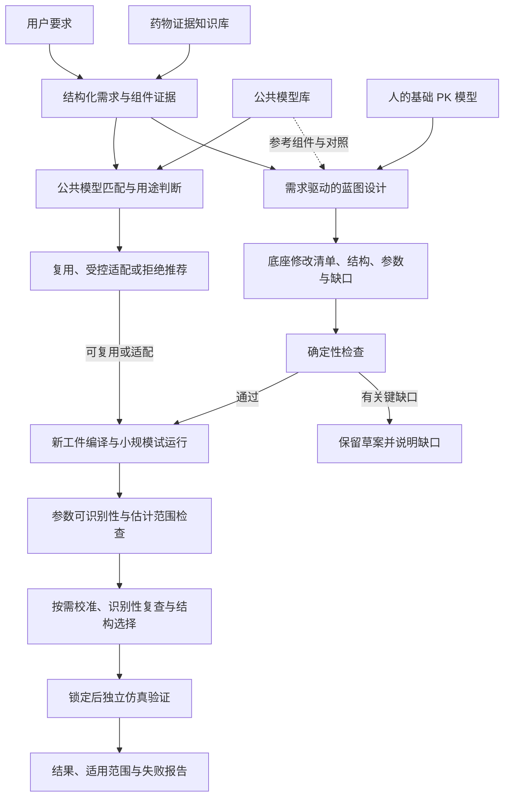

# 组件推荐、模型排序、蓝图设计与实验评估

组件推荐使用证据图谱、检索、HGT 和本地 Qwen。模型服务维持确定性用途门禁；研究模型尚未晋级。当前指标见 [实验汇总](../experiments/README.md)，下一步见 [研究计划](研究计划.md)。

组件推荐、公共模型推荐和蓝图设计共用证据基础，分别定义任务与验收。蓝图采用 [用途驱动的 PBPK 模块适配策略](#blueprint-design)；历史冻结实验不得作为下一轮未见测试。

**当前蓝图核心：来源、用途驱动的自动构建、补证更新与适用范围说明。** [第8节](#blueprint-design)是唯一权威策略。补点默认采用简单时间覆盖，停止把胜过时间规则的学习选点器作为研发目标或论文成立前提；现有论文与冻结分支保留，主张由对应版本实验支持。

## PBPK KG 推荐 Agent 策略

### 0. 文档定位

本策略定义从自动验证 evidence 到 PBPK 模型需求、机制和组件推荐的完整目标架构。其输出是后续公共模型排序和可执行模型蓝图生成的 `RequirementProfile`，不等同于已经推荐或生成了一个可运行 PBPK 模型。公共模型排序与拒答遵循 [当前公共模型推荐策略](#当前公共模型推荐策略)，蓝图设计遵循 [用途驱动的 PBPK 模块适配策略](#blueprint-design)。

推荐结果是有来源的模型设计建议，不代表 PBPK 模型已经完成参数校准、验证、适用性评价或监管确认。

### 1. 当前系统差距与最终实现要求

当前可复用输入：

```text
07_llm_quality_validation/final_auto_validated_evidence.jsonl
07_llm_quality_validation/final_quarantined_evidence.jsonl
```

硬约束：

```text
只允许 final_auto_validated_evidence 生成科学事实和推荐
quarantined evidence 仅用于审计，不得进入检索、训练正样本或推荐
```

当前代码与最终目标之间存在以下差距：

1. `build_kg_ready()` 主要是结构化字段到节点/边的固定映射，不是完整 KG 构建。
2. 没有通用 biomedical NER；化合物沿用上游归属，酶/转运体仅使用词典和正则。
3. 关系抽取仅覆盖少量 `substrate_of`、`inhibits`、`induces`、`transported_by` 模式。
4. DDI 主要使用无方向的 `HAS_DDI_WITH`，没有完整表达 victim、perpetrator、机制、效应量和实验条件。
5. Population、dose、route、condition 等仍有自由文本，缺少标准本体映射。
6. 当前所谓 1-hop/2-hop 主要是策略标签和 evidence 参数分组，不是真正的邻接遍历召回。
7. 当前子图重排是规则权重，不是真实 biomedical embedding 检索。
8. 没有训练型 GNN、Graph Transformer、GNN 子图向量或 query-conditioned graph encoder。
9. 没有真正的 LLM soft graph prompt。
10. 没有基于标准答案的推荐训练、检索评测、推荐评测和消融实验。
11. 当前推荐请求字段过少，不能完整表达 PBPK 建模场景。
12. 当前组件推荐只按 evidence 数量和来源数判断，未验证参数是否足以支持具体模型结构。

以上差距必须在一次完整的最终实现中逐项关闭，并分别提供测试和验收报告。任何缺少规定能力、测试或验收报告的中间结果均不得认定为完成。

### 2. 固定执行顺序

```text
1. 定义 PBPK ontology 和标识体系
2. 构建完整 ModelingRequest
3. biomedical NER 与实体标准化
4. 共指消解、事件抽取和关系抽取
5. KG 一致性、来源和质量校验
6. 生成正式 KG 节点、边和事件
7. 生成 0-hop、1-hop、2-hop 子图
8. biomedical embedding 子图索引
9. 真正的多跳图遍历召回
10. 训练 GNN/Graph Transformer 子图编码器
11. 子图向量召回和 query-conditioned 重排
12. 构建 LLM graph prompt 或真实 soft graph prompt
13. 生成有引用的模型设计推荐
14. 独立 Recommendation Validator 验证
15. 使用标准答案训练、评测和消融
16. API、UI、数据库和运行审计
```

不得在 ontology、实体归一化和关系抽取完成前训练 GNN。不得在 compound、population、dose、route、parameter 和 source 归属未确定前运行子图 embedding。

### 3. PBPK Ontology

#### 3.1 节点选择原则

满足任一条件时建立独立节点：

```text
具有稳定标识
被多条 evidence 重复引用
参与多种关系
需要独立检索、聚合或约束
是测量、相互作用、代谢或模拟事件
```

仅在局部上下文有意义的值保留为事件属性，不把所有字符串无条件转成节点。

例如，`5 mg oral fasted` 必须归属于同一 DoseRegimen/StudyArm，不能拆成三个失去上下文的孤立节点。

#### 3.2 核心实体

```text
Compound
ActiveMoiety
SaltForm
Metabolite
Formulation
DosageForm
AdministrationRoute
DoseRegimen
Enzyme
Transporter
Protein
Gene
GeneticVariant
Organ
Tissue
CellType
Species
Population
Disease
Study
StudyArm
ClinicalTrial
Publication
SourceDocument
Assay
Observation
PKParameter
ParameterValue
Unit
PBPKModel
ModelVersion
ModelStructure
Compartment
ModelParameter
Software
SimulationScenario
QualificationDataset
ValidationMetric
Evidence
```

#### 3.3 事件节点

以下关系必须优先建模为事件，而不是简单二元边：

```text
PKMeasurement
DDIEvent
MetabolismEvent
TransportEvent
AbsorptionEvent
ExcretionEvent
ModelCalibrationEvent
ModelValidationEvent
```

DDI 示例：

```text
Ketoconazole --PERPETRATOR_IN--> DDIEvent
Midazolam --VICTIM_IN--> DDIEvent
DDIEvent --MEDIATED_BY--> CYP3A4
DDIEvent --AFFECTS_PARAMETER--> AUC
DDIEvent --HAS_EFFECT_VALUE--> 5.2
DDIEvent --HAS_EFFECT_UNIT--> fold
DDIEvent --UNDER_REGIMEN--> DoseRegimen
DDIEvent --STUDIED_IN--> Population
DDIEvent --SUPPORTED_BY--> Evidence
```

PK 测量示例：

```text
Evidence --REPORTS--> PKMeasurement
PKMeasurement --OF_COMPOUND--> Midazolam
PKMeasurement --MEASURES--> AUC
PKMeasurement --HAS_VALUE--> ParameterValue
ParameterValue --HAS_UNIT--> ng*h/mL
PKMeasurement --UNDER_REGIMEN--> DoseRegimen
PKMeasurement --IN_STUDY_ARM--> StudyArm
```

#### 3.4 标识和标准化

```text
Compound：PubChem CID、InChIKey、ChEMBL ID、DrugCentral ID、RxCUI、UNII
Protein/Gene：UniProt、HGNC、NCBI Gene
Disease：MONDO、MeSH
Tissue/Organ：UBERON
Cell type：Cell Ontology
Route：EDQM/FHIR route code
Unit：UCUM
Clinical trial：NCT ID
Publication：PMID、PMCID、DOI
Model：repository path、version、commit checksum
```

盐型、母体、前药、代谢物和立体异构体使用显式关系，不自动合并。

### 4. Biomedical NER 与实体链接

#### 4.1 输入

```text
source_text
相邻句和章节标题
表格表头、行列和脚注
结构化 JSON/XML 字段
文档 active ingredient
已有 compound identity
```

#### 4.2 混合识别方法

```text
结构化字段：确定性映射
稳定 ID：精确链接
药物、酶、转运体别名：受控词典
自然语言实体：biomedical NER 模型
复杂多实体段落：LLM 辅助识别
```

NER 模型必须通过本项目标注集评测后选择。候选包括 biomedical transformer NER、SciSpacy/知识库链接器或等效模型，不得仅凭模型名称直接上线。

正式 Gate 1 使用锁定结构字段 silver 集并固定以下模型召回门槛：

```text
silver expected mentions >= 100
overall exact recall >= 0.80
overall overlap/type recall >= 0.85
Compound exact recall >= 0.90
PKParameter exact recall >= 0.65
```

该 silver 集未穷举文本中的全部实体，因此不把额外预测直接计为假阳性，也不声称 gold
precision/F1。`Unit` 和 `AdministrationRoute` 由结构字段、受控词典和确定性解析保证；NER
模型分数不能覆盖确定性链接结果。

#### 4.3 实体类型

至少识别：

```text
compound
metabolite
enzyme
transporter
gene
protein
organ
tissue
population
disease
genotype
route
formulation
dose
frequency
time point
PK parameter
unit
software
PBPK model
study
publication
```

#### 4.4 实体链接与拒绝规则

1. 每个实体保存原文 mention、字符范围、标准 ID、链接方法和置信度。
2. exact ID 和唯一别名可自动链接。
3. 多候选实体使用上下文重排。
4. 无法唯一链接时保留 `unresolved_entity`，不得猜测 ID。
5. comparator、excipient、co-medication、victim、perpetrator 和 target compound 必须区分角色。
6. NER 输出不得覆盖原始 evidence，只生成派生实体记录。

#### 4.5 公共标识解析与上下文重排

按以下顺序执行：

```text
mention 和证据上下文
→ PubChem exact synonym 候选
→ RxNorm exact concept 候选
→ 双源一致性检查
→ 单源、缩写、类别词和多候选进入上下文重排
→ 确定性校验
→ accepted / ambiguous / unresolved
```

执行规则：

1. PubChem 和 RxNorm 均唯一命中同一 mention 时可作为高置信候选。
2. 单源命中、多候选、全大写短缩写、药物类别词、复方名称和食品/草药名称不得仅凭字符串命中自动链接。
3. 上下文重排使用本地 `Qwen/Qwen3-14B-AWQ`，输入仅包含原始 mention、完整证据句、候选名称、候选标准 ID 和解析来源。
4. 模型只能从输入候选中选择一个 `candidate_id`，或返回 `ambiguous`、`unresolved`；不得生成新名称或新 ID。
5. 输出必须包含输入中的逐字引用、角色判断和选择理由。确定性校验器验证 candidate_id 属于候选集、引用存在于原文、mention 出现在引用中、角色与 evidence 字段不冲突。
6. 任一校验失败均不得进入外部实体目录。
7. 模型选择使用锁定 silver 集评测。silver 正例来自 PubChem 与 RxNorm 双源一致候选，拒绝样本来自类别词、复方、食品、无法解析名称和冲突候选；报告 accuracy、coverage、错误类型和模型版本，不声称 gold accuracy。
8. 外部实体目录保存解析请求、原始响应、checksum、模型版本、prompt 版本、决策和拒绝原因。
9. 药物类别、未展开短缩写、植物提取物和食品不得写成 `Compound`。保留 unresolved 记录，分别等待 `DrugClass`、`BotanicalProduct`、`Food` 或其他匹配 ontology 的解析器处理。

`Qwen3-14B-AWQ` 在隔离运行环境中执行，依赖锁为
`pbpk_kb/config/recommendation_awq_requirements.txt`。该环境与 GLiNER、embedding 和 GNN
环境分离，避免 AWQ 运行时固定的 Transformers 版本覆盖其他模型依赖。

上下文重排模型在运行前锁定以下 silver 验收阈值：

```text
decision accuracy >= 0.90
false-accept rate <= 0.05
valid JSON rate >= 0.99
accepted decision verbatim-quote validity = 1.00
```

若未达到任一阈值，单源和歧义候选全部保持 unresolved，不得写入正式外部实体目录。

### 5. 共指、事件和关系抽取

#### 5.1 固定处理顺序

```text
句子和表格范围识别
→ 实体识别
→ 实体标准化
→ 文档内共指消解
→ 事件触发词识别
→ 论元角色识别
→ 关系方向判断
→ 否定、推测和条件识别
→ 关系置信度和来源绑定
```

#### 5.2 抽取方法

```text
高精度关系：规则和依存句法
常见关系：监督式 biomedical relation extraction
复杂多药、多参数、多时间点：LLM structured extraction
最终关系：独立规则和模型验证
```

监督式关系模型先使用 NCBI 官方 BioREx 代码与 BioLinkBERT checkpoint 评测。运行环境使用
`pbpk_kb/config/biorex_requirements.txt` 独立锁定，输入转换为 PubTator，输出 logits 必须按
document/pair 映射回原 evidence。模型仓库 commit、checkpoint checksum、转换输入 checksum、
logits checksum 和阈值报告全部写入运行 manifest。锁定 silver 集至少同时满足：

```text
positive recall >= 0.75
hard-negative specificity >= 0.80
balanced accuracy >= 0.80
```

任一阈值失败时，该模型输出只保留为失败对照报告，不得进入 LLM 输入、事件候选或正式 KG。

LLM 只能输出实体 mention、关系类型、角色、逐字引用和置信度。引用必须存在于输入上下文。

DDI 角色按以下约束执行：

```text
目标化合物角色已确定，且正文只有一个已标准化的非目标药物
→ 非目标药物确定性赋为相反角色

正文含多个已标准化药物
→ 监督式 biomedical RE 生成关系候选
→ LLM 对每个候选分别输出 victim、perpetrator、触发词和逐字引用
→ 独立校验器检查实体 ID、角色方向、否定、条件和引用

正文未识别到合用药或角色方向不唯一
→ 保留 rejected/unresolved，不创建 DDIEvent
```

同一句包含多个真实相互作用时，必须创建多个独立 `DDIEvent`；不得任取第一个药物，也不得把多个 perpetrator 合并为一个字符串节点。

#### 5.3 关系范围

至少覆盖：

```text
HAS_ACTIVE_MOIETY
HAS_SALT_FORM
HAS_METABOLITE
SUBSTRATE_OF
INHIBITS
INDUCES
TRANSPORTED_BY
METABOLIZED_TO
EXPRESSED_IN
ABSORBED_VIA
EXCRETED_VIA
PERPETRATOR_IN
VICTIM_IN
MEDIATED_BY
AFFECTS_PARAMETER
HAS_MEASUREMENT
HAS_VALUE
HAS_UNIT
UNDER_REGIMEN
STUDIED_IN
HAS_FORMULATION
DESCRIBED_BY_MODEL
USES_PARAMETER
CALIBRATED_WITH
VALIDATED_WITH
SUPPORTED_BY
CONTRADICTS
```

#### 5.4 关系验证

每条关系必须具备：

```text
subject_id
predicate
object_id
evidence_id
source_id
source_location
supporting_text
source_text_hash
extraction_method
relation_confidence
negation_status
speculation_status
context_id
quality_status=auto_validated
```

无 evidence、无逐字引用、实体未链接或方向不明确的关系不得进入正式事实图。

### 6. 完整 ModelingRequest

推荐 Agent 同时支持结构化表单和自然语言请求。自然语言先解析为 ModelingRequest，再由用户可见地展示解析结果。

#### 6.1 化合物

```text
compound
active_moiety
salt_form
metabolites_to_model
candidate_public_model
```

#### 6.2 建模目的

```text
base_pk
first_in_human
dose_selection
formulation_comparison
food_effect
bioequivalence
ddi_victim
ddi_perpetrator
renal_impairment
hepatic_impairment
pediatric
geriatric
pregnancy
pharmacogenomics
tissue_exposure
public_model_reuse
```

#### 6.3 生物系统

```text
species
population
age_range
sex
body_weight
ethnicity
renal_function
hepatic_function
disease_state
genotype
pregnancy_status
```

#### 6.4 给药和制剂

```text
route
dose
dose_unit
single_or_multiple
frequency
infusion_duration
fed_or_fasted
formulation
dosage_form
release_type
```

#### 6.5 DDI

```text
victim_drug
perpetrator_drug
enzyme
transporter
interaction_mechanism
interaction_duration
victim_regimen
perpetrator_regimen
```

#### 6.6 预测终点

```text
AUC
Cmax
Tmax
half_life
clearance
volume_of_distribution
concentration_time_profile
tissue_concentration
fraction_absorbed
bioavailability
renal_excretion
DDI_AUC_ratio
DDI_Cmax_ratio
```

#### 6.7 模型约束

```text
whole_body_or_reduced_pbpk
parent_or_parent_metabolite
required_organs
required_enzymes
required_transporters
software_preference
parameter_uncertainty
calibration_datasets
validation_datasets
acceptance_criteria
sensitivity_analysis
uncertainty_analysis
```

#### 6.8 请求校验

1. compound 必须解析到稳定身份。
2. DDI 请求必须明确 victim/perpetrator 角色；缺失时输出澄清需求。
3. 特殊人群请求必须提供 population 定义或允许 Agent 显式使用默认范围。
4. dose、route、formulation 和 frequency 必须组成同一个 DoseRegimen。
5. 不完整请求可以检索，但必须在输出中列为 request gap。

### 7. 正式 KG 生成

#### 7.1 输入

```text
final_auto_validated_evidence
normalized entities
validated relation events
compound identity
public model metadata
source registry
```

#### 7.2 输出

```text
kg_nodes.jsonl
kg_edges.jsonl
kg_events.jsonl
kg_entity_mentions.jsonl
kg_unresolved_entities.jsonl
kg_rejected_relations.jsonl
kg_build_summary.json
```

#### 7.3 图一致性

1. 节点 ID 全局唯一。
2. 边的起点和终点必须存在。
3. 关系必须符合 ontology 的 domain/range。
4. 所有科学事实边必须指向 Evidence。
5. 同一事实的多来源 evidence 分别保留，不覆盖。
6. 矛盾事实通过 Conflict/Event 节点连接，不删除或平均。
7. name-only 临时节点不得参与最终推荐，除非完成实体链接。

### 8. Biomedical Embedding 子图索引

#### 8.1 禁止项

```text
禁止 hash embedding
禁止只嵌入节点名称
禁止索引 quarantined evidence
禁止索引无法解析的 name-only 科学实体
```

#### 8.2 Embedding 模型选择

使用真实 biomedical sentence embedding。模型通过项目内检索基准选择，不在策略中永久锁死单一模型。

模型评测候选集：

```text
NCBI MedCPT Query Encoder + Article Encoder 双塔
NeuML/pubmedbert-base-embeddings
经过 sentence-level biomedical retrieval 训练的 PubMedBERT 系列
Qwen3-Embedding instruction-aware 模型及其 Matryoshka 维度
GTE ModernBERT/BGE 等通用强检索模型作为对照
```

选择指标：

```text
entity query Recall@K
parameter query Recall@K
scenario query Recall@K
multi-hop path Recall@K
DDI role retrieval accuracy
special population retrieval accuracy
```

#### 8.3 子图文本表示

每个中心节点生成：

```text
0-hop：节点本身、标准名称、类型和关键属性
1-hop：中心节点及直接事件/关系/evidence
2-hop：经事件、参数、酶、转运体、人群、模型扩展的受控邻域
```

子图序列化必须包含：

```text
center entity
center preferred name、controlled aliases 和 ontology definition
typed nodes
typed directed edges
relation code 和 versioned ontology gloss
event roles
normalized values and units
study context
evidence citations
quality/conflict status
```

缩写型标准节点不得只保存缩写。例如 `TPSA`、`XLogP`、`AUC` 必须同时序列化标准全称、受控同义词和定义。关系不得只序列化 `STUDIED_IN`、`INHIBITS` 等代码，必须同时序列化稳定的自然语言关系定义。ontology gloss/alias 表必须独立版本化并在评测前锁定；禁止根据某条 benchmark 的正例 ID 或 `label_basis` 临时生成定义。

#### 8.3.1 Token 预算与信息优先级

子图 embedding 输入必须按所选模型 tokenizer 的实际 token 数控制，不得只按字符数截断。序列化顺序固定为：

```text
center entity 和标准标识
center ontology definition 和 controlled aliases
relation/event 类型计数
存在于子图中的 relation ontology gloss
与 center 相连的关键有向边和 event role
parameter/value/unit
route/dose/formulation/population/study context
高质量且来源多样的 evidence citation
其余节点和低优先级边
```

Gate 2 必须先保存未按字符截断的规范子图文本；禁止使用固定字符数切片，因为它会
把 edge、event 或 citation 截断在半行。Gate 3 再针对每个 embedding 模型的实际
tokenizer 生成模型专属输入：先压缩冗长名称和引用原文，再按上述优先级选择完整行。
每个模型输入必须至少保留 center、标准标识、关系类型、该子图实际出现关系的 ontology
gloss、关键有向 edge、存在时的 event role、来源摘要和至少一条 citation。只能删除
低优先级完整行，不得把结构化行从中间切断。

必须保证 0-hop、1-hop、2-hop 输入在模型最大长度内至少包含 center、关键关系、事件角色和证据来源。高连接度节点列表不得在关系、事件和引用之前耗尽 token 预算。

每个 embedding 记录保存：

```text
原始序列化 token 数
实际送入模型 token 数
是否截断
各信息段保留数量
tokenizer 名称和 revision
```

若关键关系、事件角色或来源在截断后缺失，该向量不得进入正式索引。

#### 8.4 向量

分别保存：

```text
node_text_embedding
edge_text_embedding
evidence_embedding
subgraph_0hop_embedding
subgraph_1hop_embedding
subgraph_2hop_embedding
```

模型名、模型版本、维度、输入 hash 和生成时间必须入库。使用 PostgreSQL/pgvector 建立 HNSW 或等效索引。

正式索引必须与第 12.1 节锁定的多路候选生成器一致：

1. `node`、`edge`、`evidence`、`subgraph_0hop`、`subgraph_1hop`、`subgraph_2hop`
   的规范文本和 provenance 元数据只保存一份。
2. NCBI MedCPT、PubMedBERT、BGE base、GTE ModernBERT 和 Qwen3 Embedding
   分别生成独立向量文件；不得把已通过的五路召回退化为单一 `selected_model`。
3. 每个模型分别保存精确 revision、维度、L2 归一化状态、逐记录 token 审计、
   向量校验和与查询探针。模型维度不一致时，只能使用模型公开支持的
   Matryoshka 截断映射到锁定维度，不得采用随机投影。
4. lexical 索引从同一份规范文本构建，使用 PostgreSQL `tsvector`/GIN 或等效
   word-bigram 检索实现；不得把任一 dense 模型的文本副本当作独立 lexical 语料。
5. 正式索引 manifest 必须绑定 Gate 1 图、Gate 2 子图、锁定 query、
   acceptance 配置、Gate 3 比较报告及所有模型 revision 的 SHA-256。
6. pgvector 导入后，对每个模型分别复现锁定查询的精确 top-K 结果。HNSW
   验收同时保存默认计划和验证计划：小数据集上 PostgreSQL 可以因精确排序成本
   更低而在默认计划中不选择 HNSW；验证会话必须禁用顺序扫描、位图扫描和显式
   排序，证明对应 partial HNSW 可被实际执行，并用全部锁定探针核对 HNSW
   top-10 对精确结果的召回率和正例命中。不得仅凭 `CREATE INDEX` 成功判定验收
   通过。Qwen3 reranker 不写入 embedding 表，其模型 revision 和评分配置作为
   fine retrieval 运行时依赖单独记录。
7. 不同 embedding 模型的向量空间不可相互计算距离。PostgreSQL 必须为每个
   `embedding_model + revision` 建立隔离的 partial HNSW 索引，查询必须同时
   过滤模型和 revision；禁止把五种模型向量放入同一个全局 HNSW 空间。

### 9. 真正的 1-hop/2-hop 图遍历召回

#### 9.1 Seed 实体

从 ModelingRequest 解析：

```text
compound
metabolite
population
route
formulation
enzyme/transporter
DDI drugs
endpoint
public model
```

#### 9.2 遍历

```text
0-hop：seed 节点
1-hop：直接 measurement、event、parameter、source、model
2-hop：通过 event/parameter/target/population/model 到达相关实体
```

必须使用真实 adjacency traversal，不得仅把 evidence 按 parameter 分组后标记为 1-hop/2-hop。

#### 9.3 关系白名单

根据 objective 限制可遍历关系。例如 DDI victim 请求优先：

```text
VICTIM_IN
PERPETRATOR_IN
MEDIATED_BY
AFFECTS_PARAMETER
SUBSTRATE_OF
INHIBITS
INDUCES
UNDER_REGIMEN
STUDIED_IN
SUPPORTED_BY
```

#### 9.4 图扩张控制

```text
最大 hop
每种关系最大邻居数
每个来源最大 evidence 数
重复事实合并显示
冲突事实单独保留
时间和版本过滤
最低质量阈值
最大 token/节点预算
```

### 10. 选择性检索策略

K-RagRec 原始 popularity policy 不适用于 PBPK。替换为 evidence sufficiency and uncertainty policy。

检索触发信号：

```text
任务所需组件覆盖不足
关键参数缺失
来源单一
存在未解决冲突
目标人群/route/dose 不匹配
公共模型与请求场景不匹配
模型预测不确定性高
```

策略：

```text
高覆盖、低不确定性：0-hop/1-hop
中等覆盖：1-hop + embedding top-K
低覆盖或复杂 DDI/人群任务：2-hop + event path retrieval
仍无证据：停止扩张并输出 evidence gap
```

### 11. GNN/Graph Transformer

#### 11.1 图类型

本项目是异构有向多关系图。模型至少比较：

```text
R-GCN
Heterogeneous Graph Transformer/HGT
Graph Transformer
无 GNN 的 embedding 对照模型
```

#### 11.2 节点特征

```text
biomedical text embedding
node type embedding
normalized numeric feature
unit/dimension embedding
quality confidence
source family
study context
missingness mask
```

#### 11.3 边特征

```text
relation type
direction
event role
evidence confidence
negation/speculation
source type
time/version
context compatibility
```

#### 11.4 两个编码器

```text
GNNIndexing：
离线生成 0-hop、1-hop、2-hop 子图向量并写入 pgvector

GNNEncoding：
在线对召回子图进行 query-conditioned 编码和重排
```

不得仅使用节点平均向量冒充 GNN 子图表示。

#### 11.5 训练目标

```text
query-positive subgraph 对比学习
hard-negative subgraph 对比学习
relation/path prediction
component relevance classification
parameter evidence ranking
citation selection
```

#### 11.6 Gate 4 固定实现

Gate 4 使用 Gate 3 锁定的 Qwen3 Embedding 768 维 query/node 向量作为冻结文本
特征，比较四个具有相同 query-conditioned 池化器、打分头、训练样本和优化配置的
编码器：

```text
NoGNN：节点特征投影，不执行消息传递
RGCN：两层 basis-decomposed R-GCN，正向和反向 relation 分别编码
HGT：两层 Heterogeneous Graph Transformer，按 node/relation type 传递消息
GraphTransformer：两层 edge-aware TransformerConv
```

禁止用节点均值替代上述模型。四个模型均使用 query 对子图节点执行条件注意力池化。
GraphTransformer 的 edge embedding 必须包含 relation、方向、event role、置信度、
否定/推测、来源类型、版本和上下文缺失标记；RGCN/HGT 至少通过 relation/direction
类型参与消息传递，其余边特征进入共享辅助任务和重排头。

节点输入固定包含：

```text
Qwen3 biomedical text embedding
node type embedding
value/value_low/value_high 的有界数值变换
unit/dimension embedding
quality/extraction confidence
source family embedding
route/population/condition study-context embedding
逐字段 missingness mask
```

训练损失固定为：

```text
1.00 * query-subgraph relevance BCE
0.20 * multi-positive contrastive loss
0.15 * relation/path prediction
0.10 * component/category relevance classification
0.10 * parameter evidence ranking
0.05 * citation selection
```

优化配置固定为 `hidden_dim=256`、`layers=2`、`heads=4`、`dropout=0.15`、
`AdamW(lr=2e-4, weight_decay=1e-4)`、梯度裁剪 `1.0`、最多 200 epochs、
patience 25，并使用随机种子 `17/29/43`。每个模型和随机种子分别保存 checkpoint、
训练曲线、输入 checksum 和软件/GPU 版本。

#### 11.7 Gate 4 预注册切分与验收

Gate 4 训练标签来自锁定的 silver benchmark。主切分以
`category + canonical(label_basis)` 为不可拆分语义组；同一目标的改写不得跨
train/validation/test。按类别做确定性 group split，并审计 query ID、规范 query
文本、label basis、positive subgraph 和 hard-negative 引用。测试标签和
`label_basis` 不得进入模型输入。

主指标在候选池内计算 Hit@10、MRR、nDCG@10、Recall@10，并同时报告每个查询类别、
三个随机种子和均值/标准差。正式通过条件在训练前锁定为：

```text
全部 checkpoint 可由相同输入 hash 重载并复现测试分数
任一模型训练过程不得读取 test label 做 early stopping
选择模型的三种子平均 composite >= NoGNN 三种子平均 composite + 0.01
选择模型的三种子平均 nDCG@10 >= NoGNN + 0.01
选择模型任一查询类别 Hit@10 相对 NoGNN 退化不得超过 0.10
选择模型三种子 composite 标准差 <= 0.05
relation/path 辅助任务 macro-F1 >= NoGNN
quarantined evidence 进入训练的数量 = 0
```

`composite = (Hit@10 + MRR + nDCG@10) / 3`。若没有模型达到门槛，Gate 4
必须失败并保留比较报告，不得选择测试集表现最好的单次随机种子冒充通过。

#### 11.8 Gate 4 失败迭代与重训约束

首轮 Gate 4 比较结果必须永久保留为失败审计，不得覆盖、删除或改写。后续重训使用新的
benchmark/training version 和输出目录，且在启动训练前写入新的
`preregistered_acceptance.json`。原验收阈值不得降低。

重训必须修正以下训练语义：

```text
训练排序集合 = train split 的全部候选，不得只训练正例和 hard negative
query-subgraph relevance = 按 query 等权的 BCE + multi-positive listwise ranking
hard negative = 在同一 query 内提高权重，不得替代普通负例
category relevance = 预测“该候选对当前 category 是否相关”，不得只复述 query category
relation/path prediction = 仅对正例子图计算目标 relation/path 损失
parameter ranking = 仅在 parameter query 内比较正负候选
citation selection = 区分有引用的正例、无引用正例和负例
```

Gate 3 已验证的召回和重排信号必须作为所有四个模型共享的候选先验输入：

```text
RRF score
各 retriever reciprocal rank 与覆盖数
Qwen3 reranker score
graph constraint pass
candidate rank 的有界变换
```

GNN 不得覆盖已经验证的文本排序信号。RGCN、HGT 和 GraphTransformer 使用
semantic-preserving residual graph fusion：

```text
冻结的文本节点表示
→ 图消息传递生成 graph delta
→ 可学习残差门控
→ query-conditioned pooling
→ 与共享 NoGNN 排序表示融合
```

每个 GNN seed 从同 seed 的 NoGNN checkpoint 加载共享参数；共享排序支路作为
teacher anchor，图支路学习 residual score。训练使用 teacher-score consistency
约束，防止图传播把强文本命中系统性冲掉。v2 在 11.6 的六项固定损失之外增加
`0.10 * SmoothL1(GNN score, NoGNN teacher score)`；NoGNN 的该项为零。

模型最终分数只允许使用 validation split 校准：

```text
final_score = NoGNN score + alpha(category) * graph residual
```

`alpha(category)` 由 validation query 网格搜索确定，并同时约束 validation
composite、nDCG@10 和 Hit@10 不低于 NoGNN。某类别没有语义隔离的 validation
query 时，`alpha=0`，回退到 NoGNN，不得利用 test label 选择 alpha。测试集只在
checkpoint 和 alpha 锁定后评估一次。

首轮失败后已经查看过的 test split 只作为回归审计，不再称为未见测试集。最终泛化结论
必须来自第 16 节和 Gate 6 的 compound/source/model/time 独立切分；Gate 4 v2
仍用于验证图编码器相对同数据、同候选、同先验的受控增益。

#### 11.9 Gate 4 v3 排序目标

Gate 4 v2 的失败报告必须继续保留。v2 仅未达到 nDCG@10 增益门槛，因此 v3
只修改与候选次序直接相关的训练和 validation 校准，不修改图、标签、切分或验收阈值。

原 `0.20 * multi-positive contrastive loss` 拆为：

```text
0.10 * multi-positive listwise softmax loss
0.10 * LambdaRank loss weighted by absolute delta nDCG@10
```

LambdaRank 在每个 query 内构造 positive-negative pair，使用当前预测名次计算交换两项
对 nDCG@10 的影响；排名 10 之后的交换只有在能改变 top-10 时获得权重。各 query
先独立归一化再取均值，避免候选数或正例数较多的 query 支配训练。

validation residual 系数固定搜索：

```text
alpha in [0, 0.25, 0.50, 0.75, 1.00, 1.25, 1.50, 2.00]
```

每个类别仍须先满足 Hit@10 和 nDCG@10 不低于 NoGNN，再最大化
`0.5 * composite + 0.5 * nDCG@10`；并列时依次选择 composite 更高、alpha
更小的配置。test label 不参与 LambdaRank 权重、alpha 选择、early stopping 或
architecture 选择。

#### 11.10 GNNIndexing 与解释产物

Gate 4 通过后，生产 checkpoint 只能按最高 validation composite 从被选架构的三个
seed 中选择，不得按 test 分数选择。

离线子图向量按以下步骤生成：

```text
加载冻结 checkpoint 和输入 checksum
→ 对完整异构图执行所选 GNN 编码
→ 以子图中心节点作为 anchor
→ anchor 对子图成员节点执行 attention pooling
→ 融合 anchor 与 pooled representation
→ L2 normalize
→ 写入独立 256 维 GNN pgvector 索引
```

不得使用节点平均。GNN 向量不得写入 768 维文本 embedding 表；必须使用独立表、独立
model revision 和独立 HNSW 索引。在线 query 使用同一 checkpoint 的
`query_projection(768 -> 256)` 生成检索向量。

每个子图必须保存：

```text
subgraph_id、center_id、hop、node/edge/path 数
vector row、vector checksum、checkpoint checksum、input checksum
top node attention
source/version/quality 摘要
```

每个 benchmark query 的 top-10 解释必须保存：

```text
NoGNN teacher score
raw GNN score
validation-locked residual alpha
final score
top node attention
top edge contribution
top path contribution
引用和来源位置
```

数据库导入验收必须同时验证精确 cosine top-10、强制 HNSW 执行计划、HNSW 对精确
top-10 的召回率和正例命中；仅创建索引成功不得判定完成。

### 12. 子图召回与重排

#### 12.1 Coarse retrieval

先用标准 ID、实体类型、objective 和 hop 约束确定可检索集合，再并行执行：

```text
biomedical dense embedding 召回
PostgreSQL FTS/BM25 或等效 lexical 召回
```

候选生成固定使用以下多路召回器，不根据测试集临时删减：

```text
NCBI MedCPT
PubMedBERT biomedical sentence embedding
BGE base
GTE ModernBERT
Qwen3 Embedding instruction-aware
word/bigram lexical retrieval
```

每一路取得同一 hop 检索集合中的 top-50，去重后使用固定 `RRF(k=60)` 排序并截取 top-100，作为 fine retrieval 的唯一候选池。RRF 只用于候选生成，不作为最终相关性分数。不得使用 hash embedding 参与正式融合。

同时评测：

```text
dense only
lexical only
dense + lexical RRF
multi-dense + lexical candidate generation
```

候选池必须单独报告 `candidate Hit@50/100`、`candidate Recall@50/100` 和各查询类别覆盖率。正式门槛为 overall candidate Hit@100 ≥ 0.95，且任一查询类别 candidate Hit@100 不低于 0.90。未达到门槛时不得进入重排或正式索引。

查询的 hop、标准实体 ID、实体类型和显式场景约束只能从实际 `ModelingRequest` 解析得到。评测数据中的 `positive_subgraph_ids`、`label_basis` 和 hard negative 标记不得进入候选生成或重排输入。

每次锁定检索评测必须同时保存 query、acceptance 配置和 0/1/2-hop 子图语料的 SHA-256；运行时逐项复核，任一 checksum 不一致立即停止。每条 query 的 positive 和 hard-negative subgraph ID 还必须在指定 hop 的锁定语料中通过引用完整性校验；子图版本变化后必须重新生成 query 标签，禁止把旧 subgraph ID 映射到新语料。

#### 12.2 Fine retrieval

对 top-100 候选先使用专用 cross-encoder 重排，再执行图约束和质量校验。

Cross-encoder 固定采用 `Qwen/Qwen3-Reranker-0.6B` 的官方 yes/no 相关性打分方法，使用英文任务指令：

```text
Given a PBPK modeling or pharmacokinetics query, judge whether the provenance-backed
knowledge-graph subgraph is directly relevant and contains the entities, relations,
study context, and evidence needed to answer the query.
```

输入由 query 和完整的 token-aware 子图序列化组成。锁定评测使用 `max_length=2048`；
该长度覆盖当前语料时，正式评测的截断对数必须为 0。未来语料超过该预算时，必须先
重新预注册长度或执行与第 8.3.1 节一致的语义保留压缩，不得在评测运行中临时改值。
使用模型 tokenizer 按 `longest_first` 截断，必须保存模型 revision、tokenizer
revision、原始 token 数、实际 token 数、是否截断、候选生成器版本和重排分数。
禁止将 silver/gold 标签、正例 ID、label_basis 或评测答案写入 prompt。

重排后执行：

```text
实体约束
关系路径约束
route/dose/population/formulation 兼容性
数值和单位维度兼容性
来源独立性
冲突状态
任务组件覆盖
GNN query-subgraph score
```

对于 `ModelingRequest` 中明确给出的 DDI victim/perpetrator 角色、目标关系和两跳路径，图兼容性是硬约束而不是可被语义分数抵消的软特征。系统先从请求字段和受控 ontology alias 解析所需 predicate/path，再用真实有向边验证候选；满足约束的候选整体排在不满足者之前，cross-encoder 分数只在同一兼容性层内排序。无法唯一解析的自然语言不得猜测硬约束，保留多种候选约束并输出解析不确定性。评测实现不得读取 `label_basis` 来获得关系或路径。

#### 12.3 最终重排分数

权重由训练集和验证集确定，不固定沿用当前规则权重。至少保留以下可解释分项：

```text
semantic similarity
graph relevance
scenario compatibility
evidence quality
source diversity
component coverage
conflict penalty
missing-context penalty
```

每次推荐保存各分项分数和模型版本。

### 13. LLM Graph Prompt

#### 13.1 文本图 Prompt

适用于 DeepSeek/OpenAI-compatible API：

```text
typed subgraph serialization
关键路径
模型组件覆盖矩阵
parameter/value/unit/context
逐条 citation
冲突和缺口
```

API 聊天模型只能接收文本或其公开支持的输入格式，不能把文本图 prompt 描述成 soft graph prompt。

#### 13.2 真实 Soft Graph Prompt

真实 soft prompt 需要本地或可控制内部 embedding 的开源 LLM：

```text
retrieved subgraph
→ GNNEncoding
→ projector/MLP
→ 与 LLM hidden size 对齐
→ 作为 soft graph tokens 注入 input_embeds
→ 与文本 ModelingRequest 联合生成
```

训练时：

```text
可冻结 LLM
训练 GNN encoder + projector
或使用 LoRA 联合训练
```

必须分别评测：

```text
text graph prompt
soft graph prompt
text + soft hybrid
无 KG 对照组
```

#### 13.3 Gate 5 锁定实现

`Qwen/Qwen3-14B-AWQ` revision
`31c69efc29464b6bb0aee1398b5a7b50a99340c3` 已完成兼容性实验，但冻结量化
模型的自回归 target loss 不能向前序 soft token/projector 产生非零梯度，因此该
模型只保留失败审计，不得用于 Gate 5 训练。

Gate 5 正式模型锁定为 `Qwen/Qwen3-8B` BF16，官方 Hugging Face revision 为
`b968826d9c46dd6066d109eabc6255188de91218`，`hidden_size=16384`。服务器可从
ModelScope 的官方 `Qwen/Qwen3-8B@master` 镜像下载，但必须保存模型来源、官方
revision、下载目录和每个权重/配置文件的 SHA256。运行环境只允许创建在服务器
`/root/autodl-tmp`，不得在本机创建模型环境或下载权重。

正式训练前使用一条真实、token 数最长的训练样本执行一次完整
`forward + target loss + backward + generate` 探针，并保存：

```text
Qwen3ForCausalLM 接受 inputs_embeds
每个有效 soft token 的梯度均为有限非零值
projector 总梯度为有限非零值
峰值 allocated/reserved GPU memory
模型可离线重载且权重 checksum 不变
```

训练和探针保持完整因果 Transformer 前向，但 LM head 与交叉熵只计算实际监督的
`target JSON + EOS` 预测位置。具体使用 `logits_to_keep` 选择从最后一个 prompt
token 到倒数第二个 target input token 的位置，并与完整 target token 序列逐项计算
交叉熵；不得裁掉 prompt hidden states、改变标签或把该显存优化描述成近似 loss。

只有 8B BF16 探针发生 CUDA OOM、非有限 loss 或 soft-token/projector 零梯度时，
才允许回退到 `Qwen/Qwen3-4B` BF16；回退前必须保存 8B 失败审计，并对 4B 重复
同一探针。不得因训练耗时或方便而回退。

文本图 prompt 输入固定为：

```text
完整 ModelingRequest
实际遍历得到的 typed nodes、typed directed edges 和 event roles
Gate 3 多路召回与 Gate 4 HGT 重排分数
关键 1-hop/2-hop 路径
组件覆盖矩阵
parameter/value/unit/compound/form/population/route/dose/study context
逐条 evidence_id/source_id/source_location/supporting_text
冲突、缺失上下文和 evidence gap
```

Gate 5 不得用 target 或 `positive_subgraph_ids` 构造候选。每个
`ModelingRequest` 必须实际执行 Gate 3 的五路 dense 检索、word/bigram lexical
检索、`RRF(k=60)` top-100 候选生成和 Qwen3 cross-encoder 重排；随后按请求中的
compound、DDI role/counterpart、population、route 和 objective 对真实有向边执行
硬图约束。最后使用 Gate 4 选择的 NoGNN teacher 与 HGT 对 query-subgraph pair
在线打分，按 validation split 锁定的 category residual alpha 融合。每条结果必须
保存各召回器 rank、RRF 分数、cross-encoder 分数、图约束、teacher 分数、HGT
分数和最终分数。

最终 top-8 采用硬约束分层排序：先保留由 `ModelingRequest.compound` 标准 ID
定位的目标化合物 2-hop、1-hop 子图作为结构锚点，再在同一兼容性层内按 HGT
融合分数排序其他候选。该锚点只读取请求标准 ID 和 hop，不读取 target evidence、
positive subgraph 或评测标签，用于防止参数中心子图挤掉承载完整化合物证据的中心
子图。

Soft graph prompt 使用 Gate 4 选择的 HGT checkpoint
`cbcc82b669db61c9966eb1f59fd31dd534ac5379cc8a902c36985511d8692b53`
对在线 query 与候选子图计算的 256 维 `pair_representation`，不得使用静态子图
向量替代 query-conditioned 表示。按最终 HGT 排序选取最多 8 个子图，
每个子图向量经过共享两层 projector：

```text
LayerNorm(256)
Linear(256, 2048)
GELU
Dropout(0.10)
Linear(2048, 16384)
LayerNorm(16384)
```

每个子图生成一个 soft token；另加一个由带分数的 attention pooling 生成的全局
soft token。soft token 插入 system instruction 和 ModelingRequest 文本之间。
禁止把 256 维向量打印成数字文本后称为 soft prompt。

Hybrid 文本图只序列化在线 top-8 中与请求场景兼容的 auto-validated evidence、
对应 typed edge/node、path、公共模型和来源，不得把同一子图中的无关 citation
混入 LLM 输入。文本图同时保存：

```text
REQUIRED_COMPONENTS：只由 ModelingRequest.objective 的锁定规则确定
SUPPORTED_COMPONENTS：只由在线召回的 allowed evidence 和公共模型确定
GAP_SELECTION_RULE：required - supported；公共模型复用请求另检查可复用模型
```

三项均在读取 silver target 前由请求和在线召回结果计算，并在泄漏审计中验证；
不得读取 `target`、`target_ids` 或 `positive_subgraph_ids` 生成这些字段。
LLM prompt 最多保留 8 条场景兼容 evidence，并用 `E01/M01/S01` 句柄表示
evidence、公共模型和子图；真实 UUID、完整 typed graph、路径、来源位置和句柄映射
保留在 retrieval trace 与运行清单中，由 assembler 回填，不在 prompt 中重复展开。

训练时冻结 Qwen3 和 HGT，只训练 projector。训练目标是从独立构建的、逐项有
provenance 的 silver recommendation target 生成受约束 JSON；不得使用待评测输出
反向生成 target。`soft_graph` 与 `hybrid` 都进入训练，validation loss 固定为两者
均值，checkpoint 选择只读取 validation split。Hybrid 最大 prompt 长度固定为
1408 tokens，并使用上述场景兼容紧凑文本图，训练和测试使用相同 token budget。
优化器使用 `AdamW(lr=1e-4, weight_decay=1e-4)`、梯度裁剪 `1.0`、最多 40
epochs、patience 6，种子固定为 `17/29/43`，不读取 test label。

目标 JSON 使用 target-only causal cross-entropy。`gap_codes` 键和值覆盖的 token
权重固定为 `4.0`，其余目标 token 和 EOS 权重为 `1.0`；训练和 validation 使用
相同权重，checkpoint 仍只按 validation loss 选择。该权重在重新生成
`preregistered_acceptance.json` 后、训练前锁定，不得按 test 指标调整。

LLM 输出在 schema 校验前执行一次受限句柄规范化。若输出项不是短句柄，但与当前
样本 `output_handle_map` 中某个允许句柄的规范值唯一相等，则确定性转换为该短句柄，
并在原始输出审计中记录字段、原值和目标句柄。未知值、多义映射或不属于当前允许
集合的值不得修复，必须继续由 schema/validator 隔离。该步骤只修复可逆序列化格式，
不得增加、删除或推断证据、组件、公共模型或缺口。

四个对照输入保持相同的 ModelingRequest、Qwen3-8B BF16 revision、解码参数和
输出 schema：

```text
no_kg：只有 ModelingRequest
text_graph：ModelingRequest + 文本图 prompt
soft_graph：ModelingRequest + soft graph tokens
hybrid：ModelingRequest + 文本图 prompt + soft graph tokens
```

LLM 只能从 prompt 中给出的 ID 和受控枚举中选择。最终推荐由独立 assembler
根据所选 ID 回填原始事实、数值、单位和引用，LLM 输出不能直接覆盖来源字段。

gap 受控枚举在读取 silver target 前由 `ModelingRequest.objective` 和锁定的
`REQUIRED_COMPONENTS` 生成，只允许：

```text
missing_component:<objective 所需组件>
public_model_reuse 时额外允许 no_reusable_public_model
```

与当前 objective 无关的 gap 不得进入 `ALLOWED_OUTPUT_IDS`。该约束只缩小本体上
不可能的输出空间，不读取 target、positive subgraph 或 LLM 输出；允许集合和生成
依据必须写入 prompt dataset 的泄漏审计。LLM 仍须依据在线召回产生的
`SUPPORTED_COMPONENTS` 判断合法 gap 是否实际存在。

#### 13.4 Gate 5 预注册验收

Gate 5 训练开始前保存 `preregistered_acceptance.json`，阈值不得根据测试结果降低：

```text
inputs_embeds 前向、生成和 projector 梯度回传均通过
四种 prompt 变体使用完全相同的 test request
JSON schema valid rate >= 0.95
hybrid component F1 >= no_kg component F1 + 0.05
hybrid citation recall >= 0.90
hybrid evidence-gap F1 >= 0.80
全部正式 recommendation 的 citation provenance completeness = 1.00
unsupported numeric parameter rate = 0
quarantined evidence leakage = 0
ontology-invalid recommendation = 0
validator 未通过的输出不得写入 recommendation_final.json
```

若软提示质量阈值未通过，Gate 5 必须保留失败报告并重训或修正，不得用文本图结果
冒充 soft graph prompt 已通过。文本图、soft graph 和 hybrid 的原始模型输出必须
全部保留，以区分 LLM 生成质量和最终确定性 assembler 的安全保证。

### 14. 推荐生成

本节生成的是模型需求、机制、组件和证据建议。`selected public model/template`
仅表示上游检索发现的公共模型候选，不代表该模型已经通过资产完整性、适用范围、
可执行性、验证迁移性和排序评估。最终公共模型的 `reuse / adapt / abstain`
决策由公共模型推荐服务产生；组件需求也可直接进入独立的蓝图设计流程。

输出至少包含：

```text
resolved ModelingRequest
selected public model/template
recommended model structure
required compartments
parent/metabolite scope
absorption strategy
distribution strategy
metabolism pathways
transport pathways
excretion pathways
DDI mechanisms
special population adjustments
parameter candidates
calibration datasets
validation datasets
sensitivity targets
uncertainty parameters
evidence gaps
conflicts
citations
overall confidence
```

每个 parameter candidate 必须绑定：

```text
parameter
value/range
canonical unit
compound/form
population/species
route/dose/formulation
study context
evidence_id
source_id
source_location
supporting_text
selection reason
```

数值 parameter candidate 只有在 `value/value_low/value_high` 均可在绑定的
`supporting_text` 中逐字核对，或存在带原始值、换算公式和单位维度的显式
normalization provenance 时才可输出。只有 canonical value、但当前来源片段中没有
原值且没有转换轨迹的事件仍可作为定性 evidence，不得进入数值 parameter
candidate。

禁止：

```text
使用 LLM 内部知识补值
对冲突值取平均
把不同剂量、人群或 route 的值混用
把定性 evidence 伪装成定量参数
把公共模型“存在”解释为模型已验证
```

### 15. Recommendation Validator

推荐生成后由独立 validator 执行：

```text
请求字段覆盖检查
所有推荐事实的 citation 检查
参数值逐字来源检查
单位和维度检查
compound/form/population/route/dose 上下文检查
KG path 存在性检查
冲突和缺口披露检查
模型组件与 objective 一致性检查
unsupported statement 检查
```

状态：

```text
recommendation_validated
recommendation_repairable
recommendation_quarantined
```

只有 `recommendation_validated` 可在默认 UI 中作为正式推荐显示。

### 16. 标准答案、训练集和数据切分

#### 16.1 标准答案层次

```text
Silver：
从公开 PBPK 模型、参数文件、评价报告和标签生成的可追溯弱监督答案

Gold：
锁定的标准 ModelingRequest、正确子图、模型组件、参数来源和预期缺口
```

Gold 不得从同一条待评测推荐输出反向生成。若完全不使用专家审核，必须明确称为 silver benchmark，不能声称是科学 gold standard。

#### 16.2 训练样本

每条样本包括：

```text
ModelingRequest
seed entities
positive subgraphs
hard-negative subgraphs
required components
accepted parameter candidates
rejected parameter candidates and reasons
expected evidence gaps
expected citations
```

#### 16.3 防止数据泄漏

分别执行：

```text
compound-disjoint split
source-document-disjoint split
public-model-disjoint split
time-based split
```

同一模型版本、论文、标签或重复段落不能跨训练和测试集。

Gate 4 的主切分用于训练编码器，不能替代本节的最终泛化评测。Gate 6 必须另外生成
compound、source-document、public-model 和 time 四套互斥评测清单。若某一来源
缺少可验证发布日期，必须列入 `time_split_ineligible` 并从 time split 分母剔除，
不得用抓取日期伪装成发表日期。

#### 16.4 Gate 5 推荐 silver 数据

Gate 5 silver target 从 `final_auto_validated_evidence`、正式 KG、公共模型节点和
实际 0/1/2-hop 路径确定性生成。每条 target 只保存：

```text
请求 objective 所需的组件
KG 中存在且上下文兼容的参数 evidence ID
实际可复用的公共模型 ID
实际存在的冲突和缺口
可由图路径验证的 citation ID
```

同一 evidence、source document、public model version 及其近重复不得跨
train/validation/test。Gate 5 主切分使用 compound-disjoint；只有至少包含两个独立
compound 的 split 才可计算正式推荐指标。数据量不足时必须报告 `insufficient_silver`
而不是把训练样本复制到测试集。

silver target 必须在运行推荐检索前，直接从正式 KG 的目标化合物、事件角色、
counterpart、population 和 `DESCRIBED_BY_MODEL` 等有向关系独立生成。禁止从本次
检索返回的子图、候选排序或 LLM 输出反推 target。每条样本同时保存独立的
`positive_subgraph_ids`；在线检索只能读取 `ModelingRequest`，完成后再用 positive
集合计算 Hit/Recall。若 target evidence 或 target public model 未被最终 prompt
所含子图覆盖，该样本记为 retrieval failure，不得静默缩减 target。

每条 silver target 最多选择 8 条代表 evidence。选择在检索运行前完成，使用固定
贪心次序：先覆盖 objective 要求但尚未覆盖的 PBPK 组件，再优先具有完整数值/单位
上下文的 evidence，再增加独立 source document，最后按 `auto_validated`
confidence 和 evidence ID 稳定排序。禁止按在线召回排名、LLM 输出或测试指标选择
target；完整的其余 objective-compatible evidence 仍保留在 KG 和
`positive_subgraph_ids` 覆盖审计中。

在线 top-8 在硬锚点之后，按 `ModelingRequest` 可验证的 objective-compatible
evidence 增量覆盖数执行贪心 set cover，HGT 分数用于同覆盖增益候选的排序。
该过程不得读取 silver target 列表。完成后才对照独立 target 计算完整覆盖率；
完整覆盖率必须 >= 0.95。未完整覆盖的样本保留在检索评测和 failure 清单中，但
不得进入 LLM projector 训练，也不得删减或替换该样本的 target。

Gate 5 数据构建必须输出并通过以下泄漏与归属审计：

```text
train/validation/test compound overlap = 0
DDI target compound role 与 ModelingRequest 一致
DDI counterpart role 与 ModelingRequest 一致
public model 由目标 compound 的直接 DESCRIBED_BY_MODEL 边绑定
target evidence 全部为 auto_validated 且能回溯 source_id/source_location
retriever/LLM 输入不含 positive_subgraph_ids、label_basis 或 target JSON
```

#### 16.5 Gate 6 独立评测执行

Gate 6 只读取锁定的 Gate 5 dataset、四种 prompt 原始输出、validator 结果、正式 KG
和上游 Gate manifest，不再训练、调参或修改阈值。运行前校验所有输入 SHA-256，
输出以下四套独立清单：

```text
compound_split_manifest.json
source_document_split_manifest.json
public_model_split_manifest.json
time_split_manifest.json
```

切分规则：

```text
compound：同一 canonical compound 只能属于一个 split
source-document：同一 source document 及其近重复只能属于一个 split
public-model：同一 public model checksum/version 只能属于一个 split
time：只使用可验证的发表/发布/模型版本日期；禁止使用下载日期
```

每个清单必须保存 train/validation/test 的 example ID、资源 owner、交集审计、
可评测样本数和不合格原因。仅当 test 至少有 2 个独立 compound 且目标字段非空时，
该轴才计算正式推荐指标；否则状态为 `insufficient_silver`。没有可验证发布日期的
样本写入 `time_split_ineligible.jsonl` 并从 time split 分母中剔除。上述
`insufficient_silver` 或 `time_split_ineligible` 是数据边界，不得改写为通过，
也不得复制训练样本补足测试集。

Gate 6 生成：

```text
retrieval_evaluation.json
recommendation_evaluation.json
safety_evaluation.json
ablation_evaluation.json
generalization_evaluation.json
gate6_manifest.json
```

推荐指标只对 Gate 5 `test` 且 schema valid 的原始选择计算；正式产品输出只统计
`recommendation_validated` 的 assembler 结果。安全硬指标必须逐条回溯 citation、
evidence quality status、ontology domain/range 和数值原文，不得只复用 Gate 5
汇总计数。Gate 6 可在安全和可重复性验收通过时标记
`engineering_acceptance=true`；只有 compound/source/model/time 四个轴均有足够
独立 silver test 数据且达到预注册阈值时，才可标记
`generalization_claim_eligible=true`。不使用专家审核时，任何报告均不得称为 gold
或临床有效性验证。

### 17. 评测指标

#### 17.1 KG 构建

```text
NER precision/recall/F1
entity linking accuracy
relation extraction precision/recall/F1
event argument F1
relation direction accuracy
negation/speculation accuracy
provenance completeness
ontology violation count
```

#### 17.2 检索

```text
node Recall@K
subgraph Recall@K
path Recall@K
MRR
nDCG@K
DDI role retrieval accuracy
scenario-compatible evidence precision
latency
retrieved token/node budget
```

#### 17.3 推荐

```text
component precision/recall/F1
parameter selection precision/recall/F1
normalized value/unit exact match
public model selection accuracy
evidence gap accuracy
citation precision/recall
unsupported statement rate
conflict disclosure rate
confidence calibration/ECE
```

component、citation、public model 和 evidence gap 的正式 precision/recall/F1
按全部 test 样本累计 TP/FP/FN 后计算 micro 指标。目标与预测均为空的样本不产生
TP/FP/FN，另行报告 exact-set accuracy 和 empty-target specificity；禁止把
empty/empty 当作 F1=0 后再做 macro 平均。按非空 target 计算的 macro 指标只作为
诊断项，不替代预注册的 micro-F1。

强制目标：

```text
citation provenance completeness = 100%
quarantined evidence leakage = 0
unsupported numeric parameter rate = 0
ontology-invalid recommendation = 0
```

#### 17.4 消融

```text
no KG
text RAG only
0-hop only
1-hop only
1+2-hop
embedding without GNN
R-GCN
HGT/Graph Transformer
text graph prompt
soft graph prompt
without selective retrieval
without conflict penalty
without source diversity
```

### 18. 推荐输出文件

```text
recommendation_request.json
resolved_modeling_request.json
seed_entities.jsonl
traversed_paths.jsonl
coarse_retrieved_subgraphs.jsonl
reranked_subgraphs.jsonl
component_coverage.json
parameter_candidates.jsonl
recommendation_draft.json
recommendation_validation.json
recommendation_final.json
recommendation_run_manifest.json
```

manifest 保存：

```text
KG version
evidence run ID
ontology version
NER/RE model versions
embedding model/version
GNN checkpoint
LLM/projector version
retrieval parameters
prompt version
input/output checksums
运行时间
```

#### 18.1 数据库、API 和 UI 运行边界

Gate 5 与 Gate 6 均通过后，按 manifest SHA-256 新建不可覆盖的
`recommendation_model_run`，只导入 `recommendation_validated` 到
`recommendation_result`。数据库同时保存完整 request、recommendation、
validation、LLM revision、projector checksum、KG/evidence run 和 Gate manifest。

API 处理顺序：

```text
ModelingRequest 精确命中已验证结果
→ 直接返回数据库中的 recommendation_validated

未命中
→ 仅在服务器执行多路 biomedical 召回
→ Qwen3 cross-encoder
→ HGT query-conditioned 重排
→ Qwen3-8B BF16 hybrid graph prompt
→ deterministic assembler
→ Recommendation Validator
→ 通过后写入数据库并返回
→ 未通过则隔离并返回阻断状态
```

禁止 API/UI 回退到旧规则 Agent 或未通过 Gate 6 的模型。在线运行必须复核模型、
embedding、reranker、HGT、projector 和 KG manifest checksum。Streamlit 只通过
FastAPI 读取已验证结果和提交 ModelingRequest；模型、GPU 环境和中间文件只存在于
服务器。本地只同步代码、manifest、最终报告和允许展示的已验证结果，不同步模型
权重、虚拟环境或模型缓存。

API 从最新工程验收通过的 `recommendation_model_run` 中查询
`recommendation_validated` 的去重 objective 列表，Streamlit 只允许提交该列表中的
目标。Pydantic 可保留尚未完成评测的目标字段，但这些目标在完成对应 benchmark、
训练、Gate 5 和 Gate 6 前不得出现在可执行界面中。

### 19. 最终系统强制验收关卡

以下关卡只用于约束工程顺序、阻断错误结果继续流入下游，不构成独立产品版本。必须完成全部六个关卡并通过端到端验收，才能认定推荐 Agent 已按本策略实现。

#### 关卡 1：Ontology、NER 和关系抽取

验收：

```text
ontology domain/range 校验通过
NER/RE 在锁定测试集达到预设阈值
DDI、PKMeasurement、DoseRegimen 事件可完整表达
所有事实关系有 provenance
```

#### 关卡 2：正式 KG 和多跳遍历

验收：

```text
图节点/边/事件完整
真实 1-hop/2-hop adjacency traversal
name-only 节点不进入正式推荐
路径可回溯到 evidence
```

#### 关卡 3：Biomedical embedding

验收：

```text
真实模型 embedding
0/1/2-hop 子图向量完成
pgvector 索引可查询
多路召回 candidate Hit@100 >= 0.95
每个查询类别 candidate Hit@100 >= 0.90
Qwen3 cross-encoder 重排后的 Hit@10 >= 0.80、MRR >= 0.45、nDCG@10 >= 0.50
重排综合分数至少比最佳 lexical/hash 对照高 0.005
任一查询类别 Hit@10 相对最佳对照退化不超过 0.10
所有结果记录模型 revision、token 截断和候选生成参数
```

#### 关卡 4：GNN/Graph Transformer

验收：

```text
训练和验证 checkpoint 可复现
NoGNN、R-GCN、HGT、GraphTransformer 使用相同切分和训练目标完成三随机种子比较
选择模型达到第 11.7 节预注册的提升、稳定性、分类别和辅助任务阈值
离线 GNN 子图向量写入独立模型版本的 pgvector 索引
query-conditioned 重排输出节点注意力、关键边、关键路径和逐项分数
```

#### 关卡 5：LLM Graph Prompt 和推荐

验收：

```text
文本图 prompt 可运行
真实 soft graph prompt 只在支持 input_embeds 的模型上实现
推荐逐项有 citation
Recommendation Validator 全部通过
```

#### 关卡 6：标准答案评测

验收：

```text
silver/gold 边界明确
compound/source/model/time split 无泄漏
检索、推荐、安全和消融报告完整
达到预先登记的 acceptance thresholds
```


## PBPK 公共模型推荐与蓝图设计

### 1. 目标与系统边界

本策略在现有 PBPK 证据知识库、组件推荐和 KG 基础上，支持两个可独立发起的任务：

```text
公共模型推荐：对已有模型排序，并决定 reuse、adapt 或 abstain
蓝图设计：从人的基础 PK 模型出发，结合药物证据和用户要求设计、编译并验证模型
```

公共模型候选可为蓝图提供参考和对照；能完整复用且支持请求时走模型推荐，没有合适模型或已有模型不支持用途时才进入蓝图。蓝图不要求事先存在完整同药物模板。

最终系统必须回答：

1. 是否存在适用于当前建模请求的公共 PBPK 模型。
2. 推荐哪个具体模型版本，以及符合和不符合哪些条件。
3. 该模型可直接复用、需要适配，还是应拒绝推荐。
4. 如何根据用户要求和药物证据修改人体基础模型，并生成有来源、可执行、可验证的蓝图。
5. 推荐或生成的模型是否真实运行，并通过独立数据验证。

本策略中的“模型”必须对应可定位、可校验版本、可解析和可执行的模型资产。只有模型名称、论文提及或组件列表的记录不得作为可复用模型。

### 2. 当前系统定位

现有推荐 Agent 的输出包括：

```text
所需吸收、分布、代谢、排泄机制
所需酶、转运体、器官和房室
DDI victim/perpetrator 机制
特殊人群要求
参数候选、证据缺口和冲突
建议的 whole-body 或 reduced PBPK 结构
```

该能力正式命名为：

```text
PBPK Model Requirement and Mechanism Inference
PBPK 模型需求与机制推断
```

它不直接构成模型排序结果。其输出必须转换为结构化 `RequirementProfile`，分别作为：

```text
公共模型推荐的匹配条件
人体底座蓝图设计的结构与参数需求规范
```

#### 2.1 后续交付边界

公共模型推荐继续执行资产、许可、适用范围、运行与科学验证检查，其评测遵循 [研究计划](研究计划.md)。蓝图设计按 [第 8 节](#blueprint-design)独立推进，采用人体底座、药物证据和需求驱动的修改流程。

两条路径共用需求解析、证据来源、参数检查、执行与科学评价基础。当前已在运行的模型推荐实验保持优先；本次策略修订不改变其任务和结果。

#### 2.2 当前实现与目标差距

现有 `blueprints/` 已有强类型蓝图、参数解析、结构检查和 OSP 离线编译运行能力。2026-09-22 增加证据驱动的新药物构建入口，范围和实现见 8.4；咖啡因两项历史研究的原生运行和评分已完成，尚非独立验证。在线 `POST /blueprints` 仍执行旧的公共模型优先及登记模板查询；`compile/run` 接口主要返回历史成功记录，新构建流程尚未接入网页。

历史 Caffeine 蓝图可执行，但吸收结构识别未通过，不得提升科学状态。现有源码、校验器、执行器和失败实验保留用于复用及回归；历史案例不再决定后续设计入口和通用参数。[实际仿真结果](../experiments/README.md#4-实际仿真与蓝图)

#### 2.3 候选检索与分层推荐

公共模型服务固定采用“全目录扫描 -> 相关性门控 -> 相关候选硬约束矩阵 -> 分层展示
-> 严格复用决策”。分层结果用于说明相关候选下一步可以怎样使用，不改变第 2.1 节的
`reuse/abstain` 科学决策。

每个已登记 `ModelVersion` 都必须被扫描，但不得因此自动成为目标化合物候选。一次请求
必须形成三个互斥集合：

| 集合 | 含义 | 是否参与排序 |
|---|---|---|
| `catalog_scanned` | 本次检查过的完整模型版本目录 | 否 |
| `relevant_candidates` | 通过同化合物或严格机制相关性门控的版本 | 是 |
| `excluded_unrelated` | 未找到可追溯相关性依据的版本 | 否，仅保留排除审计 |

不同化合物模型进入 `mechanistic_reference` 必须同时满足：

1. 目标化合物存在用户明确指定的机制，或 evidence、化合物-蛋白关系和蛋白身份均为
   `auto_validated`、关系与蛋白身份置信度均不低于 0.90 的阳性 `substrate_of`、
   `transported_by` 或 `metabolized_by` 酶/转运体关系；
2. Model KG 的审计结果为 `accepted=true`，`summary.json`、`model_kg.sqlite` checksum
   一致，且 KG 中的模型版本数与当前数据库目录一致；
3. Model KG 中存在可重建路径
   `ModelVersion -HAS_COMPONENT-> Process -MODIFIED_BY-> Enzyme/Transporter`；
4. 该 Process 的 educt 必须包含该模型实际登记的化合物或代谢物，排除软件模板中的背景
   酶、转运体、表达组件和周转组件；
5. 目标关系与模型过程使用标准名或同义词归一化后精确命中，并返回目标 evidence ID、
   relationship ID、Model KG edge ID、模型资产 checksum 和 source location。

同化合物身份只能由模型家族的主 active moiety 与目标化合物标准身份精确匹配确定。
项目资产中出现的 DDI 伴随药、探针药、对照药、代谢物或验证分析物不得用于证明
同化合物身份。例如 Erythromycin 模型资产中包含 Midazolam 时，前者仍是不同化合物模型，
只能通过上述双侧机制证据门禁进入 `mechanistic_reference`。

仅共享 species、route、formulation、population、AUC/Cmax、普通 ADME 流程或同一种
软件，不构成模型相关性。Model KG 缺失、checksum/审计失败或版本数不一致时必须
fail closed：保留同化合物候选，排除所有不同化合物候选。

通过相关性门控的版本再按以下互斥层级归类：

| 层级代码 | 显示名称 | 进入条件 | 允许用途 |
|---|---|---|---|
| `validated_reuse` | Validated for reuse | 同一 active moiety、精确模型家族、全部硬约束通过、Grade 3、`reuse_positive` | 在已登记适用范围内直接复用 |
| `controlled_adaptation_candidate` | Controlled adaptation candidate | 同一化合物、许可证允许、资产/解析/运行完整，但 route、formulation、population、mechanism 或 endpoint 需要显式适配 | 建立版本化 `AdaptationPlan` 后重新运行和独立验证；不得直接复用 |
| `same_compound_qualification_candidate` | Same-compound qualification candidate | 模型家族主 active moiety 与目标化合物精确匹配且技术资产可审计，但许可证、验证迁移性或 Grade 资格尚未完成 | 仅用于许可证、评价报告和独立验证资格提升；不得直接用于预测 |
| `mechanistic_reference` | Mechanistic reference | 非目标化合物，已通过上述双侧证据和 Model KG 过程路径门控，且核心资产未损坏 | 仅用于命中的具体过程和机制参考；禁止转移化合物特异参数 |
| `blocked` | Blocked | 资产缺失、checksum 失败、解析失败、执行失败、软件不可用或许可证明确禁止 | 仅保留元数据和失败审计，不进入适配或复用 |

固定判定顺序：

```text
模型家族主 active moiety 与目标化合物精确命中 -> 进入同化合物相关候选集
不同化合物且目标机制证据 + Model KG 过程路径命中 -> 进入相关候选集
其他不同化合物 -> excluded_unrelated
相关候选的资产/checksum/解析/执行/明确限制许可证失败 -> blocked
相关的不同化合物 -> mechanistic_reference
同化合物且全部 Grade 3 复用条件通过 -> validated_reuse
同化合物、许可证允许、技术完整但上下文需要适配 -> controlled_adaptation_candidate
其他同化合物技术资产 -> same_compound_qualification_candidate
```

每个候选必须返回：

```text
candidate_layer
candidate_layer_label
relevance_class
relevance_reason_codes
relevance_basis
permitted_use
direct_reuse_allowed
deterministic_compatibility
hard_blockers
qualification_actions
asset locations、source、version、checksum、license、parse、execution 和 validation 状态
```

层内排序固定使用可解释的 `deterministic_compatibility`，并以稳定模型 ID 作为最终
tie-breaker。分数只决定同层展示顺序，不得跨层提升候选，也不得覆盖任何硬约束。
LLM、embedding 和 HGT 可用于发现需求和相关子图，不参与当前公共模型的最终层级判定。

API/UI 必须分别展示 `catalog_scanned`、`relevant_candidates`、`excluded_unrelated` 和
五层相关候选数量。页面候选表只显示 `relevant_candidates`；无关版本不得出现在候选层级
和排序中。排除集只在审计信息中返回稳定 ID 和排除原因。`validated_reuse` 之外的层级
不得使用“可直接使用”“已验证”或同义标签。旧的 `decision=reuse/abstain` 字段继续作为
最终科学决策，避免候选检索结果被误解为复用许可。

### 3. 端到端架构



该图描述后续目标。需求和证据可以直接进入蓝图设计；模型推荐提供可选参考。所有科学用途声明均需实际执行及独立依据，缺失证据和未完成验证必须显式保留。

### 4. 统一输入

#### 4.0 与现有代码的对接

现有实现按以下职责保留和扩展：

| 现有位置 | 当前职责 | 后续对接 |
|---|---|---|
| `pbpk_kb/recommendation/schemas.py` | `ModelingRequest` 和组件推荐响应 | 增加 `RequirementProfile`、模型排序决策和蓝图 schema |
| `pbpk_kb/recommendation/agent.py` | 组件和机制需求生成 | 作为 `RequirementProfile` 的上游生成器 |
| `pbpk_kb/recommendation/formal_graph.py` | Evidence KG 和子图构建 | 增加 Model KG 节点、事件和模型资产关系 |
| `pbpk_kb/recommendation/online_agent.py` | 在线检索、重排、生成和验证 | 拆分为需求推断、模型排序、蓝图生成三个有独立审计的服务步骤 |
| `pbpk_kb/storage/schema.sql` | 证据、模型注册表和参数 evidence | 保留模型主表，增加版本、资产、适用性、运行、排序和蓝图表 |
| `pbpk_kb/graph/graph_queries.py` | 模型、来源和证据图查询 | 增加模型结构、适用范围、验证运行和需求匹配查询 |
| `pbpk_kb/api/model_routes.py` | 公共模型列表和详情 | 增加版本、资产、适用性和运行探测端点 |
| `pbpk_kb/ui/pages/14_recommendation_agent.py` | 组件推荐和证据展示 | 分离需求、模型排序、蓝图和模拟验证视图 |

现有 `RecommendationResponse.public_model_candidates` 只能保留为候选发现结果。
正式模型排序必须使用独立的 `RankedModelRecommendation`，不得复用
`ComponentRecommendation` 表示具体模型版本。

Recommendation Agent UI 按任务提供三个工作区；新增蓝图设计入口完成前必须标明待实现：

1. `PBPK 组件推荐`：读取 Gate 6 已接受运行中的 `recommendation_validated` 结果，展示
   吸收、分布、代谢、排泄、理化性质、DDI 和特殊人群组件，以及参数候选、机制实体、
   evidence ID、source location、KG 子图和验证审计；不得把组件当作可执行模型版本。
2. `公共模型推荐`：扫描已下载模型，执行相关性门控、硬约束、分层排序和用途判断。
3. `蓝图设计`：展示人体底座、用户要求、药物证据、结构与参数修改、缺口、运行和验证；用户可以直接发起设计。历史登记蓝图单独标注为已有案例。

当服务器未启用在线 LLM/GNN 推理时，组件推荐工作区只能浏览已验证结果，并明确显示
`validated_results_only`。任意新请求不得回退到未验证规则输出，也不得因服务器无 GPU
而在 UI 中伪装成可生成状态。在线推理开启后，新结果仍必须先通过引用完整性、数值支持、
隔离证据泄漏和 schema 验证，才可进入 UI。

组件推荐工作区的化合物主集合必须来自 `compound_identity`，不得直接使用论文 benchmark
中的化合物集合。`recommendation_result.compound_node_id` 只有与
`Compound:<compound_identity.compound_id>` 精确匹配时，才计入知识库覆盖率并在该工作区
显示。benchmark 中用于外部评测但未进入 Stage 1 化合物表的药物只能保留在评测审计中，
不得显示为知识库化合物推荐。知识库化合物尚无 Gate 6 结果时，UI 必须显示
`not_generated_or_validated`，不得用同机制药物、外部 benchmark 药物或公共模型候选替代。
覆盖统计必须同时显示知识库总数、已有结果的化合物数、缺失化合物数和已验证场景数。

#### 4.1 ModelingRequest

继续使用现有 `ModelingRequest`，至少包含：

```text
compound、active_moiety、salt_form、metabolites_to_model
objective、species、population、disease_state、genotype
route、dose、dose_unit、frequency、formulation
victim_drug、perpetrator_drug、enzyme、transporter
prediction_endpoints
whole_body_or_reduced_pbpk、parent_or_parent_metabolite
required_organs、required_enzymes、required_transporters
software_preference、acceptance_criteria
calibration_datasets、validation_datasets
```

请求进入排序前必须完成身份解析、单位标准化和必填条件检查。无法解析的关键实体不得由 LLM 猜测。

#### 4.2 RequirementProfile

现有 Agent 必须产生以下结构化结果：

```text
request_id
compound_identity
biological_scope
required_model_structure
required_compartments
required_adme_processes
required_enzymes
required_transporters
required_ddi_roles
required_population_features
required_routes_and_formulations
required_prediction_endpoints
required_validation_contexts
parameter_requirements
evidence_ids
critical_gaps
conflicts
profile_version
```

每项要求必须标记：

```text
hard_required
preferred
optional
unsupported
```

要求的来源必须是建模请求、自动验证 evidence、受控 PBPK 规则或版本化 ontology。LLM 生成的要求只有通过确定性验证后才能进入正式 profile。

#### 4.3 机器可执行契约

以下对象必须在 `pbpk_kb/recommendation/schemas.py` 中实现为
`extra="forbid"` 的 Pydantic v2 模型，并导出对应 JSON Schema：

```text
RequirementItem
  requirement_id: UUID
  category: controlled enum
  semantic_id: string
  preferred_name: string
  necessity: hard_required | preferred | optional | unsupported
  expected_value: string | number | range | null
  canonical_unit: UCUM | null
  context: species/population/route/formulation/dose
  evidence_ids: non-empty list[UUID]，请求直接指定项除外
  origin: user_request | validated_evidence | ontology_rule
  confidence: 0..1

RequirementProfile
  profile_id: UUID
  profile_version: semantic version
  request_id: UUID
  ontology_version: string
  compound_identity: resolved CompoundRef
  requirements: non-empty list[RequirementItem]
  critical_gaps: list[Gap]
  conflicts: list[ConflictRef]
  source_evidence_run_id: UUID
  created_at: timezone-aware datetime
  checksum: SHA-256

ConstraintCheck
  constraint_id: string
  model_version_id: UUID
  requirement_id: UUID
  severity: hard | soft
  result: pass | fail | unknown | not_applicable
  observed_value: typed value | null
  reason_code: controlled enum
  evidence_ids/model_asset_locations: non-empty when result != not_applicable

RankedModelRecommendation
  ranking_run_id: UUID
  profile_id: UUID
  decision: reuse | adapt | abstain
  candidates: list[RankedModelCandidate]
  selected_model_version_id: UUID | null
  adaptation_plan_id: UUID | null
  abstention_reason_codes: list[enum]
  decision_certainty: 0..1
  confidence_semantics: deterministic_gate | probability_calibrated
  model_run_manifest_id: UUID
```

当前公共模型服务使用 `deterministic_gate`。`decision_certainty=1.0` 只表示确定性规则已完整执行，
不表示模型预测成功率为 100%，不得命名或展示为 calibrated confidence。只有使用独立标签集完成
概率校准并保存校准方法、版本和误差后，才允许使用 `probability_calibrated`。

交叉校验：

1. `reuse` 必须存在 `selected_model_version_id`，且该候选全部 hard constraint 为
   `pass`。
2. `adapt` 必须同时存在 `selected_model_version_id` 和通过 schema 校验的
   `adaptation_plan_id`。
3. `abstain` 不得包含 selected model，且必须包含至少一个拒答原因。
4. hard constraint 的 `unknown` 按 `fail` 处理。
5. 所有引用 ID 必须存在于同一版本化运行 manifest 指向的数据快照。
6. checksum 基于字段排序后的 canonical JSON 计算。

### 5. 公共 PBPK 模型资产层

#### 5.0 锁定的首批来源和执行平台

首批只对以下范围声明“可排序并可运行”：

```text
模型来源：Open Systems Pharmacology OSP-PBPK-Model-Library
模型来源版本：v12.3.1
模型来源 commit：07a71b3e025879db5cc46feca1d262cc786ed0f6
主要执行平台：OSP Suite 12 Update 3 Hotfix 1（12.3.263）
PK-Sim runtime：12.3.173
脚本接口：OSPSuite-R 12.4.3（computational core 与 OSP 12 Update 3 匹配）
仓库原始输入：OSP 模型库中的 .pksim5 project
标准运行输入：由匹配版本 PKSim.CLI 从 .pksim5 导出的 .pkml simulation
评价材料：模型仓库内 evaluation report、qualification data 和 observed data
```

当前正式版本锁定：

```text
OSP Suite installer:
  OSPSuite-Full.12.3.263.exe
  SHA-256 e910a46f76c852f9f5a021257c021a9e5c101934f722ef11cb9ff9eb10a939aa
PK-Sim portable:
  PKSim-Portable.12.3.173.zip
  SHA-256 94a704b67c05042131cd5e51b4237b1633466a08cd6ec77506322b4d009c8567
OSPSuite-R Linux binary:
  ospsuite_12.4.3_R_x86_64-pc-linux-gnu.tar.gz
  SHA-256 9f2ae868ee072b363e824618c63e1a804a9ff04c7c757b8227c14fece86038fb
```

版本号不是 `latest` 别名。正式运行配置必须记录 Suite installer、PK-Sim
runtime、OSPSuite-R、模型仓库 tag/commit 和 runtime image/VM 的 SHA-256。
升级版本必须建立新的兼容性运行，不得覆盖旧结果。

执行部署：

```text
FastAPI/PostgreSQL/KG 服务：现有 Linux 服务
OSP execution worker：隔离的 Windows worker
任务通信：数据库 job/outbox 或持久化队列
模型与结果交换：不可变对象存储
```

首批 adapter：

```text
osp_repository_adapter：完整镜像仓库和 commit
osp_asset_inventory_parser：模型、数据、报告、license 清单
osp_pksim5_parser：只读解析 project 数据库、压缩 XML、simulation 和 observed data 索引
osp_cli_export_adapter：在 Windows worker 导出 .pkml、结构 XML、CSV 并执行 simulation
osp_pkml_parser：读取 simulation、entity、parameter、container 和 output
osp_evaluation_report_parser：解析评价场景、数据集和指标
osp_runtime_adapter：载入并运行 .pkml，保存 simulation results
```

首批 `.pksim5` 必须先通过静态 parser，再由官方 `PKSim.CLI export` 完成格式导出和
最小运行探测。MoBi project、snapshot、R workflow、Excel 或其他格式可以进入资产表，
但在对应 parser 和 runtime adapter 通过兼容性测试前必须标记
`registered_not_executable`。仓库或单个资产许可证无法确定时标记
`license_unresolved`，不得进入 reuse/adapt 候选池。

Windows worker 对每个 `.pksim5` project 执行以下官方 CLI 能力，命令帮助、CLI
二进制和 Suite installer checksum 必须写入运行 manifest：

```text
PKSim.CLI export
  -p <project.pksim5>
  -o <immutable_output_directory>
  -k
  -x
  -c
  -r
```

其中 `-k` 导出 PKML、`-x` 导出结构 XML、`-c` 导出 CSV、`-r` 运行 simulation。
Windows worker 必须按锁定计划中的 simulation 清单逐个调用 `--simulations`，不得依赖
CLI 的隐式“全部 simulation”行为。每个 simulation 单独保存完整命令、退出码、
stdout、stderr、耗时、导出文件 checksum 和覆盖状态；单个 simulation 失败不得终止
其余 simulation 的探测。project 只有在计划内全部 simulation 均运行成功且 PKML、
XML、CSV 覆盖完整时才通过。
Linux 服务不得把静态解析成功等同于执行成功；只有 Windows worker 返回经过产物校验的
成功结果后，`execution_probe_status` 才能进入 `success`。

第二批来源只能在首批端到端验收通过后登记。每个新增来源必须提交 source adapter、
格式 adapter、license policy、执行探测和回归基准，不得仅增加 URL。

#### 5.0.1 Rosuvastatin v1.0 严格许可模型复用协议

首个 `reuse` 阳性候选固定为 OSP 官方 Rosuvastatin 模型快照。该候选用于建立一条
可复现、可审计的模型复用正例，不代表其他化合物已经完成模型复现。

```text
repository: https://github.com/Open-Systems-Pharmacology/Rosuvastatin-Model
release tag: v1.0
commit: ffbacba8ff1978150f5e008fecbd12d8877d1fa1
license: GPL-2.0-only
license SHA-256: b90ed8150a6d371c84b7dbaa680cd0e9893ef7c2558765e1e00930513efcfe3b
snapshot: Rosuvastatin-Model.json
snapshot schema version: 79
snapshot SHA-256: 21361305c75e3144fac0053f1dbc62ec0f496fc6cfc4ad8997cf60b3182592dd
evaluation plan: Evaluation/Input/evaluation_plan.json
evaluation plan SHA-256: bd7c2e743fd5fa748bb5b3550e8c07be10e1d36b46379fb6ce0d9ab826221ed9
immutable source archive SHA-256: 9592d1c5013ad179113eec04f1447749390197eac21be75ad6cc80288903287d
runtime: PKSim.CLI 12.3.173
```

禁止使用无仓库级许可证的 `OSP-PBPK-Model-Library` 中 Rosuvastatin `.pksim5` 文件
替代上述 GPL 快照。执行前必须同时验证 tag、commit、工作树清洁状态、许可证文本、
快照、评价计划和不可变归档 checksum；任一不一致均以 `source_integrity_failed`
阻断运行。

快照静态解析必须得到且逐项核对：1 个 compound、428 个 expression profile、
2 个 formulation、39 个 individual、14 个 protocol、42 个 simulation、60 个
observed-data record 和 3 个 simulation classification。评价计划中的
`Plots.AllPlots[].SectionId` 是数据用途的唯一分类依据：

```text
SectionId 331: model_building，10 个 simulation，只用于开发集诊断
SectionId 332: model_verification，26 个 simulation，作为冻结的正式验证集
未出现在 AllPlots: execution_only，6 个 simulation，只检查执行覆盖，不进入科学指标
```

该 26 个 simulation 属于官方模型仓库评价计划预先声明的 repository holdout。它们与
`model_building` 集合互斥，并由独立代码重算，但不是由无关实验室另行建立的外部复制数据集。
系统必须记录 `validation_independence=repository_preregistered_holdout`，UI 不得将其简称为
“独立外部复制”。

实现不得使用“42 减开发集”推断验证集。必须从评价计划解析 simulation 名称，验证三个
集合互斥、并集等于快照中的 42 个 simulation，且评价计划引用的 simulation 全部存在。
若官方评价计划变更，必须生成新 protocol 版本；不得沿用旧划分。

执行过程固定如下：

1. 使用 `PKSim.CLI snap -p` 从锁定快照重建唯一 `.pksim5` project。
2. 使用 `PKSim.CLI snap -s` 导出 round-trip snapshot；比较 schema 版本、compound、
   simulation、observed data、protocol、output mapping 和开发/验证分类，不以字节相同
   代替语义一致。
3. 不修改模型参数、不重新校准，按 protocol 中的 42 个 simulation 名称逐项执行并导出
   PKML、结构 XML 和结果 CSV。
4. 在两个独立且不可变的输出目录重复执行同一 protocol；按 Gate 5 容差比较全部数值
   输出，并保存 CLI、操作系统、输入和输出 checksum。
5. 由独立 Python 审计器读取 26 个 verification simulation 的 output mapping、原始
   observed data 和预测 CSV，在观测时间点插值后重算每个数据集及汇总指标。

锁定的 PK-Sim 12.3 runtime 会把 schema 79 快照迁移为 schema 80。round-trip 审计只允许
下列已验证的迁移等价变换：`Version 79 -> 80`；simulation override 参数路径首段
`Applications -> Events`；`Concentration (mass)` 的 `mg/L -> ng/mL` 并同步乘以 1000；
无量纲 `Fraction -> %` 并同步乘以 100；省略 `ExtendedProperties.Value` 的空字符串。
单位换算后的 observed value 仅在 `rel_tol=2e-7`、`abs_tol=1e-10` 内视为等价，该容差
对应序列化有效数字损失，不用于模型预测接受标准。审计报告必须保存输入/输出 schema、
原始 semantic hash、迁移类型、差异计数和差异样例。compound、expression profile、
formulation、individual、protocol、simulation、observed dataset、output mapping、参数值、
参数单位或其他字段出现任何白名单外差异时，round-trip 门禁失败。

浓度插值和终点计算固定为：评价计划 `Scaling=Log` 且相邻预测值均为正时在对数浓度域
线性插值，其他情况在线性浓度域插值；禁止在预测时间范围外外推。AUC 固定为共同观测
时间网格上的 `AUC0-last` 线性梯形积分，Cmax 固定为同一网格上的最大值；不足两个有效
时间点的数据集不计算 AUC，但必须作为不可评价项报告，不能从分母中静默删除。

Rosuvastatin v1.0 的接受标准在首次查看 Windows 结果前固定为：

```text
工程完整性：42/42 simulation 两次运行成功；每次 PKML/XML/CSV 覆盖完整；
             round-trip 语义一致；双运行满足 abs_tol=1e-12、rel_tol=1e-10
评价完整性：26/26 verification simulation 均有唯一 output/observed-data 映射；
             每个可用正观测点均可在预测时间轴唯一插值；不得选择性删除失败数据集
浓度点汇总：pooled GMFE <= 2.0；geometric bias 位于 0.5-2.0；
             至少 80% 正观测点位于 two-fold 区间
单数据集保护：每个 verification 数据集完整报告；任一数据集 GMFE > 3.0 或
               geometric bias 不在 1/3-3.0 时，科学门禁失败
终点指标：对存在可唯一计算的 AUC 和 Cmax 数据集全部报告 fold error；
          至少 80% 可评价场景的 AUC、Cmax 同时位于 0.5-2.0
```

只有许可证、来源完整性、round-trip、42 个模拟双运行、输出覆盖和全部科学标准同时通过，
才写入 `validation_grade=external_study_validated`、`run_label_grade=3`、
`ranking_label=reuse_positive` 和 `reusable_candidate=true`。工程门禁通过而科学门禁失败时，
只写入 `execution_verified`、`run_label_grade=1`、
`ranking_label=abstain_validation_failed` 和 `reusable_candidate=false`。所有阴性结果必须
保留；不得在看到结果后调参、删数据、放宽阈值或改写集合归属。

#### 5.1 采集单位

模型采集以可执行版本为最小单位，不以网页或论文标题为最小单位。每个版本保存：

```text
model_id、model_version_id
repository、repository_path、release 或 commit
model file、parameter file、evaluation report
software、software_version
license
download URL、download time
SHA-256 checksum
source_id、source_location
parser_name、parser_version、parse_status
execution_probe_status
```

模型文件、参数文件、评价报告和运行产物不可覆盖；版本变化必须生成新的 `ModelVersion`。

#### 5.2 模型解析

每种目标平台实现独立 parser adapter。解析结果至少包括：

```text
compound and metabolites
species and population
route and formulation
model topology and compartments
organ volumes and blood flows
absorption processes
distribution method
metabolic enzymes and reactions
transporters
renal and biliary excretion
DDI mechanisms
parameter names、values、units and scopes
dosing and simulation scenarios
calibration datasets
validation datasets and metrics
solver and runtime requirements
```

解析器不得根据模型名称推断模型结构。不能解析的字段保留为 unresolved，并记录原始文件位置。

#### 5.3 可执行性探测

模型进入排序候选池前执行隔离探测：

```text
文件完整性校验
parser 成功
依赖和软件版本检查
模型载入
最小基线场景运行
输出文件生成
运行日志和错误保存
```

未通过探测的模型可以保留在模型注册表中，但不得标记为 `reusable_candidate`。

### 6. PBPK Model KG

#### 6.1 核心节点

```text
PBPKModel
ModelVersion
ModelAsset
Software
ModelStructure
Compartment
ModelComponent
ModelParameter
Compound
Metabolite
Enzyme
Transporter
Protein
MolecularComplex
MolecularEntity
Species
Population
AdministrationRoute
Formulation
SimulationScenario
CalibrationDataset
QualificationDataset
ValidationRun
ValidationMetric
Evidence
SourceDocument
```

#### 6.2 核心关系

```text
PBPKModel -HAS_VERSION-> ModelVersion
ModelVersion -HAS_ASSET-> ModelAsset
ModelVersion -IMPLEMENTED_IN-> Software
ModelVersion -MODELS_COMPOUND-> Compound
ModelVersion -HAS_STRUCTURE-> ModelStructure
ModelStructure -HAS_COMPARTMENT-> Compartment
ModelVersion -HAS_COMPONENT-> ModelComponent
ModelVersion -USES_PARAMETER-> ModelParameter
ModelComponent -HAS_EDUCT-> Compound | Metabolite | Enzyme | Transporter | Protein | MolecularComplex | MolecularEntity
ModelComponent -HAS_PRODUCT-> Compound | Metabolite | Enzyme | Transporter | Protein | MolecularComplex | MolecularEntity
ModelComponent -MODIFIED_BY-> Compound | Metabolite | Enzyme | Transporter | Protein | MolecularComplex | MolecularEntity
ModelVersion -SUPPORTS_ROUTE-> AdministrationRoute
ModelVersion -SUPPORTS_FORMULATION-> Formulation
ModelVersion -APPLIES_TO-> Population
ModelVersion -CALIBRATED_WITH-> CalibrationDataset
ModelVersion -VALIDATED_WITH-> QualificationDataset
ModelVersion -HAS_VALIDATION_RUN-> ValidationRun
ValidationRun -VALIDATED_WITH-> QualificationDataset
ValidationRun -REPORTS-> ValidationMetric
ValidationMetric -EVALUATES_DATASET-> QualificationDataset
任一事实 -SUPPORTED_BY-> Evidence
```

模型 KG 中所有科学事实、适用范围和验证结论必须指向 evidence 或模型资产位置。

#### 6.3 存储职责

```text
PostgreSQL：事实、版本、provenance、审计和事务主库
pgvector：请求、证据、模型和子图向量索引
Neo4j 或等效图引擎：可选的图遍历和图算法读取投影
对象存储：不可变模型文件、参数文件、报告和模拟结果
```

若增加 Neo4j，只允许从 PostgreSQL 的版本化快照或 outbox 同步生成；不得人工维护两套科学事实。

Gate 2 的模型图固定采用以下生成规则：

```text
1. Gate 1 的 parameters/components/processes 完整压缩 JSONL 是不可变事实层，不得因建图而删除或覆盖
2. 图节点只对同一 ModelVersion 内语义相同的参数概念、组件和过程做确定性去重
3. OSP 的 component ID、process ID 和 parameter ID 可能随 simulation 重生成，不得单独作为跨模拟图节点键
4. ModelParameter 是参数概念节点，稳定键固定为 ModelVersion、名称、规范化 scope、element type、维度、display unit 和 quantity type；值、公式、is_default 和 ValueOrigin 的全部变体保留在不可变参数事实层，不进入概念节点稳定键，也不得选取一个变体伪装成通用值
5. ModelComponent 的稳定键固定为 ModelVersion、组件类型、名称、element type、维度和 display unit；过程节点的稳定键固定为 ModelVersion、过程名称、过程类型、element type 以及已解析参与物的名称和类型；原始组件/过程 ID、描述和公式保留在事实层，不进入稳定键
6. 去重节点保存 occurrence_count、value_variants_in_fact_layer/process_variants_in_fact_layer 标志和至少一个精确 PKML element path；完整 ID、值、公式、描述、来源和变体集合仍由不可变事实层提供
7. PKML 过程参与物若保存为 component ID，必须在同一 simulation 内通过 component_id 映射为实体名称和类型，同时保留原始 ID 与 unresolved ID；不得把 opaque ID 当作化合物名称
8. 过程的 educt/product/modifier 使用解析后的显式组件类型建立 Compound、Metabolite、Enzyme、Transporter、Protein、MolecularComplex 或中性的 MolecularEntity 节点；OSP `quantityType=Undefined` 不得仅凭名称猜成药物、蛋白或代谢物；酶合成、降解和 turnover 过程不得被强制改写为药物关系
9. unresolved 过程参与物只保留在 Gate 1 事实层和质量报告中，不得进入任何分子或蛋白实体节点
10. Model、ModelVersion、资产、软件、结构、组件、参数、场景、数据集、验证指标分别建模，不得只保存模型名称
11. calibration、qualification/validation 和 unresolved 数据集分别建模；unresolved 不得连为 VALIDATED_WITH
12. 报告中的评价指标初始状态固定为 reported_not_reproduced，不得显示为系统复现结果
13. 每个节点和关系使用稳定 ID，并保存 source_id、source_location、asset checksum 和 extraction method
14. 生成压缩 nodes/edges、带双向邻接索引的只读 SQLite 图快照和 schema manifest
15. PostgreSQL 导入和 Neo4j 投影只能由同一版本化快照生成；SQLite 快照用于离线审计和图遍历，不成为第二套人工事实源
16. 经过第 5.0.1 节严格复现的许可模型，先将 registration summary、protocol、Windows manifest、scientific audit 和全部事实文件 checksum 锁定为不可变输入，再生成 Model KG 适配包；适配不得改写任何参数、结果或验证指标
17. 系统真实复现产生的 `ValidationRun` 必须保存 `validation_run_id`、验证等级、运行次数、仿真覆盖率、数据集数、观测点数、接受阈值、软件版本和全部审计 checksum
18. 每个外部验证数据集单独建 `QualificationDataset`；汇总和数据集级 GMFE、geometric bias、two-fold fraction、log RMSE、AUC0-last ratio 和 Cmax ratio 建 `ValidationMetric`，并保留原始 reference、source location 和审计文件 checksum
19. `reported_not_reproduced` 与 `external_study_validated` 必须使用不同状态；只有双运行、科学指标重算和独立审计全部通过的 grade 3 运行可将 `reusable_candidate` 投影为 `true`
20. 深度 Model KG 保存模型内部结构；面向推荐的 Evidence KG 只投影模型、版本、场景、数据集、验证事件和指标摘要，不将近百万条仿真参数复制进在线检索子图
```

Gate 2 独立审计必须流式读取正式 nodes/edges，并核对：

```text
输出 checksum 与 summary 一致
节点和关系 ID 唯一
关系 domain/range violation count = 0
边端点缺失和类型不一致 count = 0
孤立科学事实 count = 0
所有模型事实具有完整 provenance
每个 ModelVersion 具有 software、license、static parse、PKML parse 和 execution 状态
opaque component ID 被建成分子或蛋白实体节点 count = 0
未解析过程参与物进入分子或蛋白实体节点 count = 0
压缩 JSONL 与 SQLite 图投影的节点、关系和分类计数完全一致
```

### 7. 公共模型排序与拒答

#### 7.1 候选生成

候选必须先分类，再按以下顺序召回：

```text
exact_compound_model：
  模型家族主 active moiety 与目标标准身份精确匹配，支持相同盐型/制剂或差异不影响模型主体
  可进入 reuse 或 adapt

same_compound_adaptation：
  模型家族主 active moiety 与目标标准身份精确匹配，但目标人群、给药方案、场景或可扩展机制不同
  只能进入 adapt

mechanistic_template：
  不同 active moiety，且目标证据与 Model KG 过程路径共同证明特定 ADME 机制相关
  不参与公共模型 reuse 排名；可作为蓝图机制参考，需核实通用模块并重新提供目标药物参数
```

三类候选使用独立召回列表和分数空间。`mechanistic_template` 不得出现在
`ranked_model_versions` 的可复用排名中。

`public_model_reuse` 的 `RequirementProfile` 只记录用户显式条件和本体规则，
不得因候选模型尚未进入过滤阶段而预先写入“ADME evidence missing”阻断项。
吸收、分布、代谢、排泄等机制是否被模型实现，必须在候选生成后依据已注册的
模型组件、过程、模拟、资产 checksum 和验证运行逐项判定。其他依赖化合物证据
覆盖的建模目标仍保留原有证据缺口门禁。

在 `public_model_reuse` 请求中，单独填写 route、formulation 或 endpoint 只用于候选
检索和适用范围浏览，不足以触发自动直接复用。

直接复用必须显式提供 `route`、`dose`、`dose_unit`、`frequency`、
`single_or_multiple`、`formulation` 和至少一个 `prediction_endpoint`。缺失字段不是
通配符，不得默认匹配全部场景。模型是否值得推荐、是否可以直接复用、是否需要在新
场景重新运行必须分开判定，不得把模拟输入的数值变化当成模型身份不匹配。

请求变量按类型处理：

```text
模型身份、物种、必需机制、运行能力和许可证：真正硬门控
途径、制剂、终点和人群类别：本体归一化后的分类适用域
剂量、年龄、体重、器官功能数值和给药时间：单位感知的连续适用域
```

连续变量必须先换算为规范单位，再输出 `exact`、`numerically_equivalent`、
`interpolation`、`extrapolation`、`scope_missing` 或 `unit_mismatch`。数值等价使用
版本化、变量专属的容差，只处理浮点、显示精度和名义剂量差异，不代表生物学外推。
例如 `39.9 mg` 与 `40 mg` 的相对差异为 0.25%，在剂量 0.5% 数值等价容差内，保持
同一模型和直接复用资格；系统仍按 `39.9 mg` 重新生成模拟场景。

插值或外推不得删除同化合物候选。它们进入 `same_compound_adaptation`，继续参与模型
推荐，并附最近验证值、验证区间、相对差异、外推方向和所需重新模拟/校准操作。只有
`exact` 或 `numerically_equivalent` 可以沿用直接复用资格；插值、外推、缺少适用域或
单位不可换算时禁止声称已验证，但不应伪装成“没有相关模型”。

人口和生理连续变量必须使用模型适用域中的区间判断。尚未登记年龄、体重、eGFR、
肝功能或其他数值范围时，结果为 `scope_missing` 并进入受控适配，不允许通过字符串
完全相等或 LLM 猜测判定。分类人群标签仍使用标准本体映射。
浓度-时间曲线等直接终点由模型输出记录证明；AUC、Cmax 等派生终点只有在
锁定验证运行中已从相同数据集重算并登记指标时才视为可评价。终点名称、
派生指标和具体验证场景三者必须可追溯，不允许由 LLM 补全。

#### 7.2 硬约束过滤

以下任一关键条件失败时，候选标记为 `ineligible`：

```text
模型资产不存在、checksum 失败或许可证不允许使用
模型无法解析、载入或完成最小运行
exact_compound_model/same_compound_adaptation 的 active moiety 不匹配
物种或目标模型类型不匹配
不支持必需给药途径
缺失请求明确要求的关键代谢、转运或 DDI 机制
模型无法产生要求的预测终点
软件环境不可获得
关键适用范围或验证状态无法追溯
```

`.pksim5` 静态 SQLite parser 的 `registered_not_executable` 仅表示该只读 parser
不能替代 PK-Sim runtime，不得单独映射为 `PARSER_FAILED`。当相同 project checksum
已由锁定 Windows runtime 成功导出、运行，且导出的 PKML 被完整解析时，模型解析与
执行约束按通过处理；任一 PKML parse 或真实 execution 失败仍为 hard failure。

硬约束失败不得通过 embedding、GNN 或 LLM 的高分覆盖。

#### 7.3 软匹配特征

通过硬约束的候选计算：

```text
compound_identity_match
mechanism_coverage
route_formulation_match
population_match
structure_match
endpoint_coverage
validation_quality
validation_transferability
source_quality
reproducibility
parameter_completeness
evidence_conflict_penalty
adaptation_cost
uncertainty
```

GNN/HGT 用于编码请求子图与模型子图的兼容性。它只能贡献排序特征，最终结果必须同时保留可解释的规则特征和逐项约束结果。

#### 7.4 排序模型

公共模型推荐的当前数据、算法与评估口径见文末“当前公共模型推荐策略”。组件推荐 Gate 4 的
HGT benchmark 不得替代公共模型排序 benchmark，也不得把其指标用于说明模型复用、
适配或拒答质量。

公共模型排序服务采用“硬约束决定用途层、学习模型仅在层内排序”的契约。服务不得删除许可证、资产、checksum、解析、执行、身份、必需机制和验证可迁移性门控，也不得用高图相似度覆盖这些失败。已验收 checkpoint 不存在或 checksum/feature-store 校验失败时，服务必须返回带原因的确定性 fallback。

最终分数由可解释特征、学习排序分数和不确定性共同形成：

```text
final_score =
    deterministic_compatibility
  + learned_graph_compatibility
  + validation_transferability
  + reproducibility
  - adaptation_cost
  - conflict_penalty
  - uncertainty_penalty
```

权重和阈值只能在训练集确定，并在化合物、模型家族和时间隔离的验证集上锁定。禁止用测试集调整权重。

#### 7.4.1 排序标签与训练样本

排序标签不得由模型名称相似度或单次 LLM 判断生成。标签按可验证运行结果构建：

```text
grade 3 / reuse_positive：
  同一 active moiety
  所有 hard constraint 通过
  模型可复现运行
  在请求对应的独立数据上满足预注册接受标准

grade 2 / adapt_positive：
  同一 active moiety
  核心结构和机制兼容
  存在受允许操作约束的 AdaptationPlan
  适配后可运行并满足预注册接受标准

grade 1 / retrieval_only：
  资产真实且可运行，但适用范围或验证迁移性不足
  只能作为检索相关项，不能作为最终推荐

grade 0 / hard_negative：
  身份、物种、关键机制、route、license 或执行性硬约束失败

abstain_case：
  当前模型库中不存在 grade 2 或 grade 3 候选
```

每个标签保存生成规则、运行 ID、验证数据 ID、指标和代码版本。自动标签只能来自
确定性约束和真实运行结果；LLM 可以提出待验证候选，不得写最终 grade。

正式 benchmark 至少包含：

```text
不少于 30 个 ModelingRequest
不少于 10 个独立化合物
至少覆盖 base PK、DDI、特殊人群三类 objective
每个请求至少包含一个 hard negative
至少 20% 请求为 abstain_case
```

未达到该数据规模时只允许报告工程可行性，不训练 GNN，也不得作泛化结论。

#### 7.5 决策

```text
reuse：模型满足硬约束，适配成本低，验证适用性充分
adapt：模型满足核心硬约束，但存在可显式完成的结构或参数适配
abstain：无合格模型、关键证据不足、冲突未解决或不确定性过高
```

必须拒答的情形：

```text
没有候选通过硬约束
最高分低于锁定阈值
前两名差距不足且关键适用性相互冲突
关键参数或机制缺失
验证数据与目标人群、途径或终点不可迁移
模型无法稳定复现
```

首批受控原因码：

```text
ASSET_MISSING
CHECKSUM_FAILED
LICENSE_UNRESOLVED
PARSER_FAILED
EXECUTION_PROBE_FAILED
COMPOUND_MISMATCH
SPECIES_MISMATCH
ROUTE_UNSUPPORTED
FORMULATION_UNSUPPORTED
REQUIRED_MECHANISM_MISSING
ENDPOINT_UNSUPPORTED
VALIDATION_NOT_TRANSFERABLE
CRITICAL_EVIDENCE_GAP
UNRESOLVED_CONFLICT
AMBIGUOUS_TOP_CANDIDATES
SCORE_BELOW_THRESHOLD
NO_EXECUTABLE_TEMPLATE
NO_EXACT_COMPOUND_MODEL
VALIDATION_CRITERIA_MISSING
VALIDATION_FAILED
```

API、数据库和决策包只保存原因码；面向用户的中英文说明由版本化 message catalog
生成，不把自由文本作为程序判断条件。

#### 7.5.1 阈值校准和安全目标

阈值不写死为未经验证的通用分数，按以下可复现协议生成：

1. 只在 validation split 上对 `final_score` 做 isotonic regression 或
   Platt calibration；方法由 validation Brier score 选择并锁定。
2. `reuse_threshold` 选择为满足 `false reuse rate <= 0.01` 的最低校准概率。
3. validation 中没有足够错误样本时，使用 95% Wilson 上置信界；无法证明
   false reuse 上界不超过 0.05 时禁止自动 `reuse`，只能 `adapt` 或 `abstain`。
4. `adapt_threshold` 必须同时满足 hard constraint 全部通过、AdaptationPlan 可执行，
   且适配后验证成功概率的 95% 下置信界不低于 0.80。
5. top-1 与 top-2 的校准概率区间重叠且两者存在不同关键适用性时，返回
   `abstain_ambiguous_top_candidates`。
6. 任一 critical gap、hard constraint unknown、运行不稳定或 license unresolved
   直接拒答，不参与概率补偿。
7. 每次数据、模型、特征或软件版本变化后重新校准并生成 threshold manifest。

PBPK 科学验证指标不使用一个全局固定阈值。每个 ModelingRequest 必须从以下顺序获得
预注册接受标准：

```text
请求显式 acceptance_criteria
→ 对应模型评价报告的预注册标准
→ objective 专用且版本化的项目标准
→ 均不存在时只报告指标并 abstain_validation_criteria_missing
```

#### 7.6 公共模型推荐输出

```text
decision
ranked_model_versions
hard_constraint_matrix
score_breakdown
uncertainty
matched_requirements
unmet_requirements
adaptation_tasks
validation_evidence
model asset paths and checksums
citations
abstention_reasons
ranking_run_id
```

公共模型推荐不得只输出模型名称或总分。

#### 7.7 AdaptationPlan

`adapt` 不是自然语言建议，必须生成强类型 `AdaptationPlan`：

```text
adaptation_plan_id: UUID
source_model_version_id: UUID
target_profile_id: UUID
operations: ordered list[AdaptationOperation]
immutable_components: list[semantic ID]
parameters_to_reestimate: list[ParameterRef]
required_calibration_datasets: list[DatasetRef]
required_validation_datasets: list[DatasetRef]
estimated_cost: normalized 0..1
rollback_asset_checksum: SHA-256
status: proposed | validated | compiled | executed | rejected
```

首批自动允许的操作：

```text
SET_DOSING_SCENARIO：修改给药方案和 simulation scenario
SELECT_SUPPORTED_FORMULATION：在模型已有支持范围内切换 formulation
SELECT_SUPPORTED_ROUTE：在模型已有支持范围内切换 route
REPLACE_SOURCED_PARAMETER：替换有来源且单位、上下文兼容的 compound-specific 参数
SELECT_OSP_POPULATION_TEMPLATE：调整由 OSP population template 明确支持的人群参数
REESTIMATE_BOUNDED_PARAMETER：重新估计明确标记 estimated 且具有边界的参数
ENABLE_EXISTING_OUTPUT：启用模型中已经存在但未启用的 output 或 observation mapping
```

首批禁止自动操作：

```text
增加或删除器官、房室和质量守恒方程
增加未经原模型支持的酶、转运体或 DDI 机制
改变 parent/metabolite 网络
修改未版本化的底层 physiology
使用无来源数值
```

需要禁止操作时，该候选不得返回 `adapt`，应转为
`abstain_requires_blueprint`。适配固定流程：

```text
生成 AdaptationPlan
→ schema 和操作白名单校验
→ 克隆不可变源模型为新 ModelVersion
→ 按序执行操作并保存逐项 diff
→ 结构、单位和 provenance 校验
→ 编译和最小运行
→ 仅用 calibration dataset 估计参数
→ 使用隔离 validation dataset 验证
→ 成功则 adapt_validated，失败则 rejected/quarantined
```

每项 diff 保存 before、after、reason、evidence、执行器版本和 checksum，支持回放和回滚。

<a id="blueprint-design"></a>

### 8. 模型缺失或不能复用时的 PBPK 蓝图推荐

**当前研发主线（2026-10-09）：自动构建PBPK，用简单时间规则补充开发观测并更新模型，按用户所需终点评价实际收益。** 选点采用既有对数时间覆盖规则，不再训练新的选点器，也不要求选点模块本身构成创新。缺少现成适用模型时，以人体基础PBPK为底座，区分保留的实证、预测补缺和经开发曲线估计的参数，记录来源、报告缺项敏感性和不支持的用途。最新有曲线分支在血细胞分配仅由公式预测时增加其校准，保留direct_relaxed为三参数对照（结果见8.9）；原无本药曲线分支继续保留，校准改善不能代替无曲线建模的验证。强制采样窗暴露相等、CL先验选择均未采用，成组选参保留为证据检查工具。冻结历史结果不变，论文发布状态见下一段。

**当前论文方法：** 主方案采用8.11.6的简单时间覆盖，对应30药冻结实验中的`time_repaired`分支；人体构建、四参数校准、可见容量诊断与修复沿用既有实现。该版本使用少量本药开发观测，不能称为无本药数据预测；有观测不等于已有适用PBPK模型。学习选择只保留为历史对照，不是主流程必要步骤。全30药Cmax/曲线GMFE为1.4654/1.5535；新增20药Cmax平均下降但配对区间含1。图1(d)、图2、图6–9、临床终点表及相关正文、附录按真实时间分支同步，旧十药与其他历史结果保持原身份，以[当前论文](../results/manuscript/pbpk_paper_zh.pdf)为准。

<a id="blueprint-rf-role"></a>

**当前蓝图方法：人体模板与药物证据 → 未知参数校准 → 可行性检查与必要修复 → 目标条件预测。** 有本药开发观测时，由开发曲线估计未知CL及允许调整的参数，锁定模型后预测目标条件。正文描述和图表统一展示当前方法，不再标注RF或展开其使用说明；RF来源、消融及对照说明集中在附录表E.6附近。补缺器不作为校准后准确度的来源。具体边界如下：

- **CL初值与最终估计分开。** 现有校准用相同的绝对非肾CL边界，且无要求最终CL靠近初值的惩罚，因此自由校准可以吸收初值差异。不同补缺器经校准后近似相同，支持取消主流程中独立的CL预测步骤；不能由此断言所有药物参数补缺均无作用。
- **药物证据继续保留。** 原始参数值、单位和来源不覆盖；合格净肾CL输入仍固定。总CL的来源记录与最终校准CL分开，不能将保存来源值写成最终总CL完全固定。fu等其他缺失参数的处理也不因CL结果而删除，其作用需分别验证。
- **无本药观测的分支单独评价。** 此时不能依赖本药曲线估计未知CL，仍需要外部实验资料、外推或预测补缺。RF只是可替换的候选实现；当前直接预测结果尚不支持可靠的零临床数据预测，也不能用有曲线校准成绩替代该验证。
- **复现说明。** 既有实验结果不变，不因展示调整重新运行。工件中实际使用的CL初值、fu补缺及RF来源仍在复现资料中保留；论文中的对应说明仅放在附录表E.6附近，不在正文重复。展示调整不表示这些工件已由完全无RF代码重新生成。附录和8.13保留RF与其他预测器的直接预测、校准后结果及负结果；两种信息条件分开评价，不改写实际输入或数值。

<a id="blueprint-method"></a>
<a id="blueprint-purpose-construction"></a>

**核心目标与当前证据结论。** 本项目检验的是证据和用途驱动的构建决策能否带来实际收益，不把“自动生成了模型”直接当作预测创新，也不预设任何证据优先规则必然提高准确率。

| 要回答的问题 | 当前可支持的结论 | 尚不能声称 |
|---|---|---|
| 自动构建与可追溯 | 现有能力实验支持合格输入保护、来源记录、冲突一致处置及冻结轨迹复现 | 已证明生物学正确、节省人工工时或临床安全 |
| 证据决策的预测收益 | 无本药曲线实验中，8药确实改变证据输入，5药改善、3药退步；配对曲线误差比0.626，95%区间[0.324,1.043] | 实证优先普遍更准；或用有曲线校准的改善代替这项结论 |
| 缺项稳定性 | 既有实验仅支持有限的fu缺失稳定；无曲线分支缺CL时6药预测漂移2.608倍、临床误差增至1.884倍 | 缺CL仍稳定；少采样稳定等同于缺参数稳定 |
| 多数药物准确率 | 血细胞校准完整/五点GMFE降至1.3773/1.4099；方向上6/7药改善，但超过1%的改善均只有3药，收益集中且区间跨无差异 | 多数药物有明显收益、所有终点更好、无本药数据仍具有同等精度 |
| 用途与风险判断 | 支持执行明确的用途范围规则；数值尾部警示属于可估计性检查 | 能可靠识别临床大误差或提供临床风险保证 |

因此，当前结论收窄为：**可以按来源和用途自动装配可追溯的PBPK，并揭示补缺和校准的适用边界；部分药物有可测的证据收益，但普遍精度、缺CL稳定性和临床风险可靠性尚未得到支持。** 后续针对缺项的判断应围绕用户请求的终点，报告补哪项资料会改变输出、改变多少，而不是把未校准补缺结果写成可靠预测。

#### 8.1 校准分支前一轮修改的依据

成组选参两药小试与同预算搜索预测完全一致，仅减少了少量构建，未证明精度收益。进一步仅用原十药开发资料核查发现：Ertapenem、Ceftriaxone在完整/五点拟合中，清除倍率均卡在0.25下界；继续降低CL时开发目标仍会下降。因此先处理不合适的清除率约束，而不是凭目标误差给每药添加复杂机制。Treprostinil还存在形状失配，本改动不保证解决全部药物。

已完成的暴露约束实验预先检验了以下假设：**在数据允许时，用实际采样窗的暴露一致性约束清除，把外层搜索集中到分布和交换，能否改善跨研究预测，并减少对可能不适用的RF清除先验的依赖。** 这是项目实现中的比较假设，不宣称暴露匹配、条件求根本身是首次提出。下文保留其协议及全部结果；新一轮留点选择另见第8.8节。

#### 8.2 保留的模型与边界

保留15器官的血管—组织双区、可逆交换、OSP人体生理导出、质量守恒求解和终点计算。当前清除为静脉血浆的系统性汇出，不是已识别的肝内在清除或疾病机制。构建输入、来源及人体体重不变。

输出仍为11类：浓度曲线、窗口AUC、Cmax、Tmax、末次浓度、终末半衰期、AUC∞、CL、Vz、MRT、Vss。全部来自同一模型轨迹；缺临床参考、不满足末端估计条件的项目留空。临床风险、器官暴露和DDI不由本轮验证。

本轮优化需要本药的开发曲线，但不需要本药已建PBPK模型。没有本药曲线时仍使用原先的证据/共享参数补缺路径并标明未校准，**不能把本轮效果当成完全无本药数据的新药预测效果**。共享参数模型不重新训练。

<a id="blueprint-exposure-calibration"></a>

#### 8.3 保留的有曲线三参数校准基线

有本药开发曲线时，保留净肾输入，只校准非肾CL、分配倍率K、交换倍率PS。取消原0.25—4倍CL边界及CL先验惩罚，使用下述宽数值范围；CL来源值仍记录并作为第一个起点与倍率参照，不篡改原证据值。目标为平均平方对数浓度误差，加原有K/PS弱正则。两种分配公式按开发目标选择，目标研究只接收锁定参数，不参与估计。

实际实现为`scripts/run_exposure_blueprint.py`的`relaxed_fit`，本批全部20个direct_relaxed单元都走该实现。没有本药曲线时不启用该校准，原无曲线分支保持不变。

#### 8.4 暴露约束对照（本轮未采用为主方法）

1. **冻结可见点。** 完整曲线和固定五点各自建立训练输入，不共享由观测拟合得到的初始化、估计量或最优参数；与观测无关的固定起点一致；目标研究的浓度和终点均封存。
2. **计算开发采样窗面积。** 对当前可见时间/浓度点作线性梯形积分，从第一个实际可见点到最后一个点，不补零点、不做末端外推。这是采样窗约束，不是实测AUC∞，不能直接用Dose/AUC解释成观测系统CL。
3. **条件求解非肾CL。** 给定分配倍率K和交换倍率PS，使用同一采样网格模拟，并用一维括根使模型面积等于开发面积。有净肾CL证据时保持该输入固定，求的是非肾部分。若面积不能被括住则记录不可行，不夹到边界伪装成功。
4. **拟合形状。** 外层优化K与PS，使开发点的平均平方对数误差最小，保留两者的原有弱正则；不把RF清除先验作为必须回归的中心。仍从开发资料估计CL、K、PS三个参数，只是外层优化坐标从三维变成二维，不宣称统计自由度少一个。
5. **锁定并迁移。** 分配公式只由开发目标选定。把拟合非肾CL换回与构建输入一致的每kg率/倍率，再按目标体重生成CL；目标研究不重新求根、不重新拟合。所有目标预测先锁定，再读取真实观测评分。

CL搜索区间为非肾CL 1e-4 L/h至10倍心输出量，明确为数值括根范围，**不是已验证的生理上限**；边界/不可行、原始CL、拟合CL与目标CL分别记录。K为[0.1,10]、PS为[0.01,100]。两种分配公式继续为PK-Sim Standard、Rodgers–Rowland。

#### 8.5 十药公平验证

| 方法 | 检验内容 |
|---|---|
| fixed_prior | 重跑原清除倍率边界及正则的三参数方法 |
| direct_relaxed | 与新法相同宽CL数值区间、不带CL先验，直接拟合三参数；分离“解除约束”的贡献 |
| exposure_constrained | 宽CL范围＋开发窗面积约束＋K/PS外层优化 |
| 原论文PBPK、两室 | 冻结准确率参照，原预算不同，单独标记 |

原10药×完整/五点×3个新计算方法，共60单元；另复用40个冻结参照。每方法每公式均16固定起点、最多16384次**实际模型求解**；brent内部、有限差分和失败全部计数，每方法/药物/采样最多32768次。既有未校准原生生理可复用，旧拟合参数不可作为暖启动。

主指标：药物等权目标曲线GMFE。另报告每药与每个有参考终点的误差、两倍内比例、弱尾部、失败、预算耗尽、五点变化，以及按研究聚类的2,000次配对bootstrap（Ertapenem/Ceftriaxone同簇）。不能只展示受益药物，也不能用更大搜索量代替算法贡献。

理论上direct_relaxed的可行集包含面积约束解；新方法的价值应在目标预测与稳定性，而不能声称其有更小的全局开发最优损失。若只比fixed_prior改善、没有优于direct_relaxed，应把收益归于解除不合适的先验，而非证明面积约束有效。

#### 8.6 结果、实现与验收

全部60新单元完成，40冻结参照复用。曲线GMFE（完整/五点）：fixed_prior 1.6286/1.6444，direct_relaxed **1.4884/1.5055**，暴露约束1.5645/1.6119。两室冻结参照1.3532/1.4239，仍较低。完整/五点均7药方向性改善、3药退步；两倍内药物8/10→9/10。

选择direct_relaxed为下一轮开发基线属于查看本轮结果后的研发判断。与fixed_prior的配对误差比为0.9139 [0.8088,1.0128]、0.9155 [0.8065,1.0190]，两区间跨1；约81%的净log-GMFE收益来自Ertapenem。剔除它仅作探索诊断，其余九药平均改善约1.9%，不能替换全十药主结果。Cefepime、Midazolam、Nemonoxacin曲线退步；末次浓度整体退步，Remdesivir半衰期仍约6.34/6.42倍且弱尾。不能声称所有终点更好、缺项更稳定或临床风险可靠。

暴露硬约束未显示额外收益：它使Treprostinil误差达到4.304/4.227，不纳入主方法。现有改善支持解除过强CL约束的开发方向，还没有建立广泛创新有效性或无本药数据预测能力。

代码：`scripts/run_exposure_blueprint.py`保留冻结的三方法计算；`src/pbpk_kb/blueprint_policy/exposure_profile.py`保留暴露约束对照。统一计算入口的prepare/run/status/cleanup不变；报告使用`scripts/report_exposure_blueprint.py`去掉重复嵌入的稠密曲线，防止超过32 MiB，原曲线按哈希引用。新格式适配器不改预测或评分公式。

本批：[结果与限制](../experiments/blueprint_design/exposure_profile_20261008/README.md)。32项工程检查及独立复算通过：831文件哈希、1040个曲线点比较、800项标量误差，保留全部1100行终点记录。正式300161次数学求解、开发预检21999次另列；样本仍为10药/9研究簇。后台最多14任务，每任务2线程、原生180秒超时；每20分钟核查来源和目录增长，超过10 GiB或来源变化暂停。

验收包括：实际调用硬预算、同窗积分和求根一致性、不可行不夹边界、净肾固定、CL单位和体重迁移、五点隔离、无旧拟合初始化、预测全部锁定后评分、断点输入校验。每公式只存一份紧凑拟合记录，不生成每次优化输出；最终一张CSV、一份机器结果、一份简短说明和必要工件。

<a id="blueprint-condition-selection"></a>
<a id="blueprint-finite-exchange"></a>
<a id="blueprint-end-to-end-comparison"></a>

#### 8.7 历史与文献边界

- 成组选参两药结果：完整/五点GMFE1.4864/1.4808，与同预算搜索相同；少做4次原生构建。保留[完整记录](../experiments/blueprint_design/condition_matched_selection_20261007/README.md)，不把它写成精度创新。
- 论文十药校准分支`vascular-tissue-ten-drug-1`完整GMFE1.629；二十药无本药曲线分支`fixed-complementary-clearance-prior-1`＋`learned-exchange-design-2`为19药GMFE2.475。信息条件不同，不混报，新试验不覆盖PDF。
- [Distribution Clearance，Pharmaceutical Research，2024](https://doi.org/10.1007/s11095-024-03738-7)支持区分消除与分布过程的解释，但不是本实现的直接复现。
- [Busulfan模型法与NCA比较，JPKPD，2024](https://doi.org/10.1007/s10928-024-09915-w)提醒暴露估计受采样与模型假设影响；本轮不把稀疏梯形面积当真实无限时域暴露。
- [Separable Nonlinear Least-Squares，2020](https://pmc.ncbi.nlm.nih.gov/articles/PMC8188859/)提供参数分离估计的相关思想；本轮内层匹配面积，并非经典线性变量投影或似然剖面置信区间。

#### 8.8 校准分支的最后一次相关复验：开发留点选择

本次只检验一个有限问题：能否用开发曲线的留点误差，在fixed_prior与direct_relaxed间作统一选择，避免对全部药物强制采用同一CL约束。不增加新机制，不把这一选择器当作蓝图的核心创新，也不把有曲线结果扩展到无曲线场景。

原十药分别使用完整曲线和固定五点，共20个单元；各自仅在其可见开发点上建立5个时间fold。每fold拟合2个校准候选、每候选2种分配公式，共400次fold公式拟合；每次16个固定起点、最多4096次实际模型求解，有限差分及失败计入预算。五点分支不读取完整曲线的拟合参数、留点估计或中间结果。最终40个“药物×采样条件×校准候选”复用上一批每公式最多16384次求解的锁定全可见点拟合与预测，复用不计新增独立实验。

候选选择只读取开发留点结果，全部20个选择锁定后才读取目标评分。实验保存于`experiments/blueprint_design/development_prior_selection_20261008`。比较统一direct_relaxed基线，保留所有药物、失败与11类终点。预先规定：**若完整和五点条件的总体曲线GMFE未同时改善，则停止这条留点选择路线及相关阈值调参，继续使用统一direct_relaxed校准基线。** 即使两条件改善，也只能报告已见开发资料上的选择收益，不能据此补写普遍决策收益或临床风险结论。

**完成结果与决策（2026-10-08）。** 20/20个选择任务、400次折内公式拟合全部完成；额外381947次拟合求解、200次留点验证求解，无求解失败。最终复用40个冻结候选，并非新增40个独立临床预测。所有方法各保留十药完整/五点的11类终点记录，共660行。

22项工程检查通过；独立审计核对855个唯一文件哈希、400个训练目标、320个留点误差、600项标量终点及GMFE/区间均一致，确认全部选择锁定后才评分。审计通过只验证实现和报告一致，不表示科学假设成立。

| 方法 | 完整曲线GMFE | 五点GMFE |
|---|---:|---:|
| 统一放宽CL约束（direct_relaxed，保留） | 1.4884 | 1.5055 |
| 开发留点自动选择（adaptive，不采用） | 1.4885 | 1.5145 |
| 固定CL先验（fixed_prior，对照） | 1.6286 | 1.6444 |

自动选择/统一放宽的误差比：完整1.00007，95%区间[0.99777,1.00200]；五点1.00601，[0.99946,1.01534]。完整条件1药改善、2药退步、7药相同；五点1药改善、4药退步、5药相同。**停止条件已触发，不采用该选择器，不再用同批目标结果调整折数、阈值或先验网格。** 对固定先验的改善主要继承自已有的放宽约束候选，不能归功于选择器。[结果及全部终点](../experiments/blueprint_design/development_prior_selection_20261008/README.md)。

本次策略调整是收回未被支持的预测优势主张，并非证明任何自动决策都不可能有效。保留的研究问题是：**在没有可复用PBPK时，能否按证据来源和用户用途自动构建可运行模型，准确区分实证、补缺与校准参数，并如实报告缺项影响及不支持用途。** 构建成功、来源保护、重复运行一致性按工程指标验收；终点误差、缺项敏感性和用途判断分别用独立资料验证。已有规则检查不等于实际节省人工，也不等于临床可靠；自动串联工具本身亦不能证明算法创新。后续若提出新的决策收益假设，需另行冻结独立验证方案，不修改本批负结果或将其写成成功。

#### 8.9 新结构假设：校准缺少实测依据的血细胞分配

2026-10-08继续优化，停止过的CL先验选择路线不重启。本次开发诊断发现：原分配倍率只改变组织容量，公式预测的血细胞/血浆分配始终固定。Treprostinil原生预测B/P为13.192，使5.491 L实际血量对应72.439 L血浆等效血管容量；组织倍率已在0.1下界，仍不能修正这个容量下限。该数值不能直接断言错误，但缺少实测依据，应该作为可检验假设，而非固定真值。

新增一个有效血细胞分配倍率：`K_RBC'=K_RBC*exp(x4)`，同步按`B/P'=1-Hct+Hct*K_RBC'`和`V_vascular'=V_plasma+V_RBC*K_RBC'`更新血液及器官血管容量。人体血量、Hct、器官体积、血流、fu及净肾输入保留。原生工件不改，校准值单独标记为派生模型参数，不称为实测RBC结合。合格实测BP/RBC记录禁止修改，未知或冲突来源拒绝；本批十药均无此类显式实测记录。

[OSP官方文档](https://docs.open-systems-pharmacology.org/working-with-pk-sim/pk-sim-documentation/pk-sim-compounds-definition-and-work-flow)说明血细胞分配通常从理化性质计算，实测B/P为不同的信息条件；这是允许检验预测分配假设的依据，并非本轮校准必然有效的证据。

正式比较全部十药×完整/五点：新增血细胞校准与四参数交换形状对照，共40个新单元，复用20个direct_relaxed基线和20个两室结果。两个新法每公式16个固定起点、最多16384次实际求解；第四轴分别为RBC倍率0.05—20、交换形状alpha=-1—1，均有固定弱正则。四参数对照控制额外自由度和调用预算，不代表相同的生理先验。正式拟合不采用开发诊断的暖启动。

全部预测先锁定再读取目标结果；11类终点、失败、边界解和局部Jacobian诊断全部报告。额外将RBC输入0.5倍/2倍扰动，固定拟合参数后检查预测变化，不重新拟合，不把敏感性范围称为临床置信区间或缺CL稳定性。

采用条件在评分前冻结：相对direct_relaxed，完整及五点总体GMFE均降低、各至少6/10药改善、失败不增加，才作为下一版开发基线。即使通过，也须另看四参数对照，不能把增加自由度的收益都归因于血细胞机制。资料仍是已见开发药物，五点拟合四参数可能过拟合；无本药曲线、临床风险和普遍预测优势的结论均不自动改变。实验入口：`scripts/run_blood_partition_blueprint.py`，结果集中在`experiments/blueprint_design/blood_partition_20261008`，不覆盖论文。

**本轮已完成，预设研发采用条件通过。** 40个新单元、80次公式拟合全部完成；本版作为有开发曲线且RBC分配缺少实测依据时的开发候选保留，三参数基线及四参数对照全部留存。

| 方法 | 完整曲线GMFE | 五点GMFE |
|---|---:|---:|
| 血细胞分配校准（本版） | **1.3773** | **1.4099** |
| 四参数交换形状对照 | 1.4813 | 1.5017 |
| 原三参数direct_relaxed | 1.4884 | 1.5055 |
| 冻结两室参照（原预算不同） | 1.3532 | 1.4239 |

相对三参数基线，平均曲线误差下降7.47%/6.35%；十药曲线GMFE均低于2，两条件分别6药/7药方向性改善。但探索性按超过1%的变化区分，两条件都只有3药改善、1药退步、6药接近不变：Treprostinil、Remdesivir、Dexmedetomidine改善，Moxifloxacin退步约2.5%。不能把极小数值变化都解释为实际收益。

配对误差比完整0.9253 [0.7949,1.0016]、五点0.9365 [0.8209,1.0019]，仍跨1；与四参数对照的区间同样跨1。Treprostinil贡献约86.8%/88.7%的净log-GMFE收益，其完整/五点由2.3746/2.2644降至1.2106/1.2649。只支持修复了一个有开发诊断依据的分配限制，尚不能声称已证明普遍优胜或多数药物的明显收益。

所有11类终点保留。完整条件AUC、Cmax、CL、Vss终点GMFE分别为1.147、1.318、1.161、1.247，参考覆盖分别6、10、10、7药。半衰期总体1.761→1.768略差；Remdesivir约6.526倍且弱尾，末次浓度总体3.491倍但只有2药参考。因此曲线改善不等于所有终点均达标。五点相对完整曲线误差增幅约2.37%，原基线约1.15%，亦不能宣称少点稳定性更好。

RBC 0.5/2倍扰动仅是固定参数后的输入敏感性检查，含长时间外推与各模型自己的近零浓度掩码，不能用其均值下降证明临床稳健性或缺CL稳定。未使用目标观测来调整RBC倍率；但这些目标资料历史上已查看，本轮仍属于开发验证。[全部结果](../experiments/blueprint_design/blood_partition_20261008/README.md)。

验收：93项工程检查通过；独立核对903项来源/输出哈希、80个开发目标、40条目标轨迹、360个RBC血管容量更新、832项曲线点误差、640项标量误差及880行CSV，冻结NCA复算800项标量输出一致。正式拟合135864次求解，40次最终预测、200次Jacobian和180次敏感性求解另列；预检572次、独立审计300次不混入正式预算。3个起点耗尽配额，不写成全部优化收敛。

#### 8.10 选择性校准：先检验是否应该增加RBC自由度

创新边界还需对照[自动PopPK研究，Communications Medicine 2025](https://doi.org/10.1038/s43856-025-01054-8)：该研究已用统一搜索空间、复杂度和参数合理性惩罚，在合成数据及四个临床数据集上对照人工专家模型。它不是本项目的PBPK求解器，但说明“自动建模＋参数可信性筛选”本身已有先例；本项目必须另外证明来源保护和用途决策的实际增量。

2026-10-08再次审查：上一轮主要收益集中于少数药物，四参数拟合也可能利用额外自由度吸收其它误差；不能据此称为顶刊级创新。参数profile和自动选参数已有研究，本项目不把经典工具改名为原创算法。[PWA，2023](https://doi.org/10.1371/journal.pcbi.1011515)提供消去其它参数后检查参数约束的思路；[PBPK参数推断，2025](https://doi.org/10.1098/rsta.2024.0219)强调局部敏感度不能代替完整约束分析。

本轮实现“来源保护＋按可见资料选择性校准”：实测BP/RBC保持固定；只有原生预测参数进入候选。固定三参数基线仅用开发曲线选定的分配公式，遍历RBC倍率并重新优化CL/K/PS，使用不含正则项的浓度对数MSE。工程可接受带为最小MSE加`ln(1.1)^2`；原值必须在带外，带须单连通且不触数值边界，全部网格求解有效，才允许第四轴。主规则至少8个可见点，五点保留三轴并报告探索性诊断。10%容差和点数门槛是预先固定的工程规则，不是临床置信区间、显著性或生物机制证明。

临床部分使用原十药完整/五点开发资料，比较始终三轴、始终四轴、只看拟合必要性及完整选择规则。两种候选均为同公式冻结拟合；不能把公式变化的收益归为RBC决策收益。全部决策和预测锁定后再评分，原11类终点缺参考仍留空。另以十个原生模板、四种已知机制状态、两档噪声、两个种子、完整/五点共320个合成任务检查误修改和错误归因；只有RBC错误的情形才算应检出，错误清除/交换和候选外交换结构均作反例。合成任务不增加临床样本数，不能证明无曲线药物或临床风险的可靠性。

不以少校准几个参数自动判为有价值：还需同时报告正确修复能力、目标曲线代价、数值失败和额外求解量。此批不根据已见临床成绩调阈值，不自动覆盖上一轮预测器或论文。代码`selective_blood_partition.py`，统一入口`scripts/run_selective_blood_partition.py`；结果集中保存于`experiments/blueprint_design/selective_partition_20261008`。

**已完成的验证结论：本轮选择器不采用。** 十药20个临床选择及320个合成任务完成；完整/五点GMFE为1.4882/1.5055，上一轮始终四轴为1.3773/1.4099，新规则误差增加8.06%/6.78%。完整仅Ertapenem被选为四轴，五点均按预设规则保留三轴。Treprostinil的profile碰边，因此拒绝了已知有预测收益的修正；只去掉有界性条件，完整GMFE可回到1.3913，但仍未胜过上一轮，不采用这个消融代替主法。

合成完整曲线里，40个真实RBC错误任务检出0个，40个RBC正确任务也0次激活；去掉有界性消融仅检出2/40。缺乏误修改不能抵消零检出率，因此不能写“决策更可靠”。RBC错误时完整迁移GMFE始终四轴1.3363、严格选择器2.2319。331/340个profile全网格成功，9个保留未收敛并回退，不能全部归为科学证据不足。[本轮全部结果](../experiments/blueprint_design/selective_partition_20261008/README.md)含原11类临床终点、分噪声结果和失败。

**保留的策略修正：参数真实性与预测用途分开判断。** profile仅作有效参数的可估计性诊断，不作为否决已验证预测修正的统一硬门槛。有开发曲线分支继续使用8.9的四轴候选，合格实测参数保护不变；未证明RBC倍率为真实生物参数。此轮未支持新的决策增益或顶刊级算法创新；不得把经典profile或自动建模本身包装成原创。停止在本批目标上调profile容差、点数门槛或边界以制造阳性结论；无本药曲线和临床风险主张仍缺独立证据。论文不覆盖。

#### 8.11 当前决策主线：找出值得补充的采样点，再更新蓝图

**要证明的两件事必须分开：补齐观测是否有价值，以及我们的选点能否优于同预算的简单规则。** 从人体PBPK模板、来源可追溯的药物信息及已有开发观测构建模型；根据用户所需终点选择下一条值得获取的观测，获得后重新拟合，再继续选择。没有本药曲线的建模分支保留，但不能用本节的有曲线结果证明零数据新药预测。

前两轮结果保留为否定证据，不再作为待执行策略：

| 已完成的开发实验 | 实际结论 | 保留记录 |
|---|---|---|
| 五点再补一点 | Cmax GMFE 1.3448→1.3256，时间规则1.3241；未证明独有选点收益 | [协议、数据和结果](../experiments/blueprint_design/endpoint_evidence_design_20261008/README.md) |
| 缺前段/尾段的四点再补一点 | 主任务Cmax 2.4030→1.3759，时间规则1.3712；AUC∞和半衰期改善，但与时间规则选点完全一致 | [协议、数据和审计](../experiments/blueprint_design/evidence_gap_design_20261008/README.md) |

前两轮支持“有信息缺口时补证有用”，不支持“复杂选点比简单规则更好”。第二轮仍有约15%的事后改善空间，不能归因于没有提升空间。其目标效用更新有限候选集合的权重，最终预测却重新优化参数，两种更新不同；这属于新一轮要检验的限制，不是已证实的唯一失败原因。

**学习依据与准确对应。**

- [PopED官方采样示例](https://raw.githubusercontent.com/andrewhooker/PopED/master/tests/testthat/examples_fcn_doc/warfarin_optimize.R)使用比例与加性测量误差，避免极低浓度时间获得不合理优势。本轮借鉴噪声处理原则，不移植其华法林参数；没有临床精度资料时明确使用工程假设。
- [PyApprox，Environmental Modelling & Software 2023](https://doi.org/10.1016/j.envsoft.2023.105825)的[官方代码](https://github.com/sandialabs/pyapprox)提供经典c-optimal准则。本轮实际调用固定2.0.0发行版的`COptimalCriterion`，不将自写公式冒充作者代码。它是已有统计设计基线，不是本项目新算法。
- [Prediction-Oriented Bayesian Active Learning，AISTATS 2023](https://arxiv.org/abs/2304.08151)强调围绕预测输出选择数据；[Goal-Oriented Bayesian Optimal Experimental Design](https://doi.org/10.1137/24M1649344)研究目标量信息增益。本轮学习“按请求终点决策”的思路，不声称复现其中的EPIG、嵌套MCMC或证明提出新的贝叶斯理论。

**本轮实现：有限场景下的预期重新拟合收益。**

1. 仅用当前可见的本药开发采样点，按原四参数校准器拟合两种分配公式。人体15器官模板、血管—组织可逆交换、保护实测输入及净肾清除的规则均不变。
2. 每个公式从固定多起点结果中保留最优解，以及目标值在最优值加`ln(1.1)^2`以内、与最优解归一化参数距离最远的另一解；近重复解不重复计权。这是有限工程场景，不是完整参数后验。
3. 在每个可选时间预测浓度。假定比例噪声0.1，加性噪声底为**当前可见**最大浓度的1%；由此计算对数噪声尺度，用固定三个积分节点模拟可能得到的观测。该设定把预测浓度视为中位数，不称为实测临床噪声分布。
4. 对每个模拟观测，使用同一PBPK方程和原有惩罚损失，对两个公式分别做最多128次实际调用的局部重新拟合，选择开发目标较好的公式，再计算用户终点。选取模拟平均平方对数终点误差最小的采样时间。
5. 这个局部计算是实际多起点重新拟合的有预算近似，不能称为精确收益。获得真实新增观测后的**正式拟合仍使用每公式16个固定独立起点、16,384次调用上限**，不得从全曲线或其他采样条件暖启动。
6. 每次先写入选点和校验凭证，再揭示该条开发浓度；逐次更新。任何失败、负预期收益、实际退步均保留。全部序列的目标预测锁定后才打开目标临床值评分。

**小规模实验：十药、两种混合布局、连续补三点。**

每药用两个固定随机种子，仅根据正采样时间选出4个点，前半和后半均至少有一个点；第二布局不得重复第一布局。所有方法共享初始点，依次补0、1、2、3个点。只以Cmax作为本轮主要请求，避免在看结果后挑选改善最大的终点；同时输出和评价原11类终点，AUC∞与半衰期为次指标，不声称它们也经过专门选点优化。

| 对照 | 目的 |
|---|---|
| 预期重新拟合收益 | 检验按实际更新方式近似决策的收益 |
| 同场景集合的期望终点方差 | 检验重新拟合效用与仅更新集合权重的差别；不冒称旧剖面法完全重跑 |
| 官方PyApprox经典c-optimal | 强对照：用局部log浓度敏感度和log Cmax梯度选择观测 |
| 对数时间覆盖最远点 | 检验复杂方法是否超过简单、可解释规则 |
| 三个固定随机排列 | 估计随机补点表现；不是全部可能序列的精确平均 |
| 不补点、完整开发曲线拟合 | 分别作为起点与较充分信息参照；全数据拟合不保证最优，也不得用于初始化或选点 |

c-opt使用两公式中当前开发目标最好的一个，噪声固定在局部预测处，不包括噪声方差导数；正则精度是预先规定的工程设置，只在同方差近似下对应原拟合损失。差分步长固定为`1e-4`，不宣称给出临床置信区间。各方法新增观测预算相同，计算成本分别报告，不伪称运行成本相同。

**三项验证及预先判据。**

- 补证的实际价值：与原四点比较目标研究Cmax、曲线、AUC∞、半衰期和其他终点，列出逐药退步、失败与缺参考，不仅报告平均改善。
- 关键点算法是否有用：同一药、同一布局、同一补点预算下，比较各方法的临床终点误差。主结果是每药先对两布局、1/2/3点预算的log Cmax误差等权平均，再按药物等权；各预算分别报告，不合并不同种类指标。
- 数据效率：事后统计达到`Cmax FE≤2`且`≤1.10×完整开发曲线拟合FE`需要多少个补点；没有达到、失败或全数据不可评价者明确保留。这个标准仅用于回顾比较，不能作为没有临床真值时的线上停止规则。

相同可见点集合跨方法复用一次拟合，缓存身份包含药物、开发请求、观测源、可见原始索引和新协议版本。20种布局不等于20种药物，三次补点也不增加独立临床样本；仍按原研究聚类、固定种子2,000次bootstrap，Ertapenem和Ceftriaxone同簇。十药都已多次用于开发，本次不是新盲测。

扩到更多药物的工程门槛在评分前冻结：主Cmax平均误差须分别低于时间、c-opt和随机至少1%，相对时间至少6/10药方向改善；曲线不高于时间1.01倍，AUC∞及半衰期不高于不补点1.05倍，全部策略与药物完整、无未处理失败。失败不得事后改门槛或只保留有利预算；这不是显著性、临床有效性或论文录用标准。

**运行与结果位置。** 入口`scripts/run_sequential_sampling_design.py`提供`prepare / run / status / report / cleanup`。全部数据集中于`experiments/blueprint_design/sequential_sampling_20261008`；最多14进程，常规8进程，每20分钟及阶段边界检查源文件哈希和10 GiB上限。只有CPU小型线性求解，不启动GPU/LLM/网页服务。不生成每药报告或每次试算文件；保留紧凑拟合记录、选择凭证、最终轨迹、一个终点CSV和汇总结果。论文图表本轮暂不覆盖。

**本轮完成结果（2026-10-08）：未通过扩量门槛。** 10药、20种布局、140条序列、420次选点全部结束；复用相同观测集合后实际有296份独立拟合/预测、592次公式拟合，运行约807秒。146项实现检查和独立审计通过：1,058项源校验、6,270行11类终点、全部预测NCA及聚类统计均复算一致。570个表格单元包含共享结果，不是570种药物或570次独立训练。

| Cmax GMFE | 不补点 | 补1点 | 补2点 | 补3点 | 预设1–3点log平均 |
|---|---:|---:|---:|---:|---:|
| 预期重新拟合收益 | 1.4107 | 1.3690 | 1.3642 | 1.3539 | 1.3624 |
| 同场景期望方差 | 1.4107 | 1.3693 | 1.3647 | 1.3521 | 1.3620 |
| 官方c-optimal | 1.4107 | 1.3620 | 1.3440 | 1.3321 | 1.3460 |
| 时间覆盖 | 1.4107 | 1.3526 | 1.3504 | 1.3198 | 1.3409 |
| 随机，三个固定排列 | 1.4107 | 1.3572 | 1.3286 | 1.3222 | 1.3359 |

新方法主Cmax相对不补点误差比0.9657，95%研究聚类区间[0.9138,1.0116]，6药改善、4药退步；相对时间规则1.0160，[0.9968,1.0360]，仅4药改善。平均有所下降，不等于证明总体或独有优势。次指标主预算平均曲线GMFE1.3850、AUC∞1.1545、半衰期1.8756，全部保留；不能用较好的AUC替换预设Cmax结论。

数据效率也未支持优势：20种初始布局中14种在补点前就满足工程阈值，另6种到第三点时新方法达到3种、时间规则6种、c-opt5种。该结果只作回顾比较，不包装成线上可靠停止规则。所有标量预测均可计算，但临床参考覆盖仍不齐：Cmax/AUC∞/CL/半衰期各10药，Tmax9、MRT8、Vz8、Vss7、窗口AUC6、末次浓度2；每药均有观测曲线。没有参考的格子留空。

事后诊断（不改变冻结门槛）：60次决策中21次场景Cmax差距不足1%，37次预测补点收益不为正；原噪声混合分布区间包含57/60个被揭示观测，因此不能断言观测分布普遍失配或把未胜对照归于单一原因。这不是临床覆盖率，也不是60个独立临床样本。

新方法仅选点就额外调用开发模型369,403次、目标预测模型4,419次；c-opt分别540/480次。复杂近似没有换来主终点优势，因此不作为默认、不扩药、不替换论文。保留原预测器和这次阴性验证；下一轮先检查可见模型场景及测量噪声假设能否解释被隐藏的真实观测，再考虑改决策，不继续以增加计算量代替证据。[结果、图表和审计](../experiments/blueprint_design/sequential_sampling_20261008/README.md)。

#### 8.11.1 2026-10-09：用真实补点结果学习价值，做一次有界验证

保持8.9的人体PBPK预测器及四参数校准不变。旧的缺段四点实验已枚举140个真实补点结果，主Cmax的事后最优相对时间规则仍有约15%的改善空间；这只是诊断，不是已实现收益。本轮仅检验能否从其他药物的实际补点效果学习选点，不重新拟合大批PBPK，不改当前论文。

借鉴[Learning Active Learning from Data（NeurIPS 2017）](https://arxiv.org/abs/1703.03365)从历史任务学习补充数据价值的思路。采用固定正则线性模型，不声称发明新的主动学习理论，也不声称复现论文算法。每个请求终点分别训练一个ridge评分器，正则系数固定为1，不搜索参数。标签是补点前后临床终点对数倍数误差的减少量；在每个候选菜单内中心化，只学候选的相对优劣，不将评分当作真实收益概率或临床停止规则。

**冻结输入与隔离规则：** 8项特征为相对输注时长的对数时间、距可见点的对数时间距离、模型平均对数浓度相对可见最大浓度、模型浓度对数方差、原线性/非线性终点方差解释比例、局部c-opt方差减少比例及是否停输后。没有待补点浓度、该点拟合结果、目标临床真值、实际基线误差或药物ID特征。训练内按药物、布局、候选菜单依次等权，缩放仅用训练折。9个目标研究整组留出，Ertapenem与Ceftriaxone同折，每药两个布局及所有候选同时隔离。全部留出选择锁定后才合并评分；十药历史上已查看，因此只称回顾性开发验证。

沿用缺段4+1实验的20个布局，Cmax缺早期点为主任务，AUC∞/半衰期缺晚期点为次任务；三个终点、两个布局方向均报告。比较同布局的时间覆盖、浓度方差、原两种效用、精确随机期望，以及官方PyApprox c-opt。c-opt仅补算敏感度，不拟合：常数log噪声0.1与旧实验一致，四坐标差分步长`1e-4`，工程正则精度`5×PENALTY²/0.1²+1e-8`。参考数据与求解器不变，所有方法使用相同缓存的实际补点预测。

**判据与停止规则先冻结：** 主Cmax需比时间、方差、精确随机和c-opt分别降低至少1%，相对时间至少6/10药改善；主任务曲线不得高于时间及不补点的1.01倍，早期四点两项次终点不得高于不补点1.05倍，全部药物和动作完整。仍按研究聚类、2,000次bootstrap、固定种子20261009报告描述性区间。保留11类输出与缺失参考，不合成综合分。本轮只试这一套特征与正则；失败则停止在这十药上继续增加复杂选点变体，保留简单规则及否定证据。通过也只允许冻结后扩大验证，不能据此宣称临床有效。

统一入口`scripts/run_learned_sampling_design.py`提供`prepare / run / status / report / cleanup`。全部输出集中于`experiments/blueprint_design/learned_sampling_20261009`；不生成每药报告或新拟合中间工件。每20分钟及阶段边界校验来源与10 GiB上限。源哈希变化或计算异常暂停，不启动后台服务、LLM或GPU任务。

**本轮完成：平均改善，但未通过全部判据。** 20个布局、9个留出研究组、27个固定ridge模型全部完成，无新增PBPK拟合。主Cmax GMFE学习法1.3116、时间规则1.3712、官方c-opt1.4199、精确随机1.5974；对时间改善4.35%，配对比0.9565，95%区间[0.8696,1.0309]。Treprostinil、Cefepime、Moxifloxacin改善；Ceftriaxone、Nemonoxacin退步；另外5药选点及结果与时间规则相同。曲线1.4072对时间1.4161，早期四点AUC∞/半衰期为1.1536/1.7109，与时间规则相同。除“至少6/10药改善”外的预设工程检查均通过；不能因已有平均改善而删除这条门槛。

38项实现检查通过；2,220项源哈希、27个模型的独立最小二乘复算、60项c-opt公式、5,940行11类输出和108项聚类统计复算一致。该行数包含多策略复用，不是新增独立观测。结果支持本批少数药物存在可学习选点收益，未证明普遍优势或新的独立算法创新。按冻结停止规则，不继续在这十药上改特征或正则筛选好结果，不自动扩大药物；保留PBPK基座、简单时间规则和本轮候选供今后独立验证。论文不覆盖。[完整结果与图](../experiments/blueprint_design/learned_sampling_20261009/README.md)。

#### 8.11.2 2026-10-09：按用户要求扩大到至少30药

用户要求在更大样本上验证，覆盖原先“不自动扩药”的执行安排；十药未通过多数获益门槛的历史结论保持不变。本轮不调选点特征、ridge正则或人体PBPK方程，固定当前方法后扩大评价。

**已完成入组：30种不同化合物。** 原10药保留原9研究组留出选择；另外20药作为冻结选点器的扩展评价，其中10药已有配对资料、10药本轮从本地公开仓库观测分支整理。新增10药是Ethinylestradiol、Finerenone、Levonorgestrel、Mexiletine、Moclobemide、Paclitaxel、Probenecid、Rifampicin、Rosuvastatin、Montelukast。每药至少5个真实正时间开发观测，并有不同研究或预先注明的不同剂量组目标曲线。30种药物不是30项独立临床试验：Finerenone与Montelukast是同研究不同臂，单独报告；其他配对按来源研究标签分类。血清/血浆、动脉/外周血浆、疾病、共给药及通用人体条件假设保留敏感性说明。

**算法和数据隔离：** 只用原10药的140个历史补点结果训练3个固定终点评分器（8项特征、alpha=1），在新增20药评价前保存训练来源和模型。新增药物的目标浓度、终点及误差不参与训练或方法调整。原10药只能用原留出选择，不能用全十药训练后的回代成绩替换。新增20药的RF补缺排除全30药标准化结构与骨架；固定RF参数，完整有界化学标准化失败的分子仍排除。原10药缓存保留旧先验，混合统计必须标明这个条件差别；本轮不称新的盲测。

每新增药物使用早4点、晚4点两个时间确定的缺口，补1个点。保留原来时间覆盖、浓度方差、线性/非线性效用、官方c-opt、精确随机、不补点及事后最优对照。实际计算全部可补点，因此随机是精确期望；事后最优只作上界。固定16起点、每公式16,384次实际调用，profile与旧版预算不变。所有选择先锁定，全部预测先锁定，再读取目标值评分。

**统一终点与结果范围：** 主要结论取新增20药的缺早期点Cmax误差与曲线GMFE，原10药、全部30药、跨研究/同研究、既有/新整理各组分别报告，不用合并结果替换新增20药结论。全部11类预测保留；共有参考采用实际观测曲线NCA，明确不是原论文报告的个体参数均值。缺真实t0或尾部支持时，完整AUC∞、CL、Vz、MRT、Vss参考留空，不能用部分AUC充当完整面积。原文报告标量另列敏感性结果。真实bolus保持0输注，选点特征使用1小时参考时间；这只增加菜单共有常数，不改变线性排序差异，不伪造短输注。

主入口`scripts/run_sampling_expansion.py`，结果集中`experiments/blueprint_design/sampling_expansion_20261009`。支持准备、运行、进度、报告和清理，最多14进程，原生每任务2线程/180秒，源哈希变化、数值或基础设施异常暂停，阶段边界及每20分钟检查本批10 GiB上限。原始来源、模型和失败诊断保留，不按结果差而删除药物；论文暂不覆盖。

**本轮完成与结论：** 80份原生构建、40个新增布局、386次真实補点拟合全部完成，合并缓存586份预测、17,820行输出。新增20药的主Cmax GMFE为2.0155，时间规则2.0107，不补点2.3331；对时间规则误差比1.0024，95%研究聚类区间[0.8908,1.1196]，7药改善、7药相同、6药退步。全部30药曲线/Cmax为1.7071/1.7619，作为次要汇总。未证明学习选点优于简单时间规则，不以合并成绩替换新增20药结论。

30药统一曲线参考支持曲线、窗口AUC、采样Cmax/Tmax、末次浓度和半衰期；AUC∞、CL、Vz、MRT、Vss缺起点支持，统一参考为0/30，预测可算27/30。旧十药原文标量另存敏感性口径，所以本轮旧十药Cmax汇总与原报告不同，拟合和选点没有变。

**新暴露的底座问题：** Montelukast原生B/P6097.21、RBC/plasma分配系数13360.11，三个分配/交换校准倍率触及下界，开发GMFE仍11.24，目标Cmax误差332.50、曲线GMFE52.03。已验证原始曲线、pKa、剂量和时长读回、单位换算；没有发现配对或换算错误。该药保留在主结果中，后续应先修正极端分配先验和拟合适用性判定，不继续给选点器加复杂度来掩盖预测器失效。任何修改须作为下一轮协议，不能回改本轮冻结结果。62项实现检查、3507项哈希及468项统计独立复算通过，本任务未覆盖论文。[报告和图](../experiments/blueprint_design/sampling_expansion_20261009/README.md)。

#### 8.11.3 2026-10-09：统一评测口径、稳健选点与可见数据容量修复

30药扩展后继续开发，旧冻结结果保留。本轮已经知道30药历史结果，属于开发修正，不称新盲测。退步来源核查：旧训练标签的原文Cmax与新评价的曲线采样峰值不一致，原10药140个Cmax收益标签中64个改变、20个正负翻转。五药存在实质退步；此前第六个Montelukast仅相对时间规则差1e-13量级，为浮点平局，但它的绝对预测误差仍严重失效。

1. **统一口径：** 用原10药同一匹配采样口径的P/O误差重建Cmax及半衰期收益标签，并从冻结可见参数集合重新计算原10药模型特征。新增20药标签不训练、不调超参数。仍8特征、alpha=1；缺统一AUC∞标签时使用时间规则，不伪造标签。
2. **保守选点：** 原10药在外层按研究整组留出；训练内部再留一研究，新增20药用原10药的9个研究留出模型检查。完整训练模型提出候选后，只有每个训练子模型都认为它比分散时间规则好（分差>1e-12），才采用；否则退回时间规则。它是对训练样本敏感性的检查，不保证临床改善。结果胜负采用1e-10相对容差。
3. **修复不可能拟合的范围：** 对实际可见4点或已补成的5点，用质量守恒检查 C(t)≤已输入剂量×max(浓度观察向量)。若旧RBC最小倍率0.05下仍违反，且没有合格实测血液分配证据，扩展RBC下界使其包含K_RBC=1；原方程、四轴、目标函数、其他边界、16起点和每公式16384调用保持。1仅为工程中性参考，不当实测值；一个固定初始点覆盖新范围。实测分配受保护，禁止自由RBC拟合。未发现冲突的任务直接复用原预测。

[OSP官方说明](https://docs.open-systems-pharmacology.org/working-with-pk-sim/pk-sim-documentation/pk-sim-compounds-definition-and-work-flow)明确Standard与Rodgers–Rowland在缺实测B/P时可能共用RBC公式；[2024年研究](https://doi.org/10.1007/s11095-024-03703-4)说明脂溶性和分配预测敏感性。本文容量检查来自模型的非负药量与质量守恒，不宣称文献验证了K_RBC=1修复规则。

**隔离与对照：** 选择全部固定后才打开相应补点训练文件。对固定选点后的预测器修复单独验证，不重新宣称修复后的参数剖面指导了之前选点。比较旧学习法、只统一口径、稳健选点、时间规则，以及双方同样经过容量修复的结果；不把单药底座修复收益归于学习选点。原10药和新增20药分列，主终点仍新增20药缺早期点Cmax，曲线和其他11类输出分别保留，缺参考留空。保留任何退步，按研究聚类2000次bootstrap。全部预测锁定再评分。

实现为stable_sampling_design.py、visible_partition_feasibility.py及统一入口scripts/run_sampling_stability.py，结果集中experiments/blueprint_design/sampling_stability_20261009。最多14并行，沿用项目隔离运行和20分钟哈希/10GiB检查。本次授权后已将当前协议与结果写入论文。

**本轮完成：** 165个所需单元已核验（161复用、4重拟合），49项新检查及独立复算通过。全部30药Cmax/曲线GMFE为1.4417/1.5472，旧法1.7619/1.7071；新增20药为1.4618/1.6137。同样修复的时间规则全部30药为1.4654/1.5535，全部30药Cmax配对比0.9838，95%区间[0.9148,1.0265]。新增20药相对时间规则1改善19相同，但全部30药为1改善3退步26相同，不能声称无退步或普遍优势。相对旧学习法全部30药为6改善8退步16相同。

主要收益集中于Montelukast：Cmax FE332.50→1.34，曲线52.03→2.08；其余29药未触发容量修复。原五个退步药的Cmax均回到时间规则，但保守回退也丢失一些旧法收益。统一口径本身并未改善平均预测；研究一致性不等于临床正确。保留有明确物理依据的容量修复和本轮证据；稳健选点只作候选，不据少数病例平均改善宣布默认优越。仍为历史30药开发迭代，不作为盲测。本次论文更新已纳入结果与负结果，未改动冻结实验。[结果与图](../experiments/blueprint_design/sampling_stability_20261009/README.md)。

#### 8.11.4 2026-10-09：审稿修订——同期对照、参数不确定性与来源质量

保留8.11.3全部冻结结果，不回改标签、不按误差删药。本次代码、实验和出版输出集中在 `experiments/blueprint_design/reviewer_revision_20261009/`。**核心结论限定为补充真实开发观测并更新模型有平均收益；时间覆盖作为基础方案，学习选点保留为探索分支，不宣称必要或普遍更优。** 图表中原学习结果保留，新增分析明确标注信息条件。

1. **同信息经典对照及单研究影响。** 全30药使用完全相同四点、时间五点、学习五点，补一室、两室、两室加同源CL先验。64个不同观测集合×3模型=192次实际拟合；16起点、每起点400次评估，先锁定预测再评分。主迁移CL/V/Q按体重线性，另做CL/Q体重0.75次幂敏感性。全30药时间五点PBPK/两室的Cmax GMFE为1.4654/1.8088，曲线为1.5535/1.7035；曲线比区间跨1，新增20药两项区间也跨1，不声称普遍优越。逐目标研究删除与训练jackknife分开；新增19药去Montelukast后Cmax仍1.7971→1.4686，但删除Sufentanil后学习选择的新增药优势消失。
2. **参数不是生理真值。** 对30个时间五点及4个不同学习五点补算四轴剖面，591,565次调用；2,211节点中2,125收敛，未收敛节点保留。报告最终四倍率、总CL、数值边界距离、近等价集合、目标轨迹包络与全部可算终点范围。数据MSE容差仍为最小值加`ln(1.1)^2`，不称后验或置信区间。5/30药至少一轴近界，4/30命中边界；不能用收敛证明可辨识。Montelukast同时改变边界，不能把剖面收缩全部归于补点。
3. **尾部质量分层。** 历史采样NCA不变，新增严格敏感性：双方末段至少3点、调整R²≥0.98、跨度≥1半衰期；模型密集末段至少4点，完整面积/矩另查起点及20%外推比例。严格双侧半衰期只有13/30药合格，改善后的子集均值不当模型提升。Remdesivir/Sufentanil长尾实际回归约896–1344h，不能冒称临床半衰期；数值下限不是检测限。模型已提供1344h轨迹，而168h仅为额外延长建议上限，必须同时披露实际时域。
4. **RF贡献直接消融。** 复算两个骨架隔离100结构参数测试集，并在相同五点下替换RF来源CL、fu、两者为训练中位数，保护独立证据。80原生读回、64新拟合、10相同输入复用，90逻辑比较。改CL中位数后的曲线1.553477，RF为1.553475；改fu曲线1.553436，Cmax稍低而AUC稍高。当前没有明显的校准后RF预测收益，不能将自动补缺等同临床精度优势。
5. **来源与估计对象。** 30对60侧登记原始引用、图页、人数、曲线类型、均值、分析物、基质/采血部位、给药、人群、LLOQ与提取方法，未知保留。Finerenone定位至Heinig2018/Bayer16535/EudraCT2014-000752-28；OSP F B是内部系列名。Levonorgestrel原始Bayer A229数据标血清，保留原值但纠正解释。Edaravone早期采样存在，当前数字化保留点漏了早期点；采样峰不代表实际峰，原文个体峰均值另列，不混入曲线NCA。

来源风险联合限制子集15药，补点的Cmax/曲线比为0.6446/0.8393；其中新增9药区间均跨1，学习和时间相同。15药PBPK/两室曲线比1.0007，不能说明普遍更准。全30药仍为主分析，所有剔除名单由元数据而非误差决定。LLOQ、人数等字段仍有未核实项，该子集不是盲测或“全部高质量数据”。

入口：`scripts/blueprint_reviewer_comparators.py`、`scripts/blueprint_reviewer_diagnostics.py`、`scripts/blueprint_reviewer_rf_ablation.py`；来源表 `scripts/blueprint_reviewer_sources.py`；出版脚本 `scripts/report_blueprint_reviewer_comparators.py`、`scripts/render_blueprint_reviewer_revision.py`。附加质量规则不会反向修改冻结训练标签；尤其半衰期学习仅作探索（160记录79合格，20菜单仅5个全合格）。论文新增同期对照、来源删除、RF消融、参数表、真实末段窗口和轨迹图，不以这些事后分析宣称前瞻性验证。

#### 8.11.5 2026-10-09：可见曲线驱动的选点改进（预先冻结的小试）

保持人体PBPK、四参数校准和容量检查不变，只修改“下一点选哪里”。新候选利用原四点的拟合残差、曲线斜率及模型集合对候选时间的反应，加入四个与候选时间有关的交互特征；仅增加对所有候选相同的药物特征会在旧排序器中心化后消失，不能解决泛化问题。分别学习相对时间覆盖的Cmax收益与整条曲线收益，后者作为独立保护条件，不加权成综合分。训练研究逐组删除后仍支持峰值收益、且预测曲线退化不超过5%时才改点，否则使用时间覆盖；这不是临床风险概率或安全保证。

方法依据：Tang等[R-IDeA（2026版）](https://arxiv.org/html/2506.07805v3)指出，在模型结构有误差时，只追求信息量的采样可能放大预测偏差。因此这里检验可见残差与独立曲线保护是否有用，不把模型分歧大直接解释为临床收益大。本轮只借鉴这一原则，并非复现其贝叶斯算法；该论文的PK演示为合成口服模型，也不能当作我们的临床PBPK验证证据。

所有候选使用相同容量修复规则，补齐Montelukast此前15份未修复候选；修复属于取得第五点后的模型更新，不能提前进入选点特征。60个布局、526个候选及60份四点基线均先锁定预测再评分。特征只读取四点浓度及由四点拟合的模型，不读取候选第五点浓度或目标观测。

预先固定两组分析：原10药训练→新增20药评价为主；全30药按药物及共享开发/目标研究整组留出为开发交叉验证。所有30药已看过，均不得称为新盲测。正则仅在各训练折内对0.1、1、10做嵌套分组选择；若内部验证不支持相对时间覆盖的收益，直接退回时间覆盖。比较原8维特征、去曲线保护、去研究删除保护以及冻结旧策略；保留早期/晚期两种四点布局和全部退步。

主判据为新增20药晚期四点的Cmax误差比95%研究聚类bootstrap上限低于1，且曲线GMFE比不超过1.01。区间为冻结训练后的描述性抽样区间，不代替新的独立验证。全部11类终点数据和缺参考状态保留；严格尾部不合格的半衰期不参与新选点训练。通过判据才考虑升级论文主方法；未通过则保留现有论文结论，并记录原因。协议、状态和结果统一放在 `experiments/blueprint_design/sampling_policy_20261009/`；终端入口为 `scripts/run_contextual_sampling_policy.py prepare/run/status/report`。

**本轮完成结果：不升级为主方法。** 全30个外层折已完成，包含原10→新增20以及29个药物—研究组留出；原生容量修复另完成15个候选、30次公式拟合、39,589次求解。新增20药主Cmax：新方法1.5659、时间覆盖1.5261，误差比1.0261 [0.9865,1.0788]，4药改善、5药退步、11药相同；曲线1.6298对1.6271。全30药开发交叉验证Cmax为1.4979对1.4654，曲线1.5425对1.5535，不将终点间交换称为总体提升。新增20药早期布局去掉曲线保护时，Cmax改善但曲线恶化至2.1592（时间1.7744），全部消融完整保留。部分折内层验证直接选时间规则，保护消融未激活，不据此宣称保护无贡献。

新特征优于同一框架只用原8维的消融，但没有胜过简单时间覆盖；不能通过只报较弱对照来制造创新优势。当前仍保留简单时间覆盖作为基础方案，新学习器不替换论文主结果。人体结构、证据约束、可行性检查与补证更新的价值与“复杂选点器必要”分开讨论；本轮不能支持后者。不再据这批已查看的评价结果调阈值寻求通过。[完整结果与复现](../experiments/blueprint_design/sampling_policy_20261009/README.md)。

#### 8.11.6 当前决定：直接采用简单时间覆盖

用户明确采用简单方案。当前默认补点策略为：在可采候选时间中，选择与已有采样点的最小对数时间距离最大的点；差异不超过`1e-12`时取更早时间。只用时间，不用尚未取得的浓度，也不需要训练或模型集合。它是时间覆盖启发式，不称“终点最优关键点发现算法”。既有四点加一点协议和缺参考处理不变。

蓝图主流程为：人体模板与药物证据构建 → 可见开发观测校准 → 证据及参数可行性检查、必要更新 → 锁定预测 → 独立目标资料评分。时间覆盖补充观测是额外采样探究，不是每次建模都必须执行的步骤。主要验证自动构建是否正确可追溯、相同信息下的预测效果，以及何时不能支持某终点；补证更新的收益另外报告。补证本身有用是流程价值证据，但不是新的选点算法或自动证明整个方法原创性；自动化、诊断规则及质量控制的贡献仍需各自对照。

30药时间五点与同期经典模型结果已经完成，可复用，无需为更换默认选点策略重跑相同拟合。历史学习选点实验作为已完成比较保留，不再要求其胜过时间规则后才推进蓝图。当前论文已从`time_repaired`结果重新汇总主图、逐药表和删除敏感性；历史学习公式移至附录，原协议和来源哈希不变，没有将学习方法数值改名为时间规则。

#### 8.11.7 同类算法对照（2026-10-11）

主表采用相同PBPK结构下的公开参数推断算法，另保留两室PK经典参照。一室、三室和CL约束变体的历史结果保留，不再用房室数量代替外部算法比较。

| 方法 | 正式实现与来源 | 比较边界 |
|---|---|---|
| 我们的蓝图 | 冻结 `time_repaired`，同五点校准与容量检查 | 复用原预测，不能把已有药物视为新盲测 |
| DRAM–PBPK | [DRAM 2006](https://doi.org/10.1007/s11222-006-9438-0)，官方 [pymcmcstat 2019](https://doi.org/10.21105/joss.01417) | 全四参数贝叶斯推断适配；不是BayesPBPK 2023的NUTS群体模型复现 |
| PSS-SVD＋DRAM | [Dadashova 2025](https://doi.org/10.1098/rsta.2024.0219)，[作者MATLAB代码](https://zenodo.org/records/14366956)的SVD参数子集规则＋官方DRAM | 同五点log敏感度，从四参数中筛选子集、预设阈值；未复现原论文人工后验修订与百万步采样 |
| SNPE-C＋PBPK | [Greenberg ICML 2019 APT](https://proceedings.mlr.press/v97/greenberg19a.html)，[sbi 0.27](https://github.com/sbi-dev/sbi) | 用共同PBPK产生模拟训练数据，并用五点条件化后验；不是新的分子参数预测网络 |
| 两室PK | 原冻结同五点实现 | 保留经典动力学参照，药物先验与PBPK不完全相同 |

三种外部推断器与本法共享生理结构、药物证据、两种分配公式、同一五个开发浓度、参数范围及可见数据可行性预处理。共享修复是本项目步骤，不归于外部方法。外部算法的点预测来自log参数后验逐分量中位数；本法为惩罚开发损失最优点，两者统计含义不同。公式都由开发损失选择，目标观测不参与初值、先验、训练、采样延长、修复或选择。

统一工程似然的log标准差为0.3；可校准清除的log倍率为有界均匀先验，另外三轴为零中心截断正态。固定公式和边界后，全四轴log空间MAP目标与原正则等价；PSS仅在保留子空间内等价，其余轴固定。DRAM为4链、每链2,000步（前1,000舍弃），按开发收敛诊断预设延长至4,000/8,000。PSS主阈值固定1e-6；作者默认1e-12，原浓度敏感度改为log浓度敏感度，差异明确记录。SNPE-C三轮每轮4,096次模拟，官方多轮proposal correction，2,048后验样本；每药每公式分别训练，每任务一个冻结种子，无效模拟不能静默过滤。未收敛或预测失败保留，不能据目标成绩选方法或删药。计算预算不同，报告真实调用、耗时和收敛情况。

本批30药×3推断器×2公式，90份预测或不可用记录已全部锁定后评分，180个公式状态全部登记。全部11类输出保留，但本批临床参考仅支持曲线、窗口AUC、采样Cmax、Tmax、末次浓度与半衰期六类；AUC∞、CL、Vz、MRT、Vss不填虚构误差。单批协议、状态、预测、后验和最终CSV集中于 `experiments/blueprint_design/published_inference_controls_20261011`；入口为 `scripts/run_published_blueprint_controls.py prepare/run/status/report`。论文表13由 `scripts/report_published_blueprint_controls.py` 校验3,877个来源、预测锁和CSV后生成，20个GMFE及16组配对区间均独立复算一致。

正式结果：本法、DRAM、PSS-SVD＋DRAM、两室的30药Cmax/曲线GMFE分别为1.4654/1.5535、1.4910/1.6833、1.6490/1.7742、1.8088/1.7035。SNPE在29/30药可评分，条件GMFE为1.5516/1.6515；只在共同29药比较时，本法/SNPE曲线比为0.9313 [0.8260,1.0192]，不能跨不同分母直接排名。本法相对DRAM的曲线比为0.9229 [0.8194,1.0118]，相对PSS为0.8756 [0.7693,0.9782]。当前结果支持有竞争力的误差水平，不支持普遍优于全部推断算法；区间是未校正多重比较的回顾性描述。

DRAM和PSS所选公式分别25/30、27/30通过预设链诊断，未收敛的有限预测仍计入结果。SNPE的Ertapenem仅第一公式成功，第二公式达到原定两小时单药预算；Montelukast第一公式超时、第二公式未运行，因此无可用预测。超时裁定在读取目标评分前修订，保留原7,200秒预算、来源和已完成公式，不能解读成生理模型无效。两公式累计保存拟合耗时中位数为152.7、118.7、727.4秒，调用中位数为46,192、36,420.5、至少24,704；旧拟合与本批运行环境不同，不声称等算力或速度优胜。

[Li 2024 D-MPNN＋PBPK](https://doi.org/10.1007/s11095-024-03725-y)的[公开代码](https://github.com/xtalpi-xic/pk-model)缺少预测入口导入的 `fullbody_model_sm` 和 `analyze`，无法直接运行完整作者PBPK；且不使用本药开发曲线，不混入本轮五点对照。旧RF/SVR/XGBoost同样未使用开发浓度，不能直接搬入主表制造公平比较。原论文及官方源码的核验见 `artifacts/published_blueprint_controls/source_manifest.json` 和 `source_audit.json`。

#### 8.13 比较CL补缺器：直接预测与临床校准分开（2026-10-12，已完成）

本节是保留的补缺器对照与方法边界证据，不是为主方法必须使用RF提供论证。当前方法与参数处理见[本节开头](#blueprint-rf-role)；论文附录表E.6附近集中说明RF输入来源、消融及全部三种预测器的直接预测、校准后结果。

比较RF、官方TabPFNv2、动物参数增强＋Tanimoto KRR固定集成，统一1006个人体CL训练标签、100药骨架隔离参数测试；排除全部30种临床药的身份及骨架。TabPFN只按训练侧方差适配500维，增强集成使用额外动物CL标签，不宣称同信息的纯算法比较。配方冻结后不按测试结果调参。

**先直接预测，再单列校准后结果。** 直接组将预测CL原样输入PBPK，其他证据相同，CL、组织分配、交换、血细胞分配倍率全为1；不读开发浓度，不做拟合、观测驱动修复或逐药公式选择。PK-Sim Standard固定为主分析，Rodgers–Rowland固定为敏感性检查。两公式×三补缺器×30药共180单元，156次独立求解＋24次输入相同复用；全体锁定后才评分。已有独立CL的6药保护，主要补缺比较另报实际改变CL的24药。所有180单元成功，18项检查通过。

校准组保留原72次新校准＋18次输入不变复用的90单元，使用相同五点开发观测、两种公式及四变量校准。该流程采用相同绝对CL边界且不约束CL保留在补缺值附近，因此不同补缺值几乎只是相同优化问题的重参数化。**校准后的近似相等不能作为RF选用的有效性证据。**

| 补缺器 | 100药CL GMFE | 直接曲线GMFE：30药 | 直接曲线GMFE：24药 | 五点校准后曲线GMFE：30药 |
|---|---:|---:|---:|---:|
| RF共同重训 | 2.6931 | 5.4094 | 6.8095 | 1.553477 |
| TabPFNv2 | 2.4459 | 5.8286 | 7.4753 | 1.553475 |
| CL增强集成 | 2.5485 | 5.4232 | 6.8312 | 1.553477 |

上表直接组使用固定PK-Sim Standard。24药TabPFNv2/RF曲线误差比为1.098 [0.958,1.271]，增强集成/RF为1.003 [0.905,1.104]。Rodgers–Rowland下24药曲线GMFE为10.598/11.727/10.685，不能按成绩只保留一个公式。参数分数更好并未直接带来曲线改善；当前默认分配、交换及CL组合的直接预测误差仍大。五点组还改变了其他参数、公式选择与修复，组间差异不是CL校准的单项因果效应。

全部11类输出与缺失状态保留；临床共同参考仍只有六类。统计按药物等权，研究聚类配对bootstrap 2000次、种子20261012、未作多重比较校正。资料此前已查看，结果是回顾性开发比较，不称盲测，不按成绩删药、不补造参考值。

工件集中于 `experiments/blueprint_design/rf_gap_comparison_20261012`；新直接组在其 `direct_prediction` 子目录，保留旧结果。入口：`scripts/run_direct_cl_comparison.py prepare/run/status/report`；`scripts/report_direct_cl_comparison.py` 将两个条件和参数测试合并到现有表E.6。旧表13及其他图表数值不变，不新增逐药图表。

### 9. 校准、独立验证和不确定性

本节适用于模型复用、受控适配和新蓝图。来源模型复现属于工程基线，原来源已用于拟合或选择的数据不能充当适配后模型的独立验证。

#### 9.1 数据隔离

数据按用途分为参数校准、开发期结构选择和最终独立验证。数据较少时可在开发集内部按研究分组交叉验证，最终验证集始终保持隔离。同一研究、重复发表和重叠受试者不能跨越最终验证边界；已被用于结构修改或阈值调整的数据属于开发资料。

每个数据集记录研究、来源校验值、受试者/队列、药物、人群、途径、剂型、给药方案、观测端点、单位和用途。选择候选、参数边界、目标函数、计算预算和接受标准均在查看独立验证结果前冻结。原模型开发时用过的数据不能通过重新切分变成独立验证。

#### 9.2 校准与结构选择

只拟合标记为 `estimated` 且有边界和依据的参数。固定参数与观测值不能为改善曲线而任意改变；确需修订时建立新版本并说明来源。

记录每次实际求解、参数、目标函数、失败原因及最优候选。多起点、参数剖面或其他可识别性方法按模型和预算预先规定；全部运行失败时立即结束，不能把惩罚值或优化器退出码当成科学收敛。

结构可识别性和初步参数筛选在大规模估计前进行；校准后在最终参数区域复查实际可识别性、参数相关性及预测不确定性。结构、观测或时间窗改变时重新检查。个体变异、参数不确定性和观测误差分别记录。文献先验与拟合数据追踪同源性；只有群体均值时不把估计结果解释为已识别的个体分布。

边界解、参数不可识别或结构拟合失败都需要诊断。诊断只用开发数据，核查数据映射、单位、给药、生理条件和机制；有新证据时才修改结构或边界，并保留原失败结果。参数可识别性与预测可识别性分别报告。

#### 9.3 验证指标与不确定性

分别报告 AUC、Cmax、浓度曲线误差和残差；Tmax、半衰期按用途和数据支持情况加入。明确 AUC 积分窗口、末端外推方法、采样峰值与连续峰值的区别；零值、低于定量限和缺失点的处理预先规定。

每个请求采用用途相关的预定接受标准。只有来源支持参数分布时才计算概率预测区间；只有范围时报告情景范围，不伪装成概率区间。敏感性和不确定性覆盖目标端点及关键机制，采样量、种子和停止条件提前固定。

独立审计器从原始结果重算指标和检查工件校验值，不仅依赖运行脚本的布尔标记。工程审计通过与科学验证通过分别保存；失败结果不能通过事后放宽容差改成成功。

#### 9.4 验证等级

- `execution_verified`：在锁定环境成功运行，仅证明工程可执行。
- `internal_holdout_validated`：在开发来源中未用于校准和选择的留出数据上通过；一旦用于选择，应重新标记用途。
- `external_study_validated`：在不同研究、不同受试者且未用于开发与模型选择的数据上通过。
- `prospectively_validated`：模型、用途、预测和接受标准事先锁定并留存时间记录，再用随后开展研究获得的数据通过评价。后来取得的既有研究数据只能按其独立性标记为外部或时间留出验证。

系统在未见药物上的泛化单独统计，不作为单个模型的科学状态。`externally_validated` 必须指向具体的研究、场景与接受标准，不能外推至未评价的人群或用途。

#### 9.5 失败与资源控制

求解不收敛、输出缺失或非有限值、校准失败、数据映射不唯一和独立验证失败分别记录；缺数据标为未知，不能按失败或成功填充。

输入相同的暂时性工程故障最多重试两次，修改科学输入必须建立新版本。批任务设置时限、磁盘/日志限额和心跳；异常持续出现时停止，不能无限追加失败文件。仅当输入、模型、参数、数据和协议校验值一致时允许从检查点恢复。

### 10. 数据库、API 与 UI 对接

#### 10.1 数据库

在现有模型注册表基础上增加：

```text
public_pbpk_model_version
model_asset
model_applicability
model_component
model_qualification_dataset
model_validation_run
model_validation_metric
model_ranking_run
model_ranking_candidate
pbpk_blueprint
blueprint_version
blueprint_component
blueprint_parameter
blueprint_artifact
simulation_run
simulation_output
```

所有表保留 source、version、checksum、created_at 和运行审计字段。现有 `public_pbpk_model_registry` 继续作为模型家族入口，不重复建立第二个模型主表。

#### 10.2 API

以下是目标接口合同。现有模板查询、离线草案和原生执行器不等于第 8 节的新适配算法已完成；完整来源保真导入与请求驱动适配仍待接通。迁移后新设计应提交后台任务并返回 `job_id`，历史结果需明确标记。

```text
POST /recommendation/public-model-ranking
GET  /models/search
GET  /models/{model_id}
GET  /models/{model_version_id}/applicability
POST /models/{model_version_id}/execution-probe
POST /blueprints
GET  /blueprints/{blueprint_id}
POST /blueprints/{blueprint_id}/validate
POST /blueprints/{blueprint_id}/compile
POST /blueprints/{blueprint_id}/run
GET  /simulation-runs/{simulation_run_id}
```

长时间解析、训练和模拟任务使用后台任务状态，不阻塞 HTTP 请求。

后台任务统一契约：

```text
job_id: UUID
job_type: asset_parse | execution_probe | rank | adapt | compile | simulate | calibrate | validate
idempotency_key: SHA-256(job_type + canonical input + version manifest)
status: queued | running | succeeded | failed | cancelled | timed_out
attempt: integer, max 2
progress_current/progress_total
worker_id
created_at/started_at/heartbeat_at/finished_at
input_manifest_id/output_manifest_id
error_code/error_log_asset_id
```

端点补充：

```text
GET  /jobs/{job_id}
POST /jobs/{job_id}/cancel
POST /jobs/{job_id}/retry
GET  /jobs/{job_id}/events
```

只有相同 idempotency key 的已成功任务可以直接复用。运行中 worker 超过锁定 heartbeat
期限后标记 `timed_out`；retry 必须复用完全相同的输入 manifest。

执行 worker 限制：

```text
无外网或仅允许已登记对象存储
只读输入目录
每个任务独立可写输出目录
CPU、内存、磁盘和最长运行时间限制
非特权账户
运行结束后保存日志并销毁临时目录
```

#### 10.3 UI

推荐页面分为：

```text
Model Requirements：当前机制和组件需求
Public Model Ranking：候选模型、硬约束矩阵、分数和拒答原因
Model Applicability：模型版本、适用范围、验证数据和资产
Executable Blueprint：结构、参数来源、缺失项和编译状态
Simulation Validation：模拟曲线、指标、残差和不确定性
Run Audit：模型、数据、代码、prompt、checksum 和运行日志
```

UI不得把 `metadata_indexed`、`model_mention_only` 或仅有组件建议的记录标记为已验证模型。

### 11. 训练和评测

#### 11.1 公共模型推荐评测

```text
候选召回：Recall@K
排序：MRR、NDCG@K、Top-K accuracy
硬约束：critical violation rate，目标为 0
拒答：risk-coverage、selective accuracy、false reuse rate
可复现性：parse success、load success、run success
解释：constraint attribution correctness、citation validity
```

Gate 4 最低工程验收：

```text
critical hard-constraint violation count = 0
model asset/version/checksum coverage = 1.00
citation validity = 1.00
execution probe success among reusable candidates = 1.00
false reuse rate <= 0.01，或因样本不足禁用自动 reuse
所有错误的 95% confidence interval 必须报告
```

#### 11.2 蓝图设计评测

执行 [第 8 节](#blueprint-design)的设计对照与多维评价，及第 9 节的数据隔离与预测验证规则。分别统计全部请求、生成草案、可编译、可执行和科学验证通过的数量，不能通过只统计成功子集得到虚假的满分。

声明可执行必须有真实运行记录；声明数值守恒通过必须有残差审计；声明独立验证通过必须有未用于开发和选择的研究与预定接受标准。缺少观测的请求保留为科学状态未知。

#### 11.3 数据切分

必须同时执行：

```text
compound-disjoint split
model-family-disjoint split
source/repository-disjoint split
time split
```

同一模型的不同版本不得分别进入训练集和测试集。证据、模型和验证数据之间必须检查泄漏。

#### 11.4 对照与消融

至少比较：

```text
BM25 / lexical
biomedical dense retrieval
规则兼容度排序
无 GNN 的学习排序
R-GCN
HGT
Graph Transformer
无硬约束
无验证迁移特征
无拒答
无 provenance 校验
```

GNN 架构只有在锁定测试集上稳定改善模型排序或拒答质量时才能作为最终组件。

### 12. 四项研究贡献的交付证据

#### 12.1 带模型资产和验证状态的 PBPK Model KG

完成标志：

```text
真实模型文件及版本进入资产层
模型结构、参数、适用范围和验证关系进入 KG
任一事实可追溯到模型文件或 evidence
模型版本可解析并有执行探测结果
```

#### 12.2 生物学硬约束控制的模型排序与拒答

完成标志：

```text
输出具体模型版本
硬约束失败不可被学习分数覆盖
输出 reuse、adapt 或 abstain
拒答阈值通过独立评测锁定
```

#### 12.3 基于人体底座和需求设计蓝图

交付证据包括：锁定人体底座、逐项有依据的结构与参数修改、需求覆盖和缺口、可执行工件、真实场景运行、数值守恒及独立预测评价。研究贡献由公平对照证明，不能只凭生成了蓝图文件或执行成功作结论。

#### 12.4 真实运行和独立化合物验证

完成标志：

```text
模型在锁定运行环境中复现
校准与验证数据严格隔离
独立化合物和模型家族测试完成
模拟指标、失败案例和拒答案例全部报告
```

### 13. 实施顺序与强制关卡

#### 13.0 代码和配置落位

后续实现固定使用以下边界：

```text
pbpk_kb/model_assets/
  repository_adapter.py
  inventory.py
  osp_pkml_parser.py
  osp_report_parser.py
  license_policy.py

pbpk_kb/model_runtime/
  jobs.py
  osp_worker_client.py
  manifests.py
  result_parser.py

pbpk_kb/recommendation/
  requirement_profile.py
  model_candidate_retrieval.py
  model_constraints.py
  model_ranker.py
  calibration.py
  abstention.py
  adaptation.py

pbpk_kb/blueprints/
  schemas.py
  template_catalog.py
  parameter_resolver.py
  validators.py
  osp_compiler.py

pbpk_kb/validation/
  dataset_split.py
  calibration_runner.py
  external_validation.py
  metrics.py

pbpk_kb/config/model_runtime.yaml
pbpk_kb/config/model_constraints.yaml
pbpk_kb/config/blueprint_templates.yaml
pbpk_kb/config/objective_acceptance_criteria.yaml
pbpk_kb/config/decision_reason_messages.yaml
```

数据库迁移继续由 `pbpk_kb/storage/schema.sql` 管理；API 路由放在
`pbpk_kb/api/model_recommendation_routes.py`、`blueprint_routes.py` 和
`job_routes.py`。单元测试按同名模块放入 `tests/`，OSP worker 集成测试单独标记，
不得在缺少 OSP runtime 时伪装通过。

#### Gate 1：模型资产

完成模型仓库镜像、版本化、checksum、license 决策、`.pksim5` 静态 parser、
Windows CLI 导出以及最小运行探测。Gate 1 固定按以下顺序执行：

```text
1. 锁定 OSP 模型库 commit，枚举全部 Git tracked assets
2. 计算每个资产 SHA-256，分类模型、数据、报告和许可证
3. 只读解析每个 .pksim5，校验 SQLite、压缩 XML、引用和 simulation 清单
4. 将 project checksum 锁定的执行任务发送给 Windows worker
5. Windows worker 使用匹配版本 PKSim.CLI 导出 PKML/XML/CSV 并运行全部 simulations
6. 校验 worker manifest、退出码、产物 checksum、simulation 覆盖率和运行结果
7. 解析 PKML 与评价报告，形成可追溯 ModelVersion
8. 执行 license policy；license_unresolved 不得进入 reusable_candidate
```

PK-Sim `12.3.173` 的 `--version` 和 `export --help` 属于信息命令：即使成功输出
版本和完整帮助文本，也可能返回退出码 `1` 并将内容写入 stderr。worker 对这两个
信息命令必须同时记录 stdout、stderr 和退出码，并依据锁定版本签名与
`--project/--output/--csv/--xml/--pkml/--run` 参数集合判断 CLI 身份；只接受
信息命令退出码 `0` 或 `1`。实际 project `export`/`run` 命令仍必须返回 `0`，
不得用帮助文本存在替代真实模型执行成功。

PK-Sim `12.3.173` 仍使用受 Windows `MAX_PATH` 约束的结果写出接口，simulation
名称会同时出现在结果目录名和文件名中。worker 不得直接把 CLI 输出写入带 job id、
project key 和 attempt 层级的审计目录。每个 project 必须先在同盘短路径 scratch
目录执行，启动前计算全部 simulation 的最坏输出路径并要求不超过 240 字符。CLI
结束后必须仍在短路径内枚举产物，将 PK-Sim 清洗后的输出目录名与计划中的
simulation name/ID 一一核对；存在缺失、歧义或额外目录时记录明确 reason code。
归档时按计划顺序改写为 `s0001` 等稳定短目录和 `simulation.pkml`、
`simulation.xml`、`results.csv` 等短文件名，再移动到正式 attempt 目录。每个
artifact 必须同时记录原始 CLI 相对路径、simulation ID、simulation name、大小和
checksum。scratch 只保存运行中的临时产物，命令中的实际 scratch 路径必须进入
审计记录；真实 project export 的退出码仍按原值判定。

Windows 结果回传只打包最终 `execution_result.json` 实际引用的 attempt 和 artifact；
不得把失败尝试、scratch 或未列入 manifest 的文件混入正式结果。回传包必须使用
ZIP64，内含文件级大小和 SHA-256 清单，并在 Windows 打包前、压缩包读取后及 Linux
解包后分别校验。Linux 端必须再次使用原 execution plan 独立核对 project、
simulation、PKML/XML/CSV 覆盖率和全部 artifact checksum。

PKML 解析采用防外部实体的流式 XML parser，不把大型 PKML 整体载入内存。每个
simulation 输出完整参数、组件、过程、给药事件和结果 CSV 记录；参数记录保存
element type、ID、名称、值、公式、维度、显示单位、scope、ValueOrigin、PKML
artifact checksum 和稳定 element path。组件必须区分 compound、metabolite、
enzyme、transporter、compartment、observer、individual 和 solver；过程必须保存
educt、product、modifier 及显式来源位置。完整记录使用不可变压缩 JSONL，模型版本
摘要不得替代完整参数记录。

过程参与物必须同时保存源文件中的 educt/product/modifier 原始 identifier、
同一 simulation 内通过 `component_id` 或唯一组件名称解析出的名称与组件类型，以及
无法解析的 identifier 清单。解析必须在完整 simulation XML 读取结束后执行，保证
组件定义晚于过程定义时仍能解析；unresolved identifier 不得写入解析后的名称字段。
组件索引必须同时覆盖 building-block 层的 `MoleculeBuilder` 和运行模型层的
`MoleculeAmount`。`ReactionPartner/ReactionPartnerBuilder` 的
`partner/moleculeName` 以及 `Transport` 的 `sourceAmount/targetAmount` 都必须进入
同一参与物解析流程。OSP 显式 `quantityType` 优先于名称启发式；`OtherProtein`、
`Complex` 和 `Undefined` 分别映射为 protein、molecular_complex 和中性的
molecular_entity。

审计不得仅凭字符串长度、大小写、连字符或下划线把名称判为 opaque ID；这会误伤
`Ethinylestradiol`、`Hydroxy-Itraconazole` 等合法科学名称。只有参与物声明为
`resolved_by_component_id` 且解析后名称仍等于原始 component ID 时，才判定为
ID 泄漏；`resolved_by_component_name` 的同值属于合法名称解析。Model KG 侧必须
同时验证已接受的 Gate 1 审计，以及 unresolved identifier 与生物实体节点的集合
交集为空。

Population simulation 可能同时导出 `Results.csv`、`Population.csv` 和
`PK-Analyses.csv`。解析器必须利用 worker 保存的原始文件名分别识别时间序列、个体
协变量和 PK 指标，跳过并保存 `#Project`、`#PK-Sim version` 等注释元数据；每个
simulation 必须至少有一个可解析且无 NaN/Inf 的时间序列结果，其他 CSV 不得被误当成
时间序列，也不得因存在文本列而被丢弃。

评价报告解析必须保存 Markdown heading path、表格表头与逐行内容、原始行号、报告
checksum，并将 model building/calibration、qualification、verification/validation
数据集及明确报告的评价指标分别登记。无法确定用途的数据集标记 `unresolved`，不得
自动当作独立验证数据。`ModelVersion` 由 source、commit、project path 和 project
checksum 生成稳定 ID，合并静态 parser、Windows execution、PKML、结果 CSV 和报告
解析状态；license unresolved 时仍可进入模型注册表，但 `reusable_candidate=false`。

验收：

```text
仓库 commit、全部采集资产和 checksum 可复现
模型文件、数据集、报告和许可证资产分类覆盖率 = 1.00
每个进入候选池的 ModelVersion parser success = 1.00
每个 reusable_candidate 最小运行探测成功
每个 .pksim5 的 Windows worker project coverage = 1.00
每个 project 的 simulation 清单与实际导出/运行结果可核对
失败和 unsupported 资产有明确 reason code
```

未通过时不得把模型升级为已验证可复用；目录兼容排序开发按文末当前策略执行。

#### Gate 2：Model KG

完成模型结构、组件、参数、适用范围、校准和验证关系；随机抽样必须可回溯到文件位置。
对 grade 3 许可模型，本关必须先验证 registration package 和 scientific audit 的双向 checksum 绑定，再流式处理全部参数、组件、过程、仿真和给药记录。模型事实层、深度 Model KG 和推荐用精简投影必须分别产生不可变 manifest，且后两者都可回溯到同一 registration summary。

验收：

```text
图 schema/domain/range violation count = 0
孤立科学事实 count = 0
所有模型事实具有 asset location 或 evidence
每个模型版本具有软件、license、parse 和 execution 状态
grade 3 ValidationRun 的数据集数、指标数、标签和 scientific audit 完全一致
reusable_candidate=true 但无 grade 3 运行的模型版本 count = 0
```

#### Gate 3：RequirementProfile

将现有组件推荐输出转换为强类型 profile，并验证每项要求的来源、优先级和冲突状态。

验收：

```text
Pydantic/JSON Schema valid rate = 1.00
hard requirement provenance completeness = 1.00
unresolved compound identity count = 0
hard conflict 必须阻断排序
```

#### Gate 4：模型过滤、排序与拒答

先验证硬约束，再训练和比较排序器，最后锁定拒答阈值。不得用单一总分代替约束矩阵。

科学用途验收使用第 7.4.1、7.5.1 和 11.1 节。样本不足不能宣称独立科学验证或 GNN 优势；
目录兼容排序可使用明确标注的弱监督进行开发比较。

#### Gate 5：模型复现

对推荐候选执行真实载入和模拟。不能运行的模型不得进入 `reuse`。

当 Gate 4 因许可证或标签不足而没有 `reuse/adapt` 候选时，仍必须完成运行时重复性
控制，但不得把控制模型称为推荐结果。控制项目从 Gate 1 已成功运行的项目中按
`simulation_count`、项目相对路径稳定排序后选取；选择规则、完整 Gate 1 plan
checksum、项目 checksum 和运行时 checksum 写入版本化 protocol。

同一个控制 plan 不改变 job ID、项目、模拟、参数或运行时，在两个独立、不可变的
输出根目录各执行一次。每次结果先通过 Gate 1 的资产、命令、运行时和输出覆盖审计，
再比较所有 CSV：

```text
文件与 simulation 映射完全一致
表头、行数、列数、列顺序和时间轴完全一致
非数值单元格完全一致
有限数值满足 abs_diff <= abs_tol + rel_tol * max(abs(a), abs(b))
NaN、+Inf、-Inf 的位置和符号完全一致
比较结果保存最大绝对误差、最大相对误差和最差单元格位置
```

首个正式协议锁定 `abs_tol=1e-12`、`rel_tol=1e-10`；若平台只能达到更宽容差，必须
先形成失败审计和原因，再通过新 protocol 版本修改，不得运行后放宽阈值。PKML/XML
可因导出时间等非科学元数据产生 checksum 差异，不以二进制相等代替数值一致性；
其 schema、模拟身份和来源仍必须通过单次运行审计。

许可证未明确的控制模型即使重复运行通过，也只获得
`runtime_reproducibility_control_passed`，不得生成 grade 2/3 标签、不得进入
`reuse/adapt` 池。失败结果必须保留，并继续维持拒答。

验收：

```text
输入资产、运行环境和输出 checksum 完整
相同 manifest 重复运行的关键输出在锁定数值容差内一致
失败模型从 reuse 池移除并保留失败审计
```

#### Gate 6：人体底座、蓝图与编译器

采用第 8 节的人体底座设计流程，复用项目现有 OSP 执行环境。先确认底座与药物参数分离，再检查需求修改、模块依赖、单位和来源，接通新工件编译和场景执行。平台不支持的结构变化保留为明确缺口。

至少完成一个从人体底座到新蓝图再到实际运行的端到端案例，并保留缺参数、结构不支持和运行失败的检查。工程验收不能替代第 9 节的科学验证。

#### Gate 7：校准与外部验证

使用隔离数据完成校准、独立验证、敏感性和不确定性分析。

验收：

```text
calibration/validation subject and study overlap = 0
所有 estimated 参数具有边界、目标函数和 calibration provenance
所有 validation 指标按预注册计划完整报告
失败结果不得提升验证状态
```

#### Gate 8：API、UI 与完整审计

展示需求、候选、约束、拒答、蓝图、模拟结果和运行审计。任何界面不得把未执行模型显示为已验证。

验收：

```text
API schema 与数据库版本一致
长任务均返回 job_id 且支持查询、取消和幂等重试
UI 明确区分 candidate、reuse、adapt、abstain 和各验证等级
任一展示结果可下载完整决策包
```

### 14. 禁止的捷径

```text
不得把组件列表称为公共模型推荐
不得把论文中的模型名称视为可执行模型
不得仅用 embedding 相似度决定模型适用性
不得让 GNN 或 LLM 覆盖生物学硬约束
不得让 LLM 生成无来源参数或未经验证方程
不得使用校准数据作为独立验证数据
不得把编译成功等同于模型科学有效
不得在测试集上调整排序权重或拒答阈值
不得隐去失败模型、失败模拟或拒答案例
```

### 15. 最终交付结果

每个请求产生一个版本化结果包，只包含实际涉及的步骤：

| 部分 | 最小内容 |
|---|---|
| 共用输入 | `modeling_request.json`、`requirement_profile.json`、引用与版本记录 |
| 公共模型推荐任务 | 候选、约束矩阵、排序与用途判断；选中模型时提供对应 manifest |
| 蓝图设计任务 | `pbpk_blueprint.json`，包含人体底座引用、结构与参数修改、需求覆盖和缺口 |
| 实际执行阶段 | 编译、仿真与校准记录，工件及结果校验值 |
| 评价阶段 | `validation_report.json`，记录接受标准、实际指标、失败和未知项 |

尚未执行的步骤只记录状态与原因，不生成伪成功记录；单独蓝图请求不强制运行公共模型排序。

结果包应说明使用了哪些要求、证据和版本，为什么选择或修改模型，参数从哪里来，哪些仍缺失，是否实际运行，以及独立验证支持哪些用途。相同输入和版本应能复现结果。

### 16. 实施依据与版本锁定

首批实现依据以下官方资源，正式实施时在 manifest 中保存访问日期、release/tag、
commit 和内容 checksum：

```text
OSP-PBPK-Model-Library：
https://github.com/Open-Systems-Pharmacology/OSP-PBPK-Model-Library

OSP Suite releases：
https://github.com/Open-Systems-Pharmacology/Suite/releases

OSPSuite-R：
https://github.com/Open-Systems-Pharmacology/OSPSuite-R

OSP documentation - Working with R：
https://docs.open-systems-pharmacology.org/
```

官方资料用于确认 `.pkml` simulation 的导出、载入、实体/参数访问和运行能力。
任何超出官方接口的编译能力都必须由本项目 adapter 的集成测试证明，不得从文档描述推断。

## 当前公共模型推荐策略

更新：2026-09-14。旧目录弱标签训练已经停止，已有成绩仅用于问题核查，不再补跑或作为论文的推荐效果。现有模型源码、证据、真实执行结果与组件功能保留。

本项目是“需求与模型资料的内容匹配 + 用途判断 + 同药物模型择优”，没有真实用户行为，不套用点击推荐或序列推荐的任务定义。

### 输入与答案分开

输入包括用户用途、药物/人群/剂型/给药要求及推荐时可用的模型和组件证据。答案来自留出文献的独立适用性判断，或未用于模型开发的真实 PK 观测。标签来源、研究、版本和曲线角色必须追溯；同药物身份和覆盖规则不能再次生成评价答案。

未知与不适用分开；工程执行成功与预测验证通过分开；同族版本与独立模型族分开。全库检索、同药物择优、同机制跨药物参考和无适用模型场景分别评价。所有对照使用相同请求、候选池和信息边界，部分未审查的池不能宣称全库召回。

### 对照与新方法

对照包括规则、BM25、冻结 PubMedBERT、BGE-M3、可训练双塔、交叉编码器、LambdaMART 和 GMN。新增外部模型是已检索到的候选，尚未在新独立评估上运行。旧权重可以作诊断，但不得把旧弱标签成绩移入新表。

以上方法暂时保留。新增前沿候选按 2025–2026 年论文筛选，优先 Qwen3 专用检索/重排、ReasonRank（ACL 2026）、Rank-R1（SIGIR 2026）和 G-reasoner（ICLR 2026）；另有 Gelato 图匹配、F2LLM-v2、Jina Reranker v3.5 等。正式发表与预印本、原始任务与 PBPK 适配明确区分，具体论文、代码、权重和优先级见 [前沿候选](研究计划.md#20252026-年新增前沿候选)。当前仅完成调研，尚未下载或训练新增方法。

新方法先检验需求约束、文本交互和组件证据图是否分别有作用，再开发必要模块；不预先宣布复杂图模型优于文本或树模型。分子分支只在跨药物任务有独立科学依据时考虑。

### 多维评价

排序用 NDCG/Recall/MRR 和同药物择优；用途判断用分类与错误建议/拒绝率；实际预测按 AUC、Cmax 和曲线报告误差及选择遗憾；另报概率校准、稳健性、证据质量和计算成本。无依据的指标为 null，并公布覆盖数。不同维度不任意加成一个“综合最好”。

调参与阈值只使用训练/验证集，研究与模型开发资料隔离。按药物/研究分组报告，使用配对比较；随机种子不增加独立研究样本数。详细来源、指标分母、切分、开源基线和实现状态以 [研究计划](研究计划.md) 为准。

真实用途仍检查许可、源码、约束、执行与科学验证，学习分数不能覆盖这些条件。新评估器先审查标签独立性与完整候选提交；已有仿真评价模块保留，端到端科学评测的归一化数据尚待建立。

Streamlit 保持关闭，不恢复旧弱标签训练。LLM 可辅助疑难资料整理，不作为评测真值的独立裁判。

[当前数据盘点](../experiments/model_recommendation/scientific_evaluation/readiness.json) · [独立评估代码](../src/pbpk_kb/recommendation/model_matching/scientific_evaluation.py) · [旧评价审计](../experiments/model_recommendation/runs/expanded_catalog_20260913/lambdamart_audit.json)
